# Amazon S3 と S3 Glacier

[:material-sprout: CLF](../courses/clf/services.md){ .exam-badge .exam-foundational } [:material-sprout: AIF](../courses/aif/services.md){ .exam-badge .exam-foundational } [:material-certificate: SAA](../courses/saa/services.md){ .exam-badge .exam-associate } [:material-certificate: DVA](../courses/dva/services.md){ .exam-badge .exam-associate } [:material-certificate: SOA](../courses/soa/services.md){ .exam-badge .exam-associate } [:material-certificate: DEA](../courses/dea/services.md){ .exam-badge .exam-associate } [:material-certificate: MLA](../courses/mla/services.md){ .exam-badge .exam-associate } [:material-star-circle: SAP](../courses/sap/services.md){ .exam-badge .exam-professional } [:material-star-circle: DOP](../courses/dop/services.md){ .exam-badge .exam-professional } [:material-star-circle: AIP](../courses/aip/services.md){ .exam-badge .exam-professional } [:material-target: ANS](../courses/ans/services.md){ .exam-badge .exam-specialty } [:material-target: SCS](../courses/scs/services.md){ .exam-badge .exam-specialty }

オブジェクトをキーで保存し、HTTPS の API でアクセスするストレージです。アプリのファイル、静的コンテンツ、バックアップ、アーカイブに使います。

**提供単位**: バケットはリージョン単位で VPC の外にあり、AZ は選びません(One Zone 系のクラスを除く)。VPC からはゲートウェイエンドポイントかインターフェイスエンドポイント、または NAT 経由で呼びます([リソースの提供単位](resource-scope.md#scope-regional-outside))。

[](../assets/diagrams/s3-events-lifecycle.png)

## なぜ S3 はこういう作りなのか {#design-intent}

ファイルサーバーやディスクは、容量を先に確保し、満杯になれば増設します。サーバーの台数が増えるほど、バックアップと冗長化の手間も増えます。

S3 は、ファイルを「キーで出し入れする箱」に単純化することで、容量の上限を意識せずに、どこからでも HTTPS で読み書きできるようにした設計です。代わりに、ファイルシステムのような一部の書き換えやロックはできません。

| | ブロック（EBS） | ファイル（EFS、FSx） | オブジェクト（S3） |
| --- | --- | --- | --- |
| オンプレミスでのたとえ | SAN の LUN、サーバーのディスク | NAS の共有フォルダ | 貸し倉庫の荷物預かり |
| 読み書きの単位 | ブロック | ファイルの一部 | オブジェクト全体 |
| アクセス方法 | OS がディスクとしてマウント | NFS、SMB でマウント | HTTPS の API |
| 容量 | 確保する | 自動または確保 | 確保しない。使った分だけ |
| 向くもの | OS、DB のデータファイル | 複数台で共有する作業ファイル | 画像、ログ、バックアップ、データレイク |

**荷物預かりにたとえる**と、バケットは倉庫、キーは預かり札の番号、オブジェクトは荷物です。荷物の中身を少しだけ直すことはできず、直すなら荷物ごと預け直します。

| 同じ点（ファイルサーバーと） | 違う点（S3 ならではの点） |
| --- | --- |
| パスのような名前（`logs/2026/10/31/a.log`）で整理できる | フォルダは実在しない。`/` を含むキーの一部（プレフィックス）にすぎない |
| アクセス権を設定できる | 権限は IAM ポリシーとバケットポリシーで書く。OS のユーザーではない |
| 上書きできる | 汎用バケットでは一部の書き換えや追記はできず、オブジェクト全体を置き換える。名前の変更はコピーと削除になる |
| | バケット名は全世界で一意で、データはリージョンの複数の AZ に自動で複製される |

## 使いどころと具体例 {#use-cases}

S3 は「一度書いて、何度も読む」データの置き場として、ほとんどの AWS の構成に出てきます。どの機能を組み合わせるかは、データの読まれ方、誰が書くか、どれだけ残すかで決まります。

### 使う場面 {#use-cases-fit}

| 場面 | 具体例 | 使う機能 |
| --- | --- | --- |
| 利用者が大きなファイルを直接送る | 動画配信サービスで、投稿者がブラウザから 2 GB の元動画を送る | [署名付き URL](#presigned-urls)、[マルチパート](#multipart-upload) |
| 置かれたら処理を始める | ネットショップで、出品者が上げた商品写真からサムネイルを作る | [Event Notifications](#event-notifications) |
| 古くなるほど読まれない | 病院グループで、1 年を過ぎた医用画像を安いクラスへ移す | [ストレージクラス](#storage-classes)、[ライフサイクル](#lifecycle) |
| 期限が来たら消す | ゲームのリプレイを 90 日で自動削除する | [ライフサイクル](#lifecycle) |
| 誰にも消させない記録 | 証券会社で、取引記録を 7 年間 WORM で残す | [Object Lock](#object-lock) |
| 誤操作やランサムウェアから戻す | 社内の経理システムが出力する帳票の上書きを戻す | [バージョニング](#versioning) |
| 別リージョンにも置く | 東京の決済ログを、規程に従って大阪にも置く | [レプリケーション](#replication) |
| 多くのチームで 1 つのデータを共有 | 製造業のデータレイクを、工場ごとの分析チームが読む | [アクセスポイント](#access-points) |
| 海外から速くアップロード | 世界のプレイヤーが東京のバケットへ送る | [Transfer Acceleration](#transfer-acceleration) |
| 静的なサイトを置く | 自治体の災害情報ページを、サーバーなしで公開する | [静的ウェブサイトホスティング](#static-website) と CloudFront |
| 大きなデータセットを外部へ配る | 研究機関が公開データを配り、転送料は利用者に払ってもらう | [リクエスタ支払い](#requester-pays) |

### 使わない方がよい場面 {#use-cases-avoid}

| 場面 | 理由 | 代わりの選択肢 |
| --- | --- | --- |
| DB のデータファイルを置く | 一部の書き換えができず、毎回オブジェクト全体を置き換える | [EBS](storage.md#ebs-volume-types) |
| 複数のサーバーがロックしながら同じファイルを書く | オブジェクトのロック機構がない | [EFS](storage.md#efs-settings)、[FSx](storage-advanced.md#fsx-selection) |
| Windows の共有フォルダとして使う | SMB や NTFS の ACL がない | [FSx for Windows File Server](storage-advanced.md#fsx-windows) |
| ミリ秒未満で読むセッション情報 | HTTPS のリクエストごとに通信の往復が乗る | [データベースとキャッシュ](databases.md) |
| 数 KB の小さなファイルを数日だけ Standard-IA に置く | 128 KB と 30 日の最小課金で、Standard より高くなる | Standard のまま置く([ストレージクラス](#storage-classes)) |

### 例: 動画配信の投稿と変換 {#use-case-video}

**状況:** 月間 1,000 万再生の動画配信サービスです。投稿は 1 日 2,000 本、元動画は平均 2 GB で、夜 21 時台に投稿の半分が集中します。運用は 3 人のチームです。

**構成:**

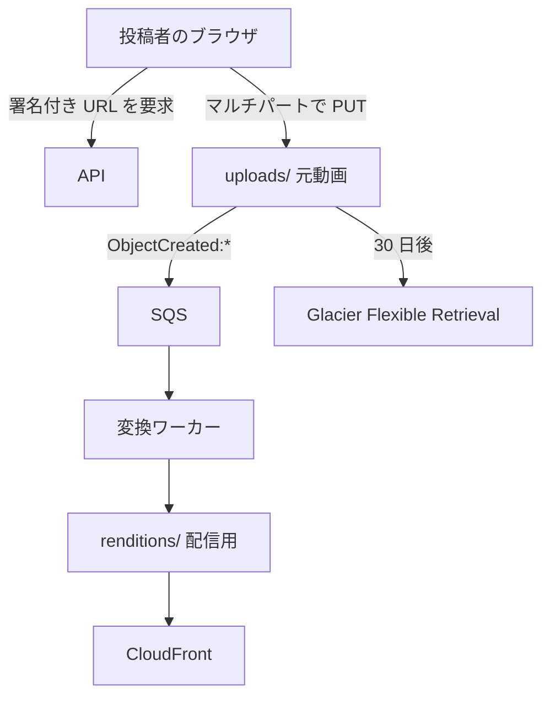

**設定値:**

| 項目 | 値 | 理由 |
| --- | --- | --- |
| 署名付き URL の期限 | 3,600 秒 | 2 GB を家庭の回線で送り切れる時間にする |
| パートサイズ | 100 MiB | 2 GB は 20 パート。切れても 1 パート分の再送で済む |
| `AbortIncompleteMultipartUpload` | 3 日 | 途中でやめた投稿のパートに課金が続かないようにする |
| 通知の対象 | `uploads/`、`s3:ObjectCreated:*` | マルチパートの完了も拾う |
| `uploads/` のライフサイクル | 30 日で `GLACIER` | 再変換は年に数回で、数時間待てる |
| `renditions/` のクラス | Intelligent-Tiering | 人気の動画と読まれない動画が混ざり、事前に分からない |

**なぜこのサービスか:** 動画をアプリサーバー経由で受けると、21 時台に帯域とディスクが足りなくなります。S3 に直接送れば、サーバーは URL を発行するだけです。通知を SQS で受けるのは、変換が詰まっても投稿を取りこぼさずに溜めておけるからです。

**つまずきやすい点:**

- 変換ワーカーが出力を `uploads/` に書くと、通知が再び飛んで変換が止まらなくなります([無限ループ](#event-notifications))。
- 通知のイベントを `s3:ObjectCreated:Put` だけにすると、マルチパートで届いた動画を取り逃がします。
- 元動画を 60 日で消す運用に変えると、Glacier Flexible Retrieval の最小 90 日分が課金されます。

### 例: 病院グループの医用画像の保管 {#use-case-medical}

**状況:** 8 病院の医療グループです。CT や MRI の画像が年に 200 TB 増え、院内規程で 10 年残します。直近 1 年の画像は毎日開きますが、それより古いものは再来院のときに年に数回開く程度です。診察中に開くので、数時間は待てません。

**構成:**

| データ | 置き場所 | 移る時期 |
| --- | --- | --- |
| 撮影から 1 年以内 | S3 Standard | 作成時 |
| 1 年〜10 年 | S3 Glacier Instant Retrieval | 365 日後 |
| 10 年を過ぎたもの | 削除 | 3,650 日後 |

**設定値:**

- ライフサイクル: `Transitions` に `{"Days": 365, "StorageClass": "GLACIER_IR"}`、`Expiration` に `{"Days": 3650}` を書きます。
- 暗号化: カスタマーマネージドキーの SSE-KMS と [Bucket Key](#bucket-key) です。誰がいつ復号したかを CloudTrail で追えるようにし、KMS のリクエストも減らします。
- [バージョニング](#versioning)を有効にし、非現行バージョンは 30 日で消します。誤った上書きを戻せる期間を残しつつ、古い版の課金を抑えます。
- [ブロックパブリックアクセス](#block-public-access)はアカウント単位で有効にします。

**なぜこのサービスか:** Glacier Flexible Retrieval のほうが保管料は安くなりやすいですが、読む前に数分から数時間の復元が要り、診察には間に合いません。Glacier Instant Retrieval は通常の `GET` でミリ秒で読めます。読む回数が四半期に 1 回程度なら、取得料金を払っても Standard より安くなりやすい設計です。

**つまずきやすい点:**

- AI の画像解析のために 10 年分を一括で読むと、Glacier Instant Retrieval の取得料金が全件にかかります。解析の前に、読む量と費用を見積もります。
- バージョニングを有効にしたまま `Expiration` だけを書くと、削除マーカーが付くだけで実データは残ります。`NoncurrentVersionExpiration` も書きます([ライフサイクル](#lifecycle))。

### 例: 証券会社の取引記録の保管 {#use-case-finance}

**状況:** 口座数 80 万のネット証券です。取引記録とその報告書を、規制に従って 7 年間、変更も削除もできない形で残します。監査で「管理者でも消せないこと」を示す必要があります。

**構成:**

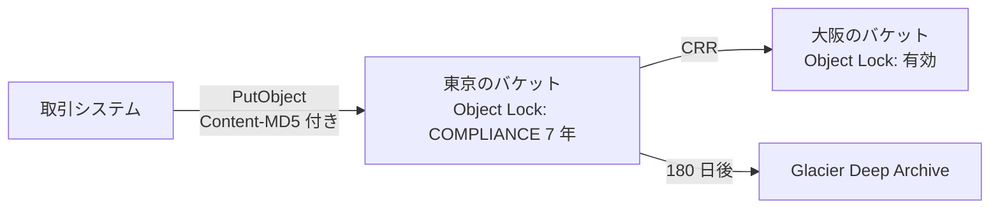

**設定値:**

| 項目 | 値 | 理由 |
| --- | --- | --- |
| 既定の保持 | `COMPLIANCE`、7 年 | ルートユーザーでも期限前に消せない |
| 本番前の試験 | `GOVERNANCE`、30 日 | 設定の誤りに気付いたら管理者が戻せる |
| ライフサイクル | 180 日で `DEEP_ARCHIVE` | 監査で読むのは年に 1 回未満。ロックはクラスを移っても保たれる |
| レプリケーション | 大阪へ CRR。送信先も Object Lock を有効にする | リージョン障害への備え。ロールに `s3:GetObjectRetention` と `s3:GetObjectLegalHold` を付ける |
| リーガルホールド | 訴訟の対象口座だけ | 7 年を過ぎても、解除するまで消させない |

S3 Object Lock は、SEC 17a-4、CFTC、FINRA の規制について第三者(Cohasset Associates)の評価を受けています。日本の規制に合うかは、自社の法務で確認します。

**なぜこのサービスか:** バージョニングだけでは、権限のある人が古い版を消せます。WORM のテープ装置でも同じ要件は満たせますが、媒体の保管と遠隔地への搬送が要ります。Object Lock なら、権限があっても期限まで消せないことをバケットの設定で示せます。

**つまずきやすい点:**

- 保持期間を指定したアップロードには、`Content-MD5` か `x-amz-sdk-checksum-algorithm` のヘッダーが必要です。古い SDK の自作コードでは付かず、400 で失敗します。
- 暗号化に使う KMS キーを削除すると、ロック中のオブジェクトも読めなくなります。Object Lock は鍵の削除からは守りません。
- 誤って 70 年と指定すると短縮できません([Object Lock](#object-lock))。試験はガバナンスモードで行います。

### 例: 大学の課題提出 {#use-case-education}

**状況:** 学生 3 万人の大学のオンライン授業です。レポートと動画の課題を受け付け、締め切りの 23:59 前の 1 時間に 2 万件の提出が集中します。情報システム課は 2 人です。

**構成:**

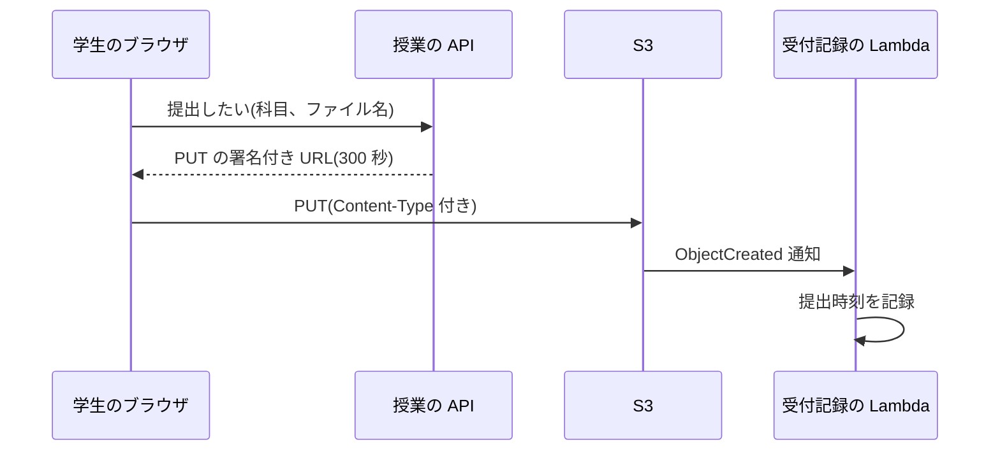

**設定値:**

- キー: `submissions/{科目コード}/{学籍番号}/{提出時刻}.pdf` です。科目ごとにプレフィックスが分かれるので、毎秒 3,500 件の書き込みの上限([リクエストレート](#request-rate))に近づきません。1 時間に 2 万件は、平均で毎秒 6 件程度です。
- 署名付き URL の期限は 300 秒です。URL が他の学生に渡っても、すぐに使えなくなります。
- [CORS](#cors) は、`AllowedOrigins` に授業サイトのオリジン、`AllowedMethods` に `PUT`、`AllowedHeaders` に `Content-Type` を入れます。
- 提出時刻は、S3 の通知を受けた Lambda が記録します。ブラウザの時計は信用しません。

**なぜこのサービスか:** 授業サイトのサーバーで受けると、締め切り前の 1 時間だけのためにサーバーを大きくすることになります。S3 に直接送れば、ピークの帯域は S3 が受け持ちます。

**つまずきやすい点:**

- 署名時の `ContentType` と、ブラウザが送る `Content-Type` が違うと `SignatureDoesNotMatch` です。
- URL を作る Lambda の実行ロールの認証情報が先に切れると、期限より前に URL が使えなくなります([有効期限](#presigned-urls))。
- 通知は少なくとも 1 回の配信なので、同じ提出が 2 回記録されることがあります。キーで重複を除きます。

### 例: 工場の設備データのデータレイク {#use-case-iot}

**状況:** 全国 5 工場、設備 2 万台の製造業です。設備のセンサー値を集め、品質保証と保全の 2 チームが分析します。データは 1 日 300 GB 増えます。分析は直近 30 日が中心で、1 年を過ぎるとほぼ読みません。

**構成:**

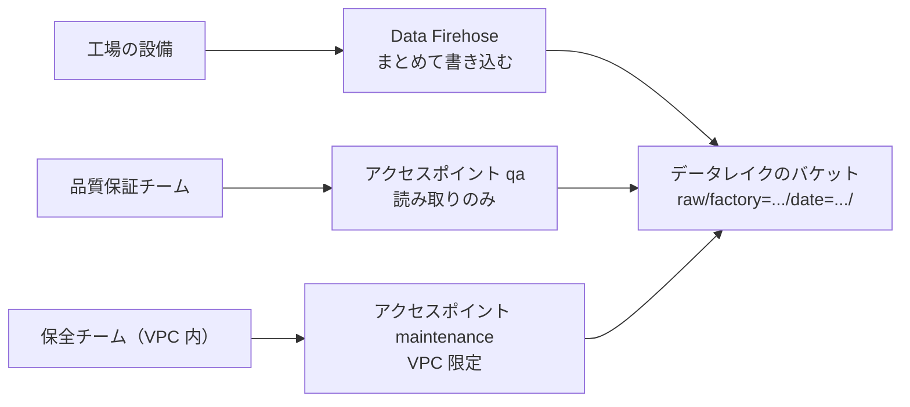

**設定値:**

| 項目 | 値 | 理由 |
| --- | --- | --- |
| キーの形 | `raw/factory=osaka/date=2026-11-13/` | 工場ごとにプレフィックスが分かれ、読み書きが分散する。Athena のパーティションにもなる |
| ライフサイクル | 30 日で `STANDARD_IA`、365 日で `GLACIER_IR` | 30 日を過ぎると月に数回しか読まない |
| オブジェクトの大きさ | 数十 MB にまとめる | 128 KB 未満は既定で移行されず、リクエストの料金も増える |
| アクセスポイント | チームごとに 1 つ | バケットポリシーが 20 KB の上限に近づかない |

**なぜこのサービスか:** NAS に置くと、容量を数年先まで見込んで買うことになります。S3 なら容量を確保せず、Athena などの分析サービスから直接読めます。

**つまずきやすい点:**

- センサー 1 回分ずつ小さなオブジェクトで書くと、`PUT` の回数が増え、ライフサイクルの移行の対象にもなりません。
- VPC 限定のアクセスポイントに VPC の外の PC から接続すると 403 です。作成後にネットワークの設定は変えられません([アクセスポイント](#access-points))。

### 例: オンラインゲームのリプレイ保存 {#use-case-game}

**状況:** 世界 300 万人がプレイする対戦ゲームです。1 試合 50 MB のリプレイを、北米や欧州の端末から東京のバケットへ送ります。リプレイは 90 日で消しますが、プレイヤーが「お気に入り」にしたものは残します。

**設定値:**

- [Transfer Acceleration](#transfer-acceleration) を有効にし、端末のアップロード先を `バケット名.s3-accelerate.amazonaws.com` にします。バケット名にピリオドは使いません。
- リプレイは `replays/`、お気に入りは `favorites/` に置きます。お気に入りにしたら `CopyObject` で移します。
- ライフサイクルは `replays/` だけを対象に `Expiration` を 90 日にします。

**なぜこのサービスか:** 地域ごとにバケットを持つと、対戦相手のリプレイがどこにあるかを管理する必要が出ます。1 つのバケットに集め、遠い端末からの転送だけを Transfer Acceleration で速くします。ダウンロードが多いなら、CloudFront を前に置きます。

**つまずきやすい点:**

- ライフサイクルのフィルターは「このタグが付いていないもの」という除外を書けません。残すものはプレフィックスを分けます。
- 東京の近くの端末では、Transfer Acceleration を使っても速くなりにくいです。端末の地域ごとに、使うかどうかを切り替えます。

## 基本と整合性 {#basics}

| 項目 | 内容 |
| --- | --- |
| 構成 | バケット(リージョン単位)にオブジェクトを保存。オブジェクトはキーで識別 |
| 1 回の `PUT` の上限 | 5 GB |
| マルチパートの上限 | 48.8 TiB（AWS のドキュメントでは「50 TB」とも表記） |
| デフォルト | バケットとオブジェクトは非公開、ACL は無効 |

**例**: 6 GB のファイルを 1 回の `PutObject` で送ると、5 GB を超えるので `EntityTooLarge` で失敗します。[マルチパートアップロード](#multipart-upload)を使います。`aws s3 cp` はサイズに応じて自動でマルチパートにします。

### 整合性 {#consistency}

オブジェクトの `PUT` と `DELETE` は、すべてのリージョンで強力な書き込み後の読み取り整合性を持ちます。成功応答の後の `GET` や `LIST` には変更が反映されています。

| 操作 | 結果 |
| --- | --- |
| 新規 `PUT` の後の `LIST` | 新しいオブジェクトが現れる |
| 上書き `PUT` の後の `GET` | 新しいデータを返す |
| `DELETE` の後の `GET` | データを返さない |
| 同じキーへの同時 `PUT` | タイムスタンプが最新のものが残る |
| バケット設定の変更 | 結果整合性 |

オブジェクトのロック機構はなく、複数キーをまとめて原子的に更新もできません。必要ならアプリ側で作ります。バージョニングを初めて有効にしたときは、反映に時間がかかるため 15 分待ってから書き込むことが推奨されています。

### リクエストレートとプレフィックス {#request-rate}

| 項目 | 値 |
| --- | --- |
| 書き込み(`PUT`、`COPY`、`POST`、`DELETE`) | プレフィックスごとに毎秒 3,500 以上 |
| 読み取り(`GET`、`HEAD`) | プレフィックスごとに毎秒 5,500 以上 |
| プレフィックスの数 | 無制限 |

S3 は負荷に応じて自動でスケールしますが、急に増えると最適化が終わるまで一時的に HTTP 503(Slow Down)が返ります。

上限がバケット全体ではなくプレフィックスごとなのは、S3 がキーの範囲ごとに処理を分担しているためです。プレフィックスを分けるほど、処理を並列に広げられます。スーパーのレジの列を増やすのと同じで、全員が同じレジ（同じプレフィックス）に並ぶと、他のレジが空いていても待たされます。

**例**: 毎秒 20,000 件の `GET` が必要なら、データを 4 つのプレフィックスに分け、それぞれから並列に読みます。理論上は毎秒 22,000 件を読めます。503 が出たら指数バックオフで再試行します。

**例**: 毎秒 10,000 件の `PUT` なら、10,000 ÷ 3,500 で約 2.9 なので 3 つ以上に分けます。`logs/0/`、`logs/1/`、`logs/2/` のように、書き込みが均等になるキーにします。

**誤ると**: `logs/2026/10/31/` の下だけに当日分が集まると、新しいプレフィックスに負荷が集中し、最適化が終わるまで 503 が返ります。

## ストレージクラス {#storage-classes}

[:material-star-circle: AIP](../courses/aip/services.md){ .exam-badge .exam-professional }

データの多くは、作った直後はよく読まれ、時間が経つとほとんど読まれなくなります。全部を同じ料金で置くと、読まない古いデータにも高い保管料を払い続けます。ストレージクラスは、「保管料の安さ」と「取り出しやすさ」を交換できるようにした仕組みです。

**倉庫にたとえる**と、次のようになります。

| クラス | 倉庫でのたとえ | 払うもの |
| --- | --- | --- |
| Standard | 店頭の棚。すぐ取れる | 保管料が高い |
| Standard-IA | バックヤード。すぐ取れるが、出すたびに手数料 | 保管料が安く、取り出しに料金 |
| One Zone-IA | 1 か所だけのバックヤード。火事なら失う | さらに安いが、AZ の喪失に耐えない |
| Glacier Flexible、Deep Archive | 郊外の倉庫。取り寄せに数分から数時間 | 保管料が最も安く、復元の手間と時間 |
| Intelligent-Tiering | 使われ方を見て、係が勝手に棚を移す | 監視の料金 |

最小保存期間や最小課金サイズがあるのは、安いクラスが「長く、大きく置く」前提で値付けされているためです。小さいファイルを短期間だけ置くと、かえって高くなります。

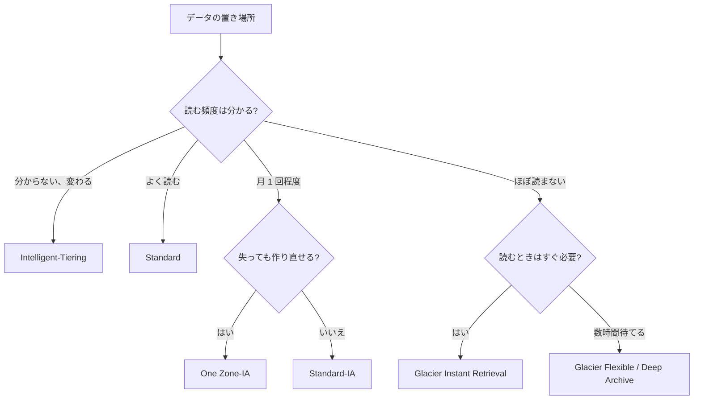

| クラス | 用途 | AZ | 最小保存期間 | 最小課金サイズ | 取得 |
| --- | --- | --- | --- | --- | --- |
| S3 Standard (`STANDARD`) | 頻繁なアクセス | 3 以上 | なし | なし | ミリ秒 |
| S3 Intelligent-Tiering | アクセスパターンが不明、変わる | 3 以上 | なし | なし | ミリ秒(アーカイブ階層は復元が必要) |
| S3 Standard-IA (`STANDARD_IA`) | 月 1 回程度、失えないデータ | 3 以上 | 30 日 | 128 KB | ミリ秒、取得料金あり |
| S3 One Zone-IA (`ONEZONE_IA`) | 月 1 回程度、再生成できるデータ | 1 | 30 日 | 128 KB | ミリ秒、取得料金あり |
| S3 Express One Zone | 1 桁ミリ秒が必要な処理 | 1 | なし | なし | 1 桁ミリ秒 |
| S3 Glacier Instant Retrieval (`GLACIER_IR`) | 四半期に 1 回、すぐ読みたいアーカイブ | 3 以上 | 90 日 | 128 KB | ミリ秒、取得料金あり |
| S3 Glacier Flexible Retrieval (`GLACIER`) | 年 1 回程度のアーカイブ | 3 以上 | 90 日 | なし(メタデータ分 40 KB を追加課金) | 復元が必要、数分から数時間 |
| S3 Glacier Deep Archive (`DEEP_ARCHIVE`) | 年 1 回未満の長期保管 | 3 以上 | 180 日 | なし(メタデータ分 40 KB を追加課金) | 復元が必要、数時間 |

耐久性の設計値は、推奨されない Reduced Redundancy Storage を除きイレブンナイン(99.999999999%)です。One Zone-IA と Express One Zone は AZ の喪失に耐えられません。

Intelligent-Tiering は、30 日アクセスがないと低頻度アクセス階層に、90 日で Archive Instant Access 階層に自動で移します。128 KB 未満のオブジェクトは監視されず、高頻度アクセス階層に留まります。

有効にすると、さらに Archive Access 階層(90 日以上)と Deep Archive Access 階層(180 日以上)にも移せます。この 2 つは読むときに復元が必要です。監視と自動化の料金がオブジェクトごとにかかりますが、取得料金はかかりません。

```bash
aws s3api put-bucket-intelligent-tiering-configuration --bucket my-bucket --id archive \
  --intelligent-tiering-configuration \
  '{"Id":"archive","Status":"Enabled","Tierings":[{"Days":90,"AccessTier":"ARCHIVE_ACCESS"},{"Days":180,"AccessTier":"DEEP_ARCHIVE_ACCESS"}]}'
```

日数は最長 730 日まで延ばせます。**誤ると**: アーカイブ階層を有効にした後に、アプリが同期的な `GET` を続けると、そのオブジェクトは復元するまで読めません。

**クラスの選び方の例**:

- **Standard**: 毎日読む商品画像です。
- **Intelligent-Tiering**: 閲覧が読めない 1 MB 以上の動画です。30 日読まれなければ低頻度の階層に移り、読むと高頻度の階層へ戻ります。取得料金はかかりません。
- **Standard-IA**: 月に 1 回読む請求書の PDF です。
- **One Zone-IA**: 元画像から作り直せるサムネイルです。AZ が失われたら再生成します。
- **Express One Zone**: 機械学習の前処理で 1 桁ミリ秒が必要な一時データです。バケットは `my-cache--apne1-az4--x-s3` のようなディレクトリバケットになります。
- **Glacier Instant Retrieval**: 四半期に 1 回、医用画像をすぐ開く用途です。
- **Glacier Flexible Retrieval**: 年に 1 回の監査で、数時間待てるログです。
- **Glacier Deep Archive**: 規制で 7 年残し、ほぼ読まないデータです。

| 設定の違い | 影響 |
| --- | --- |
| 可用性の設計値 | Standard 99.99%、Standard-IA と Intelligent-Tiering と Glacier IR 99.9%、One Zone-IA 99.5%、Express One Zone 99.95% |
| 最小課金サイズ 128 KB | 10 KB のオブジェクトも Standard-IA では 128 KB 分課金される |
| 最小保存期間 | 30 日の Standard-IA を 10 日で消しても 30 日分課金される |
| Glacier の 40 KB | 32 KB はそのクラスの料金、8 KB は Standard の料金で課金される |

**例**: 平均 20 KB の小さなログを大量に保存するなら、Standard-IA は不利です。128 KB 分の課金になるからです。Standard のままにするか、まとめて 1 つの大きなオブジェクトにします。

**計算の例**:

| 条件 | 計算 | 結果 |
| --- | --- | --- |
| 10 KB を 100 万個、Standard-IA | 128 KB × 1,000,000 | 実データ 10 GB に対し 128 GB 分の課金 |
| Standard-IA を 10 日で削除 | 30 − 10 | 残り 20 日分も課金 |
| Deep Archive を 100 日で削除 | 180 − 100 | 残り 80 日分も課金 |
| Flexible Retrieval に 100 万個 | 40 KB × 1,000,000 | 40 GB の追加(32 GB はそのクラス、8 GB は Standard の料金) |

`STANDARD` が `PutObject` のデフォルトで、`x-amz-storage-class` ヘッダー(SDK では `StorageClass`)で変更します。

```bash
aws s3api put-object --bucket my-bucket --key logs/a.gz --body a.gz \
  --storage-class STANDARD_IA
```

## ライフサイクル {#lifecycle}

[:material-star-circle: AIP](../courses/aip/services.md){ .exam-badge .exam-professional }

オブジェクトを別のクラスに移す移行アクションと、削除する失効アクションを、ルールで自動実行します。データの保持期間を設計するときの中心となる機能です。

何百万ものオブジェクトを、人が日付を見てクラスを変えたり消したりするのは無理があります。オンプレミスで「90 日経ったログをテープへ、1 年で廃棄」を cron と手順書で回していたものを、バケットの設定にした機能です。

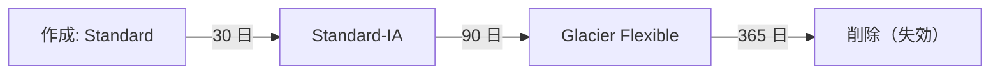

日数は例です。ルールで自由に決めますが、クラスごとの最小保存期間と、移行できる向き（安いクラスへの一方向）に従います。

```json
{
  "Rules": [
    {
      "ID": "archive-logs",
      "Status": "Enabled",
      "Filter": {"Prefix": "logs/"},
      "Transitions": [
        {"Days": 30, "StorageClass": "STANDARD_IA"},
        {"Days": 120, "StorageClass": "GLACIER"}
      ],
      "Expiration": {"Days": 365},
      "NoncurrentVersionExpiration": {"NoncurrentDays": 30},
      "AbortIncompleteMultipartUpload": {"DaysAfterInitiation": 7}
    }
  ]
}
```

| 要点 | 内容 |
| --- | --- |
| 移行の方向 | Standard から低コスト側へ一方向(ウォーターフォール)。Deep Archive から戻すルールは作れない |
| 小さなオブジェクト | 128 KB 未満はデフォルトで移行しない。サイズフィルターで変更可能 |
| 最小保存期間 | 1 つのルールで最小保存期間を満たさない連続移行は設定できない |
| 早期移行、早期削除 | 最小保存期間の残り分が課金される |
| タグのフィルター | 実行時にタグを再評価するので、外すと移行されない場合がある |
| バージョニング有効時 | 現行バージョンと非現行バージョンを別々に指定する |
| 未完了のマルチパート | `AbortIncompleteMultipartUpload` で片付ける |

!!! warning "バージョニングとの組み合わせ"
    バージョニングを有効にしたバケットで `Expiration` を設定しても、削除マーカーが付くだけで実データは残ります。実データを消すには `NoncurrentVersionExpiration` も必要です。

### ライフサイクルのルール要素 {#lifecycle-elements}

1 つのバケットに設定は 1 つで、ルールは最大 1,000 個です。この上限は変更できません。

| 要素 | 内容 | 例と注意 |
| --- | --- | --- |
| `ID` | ルールの名前 | `archive-logs` |
| `Status` | `Enabled` か `Disabled` | `Disabled` のルールは何もしない |
| `Filter` | 対象を絞る | プレフィックス、タグ、サイズ。複数なら `And` で囲む |
| `Transition` | 現行バージョンを移す | `Days` か `Date`、`StorageClass` |
| `Expiration` | 現行バージョンを失効させる | `Days`、`Date`、`ExpiredObjectDeleteMarker` |
| `NoncurrentVersionTransition` | 非現行バージョンを移す | `NoncurrentDays`、`NewerNoncurrentVersions` |
| `NoncurrentVersionExpiration` | 非現行バージョンを完全に削除する | `NoncurrentDays`、`NewerNoncurrentVersions` |
| `AbortIncompleteMultipartUpload` | 未完了のマルチパートを止める | `DaysAfterInitiation`。タグのフィルターと併用できない |
| `ExpiredObjectDeleteMarker` | 古い版がない削除マーカーを消す | `true`。`Days` と同じルールに書けない。タグのフィルターと併用できない |

`Filter` のサイズはバイト単位で、指定した値ちょうどのオブジェクトは含みません。`ObjectSizeGreaterThan` は `ObjectSizeLessThan` より小さくします。

**`Filter` の例**: `logs/` の下で、タグ `archive=true` が付き、1 MiB より大きいものだけを対象にします。

```json
{"Filter": {"And": {
  "Prefix": "logs/",
  "Tags": [{"Key": "archive", "Value": "true"}],
  "ObjectSizeGreaterThan": 1048576
}}}
```

**小さなオブジェクトの例**: 128 KB 未満も移行したいなら、`"ObjectSizeGreaterThan": 1024` のようにフィルターで下限を指定します。移行リクエストの料金が節約分を上回らないか確認します。

**連続移行の例**: `Days: 30` で `GLACIER_IR`、`Days: 60` で `GLACIER` にするルールは作れません。Glacier Instant Retrieval の最小保存期間 90 日を満たさないからです。`Days: 120` 以降にします。

**`Date` の例**: `"Date": "2027-01-01T00:00:00Z"` は、その時点で条件に合うオブジェクトが対象です。**誤ると**: 日付が過ぎた後もルールが残っていると、新しく入ったオブジェクトも対象になります。1 回だけの処理なら、終わった後にルールを消します。

日数の計算は、作成時刻に日数を足して、翌日の UTC 0 時に切り上げます。1 月 15 日 10 時 30 分に作ったオブジェクトに 3 日を指定すると、1 月 19 日 0 時が起点です。移行はその後に非同期で行われるので、ぴったりの時刻に動くとは限りません。

バケットのバージョニングの状態で、`Expiration` の動作が変わります。

| 状態 | `Expiration` の動作 | 非現行バージョン用のアクション |
| --- | --- | --- |
| 未設定 | オブジェクトを完全に削除。戻せない | 効果なし |
| 有効 | 削除マーカーを作り、現行バージョンを非現行にする | 効果あり |
| 停止 | バージョン ID が `null` の削除マーカーを作る | 効果あり |

**例**: ログを 30 日で Standard-IA、1 年で削除、古いバージョンは 2 世代だけ 30 日残すなら、次のようにします。

```json
{
  "Rules": [{
    "ID": "logs",
    "Status": "Enabled",
    "Filter": {"Prefix": "logs/"},
    "Transitions": [{"Days": 30, "StorageClass": "STANDARD_IA"}],
    "Expiration": {"Days": 365},
    "NoncurrentVersionExpiration": {"NoncurrentDays": 30, "NewerNoncurrentVersions": 2},
    "AbortIncompleteMultipartUpload": {"DaysAfterInitiation": 7}
  }]
}
```

**落とし穴**:

- MFA Delete を設定したバケットには、ライフサイクルを設定できません。
- Object Lock で保護されたバージョンは、ライフサイクルでも削除できません。
- レプリケーションの状態が `PENDING` または `FAILED` のオブジェクトは、移行も失効もされません。失敗が続くと費用がかかり続けます。
- Deep Archive から他のクラスへ移すルールは作れません。復元してコピーします。Flexible Retrieval からルールで移せるのは Deep Archive だけです。
- 2024 年 9 月以降、128 KB 未満のオブジェクトはデフォルトで移行されません。古い資料とは違います。

他のサービスの保持の設定は [ストレージの選び方](storage.md) を参照してください。

## バージョニング {#versioning}

S3 の上書きと削除は、そのままでは取り消せません。誤操作、アプリのバグ、ランサムウェアによる上書きから戻せるよう、古い版を残しておくための機能です。レプリケーションや Object Lock の前提にもなっています。

**使う場面:** 会計事務所のクライアント共有で、顧客が誤って上書きした決算資料を前の版に戻します。ランサムウェアに暗号化されたファイルも、暗号化の前の版から戻せます。

**現実のたとえ:** 文書管理システムの版管理や、パソコンのゴミ箱に近いものです。削除しても実体は残り、「削除済み」の札（削除マーカー）が一番上に載るだけです。札を外せば元に戻ります。違いは、古い版もすべて容量として課金される点です。

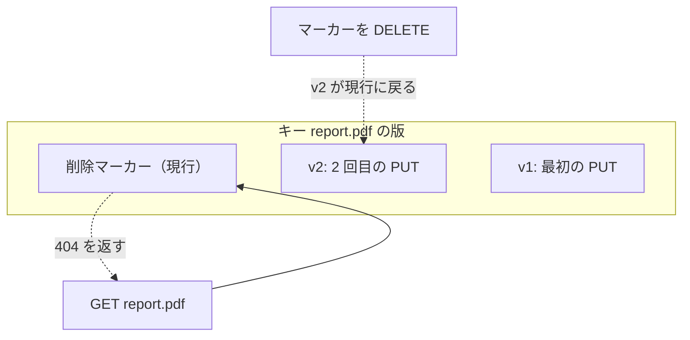

| 状態 | 動作 |
| --- | --- |
| 未設定(デフォルト) | 上書きで前のデータは消える |
| 有効 | 新しいバージョン ID を付与。上書きと削除で以前のバージョンが残る |
| 停止 | 既存のバージョンは残るが、新しいバージョンは作らない |

- 一度有効にすると未設定には戻せず、停止のみできます。
- 有効化より前からあったオブジェクトのバージョン ID は `null` です。
- バージョン ID を指定しない `DELETE` は削除マーカーを追加します。バージョン ID を指定すると、そのバージョンを完全に削除します。
- 各バージョンが丸ごと課金されます。差分ではありません。
- MFA Delete を設定すると、バージョンの完全削除に MFA を求められます。

**例**: 10 MB の `report.pdf` を 5 回上書きすると、6 バージョンで 60 MB 分の課金です。差分ではありません。古いものはライフサイクルの `NoncurrentVersionExpiration` で消します。

**誤ると**: バージョニングを停止しても、既存の古いバージョンは残り、課金も続きます。停止だけでは容量は減りません。

### 状態ごとの動作と削除マーカー {#delete-markers}

| 操作 | 有効 | 停止 |
| --- | --- | --- |
| `PUT` | 新しいバージョン ID を付与 | ID が `null` のものを作るか上書きする |
| バージョン ID なしの `DELETE` | 削除マーカーを追加 | ID が `null` の削除マーカーを追加 |
| バージョン ID ありの `DELETE` | そのバージョンを完全に削除 | そのバージョンを完全に削除 |

削除マーカーへの `GET` の動作は次のとおりです。

| リクエスト | 応答 |
| --- | --- |
| バージョン ID なしで、現行が削除マーカー | 404 と `x-amz-delete-marker: true` |
| バージョン ID ありで、そのバージョンが削除マーカー | 405 Method Not Allowed |

**例**: 誤って `report.pdf` を消したら、削除マーカーのバージョン ID を指定して `DELETE` します。マーカーが消えて、前のバージョンが現行に戻ります。

```bash
aws s3api list-object-versions --bucket my-bucket --prefix report.pdf
aws s3api delete-object --bucket my-bucket --key report.pdf \
  --version-id EXAMPLEDeleteMarkerVersionId
```

**誤ると**: 削除マーカーではなくデータのバージョン ID を指定すると、そのデータを完全に消します。元に戻せません。

**MFA Delete の設定**: `MFADelete=Enabled` を付けた `PutBucketVersioning` で有効にします。これを実行できるのはバケット所有者のルートユーザーだけです。

```bash
aws s3api put-bucket-versioning --bucket my-bucket \
  --versioning-configuration Status=Enabled,MFADelete=Enabled \
  --mfa "arn:aws:iam::111122223333:mfa/root-account-mfa-device 123789"
```

## レプリケーション {#replication}

[:material-star-circle: AIP](../courses/aip/services.md){ .exam-badge .exam-professional }

オブジェクトを別のバケットに非同期でコピーします。別リージョンへは CRR、同じリージョンへは SRR です。

S3 はリージョンの中の複数の AZ に複製するので、AZ の障害には強い一方、リージョン全体の障害や、「別リージョンにも置け」という規制、別アカウントへの隔離には対応しません。それを補うのがレプリケーションです。

| 目的 | 使う方式 | 例 |
| --- | --- | --- |
| リージョン障害への備え、規制 | CRR | 東京のデータを大阪にも置く |
| 利用者に近い場所で読む | CRR | 海外拠点の近くにコピーを置く |
| 本番とは別のアカウントで保管 | SRR または CRR | ログを監査用のアカウントへ集める |
| 本番データを検証環境へ | SRR | 同じリージョンのテスト用バケットへ |

**オンプレミスとの対比**: ストレージ装置の遠隔レプリケーションに近いものです。違いは、装置を買わずにルールを書くだけで済む点と、ルールを作る前からあるオブジェクトは自動では複製されない点です（S3 Batch Replication で別に複製します）。

[](../assets/diagrams/s3-replication.png)

**前提**:

- 送信元と送信先の両方でバージョニングが有効です。
- S3 が引き受ける IAM ロールが必要です。
- 別アカウントなら、送信先のバケットポリシーで許可します。送信先はリクエスタ支払いにできません。
- Object Lock を使うなら両方で有効にし、ロールに `s3:GetObjectRetention` と `s3:GetObjectLegalHold` を許可します。

| ルールの要素 | 内容 |
| --- | --- |
| `Status` | `Enabled` か `Disabled` |
| `Priority` | 複数ルールが同じオブジェクトに当たるときの優先度 |
| `Filter` | プレフィックスとタグ |
| `Destination.Bucket` | 送信先バケット |
| `Destination.StorageClass` | 送信先のストレージクラス。例: `GLACIER` |
| `Destination.AccessControlTranslation` | レプリカの所有者を送信先アカウントに変える |
| `DeleteMarkerReplication` | 削除マーカーを複製するか |
| `SourceSelectionCriteria.SseKmsEncryptedObjects` | SSE-KMS のオブジェクトを複製するか(オプトイン) |
| `Destination.EncryptionConfiguration.ReplicaKmsKeyID` | 送信先リージョンの KMS キー |
| `Destination.ReplicationTime`、`Metrics` | S3 RTC。新しいオブジェクトの 99.9%（専用ページと SLA の基準。公式の一部のページは 99.99% と記載）を 15 分以内に複製 |

何が複製されるかは次のとおりです。

| 対象 | 複製されるか |
| --- | --- |
| 設定後に作られたオブジェクト | される |
| 設定前からあるオブジェクト | されない。S3 Batch Replication を使う |
| メタデータ、タグ、Object Lock の保持情報 | される |
| SSE-S3、SSE-C | デフォルトでされる |
| SSE-KMS、DSSE-KMS | オプトインが必要 |
| 削除マーカー | デフォルトでされない。タグのルールでは設定できない |
| バージョン ID を指定した削除 | されない |
| 他のルールで作られたレプリカ | されない。Batch Replication なら可能 |
| Flexible Retrieval、Deep Archive のオブジェクト | されない |
| ライフサイクルの設定など、バケットの設定 | されない |
| ライフサイクルの失効で作られた削除マーカー | されない |

**例**: 東京のバケットをバージニアに複製するとします。既存の 1 億件は設定しても複製されません。Batch Replication を別途実行します。SSE-KMS のオブジェクトは `SseKmsEncryptedObjects` を `Enabled` にして、ロールに送信元キーの `kms:Decrypt` と送信先キーの `kms:Encrypt` を許可しないと `FAILED` になります。

ルールの最小の形です。

```json
{
  "Role": "arn:aws:iam::111122223333:role/s3-replication",
  "Rules": [{
    "ID": "to-virginia",
    "Status": "Enabled",
    "Priority": 1,
    "Filter": {"Prefix": "reports/"},
    "DeleteMarkerReplication": {"Status": "Enabled"},
    "SourceSelectionCriteria": {"SseKmsEncryptedObjects": {"Status": "Enabled"}},
    "Destination": {
      "Bucket": "arn:aws:s3:::my-bucket-us-east-1",
      "StorageClass": "STANDARD_IA",
      "EncryptionConfiguration": {
        "ReplicaKmsKeyID": "arn:aws:kms:us-east-1:111122223333:key/EXAMPLE"
      }
    }
  }]
}
```

要素ごとの例です。

- **`Priority`**: 数字が大きいほど優先です。同じ送信先へ向かう `logs/` のルールが優先度 2、全体のルールが優先度 1 なら、`logs/` のオブジェクトには優先度 2 のルールが使われます。送信先が別なら、どちらのルールでも複製を試みます。
- **`Destination.StorageClass`**: DR 用に `STANDARD_IA` にすれば、送信先のストレージ費用を抑えられます。
- **`AccessControlTranslation`**: 別アカウントの監査用バケットへ送るときに、レプリカの所有者を送信先のアカウントにします。
- **`DeleteMarkerReplication`**: `Disabled` なら、東京で消しても、バージニアの `GET` は成功します。誤削除が DR 先へ波及しません。
- **`ReplicationTime`**: 「15 分以内の複製」が監査の要件なら付けます。`s3:Replication:OperationMissedThreshold` のイベントで遅れを検知できます。

**誤ると**: 片方のバケットのバージョニングが無効だと、ルールの設定に失敗します。ライフサイクルは複製されないので、送信先にも同じルールを設定しないと、古いデータが残り続けます。

## 署名付き URL {#presigned-urls}

AWS の認証情報を持たない相手に、期限付きで特定のオブジェクトの操作を許可します。バケットポリシーの変更は不要です。

アプリの利用者に 1 つのファイルだけ渡したいとき、バケットを公開すると全部が見えてしまい、利用者ごとに IAM ユーザーを作るのも現実的ではありません。署名付き URL は、権限を持つアプリが「このファイルを、この操作で、この時間だけ」と決めて署名した使い捨ての許可証です。

**使う場面:** 保険会社のアプリで、契約者がその人の保険証券の PDF だけを 15 分間ダウンロードできるようにします。会員でない取引先に、見積書を 1 通だけ渡すときにも使います。

**現実のたとえ:** 会社の受付が発行する、日付と部屋が書かれた一日入館証です。発行した社員（URL を作った IAM の主体）の権限を超える部屋には入れず、社員が退職（認証情報が失効）すれば入館証も使えなくなります。

```python
import boto3

s3 = boto3.client("s3")

download_url = s3.generate_presigned_url(
    "get_object",
    Params={"Bucket": "my-bucket", "Key": "report.pdf"},
    ExpiresIn=900,
)

upload_url = s3.generate_presigned_url(
    "put_object",
    Params={
        "Bucket": "my-bucket",
        "Key": "uploads/photo.jpg",
        "ContentType": "image/jpeg",
    },
    ExpiresIn=300,
)
```

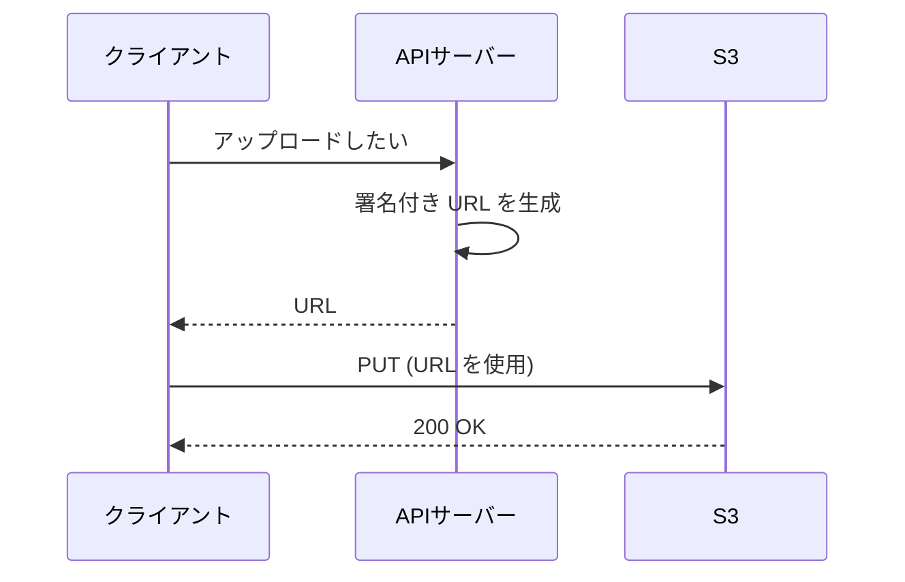

サーバーを経由せずに S3 と直接やり取りできるので、大きなファイルでもアプリの負荷が増えません。

**有効期限**

| 作成に使う認証情報 | 最長 |
| --- | --- |
| コンソールから生成 | 12 時間(1 分から) |
| CLI、SDK で IAM ユーザーの認証情報(SigV4) | 7 日 |
| IAM ロール、STS の一時認証情報 | 認証情報の期限まで |
| EC2 のインスタンスプロファイル | ロール認証情報の期限まで(通常 6 時間程度) |

**例**: Lambda の実行ロールで `ExpiresIn=604800`(7 日)を指定しても、URL は Lambda の認証情報が切れた時点で無効になります。7 日間確実に使いたいなら IAM ユーザーの認証情報で作ります。CloudFront の署名付き URL も選択肢です。

**動作のルール**

- URL の権限は生成した IAM プリンシパルの権限に依存します。生成者が `s3:GetObject` を持たなければ、URL は 403 になります。
- 認証情報が先に失効すれば、指定した期限より前に URL も無効になります。認証情報を無効化、削除した場合も同様です。
- 期限はリクエスト時に確認します。開始済みのダウンロードは途中で期限が来ても続きますが、切れた後の再開はできません。
- 期限内なら何度でも使えます。持っている人は誰でも使えるので、漏えいに注意します。
- `PUT` 用の URL は、署名時に指定した `Content-Type` と同じものを送ります。違うと `SignatureDoesNotMatch` になります。
- バケットポリシーの条件キー `s3:signatureAge` で、署名の経過時間を制限できます。

**CLI と条件の例**:

```bash
aws s3 presign s3://my-bucket/report.pdf --expires-in 900
```

```json
{
  "Effect": "Deny",
  "Principal": {"AWS": "*"},
  "Action": "s3:*",
  "Resource": "arn:aws:s3:::my-bucket/*",
  "Condition": {"NumericGreaterThan": {"s3:signatureAge": "600000"}}
}
```

`s3:signatureAge` はミリ秒です。600,000 は 10 分なので、`ExpiresIn=3600` の URL でも、作成から 10 分を過ぎると拒否されます。

**誤ると**: 開発環境でコードを動かす EC2 のロールで `ExpiresIn=604800` の URL を作ると、エラーなく URL は返りますが、約 6 時間後に `ExpiredToken` で失敗します。

### CloudFront 署名付き URL との違い {#cloudfront-signed-urls}

| 観点 | S3 署名付き URL | CloudFront 署名付き URL |
| --- | --- | --- |
| アクセス先 | S3 バケットに直接 | CloudFront ディストリビューション |
| 署名に使うもの | IAM プリンシパルの認証情報 | 信頼されたキーグループの秘密鍵 |
| 権限の源 | 生成者の IAM 権限 | キャッシュ動作に設定した署名者 |
| キャッシュ | なし | エッジでキャッシュ |
| 条件 | 期限中心 | 期限、開始日時、IP 範囲などカスタムポリシーで指定可能 |
| アップロード | `PUT` で可能 | 配信が主な用途 |
| 向く場面 | ファイルの受け渡し、ブラウザからの直接アップロード | 有料コンテンツの配信、世界中への配信 |

CloudFront の署名者には、キーグループを使うことが推奨されています。ルートユーザーが不要で、API で管理できるためです。キーペアは RSA 2048 か ECDSA 256 です。

| CloudFront の選択肢 | 向く場面 |
| --- | --- |
| 署名付き URL | 個々のファイル。Cookie に対応していないクライアント |
| 署名付き Cookie | 複数のファイル(HLS 動画一式など)。URL を変えたくない |

両方が指定された場合は署名付き URL が優先されます。CloudFront を迂回して S3 に直接アクセスされないように、オリジンのバケットはオリジンアクセスコントロール (OAC) で CloudFront からのアクセスのみに制限します。

**例**: 500 個のセグメントからなる HLS の動画なら、URL を 500 個署名するより、署名付き Cookie を 1 つ発行します。1 本の PDF をメールで送るなら、署名付き URL です。

## Event Notifications {#event-notifications}

オブジェクトの作成や削除などをトリガーに、他のサービスに通知します。

「アップロードされたら処理する」を実現するのに、新しいファイルがないかを定期的に一覧して探すと、無駄な `LIST` が増え、反応も遅れます。S3 の側から「置かれた」と知らせれば、必要なときだけ処理が動きます。オンプレミスで、共有フォルダを監視するスクリプトを常駐させていたものの置き換えです。

**使う場面:** 経費精算システムで、社員が領収書の画像を上げたら OCR の処理を始めます。物流会社で、取引先が置いた出荷指示の CSV を取り込みます。

| 送信先 | 選ぶ理由 |
| --- | --- |
| Lambda | 1 つの処理をすぐ動かす |
| SQS | 処理側の速さに合わせて溜めておく |
| SNS | 複数の処理に同時に配る |
| EventBridge | 条件で細かく振り分ける、多数の送信先 |

| 送信先 | 備考 |
| --- | --- |
| SQS | FIFO キューは指定できない(EventBridge 経由なら可能) |
| SNS | ファンアウトに使う |
| Lambda | 直接呼び出す |
| EventBridge | バケットで有効化すれば全イベントが送られ、ルールで振り分ける |

| イベントタイプ | 発生するとき |
| --- | --- |
| `s3:ObjectCreated:*`(`Put`、`Post`、`Copy`、`CompleteMultipartUpload`) | オブジェクトの作成 |
| `s3:ObjectRemoved:*`(`Delete`、`DeleteMarkerCreated`) | 削除 |
| `s3:ObjectRestore:*`(`Post`、`Completed`、`Delete`) | 復元の開始、完了、一時コピーの失効 |
| `s3:Replication:*` | 複製の失敗、15 分の閾値の超過など |
| `s3:LifecycleExpiration:*`、`s3:LifecycleTransition` | ライフサイクルの失効、移行 |
| `s3:IntelligentTiering` | Archive 系の階層への移動 |
| `s3:ObjectTagging:*`、`s3:ObjectAcl:Put` | タグと ACL の変更 |

**フィルターの規則**:

- プレフィックスとサフィックスだけです。ワイルドカード `*` は使えません。スペースは `+` に、他の特殊文字は URL エンコードします。
- 同じイベントタイプで、プレフィックスやサフィックスが重なるルールは作れません。`images/` と `images/thumb/` のように重なる場合は、設定に失敗します。
- 非同期で複数の宛先に送るなら、SNS を 1 つ置いてファンアウトします。

**例**: `uploads/` の `.jpg` だけを Lambda で処理するなら、`s3:ObjectCreated:*` に `prefix=uploads/`、`suffix=.jpg` を指定します。大きなファイルはマルチパートで届くので、`s3:ObjectCreated:Put` だけを指定すると `CompleteMultipartUpload` を取り逃がします。

```json
{
  "LambdaFunctionConfigurations": [{
    "LambdaFunctionArn": "arn:aws:lambda:ap-northeast-1:111122223333:function:thumbnail",
    "Events": ["s3:ObjectCreated:*"],
    "Filter": {"Key": {"FilterRules": [
      {"Name": "prefix", "Value": "uploads/"},
      {"Name": "suffix", "Value": ".jpg"}
    ]}}
  }]
}
```

**キーの例**: `my photo.jpg` は、イベントでは `my+photo.jpg` と届きます。**誤ると**: そのまま `GetObject` に渡すと `NoSuchKey` です。Python なら `urllib.parse.unquote_plus` で戻します。

**ポリシーの例**: SQS を宛先にするときは、キューのポリシーで S3 を許可します。

```json
{
  "Effect": "Allow",
  "Principal": {"Service": "s3.amazonaws.com"},
  "Action": "sqs:SendMessage",
  "Resource": "arn:aws:sqs:ap-northeast-1:111122223333:uploads",
  "Condition": {"ArnEquals": {"aws:SourceArn": "arn:aws:s3:::my-bucket"}}
}
```

**誤ると**: このポリシーがないと、通知の設定そのものが `Unable to validate the following destination configurations` で失敗します。

EventBridge は有効にするか無効にするかだけで、全イベントが送られます。S3 の 2 つのイベント設定を比べると、複雑なフィルターや FIFO キューへの送信が必要なら EventBridge です。

```bash
aws s3api put-bucket-notification-configuration --bucket my-bucket \
  --notification-configuration '{"EventBridgeConfiguration": {}}'
```

- 対象は作成、削除、復元、レプリケーション、ライフサイクル、タグ、ACL などのイベントです。プレフィックスとサフィックスで絞れます。
- 配信は **少なくとも 1 回** です。通常は数秒ですが、1 分以上かかることもあります。処理は冪等にします。
- SQS、SNS、Lambda 側のリソースポリシーで、S3 からの発行や呼び出しを許可します。
- 設定の反映には通常 5 分ほどかかり、初回は `s3:TestEvent` が送られます。

!!! warning "無限ループに注意"
    通知を受けた Lambda が同じバケットに書き込むと、自分自身を呼び続けます。出力を別のバケットにするか、入力用のプレフィックスだけを通知の対象にします。

連携の全体像は [メッセージング](messaging.md) を参照してください。

## 暗号化 {#encryption}

保存時の暗号化は常に有効で、新しいオブジェクトはデフォルトで SSE-S3 で暗号化されます。

方式が複数あるのは、「暗号化の鍵を誰が持ち、誰が使ったかを誰が見られるか」の要件が組織で違うためです。手間をかけずに暗号化だけしたいなら SSE-S3、鍵の使用を監査したり、鍵の権限で読める人を絞ったりしたいなら SSE-KMS、AWS に鍵も平文も渡したくないならクライアント側暗号化を選びます。

**金庫にたとえる**と、次のようになります。

| 方式 | 鍵の持ち方 | たとえ |
| --- | --- | --- |
| SSE-S3 | S3 が持ち、自動で使う | 貸金庫の鍵を銀行が管理する |
| SSE-KMS | KMS のキーで、使える人を自分のポリシーで決める | 鍵は銀行の鍵保管庫にあり、使うたびに記録が残る |
| SSE-C | 自分が持ち、毎回渡す | 自分の鍵を毎回持参する。なくすと誰も開けられない |
| クライアント側 | 自分が持ち、暗号化も自分でする | 鍵をかけた箱を預ける。銀行は中身を見られない |

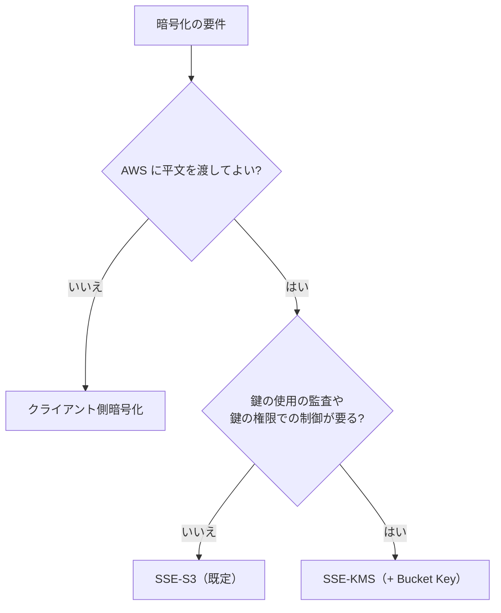

| 方式 | キーの管理者 | 暗号化する場所 | 指定 | 使いどころ |
| --- | --- | --- | --- | --- |
| SSE-S3 | S3 | サーバー | `AES256` | 特に要件がない |
| SSE-KMS | KMS | サーバー | `aws:kms` | 監査、キーのアクセス制御、ローテーション |
| DSSE-KMS | KMS | サーバー(2 層) | `aws:kms:dsse` | 2 層の暗号化が要件のとき |
| SSE-C | 自分(リクエストごとに送る) | サーバー | `SSECustomerKey` など | 自分でキーを持つ要件。下記の制約あり |
| クライアント側 | 自分 | アップロード前 | SDK やライブラリ | AWS に平文を渡したくない |

```python
s3.put_object(
    Bucket="my-bucket",
    Key="secret.csv",
    Body=data,
    ServerSideEncryption="aws:kms",
    SSEKMSKeyId="arn:aws:kms:ap-northeast-1:111122223333:key/EXAMPLE",
    BucketKeyEnabled=True,
)
```

### 方式ごとのリクエストヘッダー {#encryption-headers}

| 方式 | ヘッダー | 値 |
| --- | --- | --- |
| SSE-S3 | `x-amz-server-side-encryption` | `AES256` |
| SSE-KMS | `x-amz-server-side-encryption` | `aws:kms` |
| SSE-KMS | `x-amz-server-side-encryption-aws-kms-key-id` | KMS キーの ARN など。省略すると `aws/s3` |
| SSE-KMS | `x-amz-server-side-encryption-context` | 暗号化コンテキスト(base64) |
| SSE-KMS | `x-amz-server-side-encryption-bucket-key-enabled` | `true` か `false` |
| DSSE-KMS | `x-amz-server-side-encryption` | `aws:kms:dsse` |
| SSE-C | `x-amz-server-side-encryption-customer-algorithm` | `AES256` |
| SSE-C | `x-amz-server-side-encryption-customer-key` | 256 ビットのキー(base64) |
| SSE-C | `x-amz-server-side-encryption-customer-key-MD5` | キーの MD5(base64) |

SSE-C のオブジェクトをコピーするときは、元のオブジェクト用に `x-amz-copy-source-server-side-encryption-customer-algorithm`、`-key`、`-key-MD5` も送ります。

署名付き URL で SSE-C を使う場合は、利用者が URL とは別に 3 つのヘッダーをすべて送ります。

**例**: CLI ではヘッダーの代わりに、次のオプションで指定します。

```bash
# SSE-S3
aws s3 cp a.csv s3://my-bucket/a.csv --sse AES256
# SSE-KMS
aws s3 cp a.csv s3://my-bucket/a.csv --sse aws:kms --sse-kms-key-id alias/app
# DSSE-KMS(aws s3 cp の --sse は AES256 と aws:kms のみなので s3api を使う)
aws s3api put-object --bucket my-bucket --key a.csv --body a.csv \
  --server-side-encryption aws:kms:dsse --ssekms-key-id alias/app
```

**誤ると**: SSE-C のオブジェクトをキーのヘッダーなしで `GET` すると 400 です。別のキーを送ると 403 です。

### SSE-KMS の注意点 {#sse-kms}

- **権限**: アップロードには `kms:GenerateDataKey`、ダウンロードには `kms:Decrypt` が必要です。マルチパートアップロードには両方が必要です。
- **S3 Bucket Key**: バケット単位のキーを使い、KMS へのリクエストを最大 99% 減らします。リクエスト数のクォータやコストが問題になったら検討します。
- **リージョン**: KMS キーはバケットと同じリージョンに置きます。対称キーのみ使えます。
- **クロスアカウント**: AWS マネージドキー(`aws/s3`)が使えるのは、アップロードとアクセスのプリンシパルが同じアカウントの場合だけです。別のアカウントに読ませるならカスタマーマネージドキーを使います。
- **`GET`**: 暗号化のヘッダーを付けると 400 Bad Request になります。HTTPS と SigV4 が必須です。

**例**: 別アカウントのパートナーに SSE-KMS のオブジェクトを読ませるなら、バケットポリシーの `s3:GetObject` と、カスタマーマネージドキーのキーポリシーの `kms:Decrypt` の両方を許可します。

**誤ると**: バケットポリシーだけ許可すると 403 になります。`aws/s3` のキーで暗号化したオブジェクトは、キーポリシーを変更できないので、別アカウントからは読めません。

### S3 Bucket Key の動作 {#bucket-key}

| 項目 | 内容 |
| --- | --- |
| 設定 | デフォルト暗号化の `BucketKeyEnabled`、または `PutObject` などのヘッダー |
| 既存のオブジェクト | 影響しない。使うには `CopyObject` で作り直す |
| DSSE-KMS | 非対応 |
| 暗号化コンテキスト | オブジェクトの ARN ではなくバケットの ARN になる |
| CloudTrail | KMS のイベントが減り、バケットの ARN が記録される |

**落とし穴**: KMS のキーポリシーや IAM ポリシーで、`kms:EncryptionContext:aws:s3:arn` にオブジェクトの ARN を指定していると、Bucket Key を有効にしたときに動かなくなります。バケットの ARN に変更します。

**例**: 毎秒 5,000 件のアップロードで KMS がスロットリングするなら、Bucket Key を有効にします。リクエスト元が変わるごとにキーを取り直すので、ロールが多いほど削減効果は小さくなります。

**計算の例**: 100 万回の `PutObject` で KMS を毎回呼ぶと 100 万リクエストです。上限の 99% 削減なら、1,000,000 × 0.01 で 1 万リクエストです。

```bash
aws s3api put-bucket-encryption --bucket my-bucket \
  --server-side-encryption-configuration \
  '{"Rules":[{"ApplyServerSideEncryptionByDefault":{"SSEAlgorithm":"aws:kms","KMSMasterKeyID":"alias/app"},"BucketKeyEnabled":true}]}'
```

### SSE-C の注意点 {#sse-c}

!!! warning "SSE-C は 2026 年 4 月からデフォルトで無効"
    新しい汎用バケット（中東のバーレーンと UAE のリージョンを除く）と、SSE-C のオブジェクトを持たないアカウントの既存バケットでは、SSE-C の書き込みがブロックされます。ブロック中は `PutObject` や `CopyObject`、マルチパートなどが HTTP 403 の `AccessDenied` になります。使うには、`PutBucketEncryption` でデフォルト暗号化の `BlockedEncryptionTypes` を `NONE` にします。

- S3 はキーを保存しません。キーを失うとデータも失います。
- リクエストごとにキーを送るので HTTPS が必須です。HTTP のリクエストは拒否されます。
- どのオブジェクトにどのキーを使ったかは自分で管理します。
- コンソールからは使えません。AWS のマネージドサービスは復号できません。

**例**: 既存の規程で「キーは社内の HSM に置き、AWS に保存しない」と決まっているなら SSE-C の候補です。オブジェクトごとのキーの対応表をアプリで持ちます。Athena で読むような用途には使えません。

### バケットのデフォルト暗号化とポリシーによる強制 {#enforcing-encryption}

バケットのデフォルト暗号化を SSE-KMS にすると、指定のない `PUT` は自動でその方式で暗号化されます。既存のオブジェクトは変わりません。変更するには S3 Batch Operations のコピーなどを使います。

要件で「このキーでの暗号化以外は拒否」とする場合はポリシーを使います。

```json
{
  "Version": "2012-10-17",
  "Statement": [
    {
      "Sid": "DenyWrongKmsKey",
      "Effect": "Deny",
      "Principal": "*",
      "Action": "s3:PutObject",
      "Resource": "arn:aws:s3:::my-bucket/*",
      "Condition": {
        "StringNotEquals": {
          "s3:x-amz-server-side-encryption-aws-kms-key-id":
            "arn:aws:kms:ap-northeast-1:111122223333:key/EXAMPLE"
        }
      }
    },
    {
      "Sid": "DenyInsecureTransport",
      "Effect": "Deny",
      "Principal": "*",
      "Action": "s3:*",
      "Resource": [
        "arn:aws:s3:::my-bucket",
        "arn:aws:s3:::my-bucket/*"
      ],
      "Condition": {"Bool": {"aws:SecureTransport": "false"}}
    }
  ]
}
```

`Null` 条件で `s3:x-amz-server-side-encryption-aws-kms-key-id` を調べれば、KMS キーの指定がないリクエストを拒否することもできます。

転送中の暗号化は TLS で行います。上の後半の文で HTTP のアクセスを拒否できます。

**誤ると**: 上の前半の文では、KMS キーのヘッダーを付けない `PutObject` も拒否されます。デフォルト暗号化に任せたアップロードは、ヘッダーがないので `AccessDenied` です。アプリにキーの指定を入れるか、同じ `Condition` に `"Null": {"s3:x-amz-server-side-encryption-aws-kms-key-id": "false"}` を足して、ヘッダーがあるときだけ拒否します。`StringNotEqualsIfExists` はキーがないと true になるので、拒否は変わりません。

### クライアント側暗号化を選ぶとき {#client-side-encryption}

| 要件 | 選択 |
| --- | --- |
| AWS に平文を渡してはいけない | クライアント側 |
| 暗号化の手間をなくしたい | SSE-S3 |
| 誰がいつ復号したかを監査したい | SSE-KMS(CloudTrail に記録) |
| 自分のキーを使い、かつ処理は S3 に任せたい | SSE-C |

キーの扱いは [KMS](kms.md) を参照してください。

## バケットポリシーとアクセス制御 {#bucket-policies}

バケットに付けるリソースベースのポリシーです。サイズの上限は 20 KB です。

IAM ポリシーは「この人は何ができるか」を人の側に書くので、別のアカウントの人や匿名の利用者には付けられません。バケットポリシーは「このバケットに誰が何をできるか」をデータの側に書くことで、アカウントの外への許可や、全員への拒否を 1 か所で決められるようにしています。

S3 は公開の事故が起きやすいサービスなので、許可の仕組みの上に「公開させない」仕組みが重ねてあります。

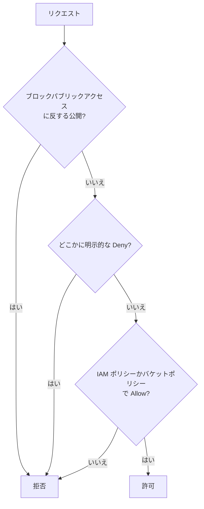

別のアカウントからのアクセスでは、相手の IAM ポリシーとバケットポリシーの両方で許可が要ります。上の図は同じアカウントの場合の考え方で、評価の詳細は [IAM](iam.md) を参照してください。

**使う場面:** 子会社のアカウントのロールに、親会社のバケットの `shared/` だけを読ませます。全員に対して「HTTPS 以外は拒否」を 1 か所で決めるときにも使います。

**オンプレミスとの対比**: ファイルサーバーの共有フォルダのアクセス権（ACL）に近いものです。違いは、OS のユーザーではなく IAM の主体や条件（送信元 VPC、暗号化の有無など）で書く点です。

```json
{
  "Version": "2012-10-17",
  "Statement": [{
    "Sid": "AllowPartnerRead",
    "Effect": "Allow",
    "Principal": {"AWS": "arn:aws:iam::111122223333:role/PartnerRole"},
    "Action": "s3:GetObject",
    "Resource": "arn:aws:s3:::my-bucket/shared/*"
  }]
}
```

| 仕組み | 用途 |
| --- | --- |
| IAM ポリシー | 同じアカウントのプリンシパルの権限 |
| バケットポリシー | クロスアカウント、匿名アクセス、条件による拒否 |
| ブロックパブリックアクセス | 公開設定を上書きして防ぐ。デフォルトで有効 |
| オブジェクト所有者の設定 | ACL の有効、無効。デフォルトで ACL は無効 |
| ACL | 古い仕組み。多くの場面で不要 |

`s3:ListBucket` はバケットの ARN に、`s3:GetObject` はオブジェクトの ARN(`/*` 付き)に指定します。

**例**: `arn:aws:s3:::my-bucket/*` に `s3:ListBucket` を許可しても効きません。`aws s3 ls s3://my-bucket/` は 403 です。リソースを `arn:aws:s3:::my-bucket` に分けます。

**例**: 別アカウントのロールにオブジェクトを読ませるなら、バケットポリシーの許可に加えて、そのロールの IAM ポリシーでも `s3:GetObject` を許可します。

### ブロックパブリックアクセス {#block-public-access}

4 つの独立した設定があり、アクセスポイント、バケット、アカウント、組織の単位で適用できます。新しいバケットではデフォルトで有効です。

バケットポリシーや ACL の書き間違い 1 つで、データが世界に公開されてしまいます。ブロックパブリックアクセスは、個々のポリシーの中身にかかわらず「公開だけは許さない」という安全装置です。IAM の[権限境界や SCP](iam.md#boundaries-scp) と同じく、権限を与えるのではなく上限を決める仕組みで、アカウントや組織の単位で付ければ、各チームのバケットの設定ミスをまとめて防げます。

| 設定 | `TRUE` のときの動作 |
| --- | --- |
| `BlockPublicAcls` | 公開 ACL を付ける `PutBucketAcl`、`PutObjectAcl`、`PutObject` を拒否する |
| `IgnorePublicAcls` | 公開 ACL を無視する。`PutObject` 自体は成功する |
| `BlockPublicPolicy` | 公開を許可するバケットポリシーの `PutBucketPolicy` を拒否する |
| `RestrictPublicBuckets` | 公開ポリシーのあるバケットへのアクセスを、AWS サービスと所有者アカウント内に限る |

**例**: `Principal: "*"` のポリシーを入れると、`BlockPublicPolicy` が有効なバケットでは `PutBucketPolicy` が拒否されます。アカウント単位が有効だと、バケットの設定を外しても拒否されます。

```bash
aws s3api put-public-access-block --bucket my-bucket \
  --public-access-block-configuration \
  BlockPublicAcls=true,IgnorePublicAcls=true,BlockPublicPolicy=true,RestrictPublicBuckets=true
```

**例**: 既に公開 ACL が付いたオブジェクトがあるバケットに `IgnorePublicAcls=true` を付けると、匿名の `GET` は 403 になります。`BlockPublicAcls` だけでは、既存の ACL は有効なままです。

### オブジェクト所有者 {#object-ownership}

ACL が有効だと、別のアカウントがアップロードしたオブジェクトはそのアカウントの持ち物になり、バケットの持ち主でも読めないことがあります。権限がバケットポリシーと ACL に分散して把握しにくくなるので、既定では ACL を無効にし、すべてバケット所有者の物としてポリシーだけで管理します。

| 設定 | 所有者 | ACL |
| --- | --- | --- |
| Bucket owner enforced(デフォルト) | バケット所有者 | 無効。設定は失敗し、読み取りのみ可 |
| Bucket owner preferred | `bucket-owner-full-control` 付きならバケット所有者 | 有効 |
| Object writer | アップロードしたアカウント | 有効 |

**例**: 別のアカウントが `x-amz-acl: public-read` を付けて、デフォルトのバケットにアップロードすると、ACL が無効なのでリクエストは失敗します。ACL を付けないか、`bucket-owner-full-control` だけを付けます。

## リクエスタ支払い {#requester-pays}

通常はバケット所有者がリクエストとダウンロードの費用を払いますが、リクエスタ支払いでは利用者が払います。ストレージの費用は常に所有者が払います。

大きなデータセットを他の組織に配ると、ダウンロードが増えるほど配る側の費用が膨らみます。受け取る側に転送の費用を払ってもらうための仕組みで、宅配の「着払い」に当たります。

| 項目 | 内容 |
| --- | --- |
| 匿名アクセス | 許可されない。すべて認証が必要 |
| リクエスト | `x-amz-request-payer` ヘッダー(CLI は `--request-payer`)で同意を示す |
| ロールを引き受けた場合 | ロールのアカウントに課金 |
| ウェブサイトエンドポイント | 使えない。403 |
| レプリケーションの送信先 | 別アカウントの送信先には設定できない |

**例**: 別の会社に大きなデータセットを公開するとき、ダウンロード費用を負担したくなければ有効にします。ヘッダーを付けない要求は 403 になります。

```bash
aws s3api put-bucket-request-payment --bucket my-dataset \
  --request-payment-configuration Payer=Requester
aws s3 cp s3://my-dataset/data.parquet . --request-payer requester
```

## CORS {#cors}

別のドメインのウェブページから、ブラウザの JavaScript で S3 にアクセスするときに設定します。

ブラウザは、別のオリジンへのリクエストの結果を、相手が許可しない限り JavaScript に渡しません（同一オリジンポリシー）。CORS の設定は、S3 がブラウザに「このオリジンからなら使ってよい」と伝えるためのものです。仕組みは [API Gateway の CORS](api-gateway.md#cors) と同じです。

```json
[
  {
    "AllowedOrigins": ["https://www.example.com"],
    "AllowedMethods": ["GET", "PUT"],
    "AllowedHeaders": ["*"],
    "ExposeHeaders": ["ETag"],
    "MaxAgeSeconds": 3000
  }
]
```

- S3 は最初に一致したルールを使います。`Origin`、メソッド、`Access-Control-Request-Headers` のすべてが一致する必要があります。
- CORS は権限を与えません。バケットポリシーや署名付き URL は別途必要です。
- ブラウザからマルチパートアップロードするなら、`ETag` を `ExposeHeaders` に入れます。

| 要素 | 値 | 動作 |
| --- | --- | --- |
| `AllowedOrigins` | `https://www.example.com`、`https://*.example.com`、`*` | ワイルドカードは 1 つまで |
| `AllowedMethods` | `GET`、`PUT`、`POST`、`DELETE`、`HEAD` | `OPTIONS` は指定しない |
| `AllowedHeaders` | `x-amz-*`、`*` など | プリフライトの `Access-Control-Request-Headers` と照合する |
| `ExposeHeaders` | `ETag` など | JavaScript から読める応答ヘッダー |
| `MaxAgeSeconds` | 秒数 | ブラウザがプリフライトの結果をキャッシュする時間 |

**例**: `https://app.example.com` から `PUT` で署名付き URL に送るなら、`AllowedOrigins` にそのオリジンを、`AllowedMethods` に `PUT` を入れます。`AllowedHeaders` に `Content-Type` が入っていないと、プリフライトが失敗します。設定がないと `403 Forbidden: CORS is not enabled for this bucket`、ルールに一致しないと `This CORS request is not allowed` になります。

**値の例**:

- **`MaxAgeSeconds`**: 3,000 なら、ブラウザは 50 分間プリフライトを省略します。設定を直しても、その間は古い結果が使われることがあります。
- **`AllowedOrigins`**: `https://*.example.com` は使えますが、`https://*.*.example.com` はワイルドカードが 2 つなので使えません。
- **`AllowedMethods`**: `OPTIONS` を書くと設定に失敗します。プリフライトは自動で処理されます。
- **`ExposeHeaders`**: `ETag` がないと、ブラウザのマルチパートで各パートの ETag を読めず、完了のリクエストを作れません。

## マルチパートアップロード {#multipart-upload}

大きなオブジェクトを分割してアップロードします。

**使う場面:** 映像制作会社が 200 GB の撮影素材を送る、毎晩 500 GB の DB のバックアップファイルを置く、といった大きなファイルの転送です。

10 GB を 1 本の通信で送ると、途中で切れたら最初からやり直しで、速さも 1 本の通信の帯域で頭打ちになります。分割すれば、並列に送って速くでき、失敗した部分だけを送り直せます。引っ越しの荷物を 1 台のトラックではなく、複数の箱に分けて何台かで運ぶのと同じです。

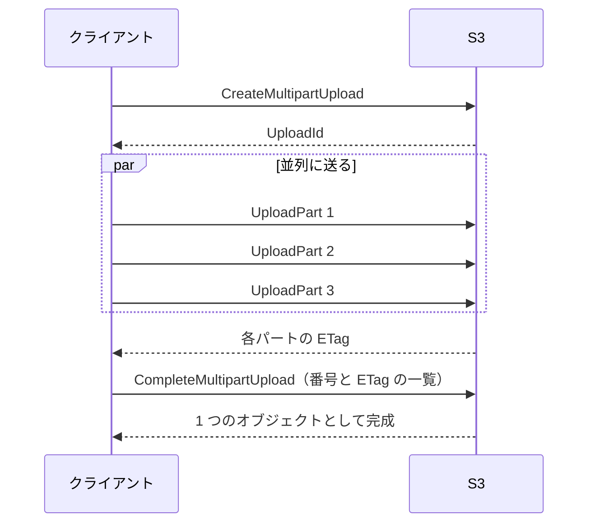

| 項目 | 値 |
| --- | --- |
| 推奨 | 100 MB 以上 |
| 必須 | 5 GB を超える場合 |
| パート数 | 最大 10,000 |
| パートサイズ | 5 MiB から 5 GiB(最後のパートに下限なし) |
| オブジェクトの上限 | 48.8 TiB（AWS のドキュメントでは「50 TB」とも表記） |

API の順序は `CreateMultipartUpload`、`UploadPart`(番号と ETag を記録)、`CompleteMultipartUpload` です。やめるときは `AbortMultipartUpload` を呼びます。

- パートは並列に、順不同で送れます。失敗したパートだけを再送できます。
- **未完了のパートにも課金されます**。ライフサイクルの `AbortIncompleteMultipartUpload` で自動的に片付けます。
- boto3 の `upload_file` は、サイズに応じて自動でマルチパートにします。

```python
from boto3.s3.transfer import TransferConfig

config = TransferConfig(multipart_threshold=100 * 1024 * 1024, max_concurrency=8)
s3.upload_file("big.bin", "my-bucket", "big.bin", Config=config)
```

boto3 の `TransferConfig` のデフォルトは、`multipart_threshold` が 8 MB、`max_concurrency` が 10 です。

**例**: 1 TiB のファイルを送るなら、パートは 10,000 個までなので 1 パートは約 105 MiB 以上にします。`UploadPart` を自分で呼ぶとき、5 MiB のパートでは 10,000 個で約 48.8 GiB にしかなりません。

**計算の例**: 最大の 48.8 TiB を送るなら、48.8 × 1,024 ÷ 10,000 で 1 パートは約 5 GiB になります。100 MiB のパートで 500 GiB を送るなら、500 × 1,024 ÷ 100 で 5,120 パートです。

CLI では次のように変えます。

```bash
aws configure set default.s3.multipart_threshold 100MB
aws configure set default.s3.multipart_chunksize 128MB
aws configure set default.s3.max_concurrent_requests 20
```

**例**: 回線が細い環境で `max_concurrency` を大きくすると、再送が増えて全体が遅くなることがあります。8 から始めて調整します。

**落とし穴**: `CompleteMultipartUpload` には、記録した番号と ETag の一覧を渡します。`ListParts` の結果を使わないでください。`Expiration` のライフサイクルでは未完了のアップロードは消えません。必ず `AbortIncompleteMultipartUpload` を設定します。

### 片付けの設定 {#abort-multipart}

```bash
aws s3api put-bucket-lifecycle-configuration --bucket my-bucket \
  --lifecycle-configuration '{"Rules":[{"ID":"abort","Status":"Enabled","Filter":{"Prefix":""},
    "AbortIncompleteMultipartUpload":{"DaysAfterInitiation":7}}]}'
```

開始から 7 日で完了しないアップロードを止め、パートを削除します。パートはコンソールのオブジェクト一覧には現れないので、気づかないまま課金が続きます。

**例**: 残っているものは次のコマンドで確認します。

```bash
aws s3api list-multipart-uploads --bucket my-bucket
```

**誤ると**: `DaysAfterInitiation` が 1 だと、1 日以上かかる数 TB のアップロードが途中で消されます。送る時間より長くします。

## Transfer Acceleration {#transfer-acceleration}

エッジロケーションを経由して、遠くのクライアントと S3 の間の転送を速くします。

海外の拠点から東京のバケットへ送ると、長い区間を混み合うインターネットで通ることになります。近くのエッジロケーションまでだけインターネットを使い、その先は AWS のネットワークで運ぶことで、遅延と揺れを減らします。近くの郵便局に預け、あとは専用便で運ぶ形です。

| 項目 | 内容 |
| --- | --- |
| 有効化 | `put-bucket-accelerate-configuration` の `Status=Enabled`。停止は `Suspended` |
| エンドポイント | `バケット名.s3-accelerate.amazonaws.com` |
| 反映 | 有効化から最大 20 分で速くなる |
| バケット名 | DNS 準拠で、ピリオド(`.`)を含められない |
| アドレス形式 | 仮想ホスト形式のみ |
| 使えない API | `ListBuckets`、`CreateBucket`、`DeleteBucket` は加速エンドポイントで使えない |

```bash
aws s3api put-bucket-accelerate-configuration --bucket my-bucket \
  --accelerate-configuration Status=Enabled
aws s3 cp big.bin s3://my-bucket/big.bin \
  --endpoint-url https://s3-accelerate.amazonaws.com
```

**例**: 世界中のスマホアプリから東京のバケットに大きな動画をアップロードするなら有効にします。同じリージョンのアプリからの転送は速くなりません。CloudFront はダウンロードのキャッシュが中心で、Transfer Acceleration はアップロードの速度を上げるときに選びます。

**誤ると**: `my.upload.bucket` のようにピリオドを含むバケットでは有効にできません。有効にしても、クライアントが通常のエンドポイントへ送っていれば速くなりません。

## アクセスポイント {#access-points}

バケットに接続する名前付きのエンドポイントです。アクセスポイントごとに独自のポリシー、ネットワーク制限、ブロックパブリックアクセスを設定できます。

**提供単位**: バケットと同じリージョンに作ります。インターネットからも受けるか、特定の VPC からだけ受けるかを作成時に選びます。

1 つのバケットを多くのチームやアプリで共有すると、バケットポリシーに全員分の条件が積み重なり、20 KB の上限に近づき、1 か所の修正が全員に影響します。アクセスポイントは、用途ごとに入口を分けて、入口ごとにポリシーを持たせるための仕組みです。

**建物にたとえる**と、バケットは倉庫、アクセスポイントは用途別の通用口です。経理用の通用口は経理の棚にだけ、分析チームの通用口は社内ネットワーク（VPC）からだけ通します。

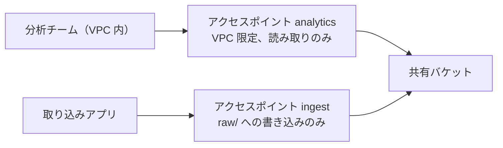

| 使いどころ | 内容 |
| --- | --- |
| 共有データセット | 巨大なバケットポリシーを、用途別のアクセスポイントに分ける |
| VPC 限定 | 特定の VPC からのリクエストだけを受ける |

- `GetObject`、`PutObject` などのオブジェクト操作だけが対象です。バケットの削除などはできません。
- 権限はアクセスポイントのポリシーと、元のバケットのポリシーの両方で評価されます。
- ARN やエイリアスで指定できます。

| 制約 | 内容 |
| --- | --- |
| 名前 | 3〜50 文字。アカウントとリージョンの中で一意 |
| 接続先 | 作成後に別のバケットへ変更できない |
| VPC の設定 | 作成後に変更できない |
| ポリシーのサイズ | 20 KB |
| 数の上限 | アカウントとリージョンごとに 10,000 |
| アドレス形式 | 仮想ホスト形式のみ |
| レプリケーション | 送信先に指定できない |

**例**: 分析チームには読み取りだけのアクセスポイント、VPC 内のバッチには VPC 限定のアクセスポイントを作り、バケットポリシーからは許可を外します。

```bash
aws s3control create-access-point --account-id 111122223333 \
  --name batch-vpc --bucket my-bucket \
  --vpc-configuration VpcId=vpc-0123456789abcdef0
aws s3api get-object --key data.csv out.csv \
  --bucket arn:aws:s3:ap-northeast-1:111122223333:accesspoint/batch-vpc
```

バケットポリシーで、自分のアカウントのアクセスポイントに権限を委任する例です。

```json
{
  "Effect": "Allow",
  "Principal": {"AWS": "*"},
  "Action": "*",
  "Resource": ["arn:aws:s3:::my-bucket", "arn:aws:s3:::my-bucket/*"],
  "Condition": {"StringEquals": {"s3:DataAccessPointAccount": "111122223333"}}
}
```

**誤ると**: VPC 限定のアクセスポイントへ VPC の外から接続すると、403 です。`NetworkOrigin` が `VPC` になっていて、後から変えられないので、作り直します。

**落とし穴**: アクセスポイントのポリシーで許可しても、バケットポリシーでも許可されていなければ拒否されます。バケットポリシーで `s3:DataAccessPointAccount` を使い、自分のアカウントのアクセスポイントに権限を委任すると、管理が 1 か所で済みます。

## Object Lambda と S3 Select の現在の状況 {#retired-features}

| 機能 | 状況 | 代わり |
| --- | --- | --- |
| S3 Object Lambda | 2025 年 11 月 7 日以降、新規利用は不可。既存の利用者と一部のパートナーのみ | CloudFront と Lambda、アプリ側での変換 |
| S3 Select | 新規の利用者には提供されない。既存の利用者は継続できる | Athena、アプリ側での処理 |

古い資料では「`GET` の結果を変換するなら Object Lambda」「オブジェクトの一部を SQL で読むなら S3 Select」と説明されますが、新規の設計には使えません。

**例**: 画像を読むときにサイズを変える処理は、CloudFront と Lambda で行います。100 GB の CSV から `status='FAILED'` の行を探すなら、Athena の SQL を実行します。

## Object Lock {#object-lock}

WORM(一度書き込み、何度でも読める)モデルで、バージョンを削除や上書きから守ります。**バージョニングが必須** です。

法令で「一定期間は変更も削除もできない形で保管せよ」と求められる記録や、管理者の認証情報を盗まれても消されたくないバックアップのためにあります。バージョニングだけでは、権限のある人が古い版を消せてしまいます。Object Lock は、権限があっても期間中は消せないようにします。

**オンプレミスとの対比**: 一度しか書けない光ディスクや、WORM テープに当たります。違いは、媒体ではなくオブジェクトの版ごとに期間を決める点です。モードの違いは、管理者が鍵を持つ金庫（ガバナンス）と、期間が過ぎるまで誰も開けられない時限金庫（コンプライアンス）の違いです。

| 種類 | 動作 |
| --- | --- |
| ガバナンスモード | `s3:BypassGovernanceRetention` と `x-amz-bypass-governance-retention:true` があれば変更、削除できる |
| コンプライアンスモード | ルートユーザーも含めて誰も削除できず、期間の短縮もできない |
| リーガルホールド | 期限なし。`s3:PutObjectLegalHold` を持つユーザーが外すまで有効。保持期間とは独立 |

- 保持期間は、固定(日付を指定)と可変(イベントホールドの解放時に確定)があります。バケットのデフォルトも設定できます。
- 延長はできますが、短縮はできません(コンプライアンスの場合)。
- バージョン ID なしの `DELETE` は成功し、削除マーカーが付きます。バージョン ID を指定した削除は 403 になります。
- 一度有効にすると、Object Lock は無効にできず、バージョニングも停止できません。
- コンプライアンスモードで期限前に消す方法は、AWS アカウントの削除だけです。
- ガバナンスモードの迂回には権限とヘッダーの両方が必要です。コンソールはヘッダーを自動で付けます。リーガルホールドは迂回の対象外です。
- 保持期間は個々のバージョンごとです。バケットのデフォルト(日数か年数)より、個別の指定が優先されます。

**例**: 30 日の保持の途中で同じキーに 60 日の保持で `PUT` すると、新しいバージョンができ、古いバージョンは元の期限のままです。「ファイルを上書きできないように」ではなく「各バージョンを消せないように」する機能です。

**バケットのデフォルトと個別の指定の例**:

```bash
# 新しいオブジェクトを 7 年間、コンプライアンスモードで保護する
aws s3api put-object-lock-configuration --bucket audit-logs \
  --object-lock-configuration \
  '{"ObjectLockEnabled":"Enabled","Rule":{"DefaultRetention":{"Mode":"COMPLIANCE","Years":7}}}'

# 特定のバージョンだけ、ガバナンスモードで指定する
aws s3api put-object-retention --bucket app-data --key a.csv \
  --retention 'Mode=GOVERNANCE,RetainUntilDate=2027-01-01T00:00:00Z'

# 権限のある管理者が迂回して消す
aws s3api delete-object --bucket app-data --key a.csv \
  --version-id EXAMPLEVersionId --bypass-governance-retention

# 訴訟の間、期限なしで止める
aws s3api put-object-legal-hold --bucket app-data --key a.csv \
  --legal-hold Status=ON
```

**選び方の例**: 金融の規制で 7 年間は誰にも消させないならコンプライアンスモードです。テスト環境で 90 日保護するが、管理者が消せる余地を残すならガバナンスモードです。

**誤ると**: コンプライアンスモードで 100 年と誤って指定すると、短縮できません。消す方法はアカウントの削除だけで、その間の課金も続きます。まずガバナンスモードで試します。

## 静的ウェブサイトホスティング {#static-website}

HTML や画像だけのサイトなら、Web サーバーを立ててパッチを当て続ける必要はありません。S3 がファイルを返すだけで済みます。ウェブサイトエンドポイントは、インデックスページやエラーページ、リダイレクトといった Web サーバーらしい動きを足すためのものです。HTTPS や非公開のまま配信したいときは、REST API エンドポイントを CloudFront の後ろに置きます。

**使う場面:** 自治体の災害情報ページや、イベントの特設サイトのように、アクセスが急に増えても落ちてほしくない静的なページです。CloudFront を前に置き、REST API エンドポイントを OAC で非公開のまま使う構成が多いです。

| 観点 | ウェブサイトエンドポイント | REST API エンドポイント |
| --- | --- | --- |
| HTTPS | 非対応 | 対応 |
| 公開範囲 | 公開コンテンツのみ | 公開、非公開の両方 |
| ルートへのアクセス | インデックスドキュメント | キーの一覧 |
| エラー応答 | HTML | XML |
| リダイレクト | 対応 | 非対応 |
| アクセスポイント | 非対応 | 対応 |
| 操作 | `GET`、`HEAD` のみ | すべて |

URL の形式は `http://{bucket}.s3-website-{region}.amazonaws.com` か `http://{bucket}.s3-website.{region}.amazonaws.com` で、リージョンによって異なります。

公開にはブロックパブリックアクセスの解除と、`s3:GetObject` を許可するバケットポリシーが必要です。HTTPS が必要なら CloudFront か Amplify Hosting を前に置きます。

```bash
aws s3 website s3://www.example.com/ \
  --index-document index.html --error-document error.html
```

| 設定 | 動作 |
| --- | --- |
| インデックスドキュメント | 必須。`/` や `docs/` へのアクセスで返す |
| エラードキュメント | 任意。4xx のときに返す |
| リダイレクト | 全リクエストの転送か、条件付きのルーティングルール |

**公開するときのバケットポリシーの例**:

```json
{
  "Effect": "Allow",
  "Principal": "*",
  "Action": "s3:GetObject",
  "Resource": "arn:aws:s3:::www.example.com/*"
}
```

**リダイレクトの例**: 古いパス `docs/` を `documents/` へ転送します。

```json
{
  "IndexDocument": {"Suffix": "index.html"},
  "ErrorDocument": {"Key": "error.html"},
  "RoutingRules": [{
    "Condition": {"KeyPrefixEquals": "docs/"},
    "Redirect": {"ReplaceKeyPrefixWith": "documents/"}
  }]
}
```

**例**: `www.example.com` のバケットなら、URL は `http://www.example.com.s3-website-ap-northeast-1.amazonaws.com` です。Route 53 のエイリアスを直接このエンドポイントへ向けるなら、バケット名をドメインと同じにします。

**落とし穴**: REST エンドポイントではルートのアクセスがキーの一覧を返し、インデックスドキュメントは返りません。ブラウザから `https://バケット.s3-website...` には接続できません。リクエスタ支払いのバケットはウェブサイトエンドポイントで 403 になります。

**誤ると**: ブロックパブリックアクセスを解除していないと、ウェブサイトのエンドポイントは 403 です。`error.html` が無ければ、S3 の既定のエラー画面が出ます。

## S3 Glacier のデータ取得 {#glacier-retrieval}

[:material-sprout: CLF](../courses/clf/services.md){ .exam-badge .exam-foundational } [:material-sprout: AIF](../courses/aif/services.md){ .exam-badge .exam-foundational } [:material-certificate: SAA](../courses/saa/services.md){ .exam-badge .exam-associate } [:material-certificate: DVA](../courses/dva/services.md){ .exam-badge .exam-associate } [:material-certificate: DEA](../courses/dea/services.md){ .exam-badge .exam-associate } [:material-certificate: MLA](../courses/mla/services.md){ .exam-badge .exam-associate } [:material-star-circle: DOP](../courses/dop/services.md){ .exam-badge .exam-professional }

Glacier Instant Retrieval は通常の `GET` で読めます。Flexible Retrieval と Deep Archive は、`RestoreObject` で一時的なコピーを作ってから読みます。

すぐには読めない代わりに保管料を下げたクラスなので、読む前に「取り寄せ」の手続きが要ります。郊外の倉庫に保管した書類を、事前に依頼して事務所に届けてもらい、一定期間だけ手元に置く流れです。急ぐほど取り寄せの料金が高くなります。

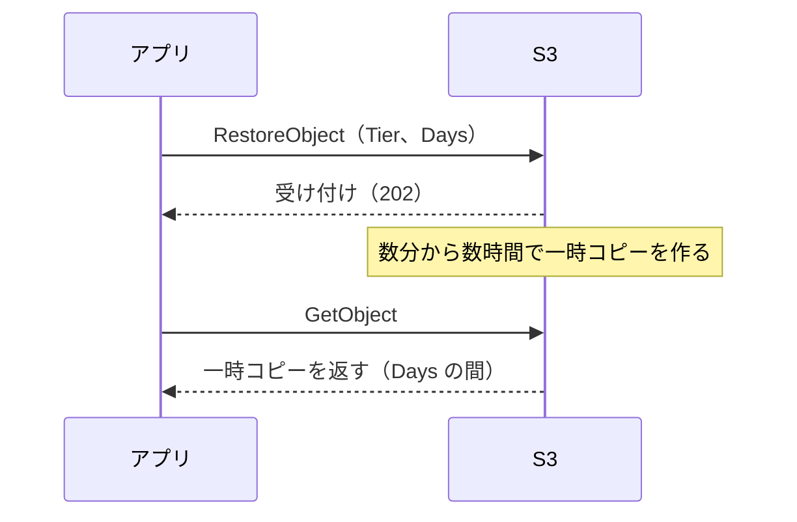

| 取得オプション (`Tier`) | Flexible Retrieval | Deep Archive |
| --- | --- | --- |
| Expedited | 1〜5 分(250 MB 未満。それ以上は最大 300 MB/秒) | 使えない |
| Standard(デフォルト) | 3〜5 時間 | 12 時間以内 |
| Bulk(最安) | 5〜12 時間 | 48 時間以内 |
| Standard を Batch Operations で実行 | 数分〜5 時間 | 9〜12 時間 |

```python
s3.restore_object(
    Bucket="my-bucket",
    Key="archive/2020.tar",
    RestoreRequest={"Days": 7, "GlacierJobParameters": {"Tier": "Standard"}},
)
```

- 復元中でもストレージクラスは `GLACIER` のままです。指定した日数が過ぎるとコピーは消えます。
- 復元中はアーカイブと一時コピーの両方が課金されます。
- 別のクラスに変えるには、復元してから `CopyObject` で上書きします。
- Expedited の容量を保証するには、プロビジョンドキャパシティを購入します。需要が高いときは受け付けられないことがあります。
- 復元完了は Event Notifications で検知できます(`s3:ObjectRestore:Completed`)。
- S3 Glacier ストレージクラスのオブジェクトは S3 の API で扱います。別サービスの Amazon Glacier のボールト API では扱えません。
- Intelligent-Tiering のアーカイブ階層の復元は `Days` を受け付けません。
- 復元の進捗は `HeadObject` の `x-amz-restore` で確認します。`ongoing-request="true"` なら実行中です。
- 復元リクエストは毎秒 1,000 件までです。超えるとスロットリングされます。

**例**: 監査で 20 GB のログが明日までに必要なら、Flexible Retrieval の Standard で 3〜5 時間です。至急なら Expedited で分単位です。Deep Archive に入っているなら Expedited は使えず、Standard で 12 時間以内です。費用が最優先で 2 日待てるなら Bulk です。

**`Days` の例**: `Days: 7` なら、復元の完了から 7 日間は `GET` で読めます。8 日目以降は再び復元が必要です。分析に 2 週間かかるなら 14 にします。

**状態の例**: 実行中は `x-amz-restore: ongoing-request="true"` です。完了すると次のようになります。

```text
x-amz-restore: ongoing-request="false", expiry-date="Fri, 06 Nov 2026 00:00:00 GMT"
```

**上限の計算**: 5,000 個のオブジェクトを復元するなら、毎秒 1,000 件で 5 秒以上に分けます。

**誤ると**:

- 復元せずに `GET` すると、403 の `InvalidObjectState` です。
- 復元の実行中に同じリクエストを送ると、409 の `RestoreAlreadyInProgress` です。
- Expedited はプロビジョンドキャパシティがないと、混雑時に 503 の `GlacierExpeditedRetrievalNotAvailable` が返ることがあります。Standard で送り直します。

## 既定値と上限のまとめ {#numbers}

| 項目 | 値 |
| --- | --- |
| 1 回の `PUT`、マルチパートの上限 | 5 GB、48.8 TiB |
| パート数、パートサイズ | 最大 10,000、5 MiB〜5 GiB |
| マルチパートの推奨 | 100 MB 以上 |
| boto3 の `multipart_threshold` | デフォルト 8 MB |
| リクエストレート | プレフィックスごとに毎秒 3,500 書き込み、5,500 読み取り |
| Standard-IA、One Zone-IA | 最小 30 日、128 KB |
| Glacier IR | 最小 90 日、128 KB |
| Flexible Retrieval、Deep Archive | 最小 90 日、180 日。追加 40 KB |
| Intelligent-Tiering | 30 日、90 日で自動移動。任意で 90 日、180 日のアーカイブ。128 KB 未満は対象外 |
| ライフサイクルのルール | 1 バケット 1,000 個 |
| ライフサイクルの最小サイズ | 128 KB 未満はデフォルトで移行しない |
| 署名付き URL(コンソール) | 1 分〜12 時間 |
| 署名付き URL(CLI、SDK) | 最長 7 日 |
| バケットポリシー、アクセスポイントポリシー | 20 KB |
| イベント通知の配信 | 少なくとも 1 回。設定の反映は約 5 分 |
| S3 RTC | 99.9%（専用ページと SLA の基準。公式の一部のページは 99.99% と記載）を 15 分以内 |
| Bucket Key の削減効果 | KMS リクエストを最大 99% |
| Transfer Acceleration の反映 | 最大 20 分 |
| アクセスポイント | アカウントとリージョンごとに 10,000 |
| Expedited | 1〜5 分(Flexible Retrieval のみ) |
| Standard | 3〜5 時間、Deep Archive は 12 時間以内 |
| Bulk | 5〜12 時間、Deep Archive は 48 時間以内 |

## 試験のポイント {#exam-points}

| こう問われたら | 答え |
| --- | --- |
| 未ログインのユーザーに一時的にダウンロードさせたい | 署名付き URL |
| ブラウザから S3 に直接アップロードしたい | `PUT` の署名付き URL と CORS |
| 署名付き URL が期限より早く切れる | 一時認証情報の失効 |
| 署名付き URL が 403 | 生成したプリンシパルの権限不足 |
| 有料動画をエッジで配信、複数ファイル | CloudFront 署名付き Cookie |
| 古いログを安くし、1 年で削除 | ライフサイクル |
| 消したはずのデータの容量が減らない | 非現行バージョン、または未完了のマルチパート |
| アクセスパターンが読めない | Intelligent-Tiering |
| アップロードで Lambda を起動 | Event Notifications |
| SQS FIFO に通知したい | EventBridge 経由 |
| 通知が 2 回届く | 少なくとも 1 回の配信。冪等に処理する |
| 誰がいつ復号したかを監査 | SSE-KMS |
| SSE-KMS で KMS のスロットリングやコスト | S3 Bucket Key |
| SSE-KMS で `PutObject` が 403 | `kms:GenerateDataKey` の不足 |
| AWS に平文を渡したくない | クライアント側暗号化 |
| 新しいバケットで SSE-C が 403 | デフォルトでブロック。`PutBucketEncryption` で解除 |
| 指定した方式やキー以外のアップロードを拒否 | バケットポリシーの `s3:x-amz-server-side-encryption`、`s3:x-amz-server-side-encryption-aws-kms-key-id` 条件 |
| HTTP でのアクセスを拒否 | `aws:SecureTransport` が `false` なら Deny |
| 別ドメインの JS で読めない | CORS の設定 |
| 100 MB を超えるファイル | マルチパートアップロード |
| 規制で誰も削除できないように | Object Lock のコンプライアンスモード |
| 権限を持つ管理者だけは削除できるように | Object Lock のガバナンスモード |
| 期間未定で削除を止めたい | リーガルホールド |
| アーカイブを最短で読みたい | Expedited(Flexible Retrieval のみ) |
| アーカイブを最も安く読みたい | Bulk |
| 静的サイトを HTTPS で | CloudFront か Amplify Hosting |
| 既存のオブジェクトを別リージョンにコピー | S3 Batch Replication |
| レプリケーションの有効化が拒否される | 両方のバケットでバージョニングが必要 |
| SSE-KMS のオブジェクトが複製されない | `SseKmsEncryptedObjects` のオプトインとロールの KMS 権限 |
| 削除が複製先に反映されない | 削除マーカーの複製はオプション。バージョン指定の削除は複製されない |
| 消したオブジェクトを戻す | 削除マーカーをバージョン ID 指定で削除 |
| マルチパートのゴミの費用 | `AbortIncompleteMultipartUpload` |
| 世界中から大きなファイルを速くアップロード | Transfer Acceleration |
| ダウンロードの費用を利用者に | リクエスタ支払い |
| 公開のバケットポリシーを設定できない | `BlockPublicPolicy` |
| ACL 付きの `PUT` が失敗する | Bucket owner enforced で ACL が無効 |
| 毎秒多数のリクエストで 503 | プレフィックスに分散、バックオフ |
| Bucket Key を有効にしたら KMS の条件で拒否 | 暗号化コンテキストがバケットの ARN になる |
| 新規に `GET` の結果を変換したい | Object Lambda は新規不可。CloudFront と Lambda など |
| CSV の一部を SQL で読みたい(新規) | S3 Select は新規不可。Athena など |

## 関連ページ {#related}

- [ストレージの選び方](storage.md)
- [KMS](kms.md)
- [IAM](iam.md)
- [Lambda](lambda.md)
- [メッセージング](messaging.md)
- [データベースとキャッシュ](databases.md)
- [ネットワーク](networking.md)

## 参考 {#references}

- [What is Amazon S3?](https://docs.aws.amazon.com/AmazonS3/latest/userguide/Welcome.html)
- [Understanding and managing Amazon S3 storage classes](https://docs.aws.amazon.com/AmazonS3/latest/userguide/storage-class-intro.html)
- [Transitioning objects using Amazon S3 Lifecycle](https://docs.aws.amazon.com/AmazonS3/latest/userguide/lifecycle-transition-general-considerations.html)
- [Retaining multiple versions of objects with S3 Versioning](https://docs.aws.amazon.com/AmazonS3/latest/userguide/Versioning.html)
- [Download and upload objects with presigned URLs](https://docs.aws.amazon.com/AmazonS3/latest/userguide/using-presigned-url.html)
- [Uploading objects with presigned URLs](https://docs.aws.amazon.com/AmazonS3/latest/userguide/PresignedUrlUploadObject.html)
- [Decide to use signed URLs or signed cookies](https://docs.aws.amazon.com/AmazonCloudFront/latest/DeveloperGuide/private-content-choosing-signed-urls-cookies.html)
- [Specify signers that can create signed URLs and signed cookies](https://docs.aws.amazon.com/AmazonCloudFront/latest/DeveloperGuide/private-content-trusted-signers.html)
- [Amazon S3 Event Notifications](https://docs.aws.amazon.com/AmazonS3/latest/userguide/EventNotifications.html)
- [Using Amazon SQS, Amazon SNS, and Lambda](https://docs.aws.amazon.com/AmazonS3/latest/userguide/how-to-enable-disable-notification-intro.html)
- [Protecting data with encryption](https://docs.aws.amazon.com/AmazonS3/latest/userguide/UsingEncryption.html)
- [Using server-side encryption with AWS KMS keys](https://docs.aws.amazon.com/AmazonS3/latest/userguide/UsingKMSEncryption.html)
- [Using server-side encryption with customer-provided keys](https://docs.aws.amazon.com/AmazonS3/latest/userguide/ServerSideEncryptionCustomerKeys.html)
- [Using cross-origin resource sharing (CORS)](https://docs.aws.amazon.com/AmazonS3/latest/userguide/cors.html)
- [Uploading objects](https://docs.aws.amazon.com/AmazonS3/latest/userguide/upload-objects.html)
- [Uploading and copying objects using multipart upload](https://docs.aws.amazon.com/AmazonS3/latest/userguide/mpuoverview.html)
- [Amazon S3 multipart upload limits](https://docs.aws.amazon.com/AmazonS3/latest/userguide/qfacts.html)
- [Managing access to shared datasets with access points](https://docs.aws.amazon.com/AmazonS3/latest/userguide/access-points.html)
- [Locking objects with Object Lock](https://docs.aws.amazon.com/AmazonS3/latest/userguide/object-lock.html)
- [Website endpoints](https://docs.aws.amazon.com/AmazonS3/latest/userguide/WebsiteEndpoints.html)
- [Understanding archive retrieval options](https://docs.aws.amazon.com/AmazonS3/latest/userguide/restoring-objects-retrieval-options.html)
- [Lifecycle configuration elements](https://docs.aws.amazon.com/AmazonS3/latest/userguide/intro-lifecycle-rules.html)
- [Working with delete markers](https://docs.aws.amazon.com/AmazonS3/latest/userguide/DeleteMarker.html)
- [Configuring MFA delete](https://docs.aws.amazon.com/AmazonS3/latest/userguide/MultiFactorAuthenticationDelete.html)
- [Replicating objects within and across Regions](https://docs.aws.amazon.com/AmazonS3/latest/userguide/replication.html)
- [What does Amazon S3 replicate?](https://docs.aws.amazon.com/AmazonS3/latest/userguide/replication-what-is-isnot-replicated.html)
- [Reducing the cost of SSE-KMS with S3 Bucket Keys](https://docs.aws.amazon.com/AmazonS3/latest/userguide/bucket-key.html)
- [Blocking public access](https://docs.aws.amazon.com/AmazonS3/latest/userguide/access-control-block-public-access.html)
- [Object Ownership](https://docs.aws.amazon.com/AmazonS3/latest/userguide/about-object-ownership.html)
- [Requester Pays](https://docs.aws.amazon.com/AmazonS3/latest/userguide/RequesterPaysBuckets.html)
- [Transfer Acceleration](https://docs.aws.amazon.com/AmazonS3/latest/userguide/transfer-acceleration.html)
- [S3 Object Lambda availability change](https://docs.aws.amazon.com/AmazonS3/latest/userguide/amazons3-ol-change.html)
- [S3 Select](https://docs.aws.amazon.com/AmazonS3/latest/userguide/selecting-content-from-objects.html)
- [Best practices design patterns: optimizing performance](https://docs.aws.amazon.com/AmazonS3/latest/userguide/optimizing-performance.html)
