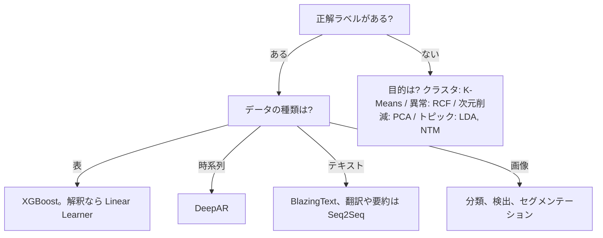
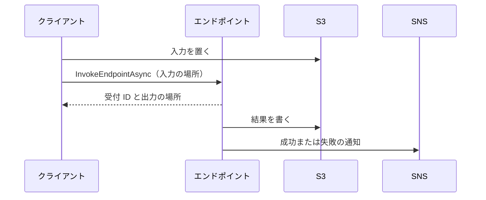

# Amazon SageMaker AI

[:material-sprout: CLF](../courses/clf/services.md){ .exam-badge .exam-foundational } [:material-sprout: AIF](../courses/aif/services.md){ .exam-badge .exam-foundational } [:material-sprout: AIB](../courses/aib/services.md){ .exam-badge .exam-foundational } [:material-certificate: SAA](../courses/saa/services.md){ .exam-badge .exam-associate } [:material-certificate: DEA](../courses/dea/services.md){ .exam-badge .exam-associate } [:material-certificate: MLA](../courses/mla/services.md){ .exam-badge .exam-associate } [:material-star-circle: SAP](../courses/sap/services.md){ .exam-badge .exam-professional } [:material-star-circle: AIP](../courses/aip/services.md){ .exam-badge .exam-professional } [:material-target: SCS](../courses/scs/services.md){ .exam-badge .exam-specialty }

ML モデルの準備、学習、デプロイ、監視をまとめて行うマネージドサービスです。MLA-C02 の中心で、AIP-C01、AIF-C01 にも出ます。

**提供単位:** SageMaker AI はリージョンのサービスです。**VPC:** ジョブとエンドポイントは既定で AWS が管理するネットワークで動き、`VpcConfig` で自分の VPC に接続できます（[VPC とネットワーク分離](#vpc-isolation)、[リソースの提供単位](resource-scope.md#scope-regional-vpc)）。

[](../assets/diagrams/sagemaker-mlops.png)

!!! warning "名前と提供状況（2026 年 10 月時点）"
    旧来の「Amazon SageMaker」のうち、ML の部分は **Amazon SageMaker AI** という名前です。**Amazon SageMaker** は分析と AI の統合プラットフォームの名前に変わりました。

    次の機能は**新規顧客の受付を終了**しています。既存の顧客は使い続けられますが、新機能は追加されません。

    | 機能 | 公式が示す移行先 |
    |---|---|
    | Clarify | SHAP ライブラリ、指標の自前計算、MLflow、CloudWatch。FM の評価は Bedrock Evaluations |
    | Model Monitor | 公開の監視ソリューション（MLflow Apps と Evidently AI）、QuickSight、CloudWatch |
    | Debugger | MLflow、TensorBoard、CloudWatch |
    | Ground Truth | 公式の案内なし |
    | Augmented AI（A2I） | 公式の案内なし（[別ページ](ai-managed-services.md#a2i)） |

    AIP-C01 の対象一覧には Clarify、Ground Truth、Model Monitor が今も載っています。MLA-C02 のスキルでは MLflow on SageMaker AI と「ドリフト検知パイプライン」が名指しされています。両方を理解しておきます。

| 段階 | 機能 | 節 |
|---|---|---|
| 開発環境 | Studio、Unified Studio | [Studio](#studio) |
| データ準備 | Processing、Data Wrangler、Feature Store、Ground Truth | [データ準備](#data-prep) |
| 学習 | Training、スクリプトモード、AMT、分散学習 | [学習](#training) |
| アルゴリズム | 組み込みアルゴリズム、JumpStart | [アルゴリズム](#algorithms) |
| 評価と説明 | MLflow、Clarify、Debugger | [評価と説明](#evaluation) |
| デプロイ | エンドポイント、バッチ変換 | [エンドポイント](#endpoints) |
| 最適化 | Neo、推論最適化、自動スケーリング、インスタンス選択 | [最適化](#optimization) |
| MLOps | Pipelines、Model Registry、Projects | [MLOps](#mlops) |
| 監視 | Model Monitor、CloudWatch | [監視](#monitoring) |
| セキュリティ | VPC、ネットワーク分離、IAM | [セキュリティ](#security) |

## 開発環境 {#studio}

### SageMaker Studio {#sagemaker-studio}

ML の作業全体を行う Web の開発環境です。

| 項目 | 内容 |
|---|---|
| ドメイン | ユーザー、ストレージ、ネットワークの設定をまとめる単位 |
| IDE | JupyterLab、Code Editor（Code-OSS ベース）、RStudio |
| 画面 | ジョブ、エンドポイント、モデルなどを 1 つの UI で扱う |
| Studio Classic | 以前の体験。既存の作業向けに維持されるが、新規オンボーディングは不可 |

**落とし穴:** JupyterLab アプリを停止し忘れると、インスタンスの料金が続きます。

**提供単位:** ドメインはリージョン単位のリソースです。**VPC:** ドメインの作成時にサブネットを指定します。`AppNetworkAccessType` が `PublicInternetOnly`（既定）ならインターネットを経由でき、`VpcOnly` なら VPC を経由します。

- **`VpcOnly` の例:** 機密データを扱うドメインでは `VpcOnly` にし、プライベートサブネットを指定します。パブリックサブネットは使えません。
- **誤ると:** `VpcOnly` にしたのに NAT も SageMaker AI の VPC エンドポイントもないと、Studio からジョブを作れず、パッケージの取得も失敗します。
- **料金の計算例:** 1 日 8 時間だけ使う JupyterLab を止め忘れると、24 時間動くので課金は 3 倍です。週末も含めれば 168 ÷ 40 = 4.2 倍です（週 5 日、1 日 8 時間の利用）。
- **IDE の選び方の例:** ノートブックで探索するなら JupyterLab、学習スクリプトをデバッグするなら Code Editor です。R の分析者は RStudio を使います。

### SageMaker Unified Studio の位置づけ {#unified-studio}

[:material-star-circle: AIP](../courses/aip/services.md){ .exam-badge .exam-professional }

| | SageMaker AI Studio | SageMaker Unified Studio |
|---|---|---|
| 属するもの | SageMaker AI | 次世代の Amazon SageMaker |
| 対象 | ML の開発者 | データ、分析、AI、ML の統合 |
| 単位 | ドメイン、ユーザープロファイル | プロジェクト。管理者がユーザーとリソースを用意する |
| 使う場面 | ML の開発に集中する | データ分析から AI まで同じ場所で進める |

- **SageMaker AI Studio の例:** データサイエンティスト 5 名が学習と MLflow を使うチームです。
- **Unified Studio の例:** アナリストが SQL で集計し、同じプロジェクトで ML エンジニアがモデルを学習し、Bedrock のアプリまで作る組織です。
- **誤ると:** 試験の文章の「Amazon SageMaker」を ML 専用と読むと、統合プラットフォームの話を取り違えます。「SageMaker AI」かどうかを見ます。

### その他の開発向け機能 {#other-dev}

| 機能 | 内容 |
|---|---|
| Canvas | コードなしで予測モデルを作る。Data Wrangler は Canvas に統合された。Autopilot の UI も Canvas へ移行 |
| Autopilot（AutoML） | モデルの自動作成。コードを書く人は API を引き続き使える |
| HyperPod | 大規模な FM の学習向けの耐障害クラスター。Slurm または EKS で管理する |

- **Canvas の例:** 営業の担当者が CSV 1 ファイルから解約予測をコードなしで作ります。
- **Autopilot の例:** エンジニアが `CreateAutoMLJobV2` で候補のモデルを自動で作り、最良の 1 つをデプロイします。
- **HyperPod の例:** 数十台の GPU で数週間かかる FM の学習です。ノードが故障しても、チェックポイントから再開します。既に Kubernetes で運用しているチームなら EKS、HPC のジョブ管理に慣れたチームなら Slurm です。

## データ準備 {#data-prep}

データの取り込みと変換の全体像は[データエンジニアリング](data-engineering.md)を、特徴量の考え方は[特徴量エンジニアリング](ai-fundamentals.md#feature-engineering)を参照してください。

### Processing {#processing}

[:material-star-circle: AIP](../courses/aip/services.md){ .exam-badge .exam-professional }

前処理、後処理、評価を、マネージドなコンテナのジョブとして実行します。

| 項目 | 内容 | 例 |
|---|---|---|
| 入力 | S3 から `/opt/ml/processing/input` などにコピー | `s3://bucket/raw/` |
| 出力 | 指定のパスから S3 へアップロード | `/opt/ml/processing/output/train` |
| コンテナ | scikit-learn、Spark、独自 | `SKLearnProcessor`、`PySparkProcessor` |
| 課金 | ジョブの実行中だけ | |

```python
from sagemaker.processing import ProcessingInput, ProcessingOutput
from sagemaker.sklearn.processing import SKLearnProcessor

processor = SKLearnProcessor(
    framework_version="1.2-1", role=role,
    instance_type="ml.m5.xlarge", instance_count=2,
)
processor.run(
    code="preprocess.py",
    inputs=[ProcessingInput(source="s3://bucket/raw/",
                            destination="/opt/ml/processing/input")],
    outputs=[ProcessingOutput(source="/opt/ml/processing/output/train",
                              destination="s3://bucket/train/")],
)
```

**落とし穴:** `/opt/ml/processing/output` の外に書いたファイルは S3 に残りません。

**提供単位:** ジョブはリージョン単位のリソースで、AZ は SageMaker AI が選びます。**VPC:** 既定は外です。`NetworkConfig` の `VpcConfig` で接続できます。

- **`instance_count` と分配の例:** 100 ファイルを 2 台で処理するとき、`ProcessingInput` の `s3_data_distribution_type` を `ShardedByS3Key` にすると、各台に約 50 ファイルです。`FullyReplicated` では、2 台とも 100 ファイルをすべて受け取ります。
- **誤ると:** 1 TB を `FullyReplicated` で 2 台に渡すと、同じデータを重複して処理し、出力も重複します。
- **フレームワークの例:** 10 GB の CSV を pandas で変換するなら `SKLearnProcessor`、数 TB を分散処理するなら `PySparkProcessor` です。
- **課金の例:** `ml.m5.xlarge` 2 台で 30 分のジョブは、2 × 0.5 = 1 インスタンス時間の課金です。終われば課金は止まります。

### Data Wrangler {#data-wrangler}

[:material-star-circle: AIP](../courses/aip/services.md){ .exam-badge .exam-professional }

データの取り込み、変換、分析を画面で行う機能です。**Canvas に統合され**、自然言語でも変換できます。

| 機能 | 内容 |
|---|---|
| 取り込み | S3、Athena、Redshift など |
| 変換 | 欠損の補完、エンコード、標準化など |
| 分析 | 分布、データ品質、ターゲットとの関係 |
| 出力 | Feature Store、Pipelines、S3 へ |

**使い分け:**

| ツール | 向いている場面 |
|---|---|
| Data Wrangler | ML の前処理を画面で試す |
| Glue DataBrew | 分析担当が画面でデータを整える |
| Glue（Spark） | 大規模な ETL をコードで |
| EMR | Spark クラスターを細かく制御する |
| Processing | ML のパイプラインにコードで組み込む |

- **Data Wrangler の例:** 欠損率 12% の `age` 列を中央値で補完し、結果を見ながら変換を決め、フローを Processing のジョブとして書き出します。
- **Glue の例:** 毎晩 500 GB の売上ログを Parquet に変換する、ML に限らない ETL です。
- **DataBrew の例:** アナリストが日付の形式をコードなしでそろえます。
- **EMR の例:** Spark のバージョンや設定を細かく指定する必要があるときです。

### Feature Store {#feature-store}

特徴量を保存して共有する機能です。学習と推論で同じ特徴量を使えるので、**学習と推論のずれ（training-serving skew）** を減らせます。

| 項目 | 内容 |
|---|---|
| フィーチャーグループ | 特徴量の定義とデータの単位 |
| `RecordIdentifierFeatureName` | レコードの ID（必須） |
| `EventTimeFeatureName` | イベント時刻（必須） |
| オンラインストア | 最新のレコードだけ。低遅延の読み取りで推論向け |
| オフラインストア | 全履歴を S3 に保存。学習やバッチ推論向け |

| 設定 | 値 | 内容 |
|---|---|---|
| オンラインの `StorageType` | `Standard`、`Standard_V2`、`InMemory` | ストレージの層 |
| `TtlDuration` | | 期限を過ぎたレコードを削除 |
| オフラインの `TableFormat` | `Glue`、`Iceberg` | テーブル形式 |

**提供単位:** フィーチャーグループはリージョン単位のリソースです。**VPC:** 外です。VPC の中からはエンドポイントか NAT を経由して呼びます。オフラインストアの実体は S3 です。

```json
{
  "FeatureGroupName": "customer-features",
  "RecordIdentifierFeatureName": "customer_id",
  "EventTimeFeatureName": "event_time",
  "FeatureDefinitions": [
    {"FeatureName": "customer_id", "FeatureType": "String"},
    {"FeatureName": "event_time", "FeatureType": "String"},
    {"FeatureName": "txn_1h", "FeatureType": "Integral"}
  ],
  "OnlineStoreConfig": {
    "EnableOnlineStore": true,
    "StorageType": "Standard",
    "TtlDuration": {"Unit": "Hours", "Value": 24}
  },
  "OfflineStoreConfig": {
    "S3StorageConfig": {"S3Uri": "s3://bucket/feature-store/"},
    "TableFormat": "Iceberg"
  },
  "RoleArn": "arn:aws:iam::111122223333:role/SageMakerFeatureStore"
}
```

**各設定の例:**

- **`RecordIdentifierFeatureName` の例:** `customer_id` が `C001` のレコードを 10:00 と 11:00 に書くと、オンラインストアの `GetRecord` は 11:00 の値を返し、オフラインストアには 2 件とも残ります。
- **`StorageType` の例:** 既定は `Standard` です。100 列のうち `last_login` だけ頻繁に変わるなら、`UpdateRecord` で一部だけ更新できる `Standard_V2` です。既存の `Standard` からは `UpdateFeatureGroup` で移行できます。
- **`InMemory` の例:** 埋め込みの `vector` 型を、非常に低い遅延で引く高スループットの推論に向きます。既定の最大は 50 GiB です。
- **`InMemory` の誤り:** 対応するオフラインストアを持てないので、学習の履歴が要るなら選べません。
- **`TtlDuration` の例:** `ExpiresAt = EventTime + TtlDuration` です。`EventTime` が 10 月 31 日 10:00 で、TTL が `{"Unit": "Hours", "Value": 24}` なら、11 月 1 日 10:00 に期限が切れます。単位は `Seconds`、`Minutes`、`Hours`、`Days`、`Weeks`、値は 1 以上です。
- **`TtlDuration` の誤り:** 過去のデータを取り込むと、書き込みの時刻でなく `EventTime` から計算するので、3 日前のレコードは TTL が 1 日なら既に期限を過ぎています。
- **`TableFormat` の例:** 既定は `Glue` です。Athena で時点を指定して検索し、ファイルの統合も行いたいなら `Iceberg` です。

**取り込み:**

| 方法 | 使いどころ |
|---|---|
| `PutRecord` API | ストリームやバッチから 1 件ずつ |
| Spark コネクタ | 大量のバッチ |
| Data Wrangler / Canvas | 前処理の結果を出力 |

**スループットモードの計算例:** 既定は `On-demand` です。`Provisioned` はオフラインのみ、または `Standard` のフィーチャーグループで使えます。

- **書き込み:** `PutRecord` は 1 KB ごとに少なくとも 1 WCU で、端数は切り上げです。毎秒 200 件、1 件 2.5 KB なら、3 WCU × 200 = 600 WCU 以上です。
- **読み取り:** `GetRecord` は 4 KB までで少なくとも 1 RCU です。一部の特徴量だけを読んでも、レコード全体の RCU を消費します。毎秒 500 件、1 件 3 KB なら 500 RCU 以上です。
- **切り替えの制限:** `On-demand` へ変更できるのは 24 時間に 1 回です。

**具体例:** 不正検知で「直近 1 時間の取引回数」を Kinesis から Lambda で計算し、`PutRecord` で書きます。推論では `GetRecord` で最新値を取ります。学習ではオフラインストアを Athena で検索し、当時の値を使います。

**落とし穴:** オンラインストアだけの設定では履歴が残らず、後から学習に使えません。

### Ground Truth {#ground-truth}

[:material-star-circle: AIP](../courses/aip/services.md){ .exam-badge .exam-professional }

!!! warning "新規受付終了"
    Ground Truth は新規顧客を受け付けていません。

データにラベルを付ける機能です。

| 項目 | 内容 |
|---|---|
| ワークフォース | ベンダー、プライベート（Cognito または OIDC で管理） |
| タスク種別 | 画像（バウンディングボックス、分類、セグメンテーション）、テキスト（分類、固有表現）、動画、3D 点群 |
| 自動ラベル付け | アクティブラーニング。信頼度の高いデータはモデルが、低いデータは人がラベルを付ける |
| カスタムワークフロー | 独自の UI と処理 |

**提供単位:** ラベル付けジョブはリージョン単位のリソースです。**VPC:** 外です。プライベートワークフォースは VPC エンドポイントの経由に限定できます。

- **ワークフォースの例:** 医療画像は社内の放射線科医をプライベートワークフォース（OIDC）にします。公開できる商品画像なら、登録済みのベンダーも選べます。
- **タスク種別の例:** 自動運転の車両の位置はバウンディングボックス、路面の画素はセグメンテーション、LiDAR は 3D 点群です。

**自動ラベル付けの流れ:** 人が付けたラベルで学習 → 信頼度のしきい値を決める → しきい値以上は自動で付ける → 残りの低信頼のデータを人に送る → 繰り返す。データが多いほど効果があります。

**しきい値の例:** 画像分類とテキスト分類では、ラベルの正解率が 95% 以上になるように信頼度のしきい値を決めます。検証データで信頼度 0.87 以上の正解率が 95% に達したなら、未ラベルのうち 0.87 以上は自動でラベルを付けます。残りのうち低いものを人へ送ります。

**データ量の例:** 10 万枚なら反復ごとにモデルが良くなり、人の作業が減ります。500 枚程度では学習に足りず、効果があまり出ません。

## 学習 {#training}

### 学習ジョブの設定 {#training-job}

| 項目 | 内容 | 例 | 誤ったときの症状 |
|---|---|---|---|
| `AlgorithmSpecification` | 学習イメージと入力モード | `TrainingInputMode: FastFile` | |
| `InputDataConfig` | チャネル | `train`、`validation` | チャネル名の誤りで実行時エラー |
| `OutputDataConfig` | 成果物の S3 パス | `s3://bucket/model/` | 権限不足で最後に失敗 |
| `ResourceConfig` | インスタンスと EBS | `ml.m5.xlarge` × 2、50 GB | 容量不足で `No space left` |
| `StoppingCondition` | 最大実行時間 | `MaxRuntimeInSeconds: 86400` | 上限で停止 |
| `RoleArn` | 実行ロール | | S3 の `AccessDenied` |
| `VpcConfig` | VPC の接続 | | S3 エンドポイントがないと到達できない |

**提供単位:** 学習ジョブはリージョン単位のリソースで、AZ は SageMaker AI が選びます。**VPC:** 既定は外です。`VpcConfig` で接続します。

**各設定の例:**

- **`MaxRuntimeInSeconds` の例:** 既定は 1 日（86,400 秒）、最大は 28 日（28 × 86,400 = 2,419,200 秒）です。6 時間で終わる学習なら 28,800 秒（8 時間）にすると、無限ループの課金を 8 時間で止められます。
- **誤ると:** 2 日かかる学習を既定の 1 日で動かすと、途中で止まります。`/opt/ml/model` にある分までが成果物として残りますが、学習は未完了です。
- **`VolumeSizeInGB` の計算例:** File モードで学習データ 200 GB、途中のモデルなど 20 GB なら 220 GB 以上にします。`ml.c5` のように EBS だけのインスタンスでは指定が必須です。
- **`VolumeSizeInGB` の罠:** NVMe のローカルストレージを持つインスタンスでは EBS を追加で用意せず、容量はインスタンスの値に固定されます。
- **`InputDataConfig` の例:** チャネル `train` は `/opt/ml/input/data/train` に見えます。`SM_CHANNEL_TRAINING` を読むスクリプトに `train` のチャネルを渡すと、環境変数が見つからず失敗します。
- **`ShardedByS3Key` の例:** 既定の `FullyReplicated` はデータセット全体を全インスタンスへ渡します。`ShardedByS3Key` なら、1,000 オブジェクトを 4 台で学習すると 1 台あたり約 250 です。オブジェクトが 3 個で 4 台にすると、1 台にデータが届かず、その分の料金が無駄になります。
- **`RoleArn` の例:** 実行ロールに `s3:GetObject` を入力の場所、`s3:PutObject` を出力の場所に許可します。出力の権限だけがないと、学習が終わった最後の段階で失敗します。

### 入力モード {#input-modes}

| モード | 動作 | 向いている場面 |
|---|---|---|
| File（既定） | 全データをローカルにダウンロード | 小さなデータ |
| FastFile | S3 を POSIX ファイルとして見せ、必要な分だけ読む | 大きなデータ。順次読みが最適。ほぼ Pipe の後継 |
| Pipe | 名前付きパイプでストリーム | 既存の Pipe 対応のコード |

**症状と対応:** File モードで開始までが長いなら、データのダウンロードが原因です。FastFile に変えます。EFS や FSx のチャネルは File モードを使います。

**設定の置き場所:**

```json
{"AlgorithmSpecification": {
  "TrainingImage": "<学習イメージ>",
  "TrainingInputMode": "FastFile"
}}
```

- **File の計算例:** 2 TB のデータを毎秒 500 MB（架空の速度）でダウンロードすると、2,000,000 ÷ 500 = 4,000 秒、約 67 分たってから学習が始まります。EBS にも 2 TB 以上が要ります。
- **FastFile の例:** 同じデータでも開始を待たず、読んだ分だけ S3 から取得します。EBS にデータセット全体が載らなくても動きます。
- **FastFile の罠:** 順に読むと最も速く、1 KB の小さなファイルをランダムに読むと遅くなります。拡張マニフェストには対応しません。CloudTrail のデータイベントを有効にしていると、ログの費用が増えることがあります。
- **Pipe の例:** 既存の TensorFlow のコードが FIFO を読むならそのまま使います。エポックごとにパイプ `/opt/ml/input/data/training_0`、`training_1` が作られます。パイプは 1 プロセスしか読めません。
- **誤ると:** 通常のファイルを開くコードで Pipe モードを使うと、ファイルが見つからず失敗します。

### スクリプトモード {#script-mode}

AWS が用意したフレームワークのコンテナで、自分の学習スクリプトを動かす方法です。独自コンテナを作らなくて済みます。

| コンテナ内のパス | 内容 | 環境変数 |
|---|---|---|
| `/opt/ml/input/data/<チャネル名>` | 入力データ | `SM_CHANNEL_<チャネル名>` |
| `/opt/ml/model` | ここに保存したモデルが `model.tar.gz` で S3 へ | `SM_MODEL_DIR` |
| `/opt/ml/output/data` | その他の成果物 | `SM_OUTPUT_DATA_DIR` |

```python
# SageMaker Python SDK V2 の例です。V3 では Estimator が廃止され、ModelTrainer を使います
from sagemaker.pytorch import PyTorch

estimator = PyTorch(
    entry_point="train.py", source_dir="src",
    framework_version="2.3", py_version="py311",
    role=role, instance_type="ml.g5.xlarge", instance_count=1,
    hyperparameters={"epochs": 10, "batch-size": 64, "lr": 0.001},
    use_spot_instances=True, max_run=3600, max_wait=7200,
    checkpoint_s3_uri="s3://bucket/ckpt/",
)
estimator.fit({"train": "s3://bucket/train/", "validation": "s3://bucket/val/"})
```

**落とし穴:** `/opt/ml/model` 以外に保存したモデルは失われます。依存パッケージは `source_dir` の `requirements.txt` に書きます。

**値の渡され方:** 上の `hyperparameters` は、スクリプトのコマンドライン引数として届きます。

```python
import argparse, os
p = argparse.ArgumentParser()
p.add_argument("--epochs", type=int, default=10)
p.add_argument("--batch-size", type=int, default=64)
p.add_argument("--lr", type=float, default=0.001)
p.add_argument("--train", default=os.environ["SM_CHANNEL_TRAIN"])
p.add_argument("--model-dir", default=os.environ["SM_MODEL_DIR"])
args = p.parse_args()
```

- **例:** `estimator.fit({"train": ...})` のチャネル `train` は `SM_CHANNEL_TRAIN=/opt/ml/input/data/train` になります。チャネルを `validation` にすると `SM_CHANNEL_VALIDATION` です。
- **`max_run` と `max_wait` の例:** 上のコードは 3,600 秒の学習に、スポットの待ちを含めて 7,200 秒まで待ちます。
- **誤ると:** `requirements.txt` を `source_dir` の外に置くと、起動後に `ModuleNotFoundError` で失敗します。

### マネージドスポット学習 {#spot-training}

| 項目 | 内容 |
|---|---|
| 効果 | オンデマンドより最大 90% 安い |
| `EnableManagedSpotTraining` | `True` にする |
| `MaxWaitTimeInSeconds` | 待ちを含む上限。`MaxRuntimeInSeconds` より大きくする |
| チェックポイント | 中断後の再開に使う。ローカルから S3 へコピーされる |
| 制約 | **オンデマンドへのフォールバックはない**。容量がなければ上限まで待って失敗 |

チェックポイントを使わない組み込みアルゴリズムは、`MaxWaitTimeInSeconds` が 3,600 秒に制限されます。

**設定の例:**

```json
{
  "EnableManagedSpotTraining": true,
  "StoppingCondition": {"MaxRuntimeInSeconds": 3600, "MaxWaitTimeInSeconds": 7200},
  "CheckpointConfig": {"S3Uri": "s3://bucket/ckpt/", "LocalPath": "/opt/ml/checkpoints"}
}
```

- **`MaxWaitTimeInSeconds` の例:** 学習に最大 1 時間、スポットの待ちを 1 時間許すなら 7,200 秒です。`MaxRuntimeInSeconds` より小さくするとリクエストが通りません。
- **`CheckpointConfig` の例:** `LocalPath` の既定は `/opt/ml/checkpoints` です。10 分ごとに保存すれば、50 分で中断されても失うのは最大 10 分です。
- **誤ると:** チェックポイントなしで 3 時間の学習を動かし、2 時間 50 分で中断されると、最初からやり直します。上限の 7,200 秒に達すればジョブは止まり、オンデマンドにはなりません。
- **締め切りの例:** 翌朝 9 時までに必ず必要な学習はスポットに向きません。容量がなければ待ったのち失敗するからです。オンデマンドを選びます。

**節約率の計算:** 課金時間 100 秒、学習時間 500 秒なら、(1 − 100/500) × 100 = 80% です。

`BillableTimeInSeconds` がスポット料金をオンデマンド換算にした時間、`TrainingTimeInSeconds` が有効な学習の時間です。中断や待ちを含む実時間（`TrainingEndTime − TrainingStartTime`）そのものは請求の時間ではありません。

### 自動モデルチューニング（AMT） {#amt}

ハイパーパラメータの最適な組み合わせを、複数の学習ジョブで探します。

| 戦略 | 動作 | 向いている場面 | 注意 |
|---|---|---|---|
| Bayesian | 過去の結果から次を予測する | 既定の選択。試行数を減らす | 並列数を増やしすぎると学習効果が減る |
| Random | ランダムに選ぶ | 並列で一気に試す | 前の結果を使わない |
| Grid | 全組み合わせ | カテゴリ値を網羅 | カテゴリのパラメータのみ。`MaxNumberOfTrainingJobs` は不要 |
| Hyperband | 途中の結果で資源を配分し、悪いものを止める | エポックごとに指標を出す反復型 | `TrainingJobEarlyStoppingType` は `Off` にする |

```json
{
  "Strategy": "Bayesian",
  "HyperParameterTuningJobObjective": {"Type": "Maximize", "MetricName": "validation:auc"},
  "ResourceLimits": {"MaxNumberOfTrainingJobs": 50, "MaxParallelTrainingJobs": 5},
  "TrainingJobEarlyStoppingType": "Auto",
  "ParameterRanges": {
    "ContinuousParameterRanges": [
      {"Name": "eta", "MinValue": "0.01", "MaxValue": "0.3", "ScalingType": "Logarithmic"}
    ],
    "IntegerParameterRanges": [
      {"Name": "max_depth", "MinValue": "3", "MaxValue": "10", "ScalingType": "Auto"}
    ]
  }
}
```

| 機能 | 内容 |
|---|---|
| 早期停止 | `Auto` にすると、エポックごとの目的指標が過去の中央値より悪いジョブを止める。エポックごとに指標を出すアルゴリズムが必要 |
| ウォームスタート `IDENTICAL_DATA_AND_ALGORITHM` | 同じデータとイメージで範囲を変えて続ける |
| ウォームスタート `TRANSFER_LEARNING` | データや範囲を変えて、過去の知見を使う |
| ウォームスタートの制約 | 親は最大 5 個、すべて終了状態。目的指標は同じ |
| スケーリング | `Logarithmic` は 0.001〜1 のように桁が変わる範囲に |

**具体例:** 学習率を 0.0001〜1 で線形に探すと、ほとんどの試行が大きな値になります。`Logarithmic` にします。

**計算の例:**

- **`ResourceLimits` の例:** `MaxNumberOfTrainingJobs` 50、`MaxParallelTrainingJobs` 5 で 1 ジョブ 1 時間なら、50 ÷ 5 = 10 回、約 10 時間です。インスタンスの課金は約 50 時間分です。
- **並列を増やす例:** 並列 50 なら約 1 時間で終わり、課金時間は同じです。ただし Bayesian では前の結果を使えないので、Random とほぼ同じ探索になります。
- **Grid の計算例:** `optimizer` 3 種類、`batch_size` 2 種類、`activation` 4 種類なら 3 × 2 × 4 = 24 ジョブです。数は自動で決まるので `MaxNumberOfTrainingJobs` は指定しません。
- **`ScalingType` の例:**
    - `Linear`: `max_depth` の 3〜10 のように差が一定の範囲。
    - `Logarithmic`: `eta` の 0.001〜1。0 より大きい値だけです。
    - `ReverseLogarithmic`: モメンタムの 0.9〜0.999 のように 1 の近くで敏感な範囲。連続値だけで、0 以上 1 未満に収まる範囲です。
    - `Auto`: SageMaker AI に選ばせます。
- **`Objective` の誤り:** `MetricName` を `validation:auc` にしたのにチャネル `validation` がないと、指標が出ずにジョブが失敗します。
- **早期停止の例:** 5 エポック目の AUC が 0.70 で、過去のジョブの移動平均の中央値が 0.78 なら、このジョブを止めます。エポックごとに指標を出さないアルゴリズムでは効きません。
- **Hyperband の例:** `HyperbandStrategyConfig` の `MinResource` は 1 ジョブが止められない最小のエポック、`MaxResource` は上限のエポックで、最大 20,000 です。`MinResource` を 1、`MaxResource` を 30 にすると、最初は短く試し、よい候補だけ 30 エポックまで進めます。
- **ウォームスタートの例:** 親ジョブの範囲 `eta` 0.01〜0.3 のあとで 0.05〜0.15 に狭めるなら `IDENTICAL_DATA_AND_ALGORITHM`、翌月の新しいデータで探すなら `TRANSFER_LEARNING` です。
- **ウォームスタートの罠:** 親のジョブの数は 500 の上限に含まれます。親が 400 ジョブなら、新しいジョブに使えるのは 100 です。祖先の情報は引き継がれません。ハイパーパラメータの総数と型も変えられません。

### 分散学習と時間短縮 {#distributed-training}

| 手法 | 内容 | 使いどころ |
|---|---|---|
| データ並列（SMDDP） | データを分割し、複数の GPU で勾配を集約 | データが大きい |
| モデル並列（SMP） | モデルを複数の GPU に分割 | モデルが 1 枚に載らない |
| 早期停止 | 改善が止まったら終わる | 時間と過学習の抑制 |
| HyperPod | 長時間の大規模学習。ノード障害から回復 | FM の学習 |
| トレーニングプラン | GPU の容量を予約 | 計画的な学習 |

**コストと時間:** インスタンスを増やすと時間は減りますが、通信のために比例しては減りません。安いのは、スポット、チェックポイント、適切なサイズの組み合わせです。

**計算例（架空の値）:** 1 台で 10 時間の学習を 4 台にします。効率が 80% なら、10 ÷ (4 × 0.8) = 3.125 時間です。課金は 4 × 3.125 = 12.5 インスタンス時間で、1 台の 10 時間より 25% 増えます。時間を買うか費用を抑えるかの判断です。

- **データ並列の例:** 1 TB の画像を 8 GPU に分け、各 GPU の勾配を集約します。
- **モデル並列の例:** 1 枚の GPU に載らない大きな Transformer を複数の GPU に分けます。
- **トレーニングプランの例:** 来月の 2 週間の学習に向けて GPU の容量を予約し、容量不足で始められない事態を避けます。
- **`EnableInterContainerTrafficEncryption` の例:** `True` にすると分散学習の通信を暗号化します。通信の多い深層学習では学習時間が延びます。

### 収束の問題 {#convergence}

| 症状 | 原因の候補 | 対応 |
|---|---|---|
| 損失が発散、`NaN` | 学習率が高い、勾配爆発、データに欠損 | 学習率を下げる、勾配クリッピング、データを確認 |
| 損失が下がらない | 学習率が低い、初期値が悪い、バグ | 学習率を上げる、少量のデータで過学習できるか試す |
| 勾配消失 | 深すぎる、活性化関数 | ReLU、残差接続、正規化 |
| 検証の損失だけ上がる | 過学習 | [正則化、早期停止](ai-fundamentals.md#regularization) |
| GPU の使用率が低い | データ読み込みが遅い | FastFile、ローダーの並列化 |

**例:**

- **発散の例:** 学習率 0.1 で 3 エポック目に損失が `NaN` になりました。0.001 に下げると損失が下がるなら学習率が原因です。下げても `NaN` なら入力の欠損を調べます。
- **切り分けの例:** 100 件だけで損失がほぼ 0 にならないなら、モデルかコードのバグです。
- **過学習の例:** 学習の損失が 0.05 まで下がり、検証の損失が 0.20 から 0.45 に上がるなら、早期停止か正則化を使います。
- **GPU の例:** GPU の使用率が 30% で CPU が 100% なら、データ読み込みが律速です。ローダーの worker 数を増やします。

### Debugger {#debugger}

!!! warning "新規受付終了"
    Debugger は新規顧客を受け付けていません。公式の移行先は次のとおりです。

| Debugger の機能 | 移行先 |
|---|---|
| 学習の指標 | MLflow、TensorBoard |
| ハイパーパラメータとモデルの記録 | MLflow |
| 勾配、活性化、重みの分析 | TensorBoard |
| CPU、GPU、メモリ、ディスクのプロファイル | CloudWatch |
| 自動の診断 | CloudWatch アラームと MLflow |

Debugger は学習中のテンソルを保存し、組み込みルール（損失が下がらない、勾配消失など）で検査します。問題が見つかればメール通知やジョブの停止ができました。

**移行の例:** 損失を MLflow に記録し、GPU の使用率を CloudWatch アラームで監視します。GPU が 2 時間 20% 未満なら通知する、というように、Debugger のプロファイルのルールを置き換えます。

## アルゴリズムの選び方 {#algorithms}

### 組み込みアルゴリズム {#built-in-algorithms}

| 問題 | データ | アルゴリズム | 覚えること |
|---|---|---|---|
| 分類、回帰 | 表 | **XGBoost** | 勾配ブースティング。表データの第一候補。CSV、Parquet など |
| 分類、回帰 | 表 | LightGBM、CatBoost | CatBoost はカテゴリ列に強い |
| 分類、回帰 | 表 | **Linear Learner** | 線形。解釈しやすい。CSV、recordIO-protobuf |
| 分類、回帰 | 表 | AutoGluon-Tabular | 複数モデルの積み重ね |
| 分類、回帰 | 表 | TabTransformer | Transformer を表に適用 |
| 分類、回帰 | 高次元の疎データ | **Factorization Machines** | 特徴量の相互作用。クリック予測、レコメンド |
| 分類、回帰 | 表 | k-NN | 近いデータで判定 |
| 時系列予測 | 時系列 | **DeepAR** | 似た系列が多数あるときに強い（RNN） |
| 埋め込み | ペア | **Object2Vec** | 重複チケットの検出など |
| 次元削減 | 表 | **PCA** | 列を減らす |
| 異常検知 | 表 | **Random Cut Forest** | スコアが高いほど異常。ラベル不要 |
| IP の異常 | IPv4 と主体の組 | **IP Insights** | 不審なログイン |
| クラスタリング | 表 | **K-Means** | グループ分け。CPU を推奨 |
| トピック | テキスト | **LDA**、**NTM** | 教師なしで話題を見つける |
| テキスト分類、単語埋め込み | テキスト | **BlazingText** | Word2vec と分類。高速 |
| テキスト分類 | テキスト | Text Classification - TensorFlow | 転移学習 |
| 翻訳、要約 | テキスト | **Seq2Seq** | 系列から系列へ |
| 画像分類 | 画像 | Image Classification（MXNet、TensorFlow） | |
| 物体検出 | 画像 | Object Detection（MXNet、TensorFlow） | 位置とクラス |
| 画素単位の分類 | 画像 | **Semantic Segmentation** | 自動運転など |

**必須のハイパーパラメータと値の例:**

| アルゴリズム | 必須 | 値の例 |
|---|---|---|
| XGBoost | `num_round` | `num_round: 200`、`objective: binary:logistic` |
| Linear Learner | `predictor_type` | `binary_classifier`。多クラスなら `num_classes` も必須 |
| Factorization Machines | `feature_dim`、`num_factors`、`predictor_type` | `num_factors: 64`、`binary_classifier` |
| DeepAR | `context_length`、`prediction_length`、`time_freq`、`epochs` | 日次で 14 日先なら `time_freq: D`、`prediction_length: 14`、`context_length: 14` |
| K-Means | `feature_dim`、`k` | 8 列で 5 グループなら `feature_dim: 8`、`k: 5` |
| PCA | `feature_dim`、`mini_batch_size`、`num_components` | 500 列を 20 列に減らす `num_components: 20` |
| Random Cut Forest | `feature_dim` | センサー 3 列なら 3 |
| LDA | `num_topics`、`feature_dim`、`mini_batch_size` | `feature_dim` は語彙のサイズ |
| NTM | `feature_dim`、`num_topics` | `num_topics` は 2〜1,000 |
| BlazingText | `mode` | 単語埋め込みは `cbow`、`skipgram`、`batch_skipgram`。分類は `supervised` |
| IP Insights | `num_entity_vectors`、`vector_dim` | 利用者と IP の組の学習 |

**選び方の例:**

- **XGBoost の例:** 解約予測の表データ 100 万行です。`objective` を `binary:logistic` にすると確率が出ます。
- **Linear Learner の例:** 融資の審査で各列の重みを説明する必要があるときです。
- **DeepAR の例:** 2,000 店舗の日次売上です。1 系列しかないなら強みが出ません。`prediction_length` を超える先は予測できないので、30 日先が必要なら 30 にします。
- **RCF の例:** ラベルのない温度センサーの値で、スコアが他より大きく高い時刻を異常と判定します。
- **IP Insights の例:** 利用者 `U1` がいつもと違う IP アドレスからログインしたとき、高いスコアを返します。
- **誤ると:** 正解のない異常検知に XGBoost は使えません。逆に、不正のラベルが十分あるなら、教師なしの RCF より XGBoost のほうが精度を上げやすい場合があります。

**選び方の流れ:**



**モデルと手段の選び方:**

| 要件 | 選択 |
|---|---|
| 解釈可能性が必要 | Linear Learner、決定木系と SHAP |
| 学習なしで使いたい | [マネージド AI サービス](ai-managed-services.md) |
| 文章の生成 | [Bedrock](genai-apps.md) |
| 独自の FM を調整 | JumpStart、SageMaker AI、Bedrock のカスタマイズ |

**例:**

- **解釈の例:** 融資の審査で「年収の寄与が +0.3」と説明するなら、決定木系と SHAP です。
- **学習なしの例:** 日本語の感情分析だけなら、まず Comprehend で足りるかを確認します。
- **生成の例:** 問い合わせへの回答文を作るなら Bedrock です。XGBoost では文章を生成できません。

### JumpStart {#jumpstart}

[:material-sprout: AIF](../courses/aif/services.md){ .exam-badge .exam-foundational } [:material-star-circle: AIP](../courses/aip/services.md){ .exam-badge .exam-professional }

事前学習済みのモデル（FM を含む）、ソリューションテンプレート、ノートブックのハブです。

| 機能 | 内容 |
|---|---|
| デプロイ | Studio の Models の画面から、設定済みのエンドポイントへ |
| ファインチューニング | 自分のデータで調整する |
| 評価 | モデルを比較する |
| ソリューションテンプレート | よくある用途のインフラをまとめて作る |

**Bedrock との違い:** JumpStart は自分のアカウントのインスタンスで動かすのでインスタンス単位の課金で、インスタンスを管理します。Bedrock は API でトークン課金です。

**費用の考え方の例:** インスタンスを常時 1 台動かすと、24 × 30 = 720 時間分の課金です。月の利用が 40 時間でも同じです。Bedrock のオンデマンドは呼んだトークン分だけです。常に高負荷なら自前のインスタンス、断続的なら Bedrock が有利になりやすいです。

- **JumpStart の例:** モデルの EULA に同意してから、`ml.g5` のエンドポイントへデプロイし、VPC の中から呼びます。
- **誤ると:** デプロイした FM のエンドポイントを検証後に消し忘れると、使わなくても GPU の料金が続きます。

**外部で作ったモデルの持ち込み:**

| 方法 | 使いどころ |
|---|---|
| `model.tar.gz` を S3 に置き、推論コンテナで `CreateModel` | SageMaker AI で動かす |
| 独自コンテナ（ECR） | 独自の依存関係 |
| [Custom Model Import](genai-apps.md#custom-model-import) | Bedrock の API で使いたい |

- **`model.tar.gz` の例:** 外部で学習した scikit-learn のモデルをまとめ、`s3://bucket/model.tar.gz` と推論コンテナのイメージを `CreateModel` に指定します。
- **独自コンテナの例:** 特殊な C++ のライブラリが要るなら、`/ping` と `/invocations` に応答するコンテナを ECR に置きます。

## 評価と説明 {#evaluation}

### MLflow on SageMaker AI {#mlflow}

実験の記録、比較、モデルの管理を行うマネージドの MLflow です。

| 項目 | 内容 |
|---|---|
| 記録するもの | パラメータ、指標、成果物 |
| 形態 | MLflow Tracking Server（単一 AZ で起動）、MLflow Apps |
| アクセス制御 | IAM |
| Model Registry との関係 | MLflow に登録したモデルは SageMaker Model Registry と連携できる |

**再現可能な実験:** データのバージョン、コードのコミット、ハイパーパラメータを記録します。

**提供単位:** Tracking Server はリージョン単位のリソースで、単一の AZ で起動します。**VPC:** 外です。サーバーとメタデータは SageMaker AI のサービスアカウントで動き、成果物は自分の S3 に置きます。

- **サイズの例:** `--tracking-server-size` は `Small`（既定）、`Medium`、`Large` です。同時に使う人数の目安は 25 人、50 人、100 人です。40 人のチームなら `Medium` です。
- **記録の例:** `mlflow.log_param("lr", 0.001)`、`mlflow.log_metric("auc", 0.91)`、コミット `a1b2c3d` のタグを 1 回の実行に残します。半年後に同じ AUC を再現できます。
- **誤ると:** データの版を記録しないと、S3 のデータが更新された後は同じ結果を再現できません。

### Clarify {#clarify}

[:material-star-circle: AIP](../courses/aip/services.md){ .exam-badge .exam-professional }

!!! warning "新規受付終了"
    Clarify は新規顧客を受け付けていません。公式の代替は、指標を pandas などで自前計算する、SHAP を直接使う、FM の評価には Bedrock Evaluations を使う、というものです。Bedrock Evaluations は表データのバイアス検出の代わりにはなりません。

Clarify はバイアスの検出と説明を Processing ジョブとして実行します。

| タイミング | 内容 |
|---|---|
| 学習前 | データのバイアス |
| 学習後 | モデルの予測のバイアス |
| 説明 | SHAP による特徴量の寄与、部分依存プロット |

- **学習前の例:** 学習データで女性の承認率 30%、男性 60% なら、モデルを作る前に偏りが分かります。
- **説明の例:** 「この申請は負債比率の寄与 −0.4 で拒否」のように、1 件ごとの理由を示します。

### Clarify のバイアス指標 {#clarify-metrics}

**学習前:**

| 指標 | 意味 | 計算例 |
|---|---|---|
| CI（クラスの不均衡） | 集団の人数の差 | (n_a − n_d) / (n_a + n_d)。800 人と 200 人で (800−200)/1000 = **0.6** |
| DPL（ラベルの割合の差） | 陽性ラベルの割合の差 | q_a − q_d。480/800 = 0.6、60/200 = 0.3 で **0.3** |
| KL、JS | 分布の違い | |
| LP、TVD、KS | 分布の距離 | |
| CDD | 条件付きの格差 | サブグループごとに見る |

**学習後:**

| 指標 | 意味 |
|---|---|
| DPPL | 予測の陽性割合の差 |
| DI（Disparate Impact） | 予測の陽性割合の比。q'_d / q'_a。0.3 / 0.6 = **0.5** |
| AD | 精度の差 |
| RD | 再現率の差 |
| SD | 特異度の差 |
| DCAcc、DCR、DAR、DRR | 受け入れ、拒否に関する差 |
| TE | 偽陰性と偽陽性の比の差 |
| FT、GE、CDDPL | 反事実の検査など |

**マルチモーダルでの考え方:** テキストや画像でも、属性ごとに件数と結果を集計すれば同じ計算ができます。

**バイアスの緩和:** [データの再サンプリング](ai-fundamentals.md#data-quality)、重み付け、集団ごとのしきい値。

**読み方の例:**

- **CI の例:** 0 なら人数が同じで、1 に近いほど集団 a に偏ります。上の 0.6 はかなりの偏りです。
- **DI の例:** 1 なら同じ割合です。上の 0.5 は、集団 d の陽性の割合が集団 a の半分という意味です。
- **自前計算の例:** Clarify を使えない場合は pandas で `df.groupby("group")["pred"].mean()` を計算します。結果が a 0.6、d 0.3 なら DPPL は 0.3、DI は 0.5 です。
- **誤ると:** `facet`（属性の列）を指定せずに全体の精度だけを見ると、集団間の差に気付きません。

### Model Cards {#model-cards}

モデルの用途、学習データ、評価、リスクを 1 か所に記録します。Model Registry と統合されています。AIF の「透明性」、AIP の「プログラムによるモデルカード」でよく問われます。PDF にエクスポートできます。

**例:** 融資モデルのカードに、用途「個人向けの一次審査」、対象外「法人」、学習データ「2023〜2025 年の 50 万件」、AUC 0.89、リスク「若年層のデータが少ない」を書きます。監査では承認済みの版を PDF で渡します。

## エンドポイントと推論 {#endpoints}

| 種類 | 入力の上限 | 処理時間の上限 | スケーリング | 向いている場面 |
|---|---|---|---|---|
| [リアルタイム](#realtime) | 6 MB（API リファレンス）。FAQ は 25 MB | 60 秒 | 自動スケーリング | 常に低遅延 |
| [サーバーレス](#serverless) | 4 MB（FAQ） | ― | 自動 | 断続的、コールドスタートを許容 |
| [非同期](#async) | 1 GB | 1 時間 | 0 まで縮小可 | 大きな入力、長い処理 |
| [バッチ変換](#batch-transform) | `MaxPayloadInMB` 最大 100 MB | ― | ジョブの間だけ | データセット全体 |

**作成の順序:** `CreateModel` → `CreateEndpointConfig` → `CreateEndpoint`。呼び出しは `sagemaker-runtime` の `InvokeEndpoint` です。

**提供単位:** エンドポイントはリージョン単位のリソースです。インスタンスを 2 台以上にすると、SageMaker AI が複数の AZ に分散します。**VPC:** インスタンスは既定で AWS が管理するネットワークに置かれ、`CreateModel` の `VpcConfig` で自分の VPC に接続できます。クライアントからの呼び出しは `sagemaker-runtime` の API です。

**種類の選び方の例:**

- **リアルタイムの例:** 決済の不正判定で、1 件 50 ms、毎秒 100 件が 24 時間続きます。
- **サーバーレスの例:** 社内の分類 API で、1 日数百件、数秒のコールドスタートを許容します。
- **非同期の例:** 300 MB の音声を 15 分かけて文字にします。同期の入力の上限（API リファレンスは 6 MB、FAQ は 25 MB）と 60 秒を超えます。
- **バッチの例:** 毎晩 500 万件の顧客をスコアリングします。常設のエンドポイントは要りません。

### リアルタイム {#realtime}

```python
sm.create_endpoint_config(
    EndpointConfigName="churn-v3",
    ProductionVariants=[{
        "VariantName": "AllTraffic",
        "ModelName": "churn-model-v3",
        "InstanceType": "ml.m5.xlarge",
        "InitialInstanceCount": 2,
        "InitialVariantWeight": 1.0,
    }],
)
sm.create_endpoint(EndpointName="churn", EndpointConfigName="churn-v3")

runtime = boto3.client("sagemaker-runtime")
resp = runtime.invoke_endpoint(
    EndpointName="churn", ContentType="text/csv", Body="34,2,120.5"
)
```

| 項目 | 内容 |
|---|---|
| ペイロード | API リファレンスでは `Body` は最大 6,291,456 バイト（約 6 MB）。Hosting FAQ は 25 MB と記載しており、公式の記載が食い違う |
| タイムアウト | コンテナは 60 秒以内に応答。50〜60 秒かかるなら SDK のソケットタイムアウトを 70 秒に |
| ヘルスチェック | コンテナの `/ping` に応答する |
| 可用性 | インスタンスを 2 台以上にすると複数の AZ に分散 |

**症状:** 60 秒を超える処理は失敗します。[非同期](#async)に変えます。

**`ProductionVariants` の各設定:**

| 設定 | 既定、範囲 | 例 |
|---|---|---|
| `InitialInstanceCount` | 1 以上 | 2 |
| `InitialVariantWeight` | 0 以上 | 1.0 |
| `VolumeSizeInGB` | 1〜512 | 大きなモデルなら増やす |
| `ModelDataDownloadTimeoutInSeconds` | 60〜3,600 | 900 |
| `ContainerStartupHealthCheckTimeoutInSeconds` | 60〜3,600 | 900 |
| `RoutingConfig.RoutingStrategy` | `LEAST_OUTSTANDING_REQUESTS`、`RANDOM`、`PREFIX_AWARE` | LLM なら処理中の少ない台へ |

- **ペイロードの計算例:** 5 MB の画像を Base64 にすると、5 × 4 ÷ 3 ≒ 6.7 MB で、API リファレンスの約 6 MB を超えます。画像を S3 に置いて URI を渡すか、非同期にします。
- **`InitialVariantWeight` の計算例:** 配分は重みの比です。A が 1.0、B が 0.25 なら、A は 1.0 ÷ 1.25 = 80%、B は 20% です。
- **起動のタイムアウトの例:** 100 GB のモデルの読み込みに 20 分かかるなら、`ContainerStartupHealthCheckTimeoutInSeconds` を 1,500 にします。短いままだと、`/ping` に間に合わずエンドポイントの作成が失敗します。
- **`RoutingStrategy` の例:** 処理時間が 1 秒から 30 秒まで大きく変わる LLM で `RANDOM` にすると、長い処理の台にも新しい要求が届いて遅くなります。処理中の要求が少ない台に送る `LEAST_OUTSTANDING_REQUESTS` を使います。
- **ソケットタイムアウトの例:** 55 秒かかるモデルでは、公式は SDK のソケットタイムアウトを 70 秒にするよう勧めています。短いままだと、モデルは成功してもクライアントがエラーになります。
- **可用性の例:** `InitialInstanceCount` が 1 だと、その AZ の障害でエンドポイントが止まります。2 にします。

### サーバーレス {#serverless}

インスタンスの管理が不要で、呼び出しがない間はコンピュートの料金がかかりません。

| 設定 | 範囲 | 内容 |
|---|---|---|
| `MemorySizeInMB` | 1024、2048、3072、4096、5120、6144 | メモリに比例して vCPU が増える。少なくともモデルサイズ以上に |
| `MaxConcurrency` | 1〜200 | 超えるとスロットリング |
| `ProvisionedConcurrency` | 1〜200 | ウォーム状態の数。予測できるバーストに |

**各設定の例:**

- **`MemorySizeInMB` の例:** 1.5 GB のモデルなら、モデル以上の 2,048 MB から試します。遅延が目標に届かなければ、3,072 MB にして vCPU を増やします。メモリが大きいと、呼び出しの単価も上がります。
- **`MemorySizeInMB` の誤り:** 2,000 のような 1 GB 単位でない値は指定できません。6 GB を超えるモデルはサーバーレスに載りません。
- **`MaxConcurrency` の計算例:** 毎秒 10 件、1 件 0.5 秒なら、同時実行は 10 × 0.5 = 5 です。ピークが毎秒 40 件なら 40 × 0.5 = 20 で、`MaxConcurrency` は 20 以上が要ります。10 にすると超えた分がスロットリングされます。
- **`ProvisionedConcurrency` の例:** 毎朝 9 時に 5 件が同時に来るなら 5 にします。`MaxConcurrency` 以下にします。Application Auto Scaling で時間帯に合わせて変えられます。
- **同時実行の合計の例:** 東京リージョンの合計は 1,000 です。1 エンドポイント 200 まで設定できますが、6 本すべてが 200 を使おうとすると 1,200 で合計を超えます。

```python
"ServerlessConfig": {"MemorySizeInMB": 2048, "MaxConcurrency": 20, "ProvisionedConcurrency": 5}
```

| 項目 | 内容 |
|---|---|
| コンテナイメージ | 最大 10 GB |
| エフェメラルディスク | 5 GB |
| 同時実行の合計 | リージョンにより 1,000 または 500 |
| エンドポイント数 | リージョンあたり 50 |
| 非対応 | GPU、Marketplace のモデルパッケージ、プライベートレジストリ、マルチモデル、VPC の設定、ネットワーク分離、データキャプチャ、複数バリアント、Model Monitor、推論パイプライン |

- **イメージの例:** 12 GB のコンテナイメージは 10 GB の上限を超えます。不要なパッケージを除くか、リアルタイムにします。
- **ワーカーの例:** サーバーレスでは、コンテナのワーカーを 1 つ、モデルを 1 コピーにすることが推奨です。vCPU ごとにワーカーを作ってモデルを読むと、メモリが足りなくなります。
- **ディスクの例:** メモリの設定によらず 5 GB です。8 GB の一時ファイルを書くと失敗します。

**コールドスタート:** `OverheadLatency` メトリクスで確認します。減らすには Provisioned Concurrency を使います。

**落とし穴:** リアルタイムからサーバーレスへは変更できず、`ValidationError` になります。逆はできますが戻せません。GPU や VPC が必要なら、サーバーレスは選べません。

### 非同期 {#async}

リクエストを内部のキューに入れて処理し、結果を S3 に置きます。



```python
"AsyncInferenceConfig": {
    "OutputConfig": {
        "S3OutputPath": "s3://bucket/async-out/",
        "NotificationConfig": {"SuccessTopic": success_arn, "ErrorTopic": error_arn},
    },
    "ClientConfig": {"MaxConcurrentInvocationsPerInstance": 4},
}
```

| 項目 | 内容 |
|---|---|
| ペイロード | 最大 1 GB |
| 処理時間 | 最大 1 時間 |
| `MaxConcurrentInvocationsPerInstance` | 1〜1,000 |
| スケーリングの指標 | `ApproximateBacklogSizePerInstance` |
| ゼロへの縮小 | `MinCapacity=0` が可能 |

**呼び出しごとの設定:**

| 設定 | 既定 | 範囲 |
|---|---|---|
| `InvocationTimeoutSeconds` | 900 秒 | 1〜3,600 秒 |
| `RequestTTLSeconds` | 21,600 秒（6 時間） | 60〜21,600 秒 |

- **`InvocationTimeoutSeconds` の例:** 1 件 40 分かかる処理は、既定の 900 秒では期限切れになります。2,700 秒にします。
- **`RequestTTLSeconds` の例:** 夜間のキューに 3 時間たまるなら既定で足ります。7 時間たまると、処理前に期限切れになります。
- **`MaxConcurrentInvocationsPerInstance` の計算例:** 3 台で各 4 件を同時に処理すると、同時 12 件です。1 件 5 分なら 1 時間に 12 × 12 = 144 件です。省略すると SageMaker AI が値を選びます。
- **誤ると:** メモリを多く使うモデルで 4 にして同時処理数が多すぎると、コンテナがメモリ不足で落ちます。1 から増やして試します。
- **スケーリングの計算例:** `ApproximateBacklogSizePerInstance` の目標を 5、`MaxCapacity` を 5 にします。キューが 40 件なら 40 ÷ 5 = 8 台が望ましいですが、上限の 5 台で止まります。
- **通知の例:** `SuccessTopic` の Lambda が結果の S3 キーを読み、DynamoDB のジョブの状態を更新します。`S3FailurePath` を設定すれば、失敗の内容を別の場所に分けられます。

**落とし穴:** 0 台のときは、キューが目標値を超えるまでスケールアウトしません。少ない要求でも起動させるには、`HasBacklogWithoutCapacity` に基づくステップスケーリングを追加します。このエンドポイントは非同期の呼び出ししか受けません。

**ゼロからの起動の例:** `HasBacklogWithoutCapacity` が 1 以上の状態が 2 期間続いたらアラームを発し、ステップスケーリングのポリシーで 1 台起動します。夜間に 0 台にすると、深夜の 1 件は起動の数分を待ってから処理されます。

### バッチ変換 {#batch-transform}

S3 のデータセット全体を推論します。常設のエンドポイントは不要です。

```python
sm.create_transform_job(
    TransformJobName="score-20261031",
    ModelName="churn-model-v3",
    MaxConcurrentTransforms=4,
    MaxPayloadInMB=6,
    BatchStrategy="MultiRecord",
    TransformInput={
        "DataSource": {"S3DataSource": {"S3DataType": "S3Prefix", "S3Uri": "s3://bucket/in/"}},
        "ContentType": "text/csv", "SplitType": "Line",
    },
    TransformOutput={"S3OutputPath": "s3://bucket/out/", "AssembleWith": "Line"},
    TransformResources={"InstanceType": "ml.m5.xlarge", "InstanceCount": 2},
    DataProcessing={"InputFilter": "$[1:]", "JoinSource": "Input", "OutputFilter": "$[0,-1]"},
)
```

| 設定 | 内容 | 既定、範囲 |
|---|---|---|
| `MaxPayloadInMB` | 1 回の HTTP リクエストの大きさ | 既定 6、最大 100 |
| `MaxConcurrentTransforms` | インスタンスあたりの並列リクエスト | `MaxConcurrentTransforms × MaxPayloadInMB` は 100 以下 |
| `BatchStrategy` | `SingleRecord` または `MultiRecord` | `SplitType` が必要 |
| `SplitType` | `Line` など | `None` だと 1 ファイルを 1 リクエスト |
| `InputFilter` / `JoinSource` / `OutputFilter` | ID を除いて推論し、結果と結合する | JSONPath |

**計算の例:**

- **`MaxPayloadInMB` の例:** 1 レコード 1 KB で `MaxPayloadInMB` 6、`MultiRecord` なら、1 リクエストは約 6,000 レコードです。
- **誤ると:** 1 レコードが 8 MB のデータで 6 のままだと、1 レコードも入らず失敗します。単一のレコード以上の値にします。
- **`MaxConcurrentTransforms` の例:** 上のコードは 4 × 6 = 24 で 100 以下です。30 × 6 = 180 は上限を超えて作成できません。省略か 0 なら、コンテナの設定を確認し、なければ 1 です。
- **`BatchStrategy` の例:** 1 件ずつしか受け取らないコンテナなら `SingleRecord` です。行をまとめて受け取れるなら `MultiRecord` にすると速くなります。どちらも `SplitType` は `Line`、`RecordIO`、`TFRecord` のいずれかです。
- **並列の計算例:** 2 台、並列 4、1 リクエスト 2 秒なら、毎秒 2 × 4 ÷ 2 = 4 リクエストです。1 リクエスト 6,000 レコードなら毎秒 24,000 レコードです。
- **`AssembleWith` の例:** `Line` にすると、出力レコードを改行で区切ります。指定しないと区切りなしのバイナリで連結されます。どちらでも出力ファイルの数は入力と同じで、ファイルは統合されません。
- **`ModelClientConfig` の例:** 1 回の推論に 5 分かかるなら `InvocationsTimeoutInSeconds` を 300 にし、一時的な失敗には `InvocationsMaxRetries` を指定します。

**具体例:** 1 列目が顧客 ID の CSV で、`InputFilter` で ID を除いて推論し、`JoinSource=Input` で結果を結合し、`OutputFilter` で ID と予測だけ残します。

**データの流れ:** 上のコードの値で、次のように変わります。

| 段階 | データ |
|---|---|
| 入力の行 | `C001,34,2,120.5` |
| `InputFilter: $[1:]` のあと | `34,2,120.5` |
| モデルの出力 | `0.82` |
| `JoinSource: Input` のあと | `C001,34,2,120.5,0.82` |
| `OutputFilter: $[0,-1]` のあと | `C001,0.82` |

- **誤ると:** `JoinSource` を省くと、出力は予測だけになり、どの顧客の結果か分からなくなります。

**落とし穴:** 1 ファイルを複数のインスタンスで処理すると、1 台しか働かず、残りは遊びます。入力を複数のファイルに分割します。`SplitType` はファイルをミニバッチに分けるだけで、台数には分散しません。CSV に改行を含む値があると分割できません。

**ファイルの例:** `input1.csv` の結果は `s3://bucket/out/input1.csv.out` に出ます。10 GB の 1 ファイルを 4 台で処理するより、2.5 GB の 4 ファイルに分けて S3 に置きます。インスタンスにはファイルが単位で割り当てられるからです。

### マルチモデル、マルチコンテナ、推論パイプライン {#multi-model}

| 方式 | 内容 | 呼び出し | 使いどころ |
|---|---|---|---|
| マルチモデル（MME） | 同じコンテナで多数のモデルを共有。S3 から動的に読み込む | `TargetModel` で指定 | 顧客ごとのモデルが数千ある |
| マルチコンテナ | 別フレームワークのコンテナを同居 | `TargetContainerHostname` で直接、または順番に | 異なるフレームワーク |
| 推論パイプライン | 2〜15 個のコンテナを順に実行 | 通常の呼び出し | 前処理 → 推論 → 後処理。バッチにも使える |
| 推論コンポーネント | 1 つのエンドポイントに複数モデルを載せ、モデルごとに CPU、GPU、メモリを割り当てる | `InferenceComponentName` | 複数の FM の共有、アダプター |

**呼び出しの例:**

```python
# マルチモデル: S3 プレフィックスからの相対パスを指定する
runtime.invoke_endpoint(EndpointName="mme", TargetModel="customer-42.tar.gz",
                        ContentType="text/csv", Body="34,2,120.5")
# マルチコンテナ: Direct モードで 1 つのコンテナを指定する
runtime.invoke_endpoint(EndpointName="mce", TargetContainerHostname="sklearn",
                        ContentType="text/csv", Body="34,2,120.5")
# 推論コンポーネント
runtime.invoke_endpoint(EndpointName="llm", InferenceComponentName="llama-a",
                        ContentType="application/json", Body=body)
```

- **推論パイプラインの例:** scikit-learn の前処理、XGBoost、後処理の 3 コンテナです。学習時と同じ変換を推論でも再利用します。16 コンテナは上限を超えます。
- **マルチコンテナの例:** `InferenceExecutionConfig` の `Mode` が `Direct` なら個別に呼び、`Serial` なら順番に処理します。TensorFlow と PyTorch のモデルを 1 台で動かす場合に使います。
- **推論コンポーネントの例:** GPU 4 枚のインスタンスに、モデル A を `NumberOfAcceleratorDevicesRequired: 2`、モデル B を 1 枚で割り当てます。残り 1 枚は予備です。A のコピーは個別にスケールします。

**LoRA アダプター:** FM を推論コンポーネントで載せておき、S3 のアダプターを指す**アダプター推論コンポーネント**を作ります。基盤モデルの計算資源を共有し、直接呼び出せます。FM ごとに丸ごとデプロイするより安く済みます。

**設定の例:** アダプターの推論コンポーネントには `BaseInferenceComponentName` に基盤のコンポーネント名、`ArtifactUrl` にアダプターの S3 パスを指定します。呼び出しはアダプターのコンポーネント名で行います。

**MME の動作:** 初回の呼び出しで S3 から読み込むので遅延が出ます。メモリが足りなくなると使っていないモデルをアンロードします。モデルを追加するには S3 に置くだけで、エンドポイントの更新は要りません。

**MME が向かない場合:** モデルごとにサイズや遅延が大きく異なるとき、特定のモデルの TPS が高いとき。これらは専用のエンドポイントにします。

**計算例（架空の値）:** 16 GB のメモリに、1 モデル 100 MB なら最大で約 160 モデルを同時に保持できます。顧客が 5,000 社でも、同時に使うのが 100 社なら 1 台で足ります。残りは S3 から初回に読み込むので、その呼び出しだけ数秒遅くなります。

**例:** 1 つのモデルだけ毎秒 500 件の呼び出しがあるなら、専用のエンドポイントへ分けます。同居させると、他のモデルをメモリから追い出して遅延が増えます。GPU のモデルにも使えます。

### デプロイとテストの戦略 {#deployment-strategies}

**デプロイガードレール（既定はブルー/グリーン）:**

| 方式 | 動作 | 注意 |
|---|---|---|
| All at once | 全トラフィックを一度にグリーンへ移す。ベイク期間に監視 | 最も速い |
| Canary | 一部を移して様子を見てから残りを移す | カナリアはグリーンの 50% 以下 |
| Linear | 段階的に移す | 各段階はグリーンの 10〜50% |
| Rolling | バッチごとに更新し、古いインスタンスを順に削除 | 追加の容量を抑えられる |

CloudWatch アラームが発報すると、自動で元に戻ります。ベイク期間はアラームを監視する待ち時間です。

**設定の例（Canary）:**

```python
sm.update_endpoint(
    EndpointName="churn", EndpointConfigName="churn-v4",
    DeploymentConfig={
        "BlueGreenUpdatePolicy": {
            "TrafficRoutingConfiguration": {
                "Type": "CANARY",
                "CanarySize": {"Type": "CAPACITY_PERCENT", "Value": 30},
                "WaitIntervalInSeconds": 600,
            },
            "TerminationWaitInSeconds": 600,
            "MaximumExecutionTimeoutInSeconds": 1800,
        },
        "AutoRollbackConfiguration": {"Alarms": [{"AlarmName": "churn-5xx"}]},
    },
)
```

- **Canary の例:** 上の値では、グリーンの 30% に流して 10 分待ちます。アラームが鳴らなければ残りを移し、さらに 10 分後にブルーを削除します。`Value` を 60 にすると、50% 以下の条件を超えます。
- **Linear の計算例:** 1 段階 20%、ベイク 300 秒なら、5 段階 × 300 秒 = 1,500 秒（25 分）です。`MaximumExecutionTimeoutInSeconds` を 900 にすると足りません。
- **Rolling の例:** バッチの大きさはフリートの 5〜50% です。10 台を 20% なら 2 台ずつ更新します。`WaitIntervalInSeconds` は 0〜3,600、`MaximumExecutionTimeoutInSeconds` は 600〜28,800 です。`RollbackMaximumBatchSize` を省くと、戻すときは全容量を一度に戻します。
- **容量の例:** 10 台のブルー/グリーンでは、更新中に 20 台分の容量が要ります。クォータが足りないなら Rolling を検討します。
- **誤ると:** アラームを指定しないと自動のロールバックが働きません。5XX が増えても新しいモデルのまま進みます。`TerminationWaitInSeconds` を 0 にすると、ブルーがすぐ消えて手動で戻せません。

**本番に近い検証:**

| 方式 | 内容 | 利用者への影響 |
|---|---|---|
| A/B（本番バリアント） | `InitialVariantWeight` で配分。`UpdateEndpointWeightsAndCapacities` で変更 | あり |
| 特定バリアントの指定 | `TargetVariant` | 指定した分のみ |
| シャドウテスト | 本番のリクエストのコピーを新しいバリアントに送る。応答は返さない | なし |

**具体例:** 新モデルの遅延を、利用者に影響させず確かめるならシャドウテストです。その後 10% だけ A/B で流し、業務指標を比べて増やします。

**重みの変更の例:**

```bash
aws sagemaker update-endpoint-weights-and-capacities \
  --endpoint-name churn \
  --desired-weights-and-capacities \
    VariantName=v3,DesiredWeight=9 VariantName=v4,DesiredWeight=1
```

- **計算例:** 重み 9 と 1 なら、9 ÷ 10 = 90% と 10% です。毎分 1,000 件なら v4 へ約 100 件です。
- **`TargetVariant` の例:** 社内の検証担当だけ `TargetVariant="v4"` を指定すると、重みによらず v4 が答えます。
- **シャドウの注意:** 応答は利用者に返らないので、業務指標（解約率など）は比較できません。遅延とエラーの確認に使います。

## 最適化 {#optimization}

### 自動スケーリング {#autoscaling}

Application Auto Scaling を使います。

```bash
aws application-autoscaling register-scalable-target \
  --service-namespace sagemaker \
  --resource-id endpoint/churn/variant/AllTraffic \
  --scalable-dimension sagemaker:variant:DesiredInstanceCount \
  --min-capacity 2 --max-capacity 10

aws application-autoscaling put-scaling-policy \
  --policy-name invocations-70 \
  --service-namespace sagemaker \
  --resource-id endpoint/churn/variant/AllTraffic \
  --scalable-dimension sagemaker:variant:DesiredInstanceCount \
  --policy-type TargetTrackingScaling \
  --target-tracking-scaling-policy-configuration file://config.json
```

```json
{
  "TargetValue": 70.0,
  "PredefinedMetricSpecification": {
    "PredefinedMetricType": "SageMakerVariantInvocationsPerInstance"
  },
  "ScaleInCooldown": 600,
  "ScaleOutCooldown": 300
}
```

| 指標 | 頻度 | 使いどころ |
|---|---|---|
| `SageMakerVariantInvocationsPerInstance` | 1 分 | 標準。1 件の処理時間が安定している |
| `SageMakerVariantConcurrentRequestsPerModelHighResolution` | 10 秒 | 急増に速く反応。LLM のストリーミングも最後のトークンまで数える |
| `ConcurrentRequestsPerCopy` | 10 秒 | 推論コンポーネント |
| CPU、GPU の使用率（カスタム） | 1 分 | CPU や GPU が先に飽和するモデル |
| `ApproximateBacklogSizePerInstance`（カスタム） | | 非同期 |

| 設定 | 誤ったときの症状 |
|---|---|
| `TargetValue` が高すぎる | 遅延が増え、スケールが間に合わない |
| `ScaleInCooldown` が短すぎる | 増減を繰り返す |
| 指標が処理の負荷を反映しない | GPU が飽和してもスケールしない。GPU の指標に変える |

**`TargetValue` の計算例:** 公式の式は `(MAX_RPS × SAFETY_FACTOR) × 60` で、`SAFETY_FACTOR` は 0.5 から試すよう推奨されています。ロードテストで 1 台が毎秒 5 件までなら、5 × 0.5 × 60 = 150 です。

- **台数の計算例:** 目標 150、毎分 900 件なら 900 ÷ 150 = 6 台です。`--max-capacity` が 4 なら 4 台で止まり、遅延が増えます。
- **既定の例:** クールダウンを指定しないと、スケールイン、スケールアウトとも 300 秒です。上の設定はスケールインを 600 秒に延ばし、減らしすぎを防ぎます。
- **`--min-capacity` の例:** 通常のエンドポイントでは 1 以上、`--max-capacity` 以下です。手動で増やすなら最小値を上げます。
- **高解像度の指標の例:** `SageMakerVariantConcurrentRequestsPerModelHighResolution` の目標を 5 にして、同時 40 件なら 8 台を目指します。1 分の指標より速く反応します。
- **推論コンポーネントの例:** `PredefinedMetricType` は `SageMakerInferenceComponentConcurrentRequestsPerCopyHighResolution` です。
- **`CPUUtilization` の例:** 処理時間がリクエストで大きく変わるなら、呼び出し数より CPU の使用率を追うカスタム指標が向きます。
- **スケジュールの例:** 毎朝 9 時のアクセス増に備えて、8 時 50 分に最小値を上げるスケジュールを置きます。設定は CLI か API で行います。

**ゼロへの縮小:** スケールイン後は推論できません。ステップスケーリングと CloudWatch アラームで起動させますが、起動に数分かかります。その間のリクエストは失敗します。

**GPU の推論:** 起動に時間がかかるので、モデルの読み込みを含めて早めに増やします。LLM は同時リクエスト数の指標が向きます。

### インスタンスの選び方 {#instance-selection}

| 区分 | ファミリーの例 | 用途 |
|---|---|---|
| 汎用、CPU | `ml.m5`、`ml.c5` | 表データの学習と推論 |
| GPU | `ml.g5`、`ml.p4d`、`ml.p5` | 深層学習、LLM |
| Inferentia（推論専用） | `ml.inf1`、`ml.inf2` | 推論のコストと性能 |
| Trainium（学習専用） | `ml.trn1`、`ml.trn2` | 深層学習の学習コスト |

| チップ | EC2 の世代 | ポイント |
|---|---|---|
| AWS Inferentia | Inf1、Inf2 | 推論向け。AWS Neuron SDK が必要 |
| AWS Trainium | Trn1、Trn1n、Trn2 | 学習向け。AWS Neuron SDK が必要。Trainium へのコンパイルも Neuron |

**落とし穴:** Inferentia や Trainium は CUDA 向けのコードがそのまま動きません。モデルを Neuron でコンパイルする必要があります。

**購入の選択肢:**

| 選択肢 | 効果 | 使いどころ |
|---|---|---|
| オンデマンド | 基準 | 変動する負荷 |
| Managed Spot | 最大 90% 割引 | 中断できる学習 |
| SageMaker AI Savings Plans | 最大 64% 割引。1 年か 3 年の使用量コミット | 継続する利用 |
| トレーニングプラン | GPU 容量の予約 | 大規模な学習 |

**例:**

- **`ml.m5` の例:** 100 万行の XGBoost です。GPU は不要です。
- **`ml.g5` の例:** 少量の推論用 LLM や画像分類の学習です。
- **`ml.inf2` の例:** LLM を毎秒多数処理するので推論の単価を下げたいときです。Neuron でのコンパイルと検証が要ります。
- **Savings Plans の計算例（相対値）:** オンデマンドの月額を 100、Savings Plans の割引を 40% とすると、60 です。稼働が半分に減っても、コミットした額は支払います。
- **スポットの誤り:** スポットは学習のためのものです。常時応答するリアルタイムの推論には選べません。

### Inference Recommender と推論の最適化 {#inference-optimization}

| 機能 | 内容 |
|---|---|
| Inference Recommender | ロードテストを自動化し、適切なインスタンスを勧める。ジョブのインスタンス分だけ課金 |
| 生成 AI の推論推奨 | モデルと負荷を分析し、最適化の適用と検証まで行う。LoRA アダプターも対象 |
| 手動の最適化 | 量子化、スペキュレイティブデコーディング、コンパイル |

| 手法 | 効果 |
|---|---|
| 量子化 | 重みの精度を下げ、メモリと遅延を減らす。精度が少し落ちることがある |
| スペキュレイティブデコーディング | 小さなモデルで候補を出して生成を速くする |
| コンパイル | ハードウェアに最適化する。精度は落ちない。GPU は TensorRT-LLM、Trainium と Inferentia は Neuron |

**コスト最適化の手順:** 推論の種類を選ぶ → Inference Recommender でサイズを決める → 複数のエンドポイントを統合する（マルチモデル、推論コンポーネント） → 自動スケーリング → Savings Plans。

**例:**

- **Inference Recommender の例:** `ml.c5.xlarge`、`ml.m5.xlarge`、`ml.g5.xlarge` を候補にし、p99 100 ms 以内で最も安いものを選びます。
- **量子化の計算例:** 70 億パラメータのモデルは、32 ビットで 7 × 4 = 28 GB、8 ビットで 7 GB です。GPU メモリが 24 GB なら、量子化で載ります。
- **スペキュレイティブデコーディングの例:** 小さなモデルが次の数トークンを提案し、大きなモデルが確認します。応答の質を保ちやすく、速度が上がります。
- **統合の例:** 利用の少ない 20 本のエンドポイントを推論コンポーネントで 1 本にまとめると、アイドルの GPU が減ります。

### SageMaker Neo {#neo}

[:material-star-circle: AIP](../courses/aip/services.md){ .exam-badge .exam-professional }

学習済みモデルをコンパイルし、ターゲットのハードウェアで高速に動かします。

| 項目 | 内容 |
|---|---|
| 入力 | Gluon、Keras、MXNet、PyTorch、TensorFlow、TensorFlow Lite、ONNX |
| 出力先 | クラウドのインスタンス、エッジ（Ambarella、ARM、Intel、Nvidia、NXP、Qualcomm、TI、Xilinx の各プロセッサ） |
| 構成 | コンパイラとランタイム |

**現状:** SageMaker Edge Manager は 2024-04-26 に提供を終了しました。MLA-C02 では「エッジ向けの Neo での最適化」がスキルから除かれましたが、AIP-C01 の対象一覧には Neo が載っています。

**コンパイルジョブの例:**

```json
{
  "InputConfig": {
    "S3Uri": "s3://bucket/model.tar.gz",
    "DataInputConfig": "{\"input\": [1, 3, 224, 224]}",
    "Framework": "PYTORCH"
  },
  "OutputConfig": {
    "S3OutputLocation": "s3://bucket/neo/",
    "TargetDevice": "ml_c5"
  },
  "StoppingCondition": {"MaxRuntimeInSeconds": 900}
}
```

- **`DataInputConfig` の例:** 上は 224 × 224 の RGB 画像 1 枚です。形が実際の入力と違うと、コンパイルが失敗するか、推論でエラーになります。
- **`TargetDevice` の例:** クラウドの CPU なら `ml_c5` です。`TargetPlatform` とは同時に指定できません。
- **`MaxRuntimeInSeconds` の例:** 公式は 900 秒から始めることを勧めています。時間内に終わらないと `TimeOut` エラーです。

## MLOps {#mlops}

### SageMaker Pipelines {#pipelines}

ML のワークフローを DAG で定義します。

| ステップ | 用途 |
|---|---|
| Processing | 前処理、評価 |
| Training、Tuning、AutoML | 学習 |
| Model | モデルの作成と登録 |
| Transform | バッチ推論 |
| Condition | 指標で分岐 |
| Callback | 外部の処理を待つ。SQS にトークンを送る |
| Lambda | 軽い処理 |
| ClarifyCheck、QualityCheck | ベースラインとの比較 |
| EMR、Notebook Job、Fail | Spark、ノートブック、明示的な失敗 |

| 機能 | 内容 |
|---|---|
| パラメータ | 実行時に値を渡す。例: 学習データのパス |
| ステップキャッシュ | 属性が同じなら前回の結果を再利用する |
| 同時実行 | アカウントの既定は 20 実行 |

**提供単位:** パイプラインはリージョン単位のリソースです。**VPC:** パイプライン自体は外です。各ステップのジョブは、それぞれの設定で VPC に接続します。

**キャッシュの設定:** ステップキャッシュは既定で無効です。有効にするときは期間も決めます。

```python
from sagemaker.mlops.workflow.steps import CacheConfig
cache_config = CacheConfig(enable_caching=True, expire_after="PT1H")
```

- **`expire_after` の例:** ISO 8601 の期間で、`PT1H` は 1 時間、`P30D` は 30 日です。
- **ヒットの例:** 前処理のステップの入力が同じなら、前回の結果を再利用して学習から再開します。学習データのパスを変えるとキャッシュに一致せず、再実行します。
- **誤ると:** 同じ S3 パスのデータを中身だけ差し替えると、属性が同じなのでキャッシュに一致し、古い結果が使われます。パスに日付を含めます。
- **再利用の範囲:** 成功した実行だけが対象で、失敗した実行は使いません。別のパイプラインのキャッシュも使えません。

**パラメータの例:** `ParameterString("TrainPath", default_value="s3://bucket/train/")` を定義し、`start_pipeline_execution` で `s3://bucket/train/2026-10/` を渡します。定義を変えずに対象の月だけを変更できます。

**同時実行の例:** 同時に動かせる実行は、アカウントあたり既定で 20 です（引き上げ可）。多数のモデルを同時に再学習するなら、順に開始するかクォータの引き上げを申請します。実行の時間切れは 672 時間（28 日）です。

```python
cond = ConditionGreaterThanOrEqualTo(
    left=JsonGet(step_name="Evaluate", property_file=report, json_path="metrics.auc"),
    right=0.85,
)
step_cond = ConditionStep(name="CheckAUC", conditions=[cond],
                          if_steps=[step_register], else_steps=[step_fail])
```

- **Condition の例:** 上のコードで AUC が 0.91 なら `step_register`、0.80 なら `step_fail` へ進みます。`metrics.auc` が `evaluation.json` にないと、ステップが失敗します。
- **Callback の例:** データ品質の確認を外部のチームに任せるなら、SQS にトークンを送って待ちます。外部の処理が `SendPipelineExecutionStepSuccess` を呼ぶと、次へ進みます。
- **Lambda の例:** モデルの作成後に通知を送る、といった短い処理です。
- **Fail の例:** 条件を満たさないとき、`Fail` ステップで「AUC が基準未満」と示して実行を失敗にします。

**使い分け:**

| ツール | 向いている場面 |
|---|---|
| SageMaker Pipelines | ML の専用機能が中心 |
| Step Functions | 多様な AWS サービスを含む業務の流れ |
| MWAA | Airflow の既存資産 |

- **Pipelines の例:** 前処理、学習、評価、Model Registry への登録だけの流れです。
- **Step Functions の例:** 学習のあと DynamoDB の更新、SNS の通知、人の承認も含める流れです。
- **MWAA の例:** データ基盤の DAG が既に Airflow にあり、その 1 タスクとして学習を動かします。

### Model Registry {#model-registry}

[:material-star-circle: AIP](../courses/aip/services.md){ .exam-badge .exam-professional }

モデルのバージョンと承認を管理します。

| 用語 | 意味 |
|---|---|
| モデルパッケージグループ | 同じモデルのバージョンの集まり。グループはアカウントのリージョンごとに既定 250 個まで（引き上げ可）。モデルパッケージの総数は既定 10,000 個まで |
| モデルパッケージ | 1 つのバージョン |
| `ModelApprovalStatus` | `PendingManualApproval`、`Approved`、`Rejected` |

| 状態の変更 | 動作の例 |
|---|---|
| `PendingManualApproval` → `Approved` | CI/CD でデプロイ |
| `PendingManualApproval` → `Rejected` | 何もしない |
| `Approved` → `Rejected` | 最新の `Approved` を再デプロイ（ロールバック） |
| `Rejected` → `Approved` | CI/CD でデプロイ |

上の動作は、SageMaker AI が提供するプロジェクトのテンプレートを使う場合のものです。

```python
sm.update_model_package(
    ModelPackageArn=arn, ModelApprovalStatus="Approved",
    ApprovalDescription="AUC 0.91 で基準を満たす",
)
```

状態の変更を EventBridge で検知し、CodePipeline や Lambda を起動します。

```json
{
  "source": ["aws.sagemaker"],
  "detail-type": ["SageMaker Model Package State Change"],
  "detail": {"ModelPackageGroupName": ["churn"], "ModelApprovalStatus": ["Approved"]}
}
```

- **例:** バージョン 7 を `Approved` にすると上のルールが一致し、CodePipeline がステージングへデプロイします。
- **ロールバックの例:** バージョン 7 を `Rejected` にすると、テンプレートの CI/CD が最新の `Approved` である 6 を再デプロイします。
- **誤ると:** `ModelApprovalStatus` を条件に入れないと、登録のたびに未承認のモデルもデプロイされます。
- **`ApprovalDescription` の例:** 「AUC 0.91、Bias の確認済み、承認者 佐藤」のように、監査で必要な理由を残します。

### CI/CD と再学習 {#cicd-retraining}

| 仕組み | 内容 |
|---|---|
| SageMaker Projects | MLOps のテンプレート。コード、パイプライン、デプロイをまとめて作る |
| CodePipeline、CodeBuild | テスト、コンテナのビルド、デプロイ（[CI/CD](cicd.md)） |
| ECR | 学習と推論のイメージ |
| Inspector、CodeGuru | イメージとコードの脆弱性の検査 |
| CloudFormation、CDK | エンドポイントなどを IaC で（[IaC](iac.md)） |

| 再学習のきっかけ | 実装 |
|---|---|
| 定期 | EventBridge のスケジュールで Pipelines を開始 |
| 新しいデータ | S3 のイベントで開始 |
| ドリフト | CloudWatch アラーム → EventBridge → Pipelines |

- **定期の例:** `cron(0 15 * * ? *)`（UTC の 15 時、日本時間の 0 時）に `StartPipelineExecution` を呼びます。
- **新しいデータの例:** `s3://bucket/train/` に 1 日 1 回ファイルが置かれるなら S3 イベントで開始します。1 時間に 1,000 ファイル届くなら、1 回ごとに開始せず、まとめて開始します。
- **ドリフトの例:** PSI が 0.2 を超えたらアラームを発して再学習します（しきい値は架空の値）。一時的な変化で再学習を繰り返さないよう、3 回連続を条件にします。
- **Projects の例:** テンプレートを選ぶと、モデルのビルドとデプロイのパイプラインとリポジトリが一度に作られます。

**テスト:** データの検証、単体テスト、評価指標のしきい値（Condition ステップ）、シャドウテスト、段階的なデプロイ。

## 監視 {#monitoring}

### Model Monitor {#model-monitor}

[:material-star-circle: AIP](../courses/aip/services.md){ .exam-badge .exam-professional }

!!! warning "新規受付終了"
    Model Monitor は新規顧客を受け付けていません。公式の移行先は、公開の監視ソリューション（MLflow Apps と Evidently AI）、QuickSight、CloudWatch です。

| 監視の種類 | 検出するもの | 必要なもの |
|---|---|---|
| データ品質 | 入力の統計の変化、欠損、型 | データキャプチャとベースライン |
| モデル品質 | 精度などの低下 | ＋ 正解ラベル（後から結合） |
| バイアスドリフト | 集団間の差の変化 | Clarify の設定 |
| 特徴量の寄与のドリフト | SHAP の順位の変化 | Clarify の設定 |

**データキャプチャの設定:**

```python
"DataCaptureConfig": {
    "EnableCapture": True,
    "InitialSamplingPercentage": 20,
    "DestinationS3Uri": "s3://bucket/capture/",
    "CaptureOptions": [{"CaptureMode": "Input"}, {"CaptureMode": "Output"}],
}
```

**流れ:** ベースラインのジョブで統計（`statistics.json`）と制約を作る → 本番データを取得する → スケジュール（例: 毎時）で比較する → 結果を S3 と CloudWatch に出す → アラームで再学習を起動する。

**各設定の例:**

- **`InitialSamplingPercentage` の例:** 0〜100 です。1 日 100 万リクエストで 20 なら 20 万件を保存します。件数が多いエンドポイントでは公式も低い値を勧めており、5 なら 5 万件です。
- **`CaptureOptions` の例:** `Input` だけならモデルの出力は残りません。予測のドリフトを見るなら `Output` も入れます。
- **`EnableCapture` の例:** 既定は有効です。`False` なら保存が止まります。
- **`CaptureContentTypeHeader` の例:** 指定がないと本文は Base64 で保存されます。JSON のまま読みたいなら `JsonContentTypes` に `application/json` を入れます。
- **保存先の例:** `s3://bucket/capture/churn/AllTraffic/2026/10/31/09/<ファイル名>.jsonl` です。
- **個人情報の例:** 入力に氏名が含まれるなら、そのまま S3 に残ります。`KmsKeyId` で暗号化し、アクセスを絞り、前処理で除きます。
- **スケジュールの例:** `cron(0 * ? * * *)` は毎時です。品質の監視には正解ラベルが要るので、ラベルが 1 週間後に届くなら、その分遅れて計算します。
- **結果の例:** 制約 `age` の欠損率 0% に対し、本番で 12% が欠損すると、違反として記録され、CloudWatch のメトリクスに表れます。

**移行後の自前の構成:** Processing で Evidently AI を動かし、EventBridge Scheduler で定期実行し、SNS で通知します。

### ドリフトの種類 {#drift}

| 種類 | 意味 | 例 | 検出 |
|---|---|---|---|
| データドリフト | 入力の分布が変わる | 利用者の年齢層が変わる | 分布の距離 |
| コンセプトドリフト | 入力と正解の関係が変わる | 不正の手口が変わる | 正解ラベルとの比較 |
| 予測ドリフト | 出力の分布が変わる | 陽性の割合が急増 | 出力の統計 |
| バイアスドリフト | 集団間の差が変わる | ある集団だけ精度が落ちる | 集団別の指標 |

**数字の例（架空の値）:**

- **データドリフトの例:** 平均年齢が 35 歳から 52 歳に変わりました。精度の変化を待たずに検知できます。
- **コンセプトドリフトの例:** 入力の分布は変わらないのに、不正検知の再現率が 0.90 から 0.65 に下がりました。ラベルが届くまで分かりません。
- **予測ドリフトの例:** 不正の予測の割合が平常の 1% から 8% に増えました。入力のバグも疑います。
- **バイアスドリフトの例:** DI が 0.95 から 0.70 に下がりました。全体の精度が同じでも検知できます。

### CloudWatch のメトリクス {#cloudwatch-metrics}

| メトリクス | 意味 |
|---|---|
| `Invocations` | 呼び出し数 |
| `InvocationsPerInstance` | インスタンスあたり |
| `ModelLatency` | モデルの処理時間 |
| `OverheadLatency` | SageMaker AI の追加分。サーバーレスのコールドスタート |
| `Invocation4XXErrors`、`Invocation5XXErrors` | エラー |
| CPU、メモリ、GPU の使用率 | リソース |

**切り分け:** `ModelLatency` が大きければモデルやインスタンス、`OverheadLatency` が大きければコールドスタートなどの基盤側です。

名前空間は `AWS/SageMaker`、ディメンションは `EndpointName` と `VariantName` です。`ModelLatency` と `OverheadLatency` の単位はマイクロ秒です。

- **単位の例:** `ModelLatency` の値が 450,000 なら 450 ms です。ミリ秒と読み違えると、アラームのしきい値を 1,000 倍誤ります。
- **切り分けの例:** `ModelLatency` 40 ms、`OverheadLatency` 3,000 ms のサーバーレスならコールドスタートです。Provisioned Concurrency を試します。`ModelLatency` が 900 ms で CPU が 95% なら、台数やインスタンスを増やします。
- **エラーの例:** `Invocation4XXErrors` が増えたらクライアントの形式やスロットリングを、`Invocation5XXErrors` が増えたらコンテナの例外をログで調べます。
- **`InvocationsPerInstance` の例:** 毎分 200 のときに遅延が増えるなら、[`TargetValue`](#autoscaling) を 200 より下げます。

詳細な監視は[オブザーバビリティ](observability.md)を参照してください。

## セキュリティ {#security}

### VPC とネットワーク分離 {#vpc-isolation}

| 設定 | 動作 | 例 |
|---|---|---|
| 既定 | コンテナからインターネットに出られる | |
| `VpcConfig` | 指定のサブネットと SG を使う。外に出るには NAT や VPC エンドポイントが必要 | モデルの `CreateModel` に指定 |
| `EnableNetworkIsolation` | コンテナからの外向き通信を一切禁止。S3 にも直接出られない。AWS 認証情報も渡されない | 機密データ。Marketplace の製品では必須 |
| インターフェイスエンドポイント | SageMaker API と Runtime を VPC 内から呼ぶ | |
| S3 ゲートウェイエンドポイント | 学習データとモデルの取得 | |

**提供単位:** `VpcConfig` のサブネットは AZ に属します。**VPC:** インターフェイスエンドポイントはサブネットごとに ENI を置きます（[提供単位](resource-scope.md#scope-zonal)）。

```json
{
  "VpcConfig": {
    "Subnets": ["subnet-0abc1234", "subnet-0def5678"],
    "SecurityGroupIds": ["sg-0123abcd"]
  },
  "EnableNetworkIsolation": true
}
```

**例:**

- **`VpcConfig` の例:** 学習データが社内の RDS にあるなら、学習ジョブを VPC へ接続します。2 つの AZ のプライベートサブネットを指定します。
- **SG の例:** 分散学習ではインスタンス同士が通信するので、SG に自分自身からの通信を許可します。許可しないと学習の開始後に止まります。
- **`EnableNetworkIsolation` の例:** 第三者のアルゴリズムを動かすとき、コンテナが外へデータを送らないようにします。入力チャネルとモデル成果物のアップロードは、実行ロールで SageMaker AI が別に行うので、学習は動きます。
- **分離の範囲の例:** 複数台の学習では、ピアのコンテナ同士の通信だけが許されます。
- **併用の例:** 分離と VPC は同時に使えます。
- **非対応の例:** Chainer と SageMaker AI Reinforcement Learning のマネージドコンテナは、S3 へのアクセスが要るので分離できません。
- **エンドポイント名の例:** `com.amazonaws.ap-northeast-1.sagemaker.api`（API）、`com.amazonaws.ap-northeast-1.sagemaker.runtime`（呼び出し）です。

**症状と対応:**

| 症状 | 原因 |
|---|---|
| VPC 内の学習で S3 に接続できない | S3 エンドポイントも NAT もない |
| エンドポイントの作成が失敗 | ECR と S3 に到達できない、実行ロールの権限不足 |
| 分離モードでスクリプトが S3 を読めない | 仕様。入力チャネル経由で受け取る |

**切り分けの例:** 学習が `Downloading` のまま止まり、サブネットのルートに NAT も S3 のゲートウェイエンドポイントもないなら、経路の問題です。ルートテーブルに S3 のゲートウェイエンドポイントを足します。

ネットワークの基本は[ネットワーク](networking.md)を参照してください。

### IAM と暗号化 {#iam-encryption}

| 対象 | 内容 |
|---|---|
| 実行ロール | ジョブやエンドポイントが S3、ECR、KMS にアクセスする |
| ユーザーの権限 | `sagemaker:CreateTrainingJob` などを最小限に。ロールを渡す `iam:PassRole` も必要 |
| 暗号化 | ジョブの EBS と出力に KMS キーを指定 |
| コンテナ間の通信 | 分散学習の暗号化を有効にできる（時間は延びる） |
| 監査 | CloudTrail で API を記録 |

**設定の例:**

```json
{
  "ResourceConfig": {
    "InstanceType": "ml.c5.xlarge", "InstanceCount": 2, "VolumeSizeInGB": 100,
    "VolumeKmsKeyId": "arn:aws:kms:us-east-1:111122223333:key/1234abcd-12ab-34cd-56ef-1234567890ab"
  },
  "OutputDataConfig": {
    "S3OutputPath": "s3://bucket/model/",
    "KmsKeyId": "arn:aws:kms:us-east-1:111122223333:key/1234abcd-12ab-34cd-56ef-1234567890ab"
  },
  "EnableInterContainerTrafficEncryption": true
}
```

- **`VolumeKmsKeyId` の罠:** ローカルストレージを持つインスタンスでは指定できません。ローカルのボリュームはインスタンスのハードウェアで暗号化されます。
- **`iam:PassRole` の例:** `sagemaker:CreateTrainingJob` があっても、実行ロールの `iam:PassRole` がないと `AccessDenied` です。`Resource` は学習用のロールの ARN に絞ります。
- **実行ロールの例:** KMS で暗号化した S3 のデータを読むなら、実行ロールに `kms:Decrypt` も要ります。S3 の権限だけでは読めません。
- **条件キーの例:** 次のポリシーは、VPC を指定しない学習ジョブの作成を拒否します。

**MLA-C02 の出題の例:** データサイエンティストに学習は許し、本番のデプロイは許さない、といった権限の分離です。詳細は [IAM](iam.md) と [KMS](kms.md) を参照してください。

```json
{
  "Effect": "Deny",
  "Action": "sagemaker:CreateTrainingJob",
  "Resource": "*",
  "Condition": {"Null": {"sagemaker:VpcSubnets": "true"}}
}
```

**権限の分離の例:** データサイエンティストのロールに `sagemaker:CreateTrainingJob` を許可し、`sagemaker:CreateEndpoint` と `sagemaker:UpdateEndpoint` を拒否します。本番へのデプロイは CodePipeline のロールだけに許可します。

## 選び方の比較 {#choosing}

| 要件 | 選択 |
|---|---|
| 60 秒以内で常時利用 | リアルタイム |
| 呼び出しが断続的、GPU 不要 | サーバーレス |
| 1 件が数分、入力が数百 MB | 非同期 |
| 夜間に数百万件 | バッチ変換 |
| 顧客ごとの数千のモデル | マルチモデル |
| 前処理と推論を 1 つに | 推論パイプライン |
| 異なるフレームワークの同居 | マルチコンテナ |
| FM を API で使いたい | [Bedrock](genai-apps.md) |
| FM を自分のインスタンスで細かく制御 | JumpStart、SageMaker AI |
| 学習なしで使える機能で足りる | [マネージド AI サービス](ai-managed-services.md) |

## 既定値と上限のまとめ {#numbers}

| 項目 | 値 |
|---|---|
| リアルタイムのペイロード | 6 MB（API リファレンス）。FAQ は 25 MB |
| リアルタイムの応答時間 | 60 秒 |
| サーバーレスのメモリ | 1,024〜6,144 MB（1 GB 単位） |
| サーバーレスの同時実行 | エンドポイントあたり最大 200 |
| サーバーレスのイメージ / ディスク | 10 GB / 5 GB |
| 非同期 | 1 GB、1 時間 |
| バッチの `MaxPayloadInMB` | 既定 6、最大 100 |
| 推論パイプライン | 2〜15 コンテナ |
| カナリア | グリーンの 50% 以下 |
| リニアの各段階 | グリーンの 10〜50% |
| スポットの割引 | 最大 90% |
| Savings Plans の割引 | 最大 64% |
| AMT のウォームスタートの親 | 最大 5 |
| 同時パイプライン実行 | 既定 20 |

## 試験のポイント {#exam-points}

| こう問われたら | 答え |
|---|---|
| 入力 500 MB、処理 20 分、ほぼリアルタイム | 非同期推論 |
| アイドル時のコストをなくす、断続的 | サーバーレス推論 |
| サーバーレスで VPC や GPU が必要 | 不可。リアルタイムへ |
| 数千の似たモデルを低コストで | マルチモデルエンドポイント |
| 前処理と推論を順に実行 | 推論パイプライン |
| 利用者に影響させずに新モデルを検証 | シャドウテスト |
| 指標が悪化したら自動で戻す | デプロイガードレールと CloudWatch アラーム |
| 急増に速く反応する LLM のスケーリング | `ConcurrentRequestsPerModel` の高解像度指標 |
| 非同期のスケーリング指標 | `ApproximateBacklogSizePerInstance` |
| 学習コストを最大に下げる、中断可 | Managed Spot とチェックポイント |
| スポットで容量がないとき | 待ったのち失敗。オンデマンドに切り替わらない |
| 学習の開始が遅い | FastFile モード |
| ハイパーパラメータを少ない試行で | Bayesian |
| エポックごとの指標で効率よく | Hyperband（早期停止は `Off`） |
| 外向き通信を完全に遮断 | `EnableNetworkIsolation` |
| 学習と推論の特徴量のずれ | Feature Store |
| 異常なセンサー値、ラベルなし | Random Cut Forest |
| 似た商品の系列の需要予測 | DeepAR |
| 表データの分類の第一候補 | XGBoost |
| 文章の話題を教師なしで | LDA、NTM |
| モデルの承認とバージョン管理 | Model Registry |
| 承認でデプロイを起動 | EventBridge → CodePipeline |
| 実験の再現 | MLflow on SageMaker AI |
| 推論のコストを下げる専用チップ | Inferentia（`ml.inf2`） |
| 学習のコストを下げる専用チップ | Trainium（`ml.trn1`） |
| 適切なインスタンスを負荷試験で | Inference Recommender |
| 特定のハードウェア向けにコンパイル | Neo |
| 新規に Clarify を使えない場合のバイアス検出 | 指標を自前計算、SHAP、MLflow |

## 関連ページ {#related}

- [AI の基礎](ai-fundamentals.md): 指標の計算例、過学習、特徴量
- [生成 AI アプリ](genai-apps.md): Bedrock、RAG、エージェント
- [マネージド AI サービス](ai-managed-services.md)
- [データエンジニアリング](data-engineering.md): Glue、Kinesis
- [CI/CD](cicd.md)、[IaC](iac.md)、[オブザーバビリティ](observability.md)

## 参考 {#references}

- [What is Amazon SageMaker AI?](https://docs.aws.amazon.com/sagemaker/latest/dg/whatis.html)
- [What is Amazon SageMaker?（次世代）](https://docs.aws.amazon.com/next-generation-sagemaker/latest/userguide/what-is-sagemaker.html)
- [What is SageMaker Unified Studio?](https://docs.aws.amazon.com/sagemaker-unified-studio/latest/userguide/what-is-sagemaker-unified-studio.html)
- [Clarify availability change](https://docs.aws.amazon.com/sagemaker/latest/dg/clarify-availability-change.html)
- [Model Monitor availability change](https://docs.aws.amazon.com/sagemaker/latest/dg/model-monitor-availability-change.html)
- [Debugger availability change](https://docs.aws.amazon.com/sagemaker/latest/dg/debugger-availability-change.html)
- [Ground Truth](https://docs.aws.amazon.com/sagemaker/latest/dg/sms.html)
- [Studio](https://docs.aws.amazon.com/sagemaker/latest/dg/studio-updated.html)
- [Processing](https://docs.aws.amazon.com/sagemaker/latest/dg/processing-job.html)
- [Data Wrangler](https://docs.aws.amazon.com/sagemaker/latest/dg/data-wrangler.html)
- [Feature Store](https://docs.aws.amazon.com/sagemaker/latest/dg/feature-store.html)
- [Built-in algorithms](https://docs.aws.amazon.com/sagemaker/latest/dg/algos.html)
- [Automatic model tuning](https://docs.aws.amazon.com/sagemaker/latest/dg/automatic-model-tuning-how-it-works.html)
- [Managed spot training](https://docs.aws.amazon.com/sagemaker/latest/dg/model-managed-spot-training.html)
- [Access training data](https://docs.aws.amazon.com/sagemaker/latest/dg/model-access-training-data.html)
- [Deploy models](https://docs.aws.amazon.com/sagemaker/latest/dg/deploy-model.html)
- [InvokeEndpoint](https://docs.aws.amazon.com/sagemaker/latest/APIReference/API_runtime_InvokeEndpoint.html)
- [Serverless Inference](https://docs.aws.amazon.com/sagemaker/latest/dg/serverless-endpoints.html)
- [Asynchronous inference](https://docs.aws.amazon.com/sagemaker/latest/dg/async-inference.html)
- [CreateTransformJob](https://docs.aws.amazon.com/sagemaker/latest/APIReference/API_CreateTransformJob.html)
- [Multi-model endpoints](https://docs.aws.amazon.com/sagemaker/latest/dg/multi-model-endpoints.html)
- [Adapter inference components](https://docs.aws.amazon.com/sagemaker/latest/dg/realtime-endpoints-adapt.html)
- [Inference pipelines](https://docs.aws.amazon.com/sagemaker/latest/dg/inference-pipelines.html)
- [Deployment guardrails](https://docs.aws.amazon.com/sagemaker/latest/dg/deployment-guardrails.html)
- [Shadow tests](https://docs.aws.amazon.com/sagemaker/latest/dg/shadow-tests.html)
- [Auto scaling](https://docs.aws.amazon.com/sagemaker/latest/dg/endpoint-auto-scaling.html)
- [Inference optimization](https://docs.aws.amazon.com/sagemaker/latest/dg/model-optimize.html)
- [Inference cost optimization](https://docs.aws.amazon.com/sagemaker/latest/dg/inference-cost-optimization.html)
- [Neo](https://docs.aws.amazon.com/sagemaker/latest/dg/neo.html)
- [Edge Manager](https://docs.aws.amazon.com/sagemaker/latest/dg/edge.html)
- [Pipelines steps](https://docs.aws.amazon.com/sagemaker/latest/dg/build-and-manage-steps-types.html)
- [Model Registry approval](https://docs.aws.amazon.com/sagemaker/latest/dg/model-registry-approve.html)
- [MLflow](https://docs.aws.amazon.com/sagemaker/latest/dg/mlflow.html)
- [Model Monitor](https://docs.aws.amazon.com/sagemaker/latest/dg/model-monitor.html)
- [Network isolation](https://docs.aws.amazon.com/sagemaker/latest/dg/mkt-algo-model-internet-free.html)
- [EC2 accelerated computing instances](https://docs.aws.amazon.com/ec2/latest/instancetypes/ac.html)
