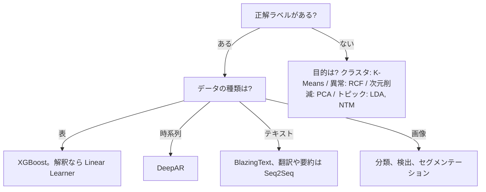
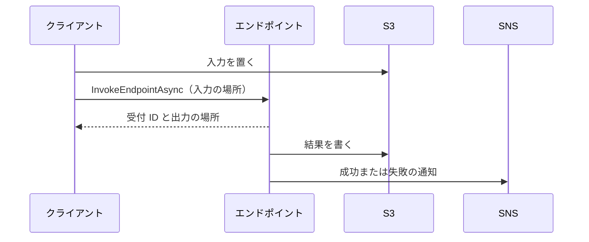

# Amazon SageMaker AI

[:material-sprout: CLF](../courses/clf/services.md){ .exam-badge .exam-foundational } [:material-sprout: AIF](../courses/aif/services.md){ .exam-badge .exam-foundational } [:material-sprout: AIB](../courses/aib/services.md){ .exam-badge .exam-foundational } [:material-certificate: SAA](../courses/saa/services.md){ .exam-badge .exam-associate } [:material-certificate: DEA](../courses/dea/services.md){ .exam-badge .exam-associate } [:material-certificate: MLA](../courses/mla/services.md){ .exam-badge .exam-associate } [:material-star-circle: SAP](../courses/sap/services.md){ .exam-badge .exam-professional } [:material-star-circle: AIP](../courses/aip/services.md){ .exam-badge .exam-professional } [:material-target: SCS](../courses/scs/services.md){ .exam-badge .exam-specialty }

ML モデルの準備、学習、デプロイ、監視をまとめて行うマネージドサービスです。MLA-C02 の中心で、AIP-C01、AIF-C01 にも出ます。

[](../assets/diagrams/sagemaker-mlops.png)

!!! warning "名前と提供状況（2026 年 10 月時点）"
    旧来の「Amazon SageMaker」のうち、ML の部分は **Amazon SageMaker AI** という名前です。**Amazon SageMaker** は分析と AI の統合プラットフォームの名前に変わりました。

    次の機能は**新規顧客の受付を終了**しています。既存の顧客は使い続けられますが、新機能は追加されません。

    | 機能 | 公式が示す移行先 |
    |---|---|
    | Clarify | SHAP ライブラリ、指標の自前計算、MLflow、CloudWatch。FM の評価は Bedrock Evaluations |
    | Model Monitor | 公開の監視ソリューション（MLflow Apps と Evidently AI）、QuickSight、CloudWatch |
    | Debugger | MLflow、TensorBoard、CloudWatch |
    | Ground Truth | 公式の案内なし |
    | Augmented AI（A2I） | 公式の案内なし（[別ページ](ai-managed-services.md#a2i)） |

    AIP-C01 の対象一覧には Clarify、Ground Truth、Model Monitor が今も載っています。MLA-C02 のスキルでは MLflow on SageMaker AI と「ドリフト検知パイプライン」が名指しされています。両方を理解しておきます。

| 段階 | 機能 | 節 |
|---|---|---|
| 開発環境 | Studio、Unified Studio | [Studio](#studio) |
| データ準備 | Processing、Data Wrangler、Feature Store、Ground Truth | [データ準備](#data-prep) |
| 学習 | Training、スクリプトモード、AMT、分散学習 | [学習](#training) |
| アルゴリズム | 組み込みアルゴリズム、JumpStart | [アルゴリズム](#algorithms) |
| 評価と説明 | MLflow、Clarify、Debugger | [評価と説明](#evaluation) |
| デプロイ | エンドポイント、バッチ変換 | [エンドポイント](#endpoints) |
| 最適化 | Neo、推論最適化、自動スケーリング、インスタンス選択 | [最適化](#optimization) |
| MLOps | Pipelines、Model Registry、Projects | [MLOps](#mlops) |
| 監視 | Model Monitor、CloudWatch | [監視](#monitoring) |
| セキュリティ | VPC、ネットワーク分離、IAM | [セキュリティ](#security) |

## 開発環境 {#studio}

### SageMaker Studio {#sagemaker-studio}

ML の作業全体を行う Web の開発環境です。

| 項目 | 内容 |
|---|---|
| ドメイン | ユーザー、ストレージ、ネットワークの設定をまとめる単位 |
| IDE | JupyterLab、Code Editor（Code-OSS ベース）、RStudio |
| 画面 | ジョブ、エンドポイント、モデルなどを 1 つの UI で扱う |
| Studio Classic | 以前の体験。既存の作業向けに維持されるが、新規オンボーディングは不可 |

**落とし穴:** JupyterLab アプリを停止し忘れると、インスタンスの料金が続きます。

### SageMaker Unified Studio の位置づけ {#unified-studio}

[:material-star-circle: AIP](../courses/aip/services.md){ .exam-badge .exam-professional }

| | SageMaker AI Studio | SageMaker Unified Studio |
|---|---|---|
| 属するもの | SageMaker AI | 次世代の Amazon SageMaker |
| 対象 | ML の開発者 | データ、分析、AI、ML の統合 |
| 単位 | ドメイン、ユーザープロファイル | プロジェクト。管理者がユーザーとリソースを用意する |
| 使う場面 | ML の開発に集中する | データ分析から AI まで同じ場所で進める |

### その他の開発向け機能 {#other-dev}

| 機能 | 内容 |
|---|---|
| Canvas | コードなしで予測モデルを作る。Data Wrangler は Canvas に統合された。Autopilot の UI も Canvas へ移行 |
| Autopilot（AutoML） | モデルの自動作成。コードを書く人は API を引き続き使える |
| HyperPod | 大規模な FM の学習向けの耐障害クラスター。Slurm または EKS で管理する |

## データ準備 {#data-prep}

データの取り込みと変換の全体像は[データエンジニアリング](data-engineering.md)を、特徴量の考え方は[特徴量エンジニアリング](ai-fundamentals.md#feature-engineering)を参照してください。

### Processing {#processing}

[:material-star-circle: AIP](../courses/aip/services.md){ .exam-badge .exam-professional }

前処理、後処理、評価を、マネージドなコンテナのジョブとして実行します。

| 項目 | 内容 | 例 |
|---|---|---|
| 入力 | S3 から `/opt/ml/processing/input` などにコピー | `s3://bucket/raw/` |
| 出力 | 指定のパスから S3 へアップロード | `/opt/ml/processing/output/train` |
| コンテナ | scikit-learn、Spark、独自 | `SKLearnProcessor`、`PySparkProcessor` |
| 課金 | ジョブの実行中だけ | |

```python
from sagemaker.processing import ProcessingInput, ProcessingOutput
from sagemaker.sklearn.processing import SKLearnProcessor

processor = SKLearnProcessor(
    framework_version="1.2-1", role=role,
    instance_type="ml.m5.xlarge", instance_count=2,
)
processor.run(
    code="preprocess.py",
    inputs=[ProcessingInput(source="s3://bucket/raw/",
                            destination="/opt/ml/processing/input")],
    outputs=[ProcessingOutput(source="/opt/ml/processing/output/train",
                              destination="s3://bucket/train/")],
)
```

**落とし穴:** `/opt/ml/processing/output` の外に書いたファイルは S3 に残りません。

### Data Wrangler {#data-wrangler}

[:material-star-circle: AIP](../courses/aip/services.md){ .exam-badge .exam-professional }

データの取り込み、変換、分析を画面で行う機能です。**Canvas に統合され**、自然言語でも変換できます。

| 機能 | 内容 |
|---|---|
| 取り込み | S3、Athena、Redshift など |
| 変換 | 欠損の補完、エンコード、標準化など |
| 分析 | 分布、データ品質、ターゲットとの関係 |
| 出力 | Feature Store、Pipelines、S3 へ |

**使い分け:**

| ツール | 向いている場面 |
|---|---|
| Data Wrangler | ML の前処理を画面で試す |
| Glue DataBrew | 分析担当が画面でデータを整える |
| Glue（Spark） | 大規模な ETL をコードで |
| EMR | Spark クラスターを細かく制御する |
| Processing | ML のパイプラインにコードで組み込む |

### Feature Store {#feature-store}

特徴量を保存して共有する機能です。学習と推論で同じ特徴量を使えるので、**学習と推論のずれ（training-serving skew）** を減らせます。

| 項目 | 内容 |
|---|---|
| フィーチャーグループ | 特徴量の定義とデータの単位 |
| `RecordIdentifierFeatureName` | レコードの ID（必須） |
| `EventTimeFeatureName` | イベント時刻（必須） |
| オンラインストア | 最新のレコードだけ。低遅延の読み取りで推論向け |
| オフラインストア | 全履歴を S3 に保存。学習やバッチ推論向け |

| 設定 | 値 | 内容 |
|---|---|---|
| オンラインの `StorageType` | `Standard`、`Standard_V2`、`InMemory` | ストレージの層 |
| `TtlDuration` | | 期限を過ぎたレコードを削除 |
| オフラインの `TableFormat` | `Glue`、`Iceberg` | テーブル形式 |

**取り込み:**

| 方法 | 使いどころ |
|---|---|
| `PutRecord` API | ストリームやバッチから 1 件ずつ |
| Spark コネクタ | 大量のバッチ |
| Data Wrangler / Canvas | 前処理の結果を出力 |

**具体例:** 不正検知で「直近 1 時間の取引回数」を Kinesis から Lambda で計算し、`PutRecord` で書きます。推論では `GetRecord` で最新値を取ります。学習ではオフラインストアを Athena で検索し、当時の値を使います。

**落とし穴:** オンラインストアだけの設定では履歴が残らず、後から学習に使えません。

### Ground Truth {#ground-truth}

[:material-star-circle: AIP](../courses/aip/services.md){ .exam-badge .exam-professional }

!!! warning "新規受付終了"
    Ground Truth は新規顧客を受け付けていません。

データにラベルを付ける機能です。

| 項目 | 内容 |
|---|---|
| ワークフォース | ベンダー、プライベート（Cognito または OIDC で管理） |
| タスク種別 | 画像（バウンディングボックス、分類、セグメンテーション）、テキスト（分類、固有表現）、動画、3D 点群 |
| 自動ラベル付け | アクティブラーニング。信頼度の高いデータはモデルが、低いデータは人がラベルを付ける |
| カスタムワークフロー | 独自の UI と処理 |

**自動ラベル付けの流れ:** 人が付けたラベルで学習 → 信頼度のしきい値を決める → しきい値以上は自動で付ける → 残りの低信頼のデータを人に送る → 繰り返す。データが多いほど効果があります。

## 学習 {#training}

### 学習ジョブの設定 {#training-job}

| 項目 | 内容 | 例 | 誤ったときの症状 |
|---|---|---|---|
| `AlgorithmSpecification` | 学習イメージと入力モード | `TrainingInputMode: FastFile` | |
| `InputDataConfig` | チャネル | `train`、`validation` | チャネル名の誤りで実行時エラー |
| `OutputDataConfig` | 成果物の S3 パス | `s3://bucket/model/` | 権限不足で最後に失敗 |
| `ResourceConfig` | インスタンスと EBS | `ml.m5.xlarge` × 2、50 GB | 容量不足で `No space left` |
| `StoppingCondition` | 最大実行時間 | `MaxRuntimeInSeconds: 86400` | 上限で停止 |
| `RoleArn` | 実行ロール | | S3 の `AccessDenied` |
| `VpcConfig` | VPC の接続 | | S3 エンドポイントがないと到達できない |

### 入力モード {#input-modes}

| モード | 動作 | 向いている場面 |
|---|---|---|
| File（既定） | 全データをローカルにダウンロード | 小さなデータ |
| FastFile | S3 を POSIX ファイルとして見せ、必要な分だけ読む | 大きなデータ。順次読みが最適。ほぼ Pipe の後継 |
| Pipe | 名前付きパイプでストリーム | 既存の Pipe 対応のコード |

**症状と対応:** File モードで開始までが長いなら、データのダウンロードが原因です。FastFile に変えます。EFS や FSx のチャネルは File モードを使います。

### スクリプトモード {#script-mode}

AWS が用意したフレームワークのコンテナで、自分の学習スクリプトを動かす方法です。独自コンテナを作らなくて済みます。

| コンテナ内のパス | 内容 | 環境変数 |
|---|---|---|
| `/opt/ml/input/data/<チャネル名>` | 入力データ | `SM_CHANNEL_<チャネル名>` |
| `/opt/ml/model` | ここに保存したモデルが `model.tar.gz` で S3 へ | `SM_MODEL_DIR` |
| `/opt/ml/output/data` | その他の成果物 | `SM_OUTPUT_DATA_DIR` |

```python
# SageMaker Python SDK V2 の例です。V3 では Estimator が廃止され、ModelTrainer を使います
from sagemaker.pytorch import PyTorch

estimator = PyTorch(
    entry_point="train.py", source_dir="src",
    framework_version="2.3", py_version="py311",
    role=role, instance_type="ml.g5.xlarge", instance_count=1,
    hyperparameters={"epochs": 10, "batch-size": 64, "lr": 0.001},
    use_spot_instances=True, max_run=3600, max_wait=7200,
    checkpoint_s3_uri="s3://bucket/ckpt/",
)
estimator.fit({"train": "s3://bucket/train/", "validation": "s3://bucket/val/"})
```

**落とし穴:** `/opt/ml/model` 以外に保存したモデルは失われます。依存パッケージは `source_dir` の `requirements.txt` に書きます。

### マネージドスポット学習 {#spot-training}

| 項目 | 内容 |
|---|---|
| 効果 | オンデマンドより最大 90% 安い |
| `EnableManagedSpotTraining` | `True` にする |
| `MaxWaitTimeInSeconds` | 待ちを含む上限。`MaxRuntimeInSeconds` より大きくする |
| チェックポイント | 中断後の再開に使う。ローカルから S3 へコピーされる |
| 制約 | **オンデマンドへのフォールバックはない**。容量がなければ上限まで待って失敗 |

チェックポイントを使わない組み込みアルゴリズムは、`MaxWaitTimeInSeconds` が 3,600 秒に制限されます。

**節約率の計算:** 課金時間 100 秒、学習時間 500 秒なら、(1 − 100/500) × 100 = 80% です。

### 自動モデルチューニング（AMT） {#amt}

ハイパーパラメータの最適な組み合わせを、複数の学習ジョブで探します。

| 戦略 | 動作 | 向いている場面 | 注意 |
|---|---|---|---|
| Bayesian | 過去の結果から次を予測する | 既定の選択。試行数を減らす | 並列数を増やしすぎると学習効果が減る |
| Random | ランダムに選ぶ | 並列で一気に試す | 前の結果を使わない |
| Grid | 全組み合わせ | カテゴリ値を網羅 | カテゴリのパラメータのみ。`MaxNumberOfTrainingJobs` は不要 |
| Hyperband | 途中の結果で資源を配分し、悪いものを止める | エポックごとに指標を出す反復型 | `TrainingJobEarlyStoppingType` は `Off` にする |

```json
{
  "Strategy": "Bayesian",
  "HyperParameterTuningJobObjective": {"Type": "Maximize", "MetricName": "validation:auc"},
  "ResourceLimits": {"MaxNumberOfTrainingJobs": 50, "MaxParallelTrainingJobs": 5},
  "TrainingJobEarlyStoppingType": "Auto",
  "ParameterRanges": {
    "ContinuousParameterRanges": [
      {"Name": "eta", "MinValue": "0.01", "MaxValue": "0.3", "ScalingType": "Logarithmic"}
    ],
    "IntegerParameterRanges": [
      {"Name": "max_depth", "MinValue": "3", "MaxValue": "10", "ScalingType": "Auto"}
    ]
  }
}
```

| 機能 | 内容 |
|---|---|
| 早期停止 | `Auto` にすると、エポックごとの目的指標が過去の中央値より悪いジョブを止める。エポックごとに指標を出すアルゴリズムが必要 |
| ウォームスタート `IDENTICAL_DATA_AND_ALGORITHM` | 同じデータとイメージで範囲を変えて続ける |
| ウォームスタート `TRANSFER_LEARNING` | データや範囲を変えて、過去の知見を使う |
| ウォームスタートの制約 | 親は最大 5 個、すべて終了状態。目的指標は同じ |
| スケーリング | `Logarithmic` は 0.001〜1 のように桁が変わる範囲に |

**具体例:** 学習率を 0.0001〜1 で線形に探すと、ほとんどの試行が大きな値になります。`Logarithmic` にします。

### 分散学習と時間短縮 {#distributed-training}

| 手法 | 内容 | 使いどころ |
|---|---|---|
| データ並列（SMDDP） | データを分割し、複数の GPU で勾配を集約 | データが大きい |
| モデル並列（SMP） | モデルを複数の GPU に分割 | モデルが 1 枚に載らない |
| 早期停止 | 改善が止まったら終わる | 時間と過学習の抑制 |
| HyperPod | 長時間の大規模学習。ノード障害から回復 | FM の学習 |
| トレーニングプラン | GPU の容量を予約 | 計画的な学習 |

**コストと時間:** インスタンスを増やすと時間は減りますが、通信のために比例しては減りません。安いのは、スポット、チェックポイント、適切なサイズの組み合わせです。

### 収束の問題 {#convergence}

| 症状 | 原因の候補 | 対応 |
|---|---|---|
| 損失が発散、`NaN` | 学習率が高い、勾配爆発、データに欠損 | 学習率を下げる、勾配クリッピング、データを確認 |
| 損失が下がらない | 学習率が低い、初期値が悪い、バグ | 学習率を上げる、少量のデータで過学習できるか試す |
| 勾配消失 | 深すぎる、活性化関数 | ReLU、残差接続、正規化 |
| 検証の損失だけ上がる | 過学習 | [正則化、早期停止](ai-fundamentals.md#regularization) |
| GPU の使用率が低い | データ読み込みが遅い | FastFile、ローダーの並列化 |

### Debugger {#debugger}

!!! warning "新規受付終了"
    Debugger は新規顧客を受け付けていません。公式の移行先は次のとおりです。

| Debugger の機能 | 移行先 |
|---|---|
| 学習の指標 | MLflow、TensorBoard |
| ハイパーパラメータとモデルの記録 | MLflow |
| 勾配、活性化、重みの分析 | TensorBoard |
| CPU、GPU、メモリ、ディスクのプロファイル | CloudWatch |
| 自動の診断 | CloudWatch アラームと MLflow |

Debugger は学習中のテンソルを保存し、組み込みルール（損失が下がらない、勾配消失など）で検査します。問題が見つかればメール通知やジョブの停止ができました。

## アルゴリズムの選び方 {#algorithms}

### 組み込みアルゴリズム {#built-in-algorithms}

| 問題 | データ | アルゴリズム | 覚えること |
|---|---|---|---|
| 分類、回帰 | 表 | **XGBoost** | 勾配ブースティング。表データの第一候補。CSV、Parquet など |
| 分類、回帰 | 表 | LightGBM、CatBoost | CatBoost はカテゴリ列に強い |
| 分類、回帰 | 表 | **Linear Learner** | 線形。解釈しやすい。CSV、recordIO-protobuf |
| 分類、回帰 | 表 | AutoGluon-Tabular | 複数モデルの積み重ね |
| 分類、回帰 | 表 | TabTransformer | Transformer を表に適用 |
| 分類、回帰 | 高次元の疎データ | **Factorization Machines** | 特徴量の相互作用。クリック予測、レコメンド |
| 分類、回帰 | 表 | k-NN | 近いデータで判定 |
| 時系列予測 | 時系列 | **DeepAR** | 似た系列が多数あるときに強い（RNN） |
| 埋め込み | ペア | **Object2Vec** | 重複チケットの検出など |
| 次元削減 | 表 | **PCA** | 列を減らす |
| 異常検知 | 表 | **Random Cut Forest** | スコアが高いほど異常。ラベル不要 |
| IP の異常 | IPv4 と主体の組 | **IP Insights** | 不審なログイン |
| クラスタリング | 表 | **K-Means** | グループ分け。CPU を推奨 |
| トピック | テキスト | **LDA**、**NTM** | 教師なしで話題を見つける |
| テキスト分類、単語埋め込み | テキスト | **BlazingText** | Word2vec と分類。高速 |
| テキスト分類 | テキスト | Text Classification - TensorFlow | 転移学習 |
| 翻訳、要約 | テキスト | **Seq2Seq** | 系列から系列へ |
| 画像分類 | 画像 | Image Classification（MXNet、TensorFlow） | |
| 物体検出 | 画像 | Object Detection（MXNet、TensorFlow） | 位置とクラス |
| 画素単位の分類 | 画像 | **Semantic Segmentation** | 自動運転など |

**選び方の流れ:**



**モデルと手段の選び方:**

| 要件 | 選択 |
|---|---|
| 解釈可能性が必要 | Linear Learner、決定木系と SHAP |
| 学習なしで使いたい | [マネージド AI サービス](ai-managed-services.md) |
| 文章の生成 | [Bedrock](genai-apps.md) |
| 独自の FM を調整 | JumpStart、SageMaker AI、Bedrock のカスタマイズ |

### JumpStart {#jumpstart}

[:material-sprout: AIF](../courses/aif/services.md){ .exam-badge .exam-foundational } [:material-star-circle: AIP](../courses/aip/services.md){ .exam-badge .exam-professional }

事前学習済みのモデル（FM を含む）、ソリューションテンプレート、ノートブックのハブです。

| 機能 | 内容 |
|---|---|
| デプロイ | Studio の Models の画面から、設定済みのエンドポイントへ |
| ファインチューニング | 自分のデータで調整する |
| 評価 | モデルを比較する |
| ソリューションテンプレート | よくある用途のインフラをまとめて作る |

**Bedrock との違い:** JumpStart は自分のアカウントのインスタンスで動かすのでインスタンス単位の課金で、インスタンスを管理します。Bedrock は API でトークン課金です。

**外部で作ったモデルの持ち込み:**

| 方法 | 使いどころ |
|---|---|
| `model.tar.gz` を S3 に置き、推論コンテナで `CreateModel` | SageMaker AI で動かす |
| 独自コンテナ（ECR） | 独自の依存関係 |
| [Custom Model Import](genai-apps.md#custom-model-import) | Bedrock の API で使いたい |

## 評価と説明 {#evaluation}

### MLflow on SageMaker AI {#mlflow}

実験の記録、比較、モデルの管理を行うマネージドの MLflow です。

| 項目 | 内容 |
|---|---|
| 記録するもの | パラメータ、指標、成果物 |
| 形態 | MLflow Tracking Server（単一 AZ で起動）、MLflow Apps |
| アクセス制御 | IAM |
| Model Registry との関係 | MLflow に登録したモデルは SageMaker Model Registry と連携できる |

**再現可能な実験:** データのバージョン、コードのコミット、ハイパーパラメータを記録します。

### Clarify {#clarify}

[:material-star-circle: AIP](../courses/aip/services.md){ .exam-badge .exam-professional }

!!! warning "新規受付終了"
    Clarify は新規顧客を受け付けていません。公式の代替は、指標を pandas などで自前計算する、SHAP を直接使う、FM の評価には Bedrock Evaluations を使う、というものです。Bedrock Evaluations は表データのバイアス検出の代わりにはなりません。

Clarify はバイアスの検出と説明を Processing ジョブとして実行します。

| タイミング | 内容 |
|---|---|
| 学習前 | データのバイアス |
| 学習後 | モデルの予測のバイアス |
| 説明 | SHAP による特徴量の寄与、部分依存プロット |

### Clarify のバイアス指標 {#clarify-metrics}

**学習前:**

| 指標 | 意味 | 計算例 |
|---|---|---|
| CI（クラスの不均衡） | 集団の人数の差 | (n_a − n_d) / (n_a + n_d)。800 人と 200 人で (800−200)/1000 = **0.6** |
| DPL（ラベルの割合の差） | 陽性ラベルの割合の差 | q_a − q_d。480/800 = 0.6、60/200 = 0.3 で **0.3** |
| KL、JS | 分布の違い | |
| LP、TVD、KS | 分布の距離 | |
| CDD | 条件付きの格差 | サブグループごとに見る |

**学習後:**

| 指標 | 意味 |
|---|---|
| DPPL | 予測の陽性割合の差 |
| DI（Disparate Impact） | 予測の陽性割合の比。q'_d / q'_a。0.3 / 0.6 = **0.5** |
| AD | 精度の差 |
| RD | 再現率の差 |
| SD | 特異度の差 |
| DCAcc、DCR、DAR、DRR | 受け入れ、拒否に関する差 |
| TE | 偽陰性と偽陽性の比の差 |
| FT、GE、CDDPL | 反事実の検査など |

**マルチモーダルでの考え方:** テキストや画像でも、属性ごとに件数と結果を集計すれば同じ計算ができます。

**バイアスの緩和:** [データの再サンプリング](ai-fundamentals.md#data-quality)、重み付け、集団ごとのしきい値。

### Model Cards {#model-cards}

モデルの用途、学習データ、評価、リスクを 1 か所に記録します。Model Registry と統合されています。AIF の「透明性」、AIP の「プログラムによるモデルカード」でよく問われます。PDF にエクスポートできます。

## エンドポイントと推論 {#endpoints}

| 種類 | 入力の上限 | 処理時間の上限 | スケーリング | 向いている場面 |
|---|---|---|---|---|
| [リアルタイム](#realtime) | 6 MB | 60 秒 | 自動スケーリング | 常に低遅延 |
| [サーバーレス](#serverless) | ― | ― | 自動 | 断続的、コールドスタートを許容 |
| [非同期](#async) | 1 GB | 1 時間 | 0 まで縮小可 | 大きな入力、長い処理 |
| [バッチ変換](#batch-transform) | `MaxPayloadInMB` 最大 100 MB | ― | ジョブの間だけ | データセット全体 |

**作成の順序:** `CreateModel` → `CreateEndpointConfig` → `CreateEndpoint`。呼び出しは `sagemaker-runtime` の `InvokeEndpoint` です。

### リアルタイム {#realtime}

```python
sm.create_endpoint_config(
    EndpointConfigName="churn-v3",
    ProductionVariants=[{
        "VariantName": "AllTraffic",
        "ModelName": "churn-model-v3",
        "InstanceType": "ml.m5.xlarge",
        "InitialInstanceCount": 2,
        "InitialVariantWeight": 1.0,
    }],
)
sm.create_endpoint(EndpointName="churn", EndpointConfigName="churn-v3")

runtime = boto3.client("sagemaker-runtime")
resp = runtime.invoke_endpoint(
    EndpointName="churn", ContentType="text/csv", Body="34,2,120.5"
)
```

| 項目 | 内容 |
|---|---|
| ペイロード | `Body` は最大 6,291,456 バイト（約 6 MB） |
| タイムアウト | コンテナは 60 秒以内に応答。50〜60 秒かかるなら SDK のソケットタイムアウトを 70 秒に |
| ヘルスチェック | コンテナの `/ping` に応答する |
| 可用性 | インスタンスを 2 台以上にすると複数の AZ に分散 |

**症状:** 60 秒を超える処理は失敗します。[非同期](#async)に変えます。

### サーバーレス {#serverless}

インスタンスの管理が不要で、呼び出しがない間はコンピュートの料金がかかりません。

| 設定 | 範囲 | 内容 |
|---|---|---|
| `MemorySizeInMB` | 1024、2048、3072、4096、5120、6144 | メモリに比例して vCPU が増える。少なくともモデルサイズ以上に |
| `MaxConcurrency` | 1〜200 | 超えるとスロットリング |
| `ProvisionedConcurrency` | 1〜200 | ウォーム状態の数。予測できるバーストに |

```python
"ServerlessConfig": {"MemorySizeInMB": 2048, "MaxConcurrency": 20, "ProvisionedConcurrency": 5}
```

| 項目 | 内容 |
|---|---|
| コンテナイメージ | 最大 10 GB |
| エフェメラルディスク | 5 GB |
| 同時実行の合計 | リージョンにより 1,000 または 500 |
| エンドポイント数 | リージョンあたり 50 |
| 非対応 | GPU、Marketplace のモデルパッケージ、プライベートレジストリ、マルチモデル、VPC の設定、ネットワーク分離、データキャプチャ、複数バリアント、Model Monitor、推論パイプライン |

**コールドスタート:** `OverheadLatency` メトリクスで確認します。減らすには Provisioned Concurrency を使います。

**落とし穴:** リアルタイムからサーバーレスへは変更できず、`ValidationError` になります。逆はできますが戻せません。GPU や VPC が必要なら、サーバーレスは選べません。

### 非同期 {#async}

リクエストを内部のキューに入れて処理し、結果を S3 に置きます。



```python
"AsyncInferenceConfig": {
    "OutputConfig": {
        "S3OutputPath": "s3://bucket/async-out/",
        "NotificationConfig": {"SuccessTopic": success_arn, "ErrorTopic": error_arn},
    },
    "ClientConfig": {"MaxConcurrentInvocationsPerInstance": 4},
}
```

| 項目 | 内容 |
|---|---|
| ペイロード | 最大 1 GB |
| 処理時間 | 最大 1 時間 |
| `MaxConcurrentInvocationsPerInstance` | 1〜1,000 |
| スケーリングの指標 | `ApproximateBacklogSizePerInstance` |
| ゼロへの縮小 | `MinCapacity=0` が可能 |

**落とし穴:** 0 台のときは、キューが目標値を超えるまでスケールアウトしません。少ない要求でも起動させるには、`HasBacklogWithoutCapacity` に基づくステップスケーリングを追加します。このエンドポイントは非同期の呼び出ししか受けません。

### バッチ変換 {#batch-transform}

S3 のデータセット全体を推論します。常設のエンドポイントは不要です。

```python
sm.create_transform_job(
    TransformJobName="score-20261031",
    ModelName="churn-model-v3",
    MaxConcurrentTransforms=4,
    MaxPayloadInMB=6,
    BatchStrategy="MultiRecord",
    TransformInput={
        "DataSource": {"S3DataSource": {"S3DataType": "S3Prefix", "S3Uri": "s3://bucket/in/"}},
        "ContentType": "text/csv", "SplitType": "Line",
    },
    TransformOutput={"S3OutputPath": "s3://bucket/out/", "AssembleWith": "Line"},
    TransformResources={"InstanceType": "ml.m5.xlarge", "InstanceCount": 2},
    DataProcessing={"InputFilter": "$[1:]", "JoinSource": "Input", "OutputFilter": "$[0,-1]"},
)
```

| 設定 | 内容 | 既定、範囲 |
|---|---|---|
| `MaxPayloadInMB` | 1 回の HTTP リクエストの大きさ | 既定 6、最大 100 |
| `MaxConcurrentTransforms` | インスタンスあたりの並列リクエスト | `MaxConcurrentTransforms × MaxPayloadInMB` は 100 以下 |
| `BatchStrategy` | `SingleRecord` または `MultiRecord` | `SplitType` が必要 |
| `SplitType` | `Line` など | `None` だと 1 ファイルを 1 リクエスト |
| `InputFilter` / `JoinSource` / `OutputFilter` | ID を除いて推論し、結果と結合する | JSONPath |

**具体例:** 1 列目が顧客 ID の CSV で、`InputFilter` で ID を除いて推論し、`JoinSource=Input` で結果を結合し、`OutputFilter` で ID と予測だけ残します。

**落とし穴:** 1 ファイルを複数のインスタンスで処理すると、1 台しか働きません。ファイルを分割するか `SplitType` を設定します。CSV に改行を含む値があると分割できません。

### マルチモデル、マルチコンテナ、推論パイプライン {#multi-model}

| 方式 | 内容 | 呼び出し | 使いどころ |
|---|---|---|---|
| マルチモデル（MME） | 同じコンテナで多数のモデルを共有。S3 から動的に読み込む | `TargetModel` で指定 | 顧客ごとのモデルが数千ある |
| マルチコンテナ | 別フレームワークのコンテナを同居 | `TargetContainerHostname` で直接、または順番に | 異なるフレームワーク |
| 推論パイプライン | 2〜15 個のコンテナを順に実行 | 通常の呼び出し | 前処理 → 推論 → 後処理。バッチにも使える |
| 推論コンポーネント | 1 つのエンドポイントに複数モデルを載せ、モデルごとに CPU、GPU、メモリを割り当てる | `InferenceComponentName` | 複数の FM の共有、アダプター |

**LoRA アダプター:** FM を推論コンポーネントで載せておき、S3 のアダプターを指す**アダプター推論コンポーネント**を作ります。基盤モデルの計算資源を共有し、直接呼び出せます。FM ごとに丸ごとデプロイするより安く済みます。

**MME の動作:** 初回の呼び出しで S3 から読み込むので遅延が出ます。メモリが足りなくなると使っていないモデルをアンロードします。モデルを追加するには S3 に置くだけで、エンドポイントの更新は要りません。

**MME が向かない場合:** モデルごとにサイズや遅延が大きく異なるとき、特定のモデルの TPS が高いとき。これらは専用のエンドポイントにします。

### デプロイとテストの戦略 {#deployment-strategies}

**デプロイガードレール（既定はブルー/グリーン）:**

| 方式 | 動作 | 注意 |
|---|---|---|
| All at once | 全トラフィックを一度にグリーンへ移す。ベイク期間に監視 | 最も速い |
| Canary | 一部を移して様子を見てから残りを移す | カナリアはグリーンの 50% 以下 |
| Linear | 段階的に移す | 各段階はグリーンの 10〜50% |
| Rolling | バッチごとに更新し、古いインスタンスを順に削除 | 追加の容量を抑えられる |

CloudWatch アラームが発報すると、自動で元に戻ります。ベイク期間はアラームを監視する待ち時間です。

**本番に近い検証:**

| 方式 | 内容 | 利用者への影響 |
|---|---|---|
| A/B（本番バリアント） | `InitialVariantWeight` で配分。`UpdateEndpointWeightsAndCapacities` で変更 | あり |
| 特定バリアントの指定 | `TargetVariant` | 指定した分のみ |
| シャドウテスト | 本番のリクエストのコピーを新しいバリアントに送る。応答は返さない | なし |

**具体例:** 新モデルの遅延を、利用者に影響させず確かめるならシャドウテストです。その後 10% だけ A/B で流し、業務指標を比べて増やします。

## 最適化 {#optimization}

### 自動スケーリング {#autoscaling}

Application Auto Scaling を使います。

```bash
aws application-autoscaling register-scalable-target \
  --service-namespace sagemaker \
  --resource-id endpoint/churn/variant/AllTraffic \
  --scalable-dimension sagemaker:variant:DesiredInstanceCount \
  --min-capacity 2 --max-capacity 10

aws application-autoscaling put-scaling-policy \
  --policy-name invocations-70 \
  --service-namespace sagemaker \
  --resource-id endpoint/churn/variant/AllTraffic \
  --scalable-dimension sagemaker:variant:DesiredInstanceCount \
  --policy-type TargetTrackingScaling \
  --target-tracking-scaling-policy-configuration file://config.json
```

```json
{
  "TargetValue": 70.0,
  "PredefinedMetricSpecification": {
    "PredefinedMetricType": "SageMakerVariantInvocationsPerInstance"
  },
  "ScaleInCooldown": 600,
  "ScaleOutCooldown": 300
}
```

| 指標 | 頻度 | 使いどころ |
|---|---|---|
| `SageMakerVariantInvocationsPerInstance` | 1 分 | 標準。1 件の処理時間が安定している |
| `SageMakerVariantConcurrentRequestsPerModelHighResolution` | 10 秒 | 急増に速く反応。LLM のストリーミングも最後のトークンまで数える |
| `ConcurrentRequestsPerCopy` | 10 秒 | 推論コンポーネント |
| CPU、GPU の使用率（カスタム） | 1 分 | CPU や GPU が先に飽和するモデル |
| `ApproximateBacklogSizePerInstance`（カスタム） | | 非同期 |

| 設定 | 誤ったときの症状 |
|---|---|
| `TargetValue` が高すぎる | 遅延が増え、スケールが間に合わない |
| `ScaleInCooldown` が短すぎる | 増減を繰り返す |
| 指標が処理の負荷を反映しない | GPU が飽和してもスケールしない。GPU の指標に変える |

**ゼロへの縮小:** スケールイン後は推論できません。ステップスケーリングと CloudWatch アラームで起動させますが、起動に数分かかります。その間のリクエストは失敗します。

**GPU の推論:** 起動に時間がかかるので、モデルの読み込みを含めて早めに増やします。LLM は同時リクエスト数の指標が向きます。

### インスタンスの選び方 {#instance-selection}

| 区分 | ファミリーの例 | 用途 |
|---|---|---|
| 汎用、CPU | `ml.m5`、`ml.c5` | 表データの学習と推論 |
| GPU | `ml.g5`、`ml.p4d`、`ml.p5` | 深層学習、LLM |
| Inferentia（推論専用） | `ml.inf1`、`ml.inf2` | 推論のコストと性能 |
| Trainium（学習専用） | `ml.trn1`、`ml.trn2` | 深層学習の学習コスト |

| チップ | EC2 の世代 | ポイント |
|---|---|---|
| AWS Inferentia | Inf1、Inf2 | 推論向け。AWS Neuron SDK が必要 |
| AWS Trainium | Trn1、Trn1n、Trn2 | 学習向け。AWS Neuron SDK が必要。Trainium へのコンパイルも Neuron |

**落とし穴:** Inferentia や Trainium は CUDA 向けのコードがそのまま動きません。モデルを Neuron でコンパイルする必要があります。

**購入の選択肢:**

| 選択肢 | 効果 | 使いどころ |
|---|---|---|
| オンデマンド | 基準 | 変動する負荷 |
| Managed Spot | 最大 90% 割引 | 中断できる学習 |
| SageMaker AI Savings Plans | 最大 64% 割引。1 年か 3 年の使用量コミット | 継続する利用 |
| トレーニングプラン | GPU 容量の予約 | 大規模な学習 |

### Inference Recommender と推論の最適化 {#inference-optimization}

| 機能 | 内容 |
|---|---|
| Inference Recommender | ロードテストを自動化し、適切なインスタンスを勧める。ジョブのインスタンス分だけ課金 |
| 生成 AI の推論推奨 | モデルと負荷を分析し、最適化の適用と検証まで行う。LoRA アダプターも対象 |
| 手動の最適化 | 量子化、スペキュレイティブデコーディング、コンパイル |

| 手法 | 効果 |
|---|---|
| 量子化 | 重みの精度を下げ、メモリと遅延を減らす。精度が少し落ちることがある |
| スペキュレイティブデコーディング | 小さなモデルで候補を出して生成を速くする |
| コンパイル | ハードウェアに最適化する。精度は落ちない。GPU は TensorRT-LLM、Trainium と Inferentia は Neuron |

**コスト最適化の手順:** 推論の種類を選ぶ → Inference Recommender でサイズを決める → 複数のエンドポイントを統合する（マルチモデル、推論コンポーネント） → 自動スケーリング → Savings Plans。

### SageMaker Neo {#neo}

[:material-star-circle: AIP](../courses/aip/services.md){ .exam-badge .exam-professional }

学習済みモデルをコンパイルし、ターゲットのハードウェアで高速に動かします。

| 項目 | 内容 |
|---|---|
| 入力 | Gluon、Keras、MXNet、PyTorch、TensorFlow、TensorFlow Lite、ONNX |
| 出力先 | クラウドのインスタンス、エッジ（Ambarella、ARM、Intel、Nvidia、NXP、Qualcomm、TI、Xilinx の各プロセッサ） |
| 構成 | コンパイラとランタイム |

**現状:** SageMaker Edge Manager は 2024-04-26 に提供を終了しました。MLA-C02 では「エッジ向けの Neo での最適化」がスキルから除かれましたが、AIP-C01 の対象一覧には Neo が載っています。

## MLOps {#mlops}

### SageMaker Pipelines {#pipelines}

ML のワークフローを DAG で定義します。

| ステップ | 用途 |
|---|---|
| Processing | 前処理、評価 |
| Training、Tuning、AutoML | 学習 |
| Model | モデルの作成と登録 |
| Transform | バッチ推論 |
| Condition | 指標で分岐 |
| Callback | 外部の処理を待つ。SQS にトークンを送る |
| Lambda | 軽い処理 |
| ClarifyCheck、QualityCheck | ベースラインとの比較 |
| EMR、Notebook Job、Fail | Spark、ノートブック、明示的な失敗 |

| 機能 | 内容 |
|---|---|
| パラメータ | 実行時に値を渡す。例: 学習データのパス |
| ステップキャッシュ | 属性が同じなら前回の結果を再利用する |
| 同時実行 | アカウントの既定は 20 実行 |

```python
cond = ConditionGreaterThanOrEqualTo(
    left=JsonGet(step_name="Evaluate", property_file=report, json_path="metrics.auc"),
    right=0.85,
)
step_cond = ConditionStep(name="CheckAUC", conditions=[cond],
                          if_steps=[step_register], else_steps=[step_fail])
```

**使い分け:**

| ツール | 向いている場面 |
|---|---|
| SageMaker Pipelines | ML の専用機能が中心 |
| Step Functions | 多様な AWS サービスを含む業務の流れ |
| MWAA | Airflow の既存資産 |

### Model Registry {#model-registry}

[:material-star-circle: AIP](../courses/aip/services.md){ .exam-badge .exam-professional }

モデルのバージョンと承認を管理します。

| 用語 | 意味 |
|---|---|
| モデルパッケージグループ | 同じモデルのバージョンの集まり（既定 250 個まで） |
| モデルパッケージ | 1 つのバージョン |
| `ModelApprovalStatus` | `PendingManualApproval`、`Approved`、`Rejected` |

| 状態の変更 | 動作の例 |
|---|---|
| `PendingManualApproval` → `Approved` | CI/CD でデプロイ |
| `PendingManualApproval` → `Rejected` | 何もしない |
| `Approved` → `Rejected` | 最新の `Approved` を再デプロイ（ロールバック） |

```python
sm.update_model_package(
    ModelPackageArn=arn, ModelApprovalStatus="Approved",
    ApprovalDescription="AUC 0.91 で基準を満たす",
)
```

状態の変更を EventBridge で検知し、CodePipeline や Lambda を起動します。

### CI/CD と再学習 {#cicd-retraining}

| 仕組み | 内容 |
|---|---|
| SageMaker Projects | MLOps のテンプレート。コード、パイプライン、デプロイをまとめて作る |
| CodePipeline、CodeBuild | テスト、コンテナのビルド、デプロイ（[CI/CD](cicd.md)） |
| ECR | 学習と推論のイメージ |
| Inspector、CodeGuru | イメージとコードの脆弱性の検査 |
| CloudFormation、CDK | エンドポイントなどを IaC で（[IaC](iac.md)） |

| 再学習のきっかけ | 実装 |
|---|---|
| 定期 | EventBridge のスケジュールで Pipelines を開始 |
| 新しいデータ | S3 のイベントで開始 |
| ドリフト | CloudWatch アラーム → EventBridge → Pipelines |

**テスト:** データの検証、単体テスト、評価指標のしきい値（Condition ステップ）、シャドウテスト、段階的なデプロイ。

## 監視 {#monitoring}

### Model Monitor {#model-monitor}

[:material-star-circle: AIP](../courses/aip/services.md){ .exam-badge .exam-professional }

!!! warning "新規受付終了"
    Model Monitor は新規顧客を受け付けていません。公式の移行先は、公開の監視ソリューション（MLflow Apps と Evidently AI）、QuickSight、CloudWatch です。

| 監視の種類 | 検出するもの | 必要なもの |
|---|---|---|
| データ品質 | 入力の統計の変化、欠損、型 | データキャプチャとベースライン |
| モデル品質 | 精度などの低下 | ＋ 正解ラベル（後から結合） |
| バイアスドリフト | 集団間の差の変化 | Clarify の設定 |
| 特徴量の寄与のドリフト | SHAP の順位の変化 | Clarify の設定 |

**データキャプチャの設定:**

```python
"DataCaptureConfig": {
    "EnableCapture": True,
    "InitialSamplingPercentage": 20,
    "DestinationS3Uri": "s3://bucket/capture/",
    "CaptureOptions": [{"CaptureMode": "Input"}, {"CaptureMode": "Output"}],
}
```

**流れ:** ベースラインのジョブで統計（`statistics.json`）と制約を作る → 本番データを取得する → スケジュール（例: 毎時）で比較する → 結果を S3 と CloudWatch に出す → アラームで再学習を起動する。

**移行後の自前の構成:** Processing で Evidently AI を動かし、EventBridge Scheduler で定期実行し、SNS で通知します。

### ドリフトの種類 {#drift}

| 種類 | 意味 | 例 | 検出 |
|---|---|---|---|
| データドリフト | 入力の分布が変わる | 利用者の年齢層が変わる | 分布の距離 |
| コンセプトドリフト | 入力と正解の関係が変わる | 不正の手口が変わる | 正解ラベルとの比較 |
| 予測ドリフト | 出力の分布が変わる | 陽性の割合が急増 | 出力の統計 |
| バイアスドリフト | 集団間の差が変わる | ある集団だけ精度が落ちる | 集団別の指標 |

### CloudWatch のメトリクス {#cloudwatch-metrics}

| メトリクス | 意味 |
|---|---|
| `Invocations` | 呼び出し数 |
| `InvocationsPerInstance` | インスタンスあたり |
| `ModelLatency` | モデルの処理時間 |
| `OverheadLatency` | SageMaker AI の追加分。サーバーレスのコールドスタート |
| `Invocation4XXErrors`、`Invocation5XXErrors` | エラー |
| CPU、メモリ、GPU の使用率 | リソース |

**切り分け:** `ModelLatency` が大きければモデルやインスタンス、`OverheadLatency` が大きければコールドスタートなどの基盤側です。

詳細な監視は[オブザーバビリティ](observability.md)を参照してください。

## セキュリティ {#security}

### VPC とネットワーク分離 {#vpc-isolation}

| 設定 | 動作 | 例 |
|---|---|---|
| 既定 | コンテナからインターネットに出られる | |
| `VpcConfig` | 指定のサブネットと SG を使う。外に出るには NAT や VPC エンドポイントが必要 | モデルの `CreateModel` に指定 |
| `EnableNetworkIsolation` | コンテナからの外向き通信を一切禁止。S3 にも直接出られない。AWS 認証情報も渡されない | 機密データ。Marketplace の製品では必須 |
| インターフェイスエンドポイント | SageMaker API と Runtime を VPC 内から呼ぶ | |
| S3 ゲートウェイエンドポイント | 学習データとモデルの取得 | |

**症状と対応:**

| 症状 | 原因 |
|---|---|
| VPC 内の学習で S3 に接続できない | S3 エンドポイントも NAT もない |
| エンドポイントの作成が失敗 | ECR と S3 に到達できない、実行ロールの権限不足 |
| 分離モードでスクリプトが S3 を読めない | 仕様。入力チャネル経由で受け取る |

ネットワークの基本は[ネットワーク](networking.md)を参照してください。

### IAM と暗号化 {#iam-encryption}

| 対象 | 内容 |
|---|---|
| 実行ロール | ジョブやエンドポイントが S3、ECR、KMS にアクセスする |
| ユーザーの権限 | `sagemaker:CreateTrainingJob` などを最小限に。ロールを渡す `iam:PassRole` も必要 |
| 暗号化 | ジョブの EBS と出力に KMS キーを指定 |
| コンテナ間の通信 | 分散学習の暗号化を有効にできる（時間は延びる） |
| 監査 | CloudTrail で API を記録 |

**MLA-C02 の出題の例:** データサイエンティストに学習は許し、本番のデプロイは許さない、といった権限の分離です。詳細は [IAM](iam.md) と [KMS](kms.md) を参照してください。

## 選び方の比較 {#choosing}

| 要件 | 選択 |
|---|---|
| 60 秒以内で常時利用 | リアルタイム |
| 呼び出しが断続的、GPU 不要 | サーバーレス |
| 1 件が数分、入力が数百 MB | 非同期 |
| 夜間に数百万件 | バッチ変換 |
| 顧客ごとの数千のモデル | マルチモデル |
| 前処理と推論を 1 つに | 推論パイプライン |
| 異なるフレームワークの同居 | マルチコンテナ |
| FM を API で使いたい | [Bedrock](genai-apps.md) |
| FM を自分のインスタンスで細かく制御 | JumpStart、SageMaker AI |
| 学習なしで使える機能で足りる | [マネージド AI サービス](ai-managed-services.md) |

## 既定値と上限のまとめ {#numbers}

| 項目 | 値 |
|---|---|
| リアルタイムのペイロード | 6 MB |
| リアルタイムの応答時間 | 60 秒 |
| サーバーレスのメモリ | 1,024〜6,144 MB（1 GB 単位） |
| サーバーレスの同時実行 | エンドポイントあたり最大 200 |
| サーバーレスのイメージ / ディスク | 10 GB / 5 GB |
| 非同期 | 1 GB、1 時間 |
| バッチの `MaxPayloadInMB` | 既定 6、最大 100 |
| 推論パイプライン | 2〜15 コンテナ |
| カナリア | グリーンの 50% 以下 |
| リニアの各段階 | グリーンの 10〜50% |
| スポットの割引 | 最大 90% |
| Savings Plans の割引 | 最大 64% |
| AMT のウォームスタートの親 | 最大 5 |
| 同時パイプライン実行 | 既定 20 |

## 試験のポイント {#exam-points}

| こう問われたら | 答え |
|---|---|
| 入力 500 MB、処理 20 分、ほぼリアルタイム | 非同期推論 |
| アイドル時のコストをなくす、断続的 | サーバーレス推論 |
| サーバーレスで VPC や GPU が必要 | 不可。リアルタイムへ |
| 数千の似たモデルを低コストで | マルチモデルエンドポイント |
| 前処理と推論を順に実行 | 推論パイプライン |
| 利用者に影響させずに新モデルを検証 | シャドウテスト |
| 指標が悪化したら自動で戻す | デプロイガードレールと CloudWatch アラーム |
| 急増に速く反応する LLM のスケーリング | `ConcurrentRequestsPerModel` の高解像度指標 |
| 非同期のスケーリング指標 | `ApproximateBacklogSizePerInstance` |
| 学習コストを最大に下げる、中断可 | Managed Spot とチェックポイント |
| スポットで容量がないとき | 待ったのち失敗。オンデマンドに切り替わらない |
| 学習の開始が遅い | FastFile モード |
| ハイパーパラメータを少ない試行で | Bayesian |
| エポックごとの指標で効率よく | Hyperband（早期停止は `Off`） |
| 外向き通信を完全に遮断 | `EnableNetworkIsolation` |
| 学習と推論の特徴量のずれ | Feature Store |
| 異常なセンサー値、ラベルなし | Random Cut Forest |
| 似た商品の系列の需要予測 | DeepAR |
| 表データの分類の第一候補 | XGBoost |
| 文章の話題を教師なしで | LDA、NTM |
| モデルの承認とバージョン管理 | Model Registry |
| 承認でデプロイを起動 | EventBridge → CodePipeline |
| 実験の再現 | MLflow on SageMaker AI |
| 推論のコストを下げる専用チップ | Inferentia（`ml.inf2`） |
| 学習のコストを下げる専用チップ | Trainium（`ml.trn1`） |
| 適切なインスタンスを負荷試験で | Inference Recommender |
| 特定のハードウェア向けにコンパイル | Neo |
| 新規に Clarify を使えない場合のバイアス検出 | 指標を自前計算、SHAP、MLflow |

## 関連ページ {#related}

- [AI の基礎](ai-fundamentals.md): 指標の計算例、過学習、特徴量
- [生成 AI アプリ](genai-apps.md): Bedrock、RAG、エージェント
- [マネージド AI サービス](ai-managed-services.md)
- [データエンジニアリング](data-engineering.md): Glue、Kinesis
- [CI/CD](cicd.md)、[IaC](iac.md)、[オブザーバビリティ](observability.md)

## 参考 {#references}

- [What is Amazon SageMaker AI?](https://docs.aws.amazon.com/sagemaker/latest/dg/whatis.html)
- [What is Amazon SageMaker?（次世代）](https://docs.aws.amazon.com/next-generation-sagemaker/latest/userguide/what-is-sagemaker.html)
- [What is SageMaker Unified Studio?](https://docs.aws.amazon.com/sagemaker-unified-studio/latest/userguide/what-is-sagemaker-unified-studio.html)
- [Clarify availability change](https://docs.aws.amazon.com/sagemaker/latest/dg/clarify-availability-change.html)
- [Model Monitor availability change](https://docs.aws.amazon.com/sagemaker/latest/dg/model-monitor-availability-change.html)
- [Debugger availability change](https://docs.aws.amazon.com/sagemaker/latest/dg/debugger-availability-change.html)
- [Ground Truth](https://docs.aws.amazon.com/sagemaker/latest/dg/sms.html)
- [Studio](https://docs.aws.amazon.com/sagemaker/latest/dg/studio-updated.html)
- [Processing](https://docs.aws.amazon.com/sagemaker/latest/dg/processing-job.html)
- [Data Wrangler](https://docs.aws.amazon.com/sagemaker/latest/dg/data-wrangler.html)
- [Feature Store](https://docs.aws.amazon.com/sagemaker/latest/dg/feature-store.html)
- [Built-in algorithms](https://docs.aws.amazon.com/sagemaker/latest/dg/algos.html)
- [Automatic model tuning](https://docs.aws.amazon.com/sagemaker/latest/dg/automatic-model-tuning-how-it-works.html)
- [Managed spot training](https://docs.aws.amazon.com/sagemaker/latest/dg/model-managed-spot-training.html)
- [Access training data](https://docs.aws.amazon.com/sagemaker/latest/dg/model-access-training-data.html)
- [Deploy models](https://docs.aws.amazon.com/sagemaker/latest/dg/deploy-model.html)
- [InvokeEndpoint](https://docs.aws.amazon.com/sagemaker/latest/APIReference/API_runtime_InvokeEndpoint.html)
- [Serverless Inference](https://docs.aws.amazon.com/sagemaker/latest/dg/serverless-endpoints.html)
- [Asynchronous inference](https://docs.aws.amazon.com/sagemaker/latest/dg/async-inference.html)
- [CreateTransformJob](https://docs.aws.amazon.com/sagemaker/latest/APIReference/API_CreateTransformJob.html)
- [Multi-model endpoints](https://docs.aws.amazon.com/sagemaker/latest/dg/multi-model-endpoints.html)
- [Adapter inference components](https://docs.aws.amazon.com/sagemaker/latest/dg/realtime-endpoints-adapt.html)
- [Inference pipelines](https://docs.aws.amazon.com/sagemaker/latest/dg/inference-pipelines.html)
- [Deployment guardrails](https://docs.aws.amazon.com/sagemaker/latest/dg/deployment-guardrails.html)
- [Shadow tests](https://docs.aws.amazon.com/sagemaker/latest/dg/shadow-tests.html)
- [Auto scaling](https://docs.aws.amazon.com/sagemaker/latest/dg/endpoint-auto-scaling.html)
- [Inference optimization](https://docs.aws.amazon.com/sagemaker/latest/dg/model-optimize.html)
- [Inference cost optimization](https://docs.aws.amazon.com/sagemaker/latest/dg/inference-cost-optimization.html)
- [Neo](https://docs.aws.amazon.com/sagemaker/latest/dg/neo.html)
- [Edge Manager](https://docs.aws.amazon.com/sagemaker/latest/dg/edge.html)
- [Pipelines steps](https://docs.aws.amazon.com/sagemaker/latest/dg/build-and-manage-steps-types.html)
- [Model Registry approval](https://docs.aws.amazon.com/sagemaker/latest/dg/model-registry-approve.html)
- [MLflow](https://docs.aws.amazon.com/sagemaker/latest/dg/mlflow.html)
- [Model Monitor](https://docs.aws.amazon.com/sagemaker/latest/dg/model-monitor.html)
- [Network isolation](https://docs.aws.amazon.com/sagemaker/latest/dg/mkt-algo-model-internet-free.html)
- [EC2 accelerated computing instances](https://docs.aws.amazon.com/ec2/latest/instancetypes/ac.html)
