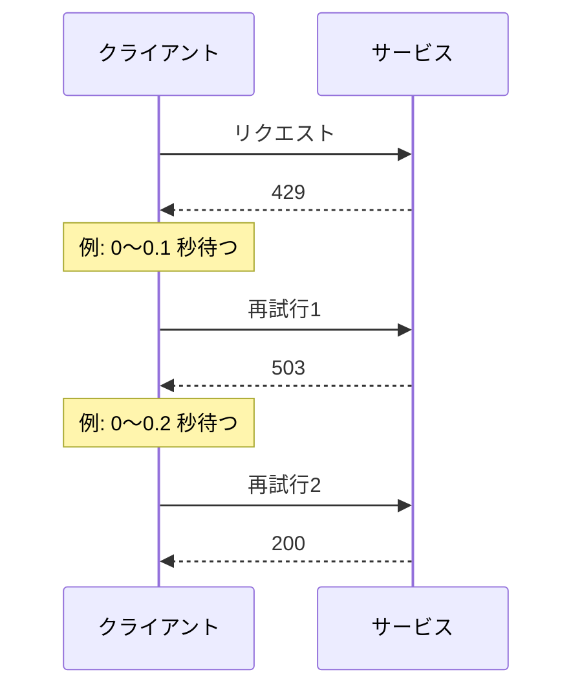
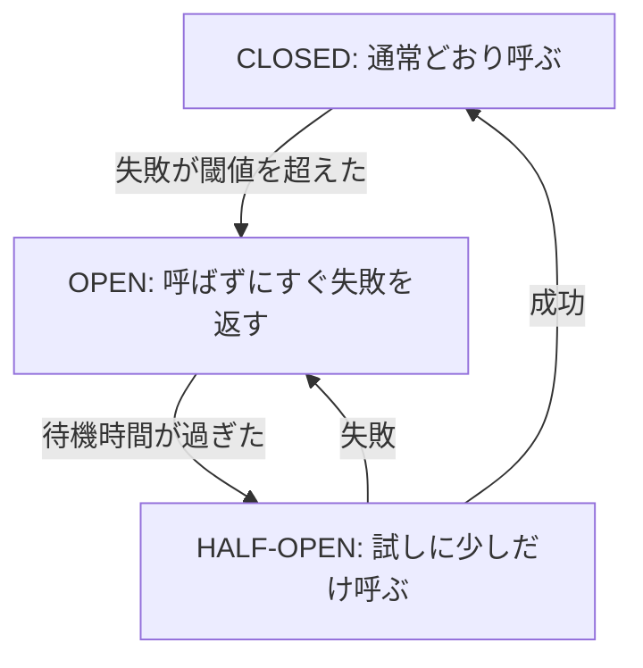

# SDK と耐障害性

AWS SDK でサービスを呼ぶコードの書き方と、失敗しても動き続けるアプリケーションの作り方をまとめる。リトライ、タイムアウト、冪等性、アーキテクチャの選び方、シリアライズ、単体テストを扱う。

[](../assets/diagrams/sdk-resilience-event-driven.png)

## AWS SDK の基本 {#sdk-basics}

コードの例は Python の boto3 を使う。考え方は他の言語の SDK でも同じ。

### 認証情報 {#credentials}

SDK は **認証情報プロバイダーチェーン** を順に探し、最初に見つかったものを使う。コードにアクセスキーを書かない。

| 実行場所 | 認証情報の取得元 |
| --- | --- |
| Lambda | 実行ロール（環境変数で自動的に渡される） |
| ECS | タスクロール（コンテナプロバイダー） |
| EC2 | インスタンスプロファイル（IMDS） |
| 開発マシン | IAM Identity Center のプロファイルなど |

詳細な権限設計と STS の使い方は [IAM](iam.md) を参照する。

### クライアントとリソース {#clients}

```python
import boto3
from botocore.config import Config
from botocore.exceptions import ClientError

config = Config(
    retries={"mode": "standard", "total_max_attempts": 3},  # 最初の1回を含めて3回
    connect_timeout=3,
    read_timeout=5,
)
dynamodb = boto3.client("dynamodb", region_name="ap-northeast-1", config=config)

try:
    dynamodb.get_item(TableName="orders", Key={"id": {"S": "1"}})
except ClientError as e:
    code = e.response["Error"]["Code"]
    status = e.response["ResponseMetadata"]["HTTPStatusCode"]
    if code == "ResourceNotFoundException":
        print("テーブルがない")
    else:
        raise
```

クライアントは作るのにコストがかかるので、使い回す。Lambda ならハンドラーの外で作る。エラーの種類は `Error.Code` で判定する。

### ページネーション {#pagination}

一覧 API は結果を分割して返す。1回の呼び出しで全件が返ると思わない。**ページネーター** を使うと、`NextToken` などの扱いを任せられる。

```python
s3 = boto3.client("s3")
paginator = s3.get_paginator("list_objects_v2")

for page in paginator.paginate(
    Bucket="my-bucket",
    Prefix="logs/",
    PaginationConfig={"PageSize": 1000},
):
    for obj in page.get("Contents", []):
        print(obj["Key"])
```

DynamoDB の `Query` と `Scan` も同じで、1回の応答は 1 MB までに区切られる。詳細は [DynamoDB](dynamodb.md) を参照する。

### ウェイター {#waiters}

リソースが目的の状態になるまで、一定間隔でポーリングする機能。自前のループを書かずに済む。

```python
dynamodb.create_table(...)
waiter = dynamodb.get_waiter("table_exists")
waiter.wait(
    TableName="orders",
    WaiterConfig={"Delay": 5, "MaxAttempts": 20},
)
```

使える名前は `client.waiter_names` で確認する。

### 部分的な失敗 {#partial-failures}

バッチ API は、呼び出しが成功しても一部のアイテムが失敗していることがある。応答を必ず確認する。

| API | 確認するフィールド |
| --- | --- |
| DynamoDB `BatchWriteItem` | `UnprocessedItems` |
| DynamoDB `BatchGetItem` | `UnprocessedKeys` |
| SQS `SendMessageBatch` | `Failed` |
| Kinesis `PutRecords` | `FailedRecordCount` |
| EventBridge `PutEvents` | `FailedEntryCount` |

## リトライ {#retries}

一時的なエラー（スロットリング、ネットワーク、5XX）は再試行で回復することが多い。4XX の認証エラーや検証エラーは何度試しても失敗するので、すぐ諦める。

| エラー | 再試行 |
| --- | --- |
| 429、`ThrottlingException`、`ProvisionedThroughputExceededException` | する（バックオフ） |
| 500、502、503、504 | する |
| 接続エラー、タイムアウト | する（冪等なら） |
| 400、401、403、404 | しない |
| `ConditionalCheckFailedException` | しない（ロジックで扱う） |

### 指数バックオフとジッター {#backoff-jitter}

待ち時間を指数的に増やす（バックオフ）だけだと、多数のクライアントが同時に再試行して負荷の波を作る。ランダムな揺らぎ（ジッター）を加えて分散させる。回数にも上限を設ける。

```python
import random
import time

from botocore.exceptions import ClientError

RETRYABLE = {"ThrottlingException", "ProvisionedThroughputExceededException"}


def with_backoff(call, max_attempts=5, base=0.1, cap=5.0):
    for attempt in range(max_attempts):
        try:
            return call()
        except ClientError as e:
            code = e.response["Error"]["Code"]
            if code not in RETRYABLE or attempt == max_attempts - 1:
                raise
            # フルジッター: 0 から上限までのランダムな時間を待つ
            time.sleep(random.uniform(0, min(cap, base * 2**attempt)))
```



### SDK の再試行モード {#retry-modes}

SDK は自動で再試行する。自前で実装する前に、まず設定を確認する。多重に再試行すると回数が掛け算で増えるので注意する。

| モード | 動き | 向いている場面 |
| --- | --- | --- |
| `legacy` | SDK ごとに違う。boto3 では既定で、最大 5 回 | 後方互換 |
| `standard` | 指数バックオフとジッター、リトライ枠（トークンバケット）。既定で最大 3 回 | ほとんどの場合 |
| `adaptive` | `standard` にクライアント側のレート制限を追加 | 1つのリソースに集中してスロットリングが多い場合 |

- 環境変数 `AWS_RETRY_MODE`、`AWS_MAX_ATTEMPTS` か、`~/.aws/config` でも指定できる。
- `AWS_MAX_ATTEMPTS` と設定ファイルの `max_attempts` は、最初のリクエストを含む総数。1 で再試行なしになる。
- boto3 の `Config` の `max_attempts` だけは再試行の回数で、最初のリクエストを含まない。総数で書くなら `total_max_attempts` を使う。
- `adaptive` は、1クライアントで複数のリソースや複数テナントを扱うと、無関係なリクエストまで遅くなる。boto3 では実験的な機能と記載されている。

!!! note "2026 年の新しい再試行動作"
    SDK の新しい再試行動作は、現在 `AWS_NEW_RETRIES_2026=true` でオプトインする形で提供されている。バックオフの時間、リトライ枠の消費、サービスごとの既定値が変わる。たとえば DynamoDB の既定は 4 回になる。

## タイムアウト {#timeouts}

タイムアウトがないと、遅い相手につられて自分のリソースが枯渇する。接続と読み取りの両方を設定する。

| 設定 | boto3 | 既定 |
| --- | --- | --- |
| 接続タイムアウト | `connect_timeout` | 60 秒 |
| 読み取りタイムアウト | `read_timeout` | 60 秒 |

- 既定値は短時間の API には長すぎる。呼び出し元の時間制限より短くする。
- **内側のタイムアウトを外側より短くする**。例: API Gateway の 29 秒 > Lambda のタイムアウト > SDK のタイムアウト。こうしないと、内側の処理が続いているのに外側がエラーを返してしまう。
- Lambda では `context.get_remaining_time_in_millis()` で残り時間を確認する。

## 冪等性 {#idempotency}

同じ操作を何度実行しても結果が変わらない性質。リトライ、少なくとも1回の配信（SQS、SNS、EventBridge、Lambda の非同期とイベントソースマッピング）、Firehose があるので、耐障害性の前提になる。

| 方法 | 例 |
| --- | --- |
| 条件付き書き込み | DynamoDB の `attribute_not_exists` |
| 冪等性トークン | `TransactWriteItems` の `ClientRequestToken` |
| 実行名 | Step Functions の Standard の `name` |
| 重複排除 ID | SQS FIFO の `MessageDeduplicationId` |
| 既存の仕組み | Powertools for AWS Lambda の冪等性ユーティリティ |

```python
from botocore.exceptions import ClientError

try:
    dynamodb.put_item(
        TableName="processed-events",
        Item={"id": {"S": event_id}},
        ConditionExpression="attribute_not_exists(id)",
    )
except ClientError as e:
    if e.response["Error"]["Code"] == "ConditionalCheckFailedException":
        return  # 処理済みなので何もしない
    raise
do_business_logic()
```

上の例は処理の前に印を付ける。処理の失敗時の扱いまで考えるなら、状態（処理中、完了）を持つテーブルにする。Powertools はこれを実装している。

`UpdateItem` のカウンター加算のように、そのままでは冪等でない操作に注意する。

## サーキットブレーカー {#circuit-breaker}

相手の障害が続くときに、呼び出しを一時的に止める仕組み。無駄な待ちと、相手への追加の負荷を防ぐ。リトライが一時的な失敗向けなのに対し、こちらは長引く失敗向け。



```python
import time


class CircuitBreaker:
    def __init__(self, threshold=5, reset_seconds=30):
        self.threshold = threshold
        self.reset_seconds = reset_seconds
        self.failures = 0
        self.opened_at = None

    def call(self, func, fallback):
        if self.opened_at and time.time() - self.opened_at < self.reset_seconds:
            return fallback()  # OPEN: 呼ばない
        try:
            result = func()  # CLOSED または HALF-OPEN
        except Exception:
            self.failures += 1
            if self.failures >= self.threshold:
                self.opened_at = time.time()
            return fallback()
        self.failures = 0
        self.opened_at = None
        return result
```

Lambda のように実行環境が複数ある場合、メモリの状態は共有されない。状態を共有するには DynamoDB や ElastiCache を使う。AWS のパターンでは、Step Functions の Express ワークフローと DynamoDB で実装する例が紹介されている。

## グレースフルデグラデーション {#graceful-degradation}

依存先が止まっても、機能を縮小して動き続けること。必須の依存を任意の依存に変える。

| 依存先の障害 | 縮小の例 |
| --- | --- |
| おすすめ API が停止 | 固定の人気商品を表示 |
| 書き込みの DB が遅い | [SQS](messaging.md) にためて後で書く |
| 外部の価格 API が停止 | キャッシュの値を「更新日時つき」で表示 |
| 検索サービスが停止 | 検索だけ無効にして他は動かす |

障害は通常の動作として設計する。フォールバックは定期的にテストする。[ヘルスチェック](observability.md) で浅い確認と依存先まで見る確認を分けると、依存先の不調でインスタンスが全部外される事態を防げる。

## サードパーティ連携の耐障害性 {#third-party}

外部の API は自分で直せず、制限も相手次第。次を組み合わせる。

| 問題 | 対策 |
| --- | --- |
| 遅い、止まる | 短いタイムアウト、サーキットブレーカー |
| 一時的な失敗 | バックオフとジッターのリトライ |
| レート制限（429） | `Retry-After` を尊重、キューで流量を調整 |
| 二重の課金や注文 | 冪等性キーをリクエストに付ける（相手が対応していれば） |
| 受信 Webhook の重複 | イベント ID で重複を除く |
| 長時間の停止 | SQS にためる、DLQ に退避、後で再処理 |
| API キーの管理 | [Secrets Manager](secrets.md) に保管 |
| 想定外の応答 | スキーマを検証し、エラーの分類（再試行可、不可）を明確にする |

```python
import requests


def call_partner(payload, idempotency_key):
    res = requests.post(
        "https://api.example.com/orders",
        json=payload,
        headers={"Idempotency-Key": idempotency_key},
        timeout=(2, 5),  # 接続 2 秒、読み取り 5 秒
    )
    if res.status_code == 429 or res.status_code >= 500:
        raise RetryableError(res.status_code)  # 自分で定義する例外
    res.raise_for_status()  # その他の 4XX は再試行しない
    return res.json()
```

`requests` はサードパーティのライブラリで、Lambda の Python ランタイムには含まれない。パッケージに含める。

## ステートフルとステートレス {#stateful-stateless}

| | ステートレス | ステートフル |
| --- | --- | --- |
| 状態の場所 | 外部のストア | サーバーのメモリやディスク |
| スケール | 台数を増やすだけ | 状態の移動やセッションの固定が必要 |
| 障害 | 他のインスタンスが引き継げる | 状態を失う可能性がある |
| 例 | Lambda、ECS のタスク、REST API | WebSocket の接続、セッションをメモリに持つサーバー |

AWS では、状態を外部に出してステートレスにするのが基本。

| 状態 | 置き場所 |
| --- | --- |
| セッション | [ElastiCache](databases.md)、[DynamoDB](dynamodb.md) |
| ファイル | [S3](s3.md)、[EFS](storage.md) |
| ワークフローの進み具合 | [Step Functions](step-functions.md) |
| WebSocket の接続 ID | DynamoDB |

Lambda の `/tmp` やグローバル変数はキャッシュとしてだけ使う。

## アーキテクチャパターン {#architectural-patterns}

| パターン | 特徴 | 利点 | 課題 |
| --- | --- | --- | --- |
| モノリシック | 1つのデプロイ単位 | 単純、テストが楽、呼び出しが速い | 部分的なスケールやデプロイが難しい |
| マイクロサービス | 機能ごとに独立してデプロイ | 独立したスケールとデプロイ、技術の自由 | 分散の複雑さ、運用と監視の負担 |
| イベント駆動 | イベントで疎結合につなぐ | 拡張しやすい、耐障害性が高い | 追跡が難しい、結果整合性 |
| ファンアウト | 1つのメッセージを複数の宛先に | 処理の追加が簡単、並列処理 | 重複と部分失敗への対応 |
| オーケストレーション | 中央の指揮者が流れを制御 | 流れが明確 | 指揮者への依存 |
| コレオグラフィー | 各サービスがイベントに反応 | 結合が弱い | 全体の流れが見えにくい |

AWS の代表的な実現方法は次の通り。

| パターン | AWS サービス |
| --- | --- |
| モノリシック | [EC2、Elastic Beanstalk](ec2-beanstalk.md) |
| マイクロサービス | [API Gateway](api-gateway.md) と [Lambda](lambda.md)、[ECS、EKS](containers.md) |
| イベント駆動 | [EventBridge](messaging.md)、SQS、SNS |
| ファンアウト | [SNS + SQS](messaging.md)、EventBridge、[Kinesis の拡張ファンアウト](streaming.md) |
| オーケストレーション | [Step Functions](step-functions.md) |
| コレオグラフィー | EventBridge、SNS |

最初から細かく分ける必要はない。チームや変更頻度、スケールの要件の違いが出てきたら、境界の明確な部分から切り出す。

## シリアライズとデシリアライズ {#serialization}

オブジェクトを送信や保存のためのバイト列や文字列に変換することをシリアライズ、その逆をデシリアライズという。AWS との連携では JSON が中心だが、サービスごとの落とし穴がある。

### JSON の落とし穴 {#json-pitfalls}

| 問題 | 例 | 対処 |
| --- | --- | --- |
| `datetime` は JSON にできない | `TypeError` | ISO 8601 の文字列に変換 |
| `Decimal` は JSON にできない | DynamoDB から読んだ数値 | `default=` で変換 |
| バイナリは JSON にできない | 画像、圧縮データ | Base64 にする |
| float の誤差 | `0.1 + 0.2` | 金額は整数か Decimal で |
| 文字コード | 日本語がエスケープされる | `ensure_ascii=False` |
| 大きな整数 | JavaScript で精度が落ちる | 文字列で渡す |

```python
import json
from datetime import datetime, timezone
from decimal import Decimal


def default(o):
    if isinstance(o, Decimal):
        return int(o) if o == o.to_integral_value() else float(o)
    if isinstance(o, datetime):
        return o.astimezone(timezone.utc).isoformat()
    raise TypeError(f"シリアライズできない型: {type(o)}")


body = json.dumps(item, default=default, ensure_ascii=False)
```

### サービスごとの形式 {#service-formats}

| サービス | 形式 | 注意点 |
| --- | --- | --- |
| Lambda のプロキシ統合（API Gateway） | 入出力の `body` は文字列 | 入力は `json.loads`、出力は `json.dumps` が必要 |
| SQS | `Body` は文字列 | SNS 経由なら JSON が二重になる。raw 配信を検討 |
| SNS | `Message` は文字列 | 同上 |
| EventBridge | `Detail` は JSON 文字列 | `put_events` で `json.dumps` が必要 |
| Kinesis | Lambda のイベントでは Base64 | デコードしてから解析 |
| Firehose の変換 | 入出力とも Base64 | 応答も Base64 にする |
| S3 | バイト列 | `Body` は `read()` してデコード |
| S3 イベント | キーは URL エンコード | `unquote_plus` でデコード |
| API Gateway のバイナリ | Base64 | `isBase64Encoded` を設定 |

### DynamoDB のシリアライズ {#dynamodb-serialization}

DynamoDB の低レベル API は、値に型の記述子を付けた形式を使う。

```json
{
  "id": { "S": "order-1" },
  "amount": { "N": "1200" },
  "paid": { "BOOL": true },
  "tags": { "SS": ["new", "gift"] },
  "items": { "L": [{ "M": { "sku": { "S": "a-1" } } }] }
}
```

数値も文字列として送る。boto3 の変換の方法は3通りある。

| 方法 | 型の扱い |
| --- | --- |
| `boto3.client("dynamodb")` | 型の記述子を自分で書く |
| `boto3.resource("dynamodb").Table(...)` | Python の型との変換を自動で行う |
| `TypeSerializer`、`TypeDeserializer` | 変換だけ行う。DynamoDB Streams のイベントなどに使う |

```python
from decimal import Decimal

from boto3.dynamodb.types import TypeDeserializer, TypeSerializer

serializer = TypeSerializer()
deserializer = TypeDeserializer()

low = {k: serializer.serialize(v) for k, v in {"id": "1", "amount": Decimal("12.5")}.items()}
# {"id": {"S": "1"}, "amount": {"N": "12.5"}}

# DynamoDB Streams のイベントの NewImage は低レベルの形式で届く
item = {k: deserializer.deserialize(v) for k, v in record["dynamodb"]["NewImage"].items()}
```

落とし穴は次の通り。

| 落とし穴 | 内容 | 対処 |
| --- | --- | --- |
| float を渡せない | boto3 の `TypeSerializer` は float で `TypeError` を起こす | `Decimal(str(value))` に変換 |
| 読むと `Decimal` | 数値は `Decimal` で返る | JSON にする前に変換 |
| 精度の上限 | 数値は最大 38 桁。超えると例外 | 文字列で保存 |
| 空の Set | 空の Set は保存できない | 属性ごと省くか List を使う |
| キーの型 | キー属性は文字列、数値、バイナリのみ | `BOOL` や Map は使えない |
| JSON で float を読み込む | `json.loads` の結果を直接渡すと float が残る | `json.loads(s, parse_float=Decimal)` |
| 日付の型がない | ISO 8601 の文字列か、エポック秒の数値 | TTL はエポック秒の数値 |

データ設計は [DynamoDB](dynamodb.md) を参照する。

## 単体テスト {#unit-testing}

単体テストでは AWS を実際に呼ばず、スタブやモックで応答を差し替える。速く、費用がかからず、エラーの場合も試せる。

| 手段 | 内容 | 向いている場面 |
| --- | --- | --- |
| `botocore.stub.Stubber` | 期待するリクエストと応答を登録する | SDK の呼び方まで検証 |
| `unittest.mock` | 関数やクライアントを差し替える | ロジックの分離 |
| moto（サードパーティ） | AWS を疑似的に動かす | 複数の呼び出しのつながりを確認 |
| `sam local invoke` | Docker で関数を動かす | パッケージやハンドラーの確認 |
| `sam local start-lambda` | ローカルのエンドポイントを自動テストから呼ぶ | 統合テスト |
| `sam local start-api` | ローカルで API を動かす | API の確認 |

### Stubber の例 {#stubber}

```python
import boto3
import pytest
from botocore.exceptions import ClientError
from botocore.stub import Stubber


def get_status(client, order_id):
    res = client.get_item(TableName="orders", Key={"id": {"S": order_id}})
    return res["Item"]["status"]["S"]


def test_get_status():
    client = boto3.client("dynamodb", region_name="ap-northeast-1")
    with Stubber(client) as stubber:
        stubber.add_response(
            "get_item",
            {"Item": {"status": {"S": "PAID"}}},
            {"TableName": "orders", "Key": {"id": {"S": "1"}}},
        )
        assert get_status(client, "1") == "PAID"
        stubber.assert_no_pending_responses()


def test_throttling_is_raised():
    client = boto3.client("dynamodb", region_name="ap-northeast-1")
    with Stubber(client) as stubber:
        stubber.add_client_error("get_item", service_error_code="ThrottlingException")
        with pytest.raises(ClientError):
            get_status(client, "1")
```

### テストしやすい書き方 {#testable-code}

- ビジネスロジックをハンドラーから分離する。ハンドラーはイベントの解析だけにする。
- クライアントは引数で受け取れるようにする（依存性の注入）。
- 正常系だけでなく、スロットリングや空の応答、不正な入力も試す。
- テスト用のイベントは `sam local generate-event` で作り、実際の形に合わせる。

```python
# app.py
import os

import boto3

_table = None


def get_table():
    global _table
    if _table is None:
        _table = boto3.resource("dynamodb").Table(os.environ["TABLE_NAME"])
    return _table


def save_order(table, order):  # ロジックはクライアントを受け取るだけ
    table.put_item(Item=order)
    return order["id"]


def handler(event, context):
    return save_order(get_table(), event)
```

```python
# test_app.py
from unittest.mock import MagicMock

from app import save_order


def test_save_order():
    table = MagicMock()
    assert save_order(table, {"id": "1"}) == "1"
    table.put_item.assert_called_once_with(Item={"id": "1"})
```

Lambda のテストイベントは [Lambda](lambda.md)、外部依存のモック API は [API Gateway](api-gateway.md)、テストのテンプレート管理は [IaC](iac.md) を参照する。

## 試験のポイント {#exam-points}

| こう問われたら | 答え |
| --- | --- |
| スロットリング（429）への対応 | 指数バックオフとジッター |
| 多数のクライアントが同時に再試行する | ジッターを追加 |
| 再試行で重複が起きても問題ないように | 処理を冪等にする |
| 再試行の設定を最小のコードで | SDK の `retries`（`standard`） |
| 一覧 API で一部しか返らない | ページネーターか `NextToken` |
| リソースの作成完了を待つ | ウェイター |
| `BatchWriteItem` で一部が書かれない | `UnprocessedItems` を再送 |
| 相手の障害が長引くとき呼ばないように | サーキットブレーカー |
| 依存先の障害でも主要機能を維持 | グレースフルデグラデーション |
| 外部 API が遅くて巻き込まれる | タイムアウト、キューで非同期に |
| 外部 API の二重実行を防ぐ | 冪等性キー |
| セッションをどこに置くか | ElastiCache か DynamoDB（ステートレス化） |
| 複数のサービスに同時に通知 | ファンアウト |
| 独立してデプロイ、スケール | マイクロサービス |
| float を DynamoDB に保存できない | `Decimal` を使う |
| DynamoDB の結果を JSON にできない | `Decimal` を変換する `default` |
| DynamoDB Streams のイメージを Python の値に | `TypeDeserializer` |
| SDK の呼び出しを実際に行わずテスト | `Stubber` やモック |
| Lambda をローカルで実行 | `sam local invoke` |
| テストイベントを作る | `sam local generate-event` |

## 関連ページ {#related}

- [IAM](iam.md)
- [Lambda](lambda.md)
- [メッセージング](messaging.md)
- [Step Functions](step-functions.md)
- [DynamoDB](dynamodb.md)
- [オブザーバビリティ](observability.md)
- [IaC](iac.md)

## 参考 {#references}

- [Retry behavior（AWS SDKs and Tools）](https://docs.aws.amazon.com/sdkref/latest/guide/feature-retry-behavior.html)
- [Standardized credential providers](https://docs.aws.amazon.com/sdkref/latest/guide/standardized-credentials.html)
- [Smart configuration defaults](https://docs.aws.amazon.com/sdkref/latest/guide/feature-smart-config-defaults.html)
- [Boto3 retries](https://boto3.amazonaws.com/v1/documentation/api/latest/guide/retries.html)
- [Boto3 paginators](https://boto3.amazonaws.com/v1/documentation/api/latest/guide/paginators.html)
- [Boto3 clients and waiters](https://boto3.amazonaws.com/v1/documentation/api/latest/guide/clients.html)
- [Botocore config](https://botocore.amazonaws.com/v1/documentation/api/latest/reference/config.html)
- [Botocore Stubber](https://botocore.amazonaws.com/v1/documentation/api/latest/reference/stubber.html)
- [Boto3 DynamoDB customization](https://boto3.amazonaws.com/v1/documentation/api/latest/reference/customizations/dynamodb.html)
- [DynamoDB low-level API](https://docs.aws.amazon.com/amazondynamodb/latest/developerguide/Programming.LowLevelAPI.html)
- [DynamoDB data types](https://docs.aws.amazon.com/amazondynamodb/latest/developerguide/HowItWorks.NamingRulesDataTypes.html)
- [DynamoDB error handling](https://docs.aws.amazon.com/amazondynamodb/latest/developerguide/Programming.Errors.html)
- [DynamoDB transactions](https://docs.aws.amazon.com/amazondynamodb/latest/developerguide/transaction-apis.html)
- [Retry with backoff pattern](https://docs.aws.amazon.com/prescriptive-guidance/latest/cloud-design-patterns/retry-backoff.html)
- [Circuit breaker pattern](https://docs.aws.amazon.com/prescriptive-guidance/latest/cloud-design-patterns/circuit-breaker.html)
- [REL05-BP01 Graceful degradation](https://docs.aws.amazon.com/wellarchitected/latest/reliability-pillar/rel_mitigate_interaction_failure_graceful_degradation.html)
- [REL05-BP03 Control and limit retry calls](https://docs.aws.amazon.com/wellarchitected/latest/reliability-pillar/rel_mitigate_interaction_failure_limit_retries.html)
- [Timeouts, retries, and backoff with jitter](https://aws.amazon.com/builders-library/timeouts-retries-and-backoff-with-jitter/)
- [Powertools for AWS Lambda idempotency](https://docs.aws.amazon.com/powertools/python/latest/utilities/idempotency/)
- [Automate local integration tests with AWS SAM](https://docs.aws.amazon.com/serverless-application-model/latest/developerguide/serverless-sam-cli-using-automated-tests.html)
- [sam local start-api](https://docs.aws.amazon.com/serverless-application-model/latest/developerguide/using-sam-cli-local-start-api.html)
