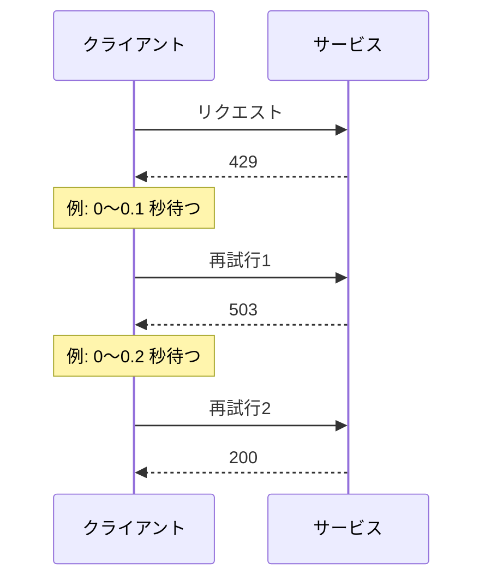
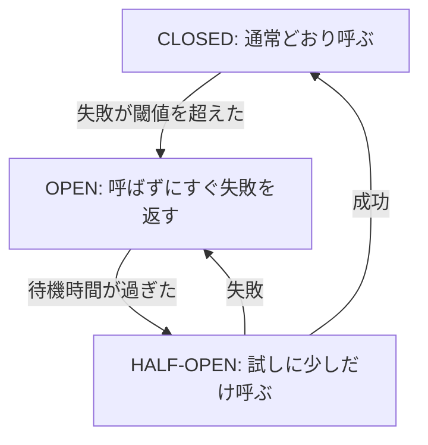

# SDK と耐障害性

[:material-star-circle: DOP](../courses/dop/services.md){ .exam-badge .exam-professional } [:material-star-circle: AIP](../courses/aip/services.md){ .exam-badge .exam-professional } [:material-certificate: SAA](../courses/saa/services.md){ .exam-badge .exam-associate .exam-badge--related } [:material-certificate: DVA](../courses/dva/services.md){ .exam-badge .exam-associate .exam-badge--related } [:material-certificate: DEA](../courses/dea/services.md){ .exam-badge .exam-associate .exam-badge--related } [:material-star-circle: SAP](../courses/sap/services.md){ .exam-badge .exam-professional .exam-badge--related }

AWS SDK でサービスを呼ぶコードの書き方と、失敗しても動き続けるアプリケーションの作り方をまとめる。リトライ、タイムアウト、冪等性、アーキテクチャの選び方、シリアライズ、単体テストを扱う。

[](../assets/diagrams/sdk-resilience-event-driven.png)

## AWS SDK の基本 {#sdk-basics}

コードの例は Python の boto3 を使う。考え方は他の言語の SDK でも同じ。

SDK は実行環境に入れるライブラリで、AWS のリソースではないので提供単位はない。クライアントはリージョンごとに作る。呼び先の単位と VPC の内外は [リソースの提供単位](resource-scope.md) を参照する。

- **例:** 東京のテーブルを読むのに `region_name="us-east-1"` のクライアントを使うと、テーブルが見つからず `ResourceNotFoundException` になる。テーブルの有無ではなく、まずリージョンを確認する。

### 認証情報 {#credentials}

SDK は **認証情報プロバイダーチェーン** を順に探し、最初に見つかったものを使う。コードにアクセスキーを書かない。

| 実行場所 | 認証情報の取得元 |
| --- | --- |
| Lambda | 実行ロール（環境変数で自動的に渡される） |
| ECS | タスクロール（コンテナプロバイダー） |
| EC2 | インスタンスプロファイル（IMDS） |
| 開発マシン | IAM Identity Center のプロファイルなど |

詳細な権限設計と STS の使い方は [IAM](iam.md) を参照する。

boto3 が探す順番は次の通り。先に見つかったものが使われ、そこで探索は止まる。

1. `boto3.client()` や `Session` に渡した引数
2. 環境変数（`AWS_ACCESS_KEY_ID`、`AWS_SECRET_ACCESS_KEY`、`AWS_SESSION_TOKEN`）
3. ロールの引き受け（`~/.aws/config` の `role_arn`）
4. Web ID のロールの引き受け（`AWS_ROLE_ARN`、`AWS_WEB_IDENTITY_TOKEN_FILE`）
5. IAM Identity Center
6. 共有認証情報ファイル（`~/.aws/credentials`）
7. コンソールの認証情報でのログイン
8. 設定ファイル（`~/.aws/config`）
9. コンテナの認証情報（ECS のタスクロールなど）
10. EC2 のインスタンスメタデータ（IMDS）

順番が効く例を示す。EC2 にインスタンスプロファイルを付けたのに権限エラーになるとき、環境変数や `~/.aws/credentials` に古いキーがあると、そちらが優先されている。`aws sts get-caller-identity` で実際の ID を確認する。

- **例（`AWS_PROFILE`）:** `AWS_PROFILE=dev aws sts get-caller-identity` で、`[profile dev]` の設定を使う。`get-caller-identity` の `Arn` に出たロールが、実際に使われている ID である。
- **例（引数）:** `boto3.client("s3", aws_access_key_id=...)` と書くと、インスタンスのロールより優先される。コードに書かない理由の 1 つで、ロールを直しても効かない。
- **例（Web ID）:** EKS の IRSA では、`AWS_ROLE_ARN` と `AWS_WEB_IDENTITY_TOKEN_FILE` が Pod に入り、4 番目で解決される。同じ Pod に `AWS_ACCESS_KEY_ID` を入れると、2 番目が先に使われる。

一時的な認証情報には `AWS_SESSION_TOKEN` も必要で、これがないと認証エラーになる。チェーンのプロバイダーは、期限が切れる前に自動で更新する。別のアカウントの処理には STS の `AssumeRole` を使う。

- **例（トークンの付け忘れ）:** `AssumeRole` の結果からキーとシークレットだけを環境変数に入れると、`The security token included in the request is invalid` というエラーになる。`AWS_SESSION_TOKEN` も入れる。

リージョンは `AWS_REGION` か設定ファイルの `region`、クライアントの `region_name` で指定する。未指定なら `NoRegionError` が出る。

- **例:** `AWS_REGION=ap-northeast-1` のマシンで `boto3.client("s3", region_name="us-east-1")` と書くと、コードの指定が勝って `us-east-1` になる。

### クライアントの設定と優先順位 {#client-config}

同じ設定を複数の場所に書いたら、次の順で優先する。

1. コードのクライアント設定
2. 環境変数
3. 共有設定ファイル（`~/.aws/config`）
4. SDK の既定値

```ini
# ~/.aws/config
[default]
region = ap-northeast-1
retry_mode = standard
max_attempts = 3
defaults_mode = in-region
```

`AWS_RETRY_MODE=adaptive` を環境に設定し、設定ファイルが `standard` なら、`adaptive` になる。コードで `Config(retries={"mode": "standard"})` と書けば、環境変数より優先される。

- **例（`connect_timeout`）:** `connect_timeout=3` なら、到達できない相手には 3 秒で諦める。既定の 60 秒のままだと、10 秒の Lambda は先に止まる。
- **例（`read_timeout`）:** `GetItem` が普段 20 ms なら `read_timeout=2` で十分。ロングポーリングの SQS なら 25 秒、大きな S3 の取得なら長めにする。
- **例（`max_pool_connections`）:** 50 スレッドで呼ぶなら 50 にする。既定の 10 のままだと、余った分は接続を作り直す。
- **例（`tcp_keepalive`）:** 関数の中で 3 分間応答を待つ API を呼ぶと、途中のネットワーク機器が接続を切ることがある。`tcp_keepalive=True` で防げる場合がある。

| `botocore.config.Config` の項目 | 既定 | 内容 |
| --- | --- | --- |
| `retries` | | `mode`、`max_attempts`、`total_max_attempts` |
| `connect_timeout` | 60 秒 | 接続を張るまでの時間 |
| `read_timeout` | 60 秒 | 応答を待つ時間 |
| `max_pool_connections` | 10 | 接続プールの最大数 |
| `tcp_keepalive` | false | TCP キープアライブ |
| `region_name` | | リージョン |

`defaults_mode` で値の組をまとめて選ぶ SDK もある。接続タイムアウトの値は次の通り。

| モード | 向いている場面 | `connectTimeoutInMillis` |
| --- | --- | --- |
| `standard` | 多くの場合 | 3,100 |
| `in-region` | 同じリージョンのサービスを呼ぶ | 1,100 |
| `cross-region` | 別のリージョンのサービスを呼ぶ | 3,100 |
| `mobile` | モバイルアプリ | 30,000 |


- **例:** 東京の Lambda が東京の DynamoDB を呼ぶなら `in-region` で、接続の確立は 1.1 秒で打ち切る。バージニアの S3 も呼ぶなら `cross-region` にする。
- **誤ると:** 海を越える呼び出しに `in-region` を使うと、1,100 ms の接続タイムアウトに当たりやすくなる。遅さではなく接続エラーとして現れる。

### クライアントとリソース {#clients}

```python
import boto3
from botocore.config import Config
from botocore.exceptions import ClientError

config = Config(
    retries={"mode": "standard", "total_max_attempts": 3},  # 最初の1回を含めて3回
    connect_timeout=3,
    read_timeout=5,
)
dynamodb = boto3.client("dynamodb", region_name="ap-northeast-1", config=config)

try:
    dynamodb.get_item(TableName="orders", Key={"id": {"S": "1"}})
except ClientError as e:
    code = e.response["Error"]["Code"]
    status = e.response["ResponseMetadata"]["HTTPStatusCode"]
    if code == "ResourceNotFoundException":
        print("テーブルがない")
    else:
        raise
```

クライアントは作るのにコストがかかるので、使い回す。Lambda ならハンドラーの外で作る。エラーの種類は `Error.Code` で判定する。

| | クライアント | リソース |
| --- | --- | --- |
| API | サービスの API と 1 対 1 | オブジェクト指向の高レベル API |
| 新機能 | 追加される | AWS は新しい機能を追加しない方針 |
| スレッド | 一般に安全 | 安全ではない。スレッドごとに作る |


- **例（書き方の違い）:** クライアントは `put_item(TableName="orders", Item={"id": {"S": "1"}})` で、リソースは `Table("orders").put_item(Item={"id": "1"})`。
- **例（新機能）:** 新しい機能を使うならクライアントを選ぶ。リソースには追加されないので、該当のメソッドがない。
- **誤ると:** 1 つのリソースを 20 スレッドで共有すると、まれに例外や予期しない動作になる。スレッドごとに `Session` からリソースを作る。

### 接続の再利用 {#connection-reuse}

接続を毎回作ると、TCP と TLS のハンドシェイクの分だけ遅くなる。特に Lambda ではハンドラーの外でクライアントを作り、実行環境の再利用で接続も使い回す。

```python
import boto3

# 実行環境ごとに 1 回だけ作られる
table = boto3.resource("dynamodb").Table("orders")


def handler(event, context):
    return table.get_item(Key={"id": event["id"]}).get("Item")
```

ハンドラーの中で作ると、呼び出しのたびに認証情報の解決と接続の確立が走る。

| SDK | 既定の動き |
| --- | --- |
| boto3 | `max_pool_connections` は 10。スレッドが多いならこれを増やす |
| JavaScript v3 | 既定で TCP 接続を再利用する。`maxSockets` で接続数を設定できる |

boto3 で 50 スレッドが 1 つのクライアントを使うと、プールの 10 を超えた分は接続を作り直す。`Connection pool is full` の警告が出るなら `max_pool_connections=50` にする。

Lambda は使われていない接続を時間とともに切る。切れた接続を使うとエラーになるので、キープアライブを使う。DB のように接続数が限られる相手には、RDS Proxy などの接続プールも検討する。

複数のプロセスで動かすときは、プロセスごとにクライアントを作る。

- **例（時間）:** 接続の確立に 50 ms かかる環境で、呼び出しごとに作ると 1,000 回で 50 秒が無駄になる。使い回せば最初の 1 回だけで済む。
- **例（JavaScript）:** クライアントの設定に `requestHandler: { httpsAgent: { maxSockets: 100 } }` を渡すと、同時の接続を 100 にできる（v3.521.0 以降の短い書き方）。AWS への呼び出しは HTTPS なので `httpAgent` では効かない。
- **誤ると（Lambda）:** ハンドラーの中で `boto3.client()` を作ると、毎回の実行で 100 ms 以上遅くなることがある。プロビジョニングした同時実行でも減らない遅さになる。

### コードでのエラー処理 {#error-handling}

boto3 のエラーは大きく 2 種類に分かれる。

| 種類 | 例 | いつ起きるか |
| --- | --- | --- |
| サービスのエラー | `ClientError` | AWS が応答を返した。`Error.Code` を見る |
| クライアント側のエラー | `EndpointConnectionError`、`ConnectTimeoutError`、`ReadTimeoutError` | 応答がない。`botocore.exceptions` にある |

```python
import botocore.exceptions

try:
    table_client.put_item(TableName="orders", Item=item)
except table_client.exceptions.ConditionalCheckFailedException:
    pass                                   # サービスごとの例外クラス
except botocore.exceptions.ClientError as e:
    code = e.response["Error"]["Code"]
    status = e.response["ResponseMetadata"]["HTTPStatusCode"]
    request_id = e.response["ResponseMetadata"]["RequestId"]
    print(code, status, request_id)        # サポートへの問い合わせに RequestId を使う
    raise
except botocore.exceptions.ReadTimeoutError:
    raise                                  # 書き込みが成功している可能性がある
```

`ClientError` が届いた時点で、SDK の再試行はすでに終わっている。ここでさらに同じ回数を再試行すると、回数が掛け算になる。

- **例（`ClientError` の中身）:** `Code` が `ThrottlingException`、`HTTPStatusCode` が 400、`RequestId` が `...` のように取れる。`status == 400` だけで分岐すると、再試行できるエラーも諦めてしまう。
- **例（タイムアウト後の確認）:** `PutItem` が `ReadTimeoutError` になった場合、実際には書けていることがある。`attribute_not_exists(id)` を付けて再試行し、`ConditionalCheckFailedException` が返れば、前の書き込みが成功していたと判断できる。

!!! warning "5XX やタイムアウトの書き込みは、成功している可能性がある"
    DynamoDB は、書き込みの 500 について、成功か失敗か分からないと説明している。`TransactWriteItems` なら再試行してよい。`PutItem`、`UpdateItem`、`DeleteItem` は、アイテムの状態を読んで確認するか、条件式を付けて再試行する。

### ページネーション {#pagination}

一覧 API は結果を分割して返す。1回の呼び出しで全件が返ると思わない。**ページネーター** を使うと、`NextToken` などの扱いを任せられる。

```python
s3 = boto3.client("s3")
paginator = s3.get_paginator("list_objects_v2")

for page in paginator.paginate(
    Bucket="my-bucket",
    Prefix="logs/",
    PaginationConfig={"PageSize": 1000},
):
    for obj in page.get("Contents", []):
        print(obj["Key"])
```

DynamoDB の `Query` と `Scan` も同じで、1回の応答は 1 MB までに区切られる。詳細は [DynamoDB](dynamodb.md) を参照する。

| `PaginationConfig` | 内容 |
| --- | --- |
| `PageSize` | 1 ページの件数。全体の件数は変わらず、API の呼び出し回数が変わる |
| `MaxItems` | 全体で返す最大件数。超えると止まり、続きのトークンを返す |
| `StartingToken` | 前回のトークンから再開する |

`PageSize` はサービスによって、指定より多く返したり少なく返したりする。

- **例（`StartingToken`）:** `paginate(Bucket="b", PaginationConfig={"MaxItems": 100}).build_full_result()` の結果の `NextToken` を保存する。次回は `StartingToken` に渡して 101 件目から読む。

具体例を示す。5,000 件のオブジェクトに `MaxItems=10` を指定すると、10 件で止まる。`PageSize=100` だけなら全 5,000 件を返し、API を約 50 回呼ぶ。`PageSize` を小さくすると、1 回の呼び出しのタイムアウトは避けられるが回数は増える。

```python
# ページの中身を JMESPath で絞る
for key in paginator.paginate(Bucket="my-bucket").search("Contents[?Size > `1024`].Key"):
    print(key)
```

**落とし穴**は、自分でループを書くときにトークンを見ないこと。`list_objects_v2` の 1 回の呼び出しだけで全件を処理すると、それ以降のオブジェクトを黙って取りこぼす。エラーも出ないので気づきにくい。

### ウェイター {#waiters}

リソースが目的の状態になるまで、一定間隔でポーリングする機能。自前のループを書かずに済む。

```python
dynamodb.create_table(...)
waiter = dynamodb.get_waiter("table_exists")
waiter.wait(
    TableName="orders",
    WaiterConfig={"Delay": 5, "MaxAttempts": 20},
)
```

使える名前は `client.waiter_names` で確認する。

`Delay` は待つ秒数、`MaxAttempts` は確認の回数。既定はウェイターごとに決まっていて、`table_exists` は 20 秒間隔で 25 回、合計 500 秒まで待つ。時間切れになると `WaiterError` が起きる。作成そのものが失敗したのではないこともあるので、状態を確認する。

Lambda の中で既定のまま待つと、関数のタイムアウトのほうが先に切れる。長い待ちは [Step Functions](step-functions.md) の待機に移す。

- **例（`WaiterConfig`）:** 上の `Delay=5`、`MaxAttempts=20` なら、5 × 20 = 100 秒で諦める。既定なら 500 秒まで待つ。
- **例（Lambda）:** 関数のタイムアウトが 60 秒なら、既定の 500 秒には届かない。`Delay=5`、`MaxAttempts=10` で 50 秒にして、残りの 10 秒でエラー処理を行う。
- **例（名前）:** `dynamodb.waiter_names` には `table_exists` などが入る。存在しない名前で `get_waiter` を呼ぶと `ValueError` になる。

### 部分的な失敗 {#partial-failures}

バッチ API は、呼び出しが成功しても一部のアイテムが失敗していることがある。応答を必ず確認する。

| API | 確認するフィールド |
| --- | --- |
| DynamoDB `BatchWriteItem` | `UnprocessedItems` |
| DynamoDB `BatchGetItem` | `UnprocessedKeys` |
| SQS `SendMessageBatch` | `Failed` |
| Kinesis `PutRecords` | `FailedRecordCount` |
| EventBridge `PutEvents` | `FailedEntryCount` |
| Firehose `PutRecordBatch` | `FailedPutCount` |

これらは例外にならないので、SDK の再試行も `try` も働かない。失敗分だけを取り出し、バックオフを入れて再送する。

```python
items = {"orders": requests}
while items:
    res = dynamodb.batch_write_item(RequestItems=items)
    items = res.get("UnprocessedItems") or None
    if items:
        time.sleep(random.uniform(0, 1))  # 実際は回数の上限とバックオフを付ける
```

boto3 の `Table.batch_writer()` は、バッファと未処理アイテムの再送を自動で行う。

- **例（`BatchWriteItem`）:** 25 件を書き、`UnprocessedItems` に 3 件が残った。例外は出ないので、そのまま進めると 3 件が欠ける。3 件だけを、待ってから再送する。
- **例（`PutRecords`）:** 500 件中 `FailedRecordCount` が 12 なら、`Records` のうち `ErrorCode` がある 12 件だけを再送する。全部を再送すると、488 件が重複する。
- **誤ると:** バックオフなしで `while` を回すと、スロットリング中に同じ負荷をかけ続け、未処理が減らない。

## リトライ {#retries}

一時的なエラー（スロットリング、ネットワーク、5XX）は再試行で回復することが多い。4XX の認証エラーや検証エラーは何度試しても失敗するので、すぐ諦める。

| エラー | 再試行 |
| --- | --- |
| 429、`ThrottlingException`、`ProvisionedThroughputExceededException` | する（バックオフ） |
| 500、502、503、504 | する |
| 接続エラー、タイムアウト | する（冪等なら） |
| `AccessDeniedException`、`ValidationException`、`ResourceNotFoundException` | しない |
| `ConditionalCheckFailedException` | しない（ロジックで扱う） |

HTTP ステータスだけで判定しない。SDK はまずエラーコードを見る。

- DynamoDB の `ProvisionedThroughputExceededException` は HTTP **400** で返るが、スロットリングなので再試行する。
- HTTP 400 の `RequestTimeout` は一時的なエラーとして再試行する。
- 同じ HTTP 400 でも `ValidationException` は再試行しない。
- 5XX でもスロットリングのコードならスロットリングとして扱う。

- **例（判定）:** `{"Code": "ValidationException"}` が 400 で返ったら、値を直さない限り毎回失敗する。3 回試すだけ時間の無駄で、すぐ呼び出し元にエラーを返す。
- **例（`ConditionalCheckFailedException`）:** 在庫の条件付き更新で返ったら、在庫切れの処理に進む。再試行しても結果は変わらない。

### 指数バックオフとジッター {#backoff-jitter}

待ち時間を指数的に増やす（バックオフ）だけだと、多数のクライアントが同時に再試行して負荷の波を作る。ランダムな揺らぎ（ジッター）を加えて分散させる。回数にも上限を設ける。

```python
import random
import time

from botocore.exceptions import ClientError

RETRYABLE = {"ThrottlingException", "ProvisionedThroughputExceededException"}


def with_backoff(call, max_attempts=5, base=0.1, cap=5.0):
    for attempt in range(max_attempts):
        try:
            return call()
        except ClientError as e:
            code = e.response["Error"]["Code"]
            if code not in RETRYABLE or attempt == max_attempts - 1:
                raise
            # フルジッター: 0 から上限までのランダムな時間を待つ
            time.sleep(random.uniform(0, min(cap, base * 2**attempt)))
```



### SDK の再試行モード {#retry-modes}

上のコードの `base=0.1`、`cap=5.0`、`max_attempts=5` なら、待ち時間の上限は次のようになる。

| 再試行の前 | 上限（`min(cap, base × 2^n)`） |
| --- | --- |
| 1 回目 | 0.1 秒 |
| 2 回目 | 0.2 秒 |
| 3 回目 | 0.4 秒 |
| 4 回目 | 0.8 秒 |

- **例（合計）:** 待ち時間の合計は最大 0.1 + 0.2 + 0.4 + 0.8 = 1.5 秒。`cap` の 5 秒に届くのは `base × 2^n` が 5 を超える `n=6`（6.4 秒）からで、この回数では届かない。
- **例（ジッターの効果）:** 1,000 のクライアントが同時に 429 を受けると、ジッターなしなら全員が 0.1 秒後にそろって再試行する。フルジッターなら 0〜0.1 秒に散らばり、波が小さくなる。

SDK は自動で再試行する。自前で実装する前に、まず設定を確認する。多重に再試行すると回数が掛け算で増えるので注意する。

| モード | 動き | 向いている場面 |
| --- | --- | --- |
| `legacy` | SDK ごとに違う。boto3 では既定で、最大 5 回 | 後方互換 |
| `standard` | 指数バックオフとジッター、リトライ枠（トークンバケット）。既定で最大 3 回 | ほとんどの場合 |
| `adaptive` | `standard` にクライアント側のレート制限を追加 | 1つのリソースに集中してスロットリングが多い場合 |

- 環境変数 `AWS_RETRY_MODE`、`AWS_MAX_ATTEMPTS` か、`~/.aws/config` でも指定できる。
- `AWS_MAX_ATTEMPTS` と設定ファイルの `max_attempts` は、最初のリクエストを含む総数。1 で再試行なしになる。
- boto3 の `Config` の `max_attempts` だけは再試行の回数で、最初のリクエストを含まない。総数で書くなら `total_max_attempts` を使う。
- `adaptive` は、1クライアントで複数のリソースや複数テナントを扱うと、無関係なリクエストまで遅くなる。boto3 では実験的な機能と記載されている。

- **例（環境変数）:** `AWS_RETRY_MODE=standard AWS_MAX_ATTEMPTS=5 python app.py` なら、最大 5 回呼ぶ。
- **例（`adaptive`）:** 1 つのテーブルへ毎秒 5,000 件を書くバッチで 429 が続くなら、`Config(retries={"mode": "adaptive"})` でクライアントの送信を自動で抑える。
- **誤ると:** 同じクライアントで `orders` と `users` のテーブルを呼び、`orders` だけが 429 を返すと、`users` への呼び出しも待たされる。テーブルごとにクライアントを分ける。

!!! note "2026 年の新しい再試行動作"
    SDK の新しい再試行動作は、現在 `AWS_NEW_RETRIES_2026=true` でオプトインする形で提供されている。バックオフの時間、リトライ枠の消費、サービスごとの既定値が変わる。たとえば DynamoDB の既定は 4 回になる。

#### 回数の指定を比べる

| 指定の場所 | `3` の意味 | 実際の呼び出し |
| --- | --- | --- |
| `AWS_MAX_ATTEMPTS=3` | 総数 | 最初の 1 回 + 再試行 2 回 = 3 回 |
| `~/.aws/config` の `max_attempts = 3` | 総数 | 3 回 |
| `Config(retries={"total_max_attempts": 3})` | 総数 | 3 回 |
| `Config(retries={"max_attempts": 3})` | 再試行の回数 | 最初の 1 回 + 再試行 3 回 = 4 回 |

| 実行環境とモード | 既定の総数 |
| --- | --- |
| boto3（`legacy` が既定） | 5 回 |
| boto3 の `standard` | 3 回 |
| AWS CLI v2（`standard` が既定） | 3 回 |
| AWS CLI v1（`legacy` が既定） | 5 回。DynamoDB は 10 回 |

1 にすると再試行なしになる。

!!! warning "「SDK の既定は standard」は SDK によって異なる"
    AWS の SDK 共通の説明では `standard` が既定だが、boto3 の現在の既定は `legacy` と明記されている。コードで `mode` を明示すれば、この違いに左右されない。

#### 新しい動作の待ち時間

`AWS_NEW_RETRIES_2026=true` で有効になる計算は次の通り。

```text
待ち時間 = random(0, 1) × min(20 秒, 基準 × 2^再試行番号)
再試行番号は最初の再試行を 0 とする
```

| エラーの種類 | 基準の遅延 |
| --- | --- |
| 一時的なエラー（503、接続の失敗など） | 50 ms |
| スロットリング | 1,000 ms |
| DynamoDB と DynamoDB Streams の一時的なエラー | 25 ms（既定の総数は 4 回） |

```text
503 が続く場合: 1 回目の再試行の前に 0〜50 ms、2 回目の前に 0〜100 ms
429 が続く場合: 1 回目の再試行の前に 0〜1,000 ms、2 回目の前に 0〜2,000 ms
```

- **例（上限 20 秒）:** スロットリングでは `1 秒 × 2^再試行番号` が再試行番号 5 で 32 秒になり、`min(20, 32)` で 20 秒に抑えられる。


#### リトライ枠（トークンバケット）

`standard` と `adaptive` には再試行の予算があり、障害が広がると SDK は再試行をやめてすぐエラーを返す。

| 項目 | 値（新しい動作） |
| --- | --- |
| 予算の容量 | 500 トークン |
| 一時的なエラーの再試行 | 14 トークン消費 |
| スロットリングの再試行 | 5 トークン消費 |
| 再試行の成功 | 消費した分を戻す |
| 最初の 1 回で成功 | 1 トークン戻す |

一時的なエラーが続けば、500 ÷ 14 で約 35 回の再試行で枯渇する。すると「回数が残っているのに再試行されない」という動きになるが、これは障害時に負荷を増やさないための正常な動作である。

- **例（スロットリング）:** スロットリングだけが続くなら、500 ÷ 5 = 100 回の再試行で枯渇する。一時的なエラーより長く続けられる。
- **例（回復）:** 再試行で成功すると消費した分が戻り、最初の 1 回での成功でも 1 トークン戻る。障害が収まれば、自然に再試行できる状態に戻る。

サービスが `x-amz-retry-after` ヘッダーを返したら、SDK はその値を参考に待つ（計算した待ち時間から +5,000 ms の範囲）。

SQS の `ReceiveMessage` のようなロングポーリングの操作は、枠が枯渇しても待ってからエラーを返す。そうしないと、ループで呼ぶコードが高速で再試行してしまう。

#### 再試行の掛け算

複数の層で再試行すると回数が増える。

```text
SDK: 3 回 × アプリの再試行: 3 回 × Step Functions の Retry: 3 回 = 最大 27 回
```

再試行は 1 つの層に寄せる。通常は SDK に任せ、アプリでの再試行を重ねない。

- **例（Step Functions）:** Lambda のステートに `"MaxAttempts": 2` を付けると、ステートは最大 3 回実行される。中の SDK が 3 回なら、3 × 3 = 9 回呼ばれる。SDK を `total_max_attempts=1` にすれば 3 回で済む。
- **誤ると:** 障害中の相手に 27 倍の呼び出しが届き、回復を遅らせる。

## タイムアウト {#timeouts}

タイムアウトがないと、遅い相手につられて自分のリソースが枯渇する。接続と読み取りの両方を設定する。

| 設定 | boto3 | 既定 |
| --- | --- | --- |
| 接続タイムアウト | `connect_timeout` | 60 秒 |
| 読み取りタイムアウト | `read_timeout` | 60 秒 |

- 既定値は短時間の API には長すぎる。呼び出し元の時間制限より短くする。
- **内側のタイムアウトを外側より短くする**。例: API Gateway の 29 秒 > Lambda のタイムアウト > SDK のタイムアウト。こうしないと、内側の処理が続いているのに外側がエラーを返してしまう。
- Lambda では `context.get_remaining_time_in_millis()` で残り時間を確認する。

- **例（層の順番）:** API Gateway 29 秒 > Lambda 25 秒 > SDK は `(1 + 2) × 3 = 9` 秒。Lambda が先に切れるので、API Gateway が 504 を返す前に、自分の形式でエラーを返せる。
- **例（残り時間）:** `get_remaining_time_in_millis()` が 2,000 未満なら、新しい呼び出しを始めず、途中経過を保存して終わる。

#### 予算の計算 {#timeout-budget}

タイムアウトと再試行は掛け算で効く。

```text
既定のまま: 接続 60 秒 + 読み取り 60 秒、総数 3 回
最悪で (60 + 60) × 3 = 360 秒 + バックオフ
→ Lambda のタイムアウトが 10 秒なら、SDK のエラー処理に届く前に関数が止まる

見直し: 接続 1 秒、読み取り 2 秒、総数 3 回
最悪で (1 + 2) × 3 = 9 秒 + バックオフ
→ Lambda の 10 秒に収まり、残りの時間でエラーを返せる
```

症状は Lambda の `Task timed out`。呼び先が遅いときでもコードの `except` に入らず、フォールバックもログも動かない。

逆に短すぎると、成功するはずの呼び出しまで失敗して再試行が増える。読み取りタイムアウトは、その API の遅い場合の応答時間より長くする。SQS のロングポーリングなら 20 秒より長くする。

- **例（短すぎ）:** 応答の 99% が 1.5 秒で返る API に `read_timeout=1` を設定すると、遅い呼び出しのたびに再試行が走り、3 回とも失敗することが増える。2〜3 秒にする。

## 冪等性 {#idempotency}

同じ操作を何度実行しても結果が変わらない性質。リトライ、少なくとも1回の配信（SQS、SNS、EventBridge、Lambda の非同期とイベントソースマッピング）、Firehose があるので、耐障害性の前提になる。

| 方法 | 例 |
| --- | --- |
| 条件付き書き込み | DynamoDB の `attribute_not_exists` |
| 冪等性トークン | `TransactWriteItems` の `ClientRequestToken` |
| 実行名 | Step Functions の Standard の `name` |
| 重複排除 ID | SQS FIFO の `MessageDeduplicationId` |
| 既存の仕組み | Powertools for AWS Lambda の冪等性ユーティリティ |

各サービスのトークンには、それぞれ有効な範囲がある。

| API | パラメーター | 有効な範囲 | 同じトークンで内容が違うと |
| --- | --- | --- | --- |
| DynamoDB `TransactWriteItems` | `ClientRequestToken` | 完了から 10 分 | `IdempotentParameterMismatch` |
| EC2 `RunInstances` など | `ClientToken` | 64 文字までの ASCII。リージョンをまたがない | `IdempotentParameterMismatch` |
| Step Functions `StartExecution` | `name` | Standard のみ。閉じた実行の名前は 90 日後に再利用できる | `ExecutionAlreadyExists` |
| SQS FIFO | `MessageDeduplicationId` | 5 分 | 受け付けるが配信しない |
| EventBridge Scheduler `CreateSchedule` | `ClientToken` | 省略するとランダムに生成される | |

AWS の SDK は `TransactWriteItems` のトークンを自動で付ける。SDK の再試行には効くが、アプリケーションが呼び直すときは別のトークンになる。業務の単位で重複を防ぐなら、注文 ID から作った値を自分で渡す。

```python
dynamodb.transact_write_items(
    TransactItems=items,
    ClientRequestToken=f"order-{order_id}-pay",   # 再試行でも同じ値
)
```

`uuid4()` を再試行のたびに生成すると、毎回別のトークンになって冪等にならない。トークンは **業務の操作ごとに 1 つ** 作り、再試行では使い回す。

- **例（期限）:** `ClientRequestToken="order-1-pay"` で送り、9 分後に再試行すると、同じ結果が返り二重には実行されない。11 分後の再試行は 10 分を過ぎているので、別のトランザクションとして実行される。
- **例（EC2）:** `run_instances(ClientToken="batch-20261031-a", MinCount=1, MaxCount=1, ...)` を 2 回呼んでも、インスタンスは 1 台だけで、同じインスタンスの情報が返る。別の `InstanceType` に変えて同じトークンで呼ぶと `IdempotentParameterMismatch` になる。

Step Functions の `StartExecution` は、実行中の同じ名前、同じ入力なら成功して同じ応答を返す。実行が閉じているか、入力が違うと `ExecutionAlreadyExists` になる。Express ワークフローは冪等ではない。

- **例:** `start_execution(stateMachineArn=arn, name="order-123", input=body)` を実行中に再送すると、同じ実行の応答が返る。`order-123` が完了した後に呼ぶと `ExecutionAlreadyExists` になり、注文が二重に処理されない。

```python
from botocore.exceptions import ClientError

try:
    dynamodb.put_item(
        TableName="processed-events",
        Item={"id": {"S": event_id}},
        ConditionExpression="attribute_not_exists(id)",
    )
except ClientError as e:
    if e.response["Error"]["Code"] == "ConditionalCheckFailedException":
        return  # 処理済みなので何もしない
    raise
do_business_logic()
```

上の例は処理の前に印を付ける。処理の失敗時の扱いまで考えるなら、状態（処理中、完了）を持つテーブルにする。Powertools はこれを実装している。

- **例（印の保持期間）:** SQS の保持期間が 4 日なら、`processed-events` の項目の TTL は 7 日にする。TTL が 1 日だと、3 日後に届いた再配信を処理済みと判定できない。
- **例（途中の失敗）:** 上のコードは、印を付けた後で `do_business_logic()` が失敗すると、再試行で「処理済み」と判断され、処理されないままになる。`status` を `IN_PROGRESS` と `COMPLETED` に分け、完了後に更新する。
- **例（Powertools）:** `@idempotent(config=IdempotencyConfig(expires_after_seconds=3600), persistence_store=DynamoDBPersistenceLayer(table_name="idempotency"))` を関数に付ける。同じ入力は 1 時間の間、保存された結果を返す。

`UpdateItem` のカウンター加算のように、そのままでは冪等でない操作に注意する。

- **例（カウンター）:** `SET stock = stock - :n` は 2 回実行すると 2 個減る。`ConditionExpression="version = :v"` を付けて `version` も更新すれば、2 回目は `ConditionalCheckFailedException` で止まる。

## サーキットブレーカー {#circuit-breaker}

相手の障害が続くときに、呼び出しを一時的に止める仕組み。無駄な待ちと、相手への追加の負荷を防ぐ。リトライが一時的な失敗向けなのに対し、こちらは長引く失敗向け。



```python
import time


class CircuitBreaker:
    def __init__(self, threshold=5, reset_seconds=30):
        self.threshold = threshold
        self.reset_seconds = reset_seconds
        self.failures = 0
        self.opened_at = None

    def call(self, func, fallback):
        if self.opened_at and time.time() - self.opened_at < self.reset_seconds:
            return fallback()  # OPEN: 呼ばない
        try:
            result = func()  # CLOSED または HALF-OPEN
        except Exception:
            self.failures += 1
            if self.failures >= self.threshold:
                self.opened_at = time.time()
            return fallback()
        self.failures = 0
        self.opened_at = None
        return result
```

Lambda のように実行環境が複数ある場合、メモリの状態は共有されない。状態を共有するには DynamoDB や ElastiCache を使う。AWS のパターンでは、Step Functions の Express ワークフローと DynamoDB で実装する例が紹介されている。

- **例（上のコードの効果）:** `threshold=5`、`reset_seconds=30` なら、5 回続けて失敗すると 30 秒は呼ばない。毎秒 100 件なら 3,000 件が相手に届かず、1 件 5 秒のタイムアウトを待つ必要もなくなる。
- **例（Lambda の実行環境）:** 実行環境が 50 個あると、それぞれが 5 回ずつ失敗してから開くので、計 250 回は呼ぶ。全体で一度に止めたいなら、状態を DynamoDB に置く。
- **誤ると:** 閾値が 1 だと、一時的な失敗 1 回で 30 秒止まる。再試行と組み合わせ、再試行の後の失敗だけを数える。

## グレースフルデグラデーション {#graceful-degradation}

依存先が止まっても、機能を縮小して動き続けること。必須の依存を任意の依存に変える。

| 依存先の障害 | 縮小の例 |
| --- | --- |
| おすすめ API が停止 | 固定の人気商品を表示 |
| 書き込みの DB が遅い | [SQS](messaging.md) にためて後で書く |
| 外部の価格 API が停止 | キャッシュの値を「更新日時つき」で表示 |
| 検索サービスが停止 | 検索だけ無効にして他は動かす |

障害は通常の動作として設計する。フォールバックは定期的にテストする。[ヘルスチェック](observability.md) で浅い確認と依存先まで見る確認を分けると、依存先の不調でインスタンスが全部外される事態を防げる。

- **例（おすすめ）:** おすすめ API の呼び出しを `timeout=(0.2, 0.3)` にし、超えたら人気商品の固定リストを返す。商品ページの表示は止まらない。
- **例（ヘルスチェック）:** ALB のヘルスチェックは DB を呼ばない `/health` にする。DB を確認する `/health/deep` は監視だけに使う。全インスタンスが DB の不調で同時に外れると、DB に関係ないページも止まる。

## サードパーティ連携の耐障害性 {#third-party}

外部の API は自分で直せず、制限も相手次第。次を組み合わせる。

| 問題 | 対策 |
| --- | --- |
| 遅い、止まる | 短いタイムアウト、サーキットブレーカー |
| 一時的な失敗 | バックオフとジッターのリトライ |
| レート制限（429） | `Retry-After` を尊重、キューで流量を調整 |
| 二重の課金や注文 | 冪等性キーをリクエストに付ける（相手が対応していれば） |
| 受信 Webhook の重複 | イベント ID で重複を除く |
| 長時間の停止 | SQS にためる、DLQ に退避、後で再処理 |
| API キーの管理 | [Secrets Manager](secrets.md) に保管 |
| 想定外の応答 | スキーマを検証し、エラーの分類（再試行可、不可）を明確にする |

```python
import requests


def call_partner(payload, idempotency_key):
    res = requests.post(
        "https://api.example.com/orders",
        json=payload,
        headers={"Idempotency-Key": idempotency_key},
        timeout=(2, 5),  # 接続 2 秒、読み取り 5 秒
    )
    if res.status_code == 429 or res.status_code >= 500:
        raise RetryableError(res.status_code)  # 自分で定義する例外
    res.raise_for_status()  # その他の 4XX は再試行しない
    return res.json()
```

`requests` はサードパーティのライブラリで、Lambda の Python ランタイムには含まれない。パッケージに含める。

- **例（`Retry-After`）:** 429 に `Retry-After: 30` が付いて返ったら、30 秒より前に再試行しない。指数バックオフの計算より、この値を優先する。
- **例（レート制限をキューで守る）:** 相手の上限が 1 分に 100 回（毎秒約 1.67 回）で、1 回に 1.2 秒かかるなら、SQS と Lambda の `MaximumConcurrency=2` で 2 ÷ 1.2 ≈ 1.67 回/秒に抑えられる。
- **例（冪等性キー）:** `idempotency_key=f"order-{order_id}"` にする。読み取りタイムアウトの後で再送しても、対応している相手なら同じ注文として扱う。
- **例（Webhook）:** 受信した `event_id` を DynamoDB に `attribute_not_exists` で書き、失敗したら 200 を返して処理しない。5XX を返すと、相手がまた送ってくる。
- **誤ると:** 再試行できない 400 まで再試行すると、相手のレート制限を無駄に消費する。

## ステートフルとステートレス {#stateful-stateless}

| | ステートレス | ステートフル |
| --- | --- | --- |
| 状態の場所 | 外部のストア | サーバーのメモリやディスク |
| スケール | 台数を増やすだけ | 状態の移動やセッションの固定が必要 |
| 障害 | 他のインスタンスが引き継げる | 状態を失う可能性がある |
| 例 | Lambda、ECS のタスク、REST API | WebSocket の接続、セッションをメモリに持つサーバー |

AWS では、状態を外部に出してステートレスにするのが基本。

| 状態 | 置き場所 |
| --- | --- |
| セッション | [ElastiCache](databases.md)、[DynamoDB](dynamodb.md) |
| ファイル | [S3](s3.md)、[EFS](storage.md) |
| ワークフローの進み具合 | [Step Functions](step-functions.md) |
| WebSocket の接続 ID | DynamoDB |

Lambda の `/tmp` やグローバル変数はキャッシュとしてだけ使う。

- **例（セッション）:** ALB の裏の 2 台のメモリにセッションを置くと、1 台が落ちたとき半分の利用者がログアウトされる。DynamoDB か ElastiCache に TTL 30 分で置けば、残りの 1 台で続けられる。
- **例（スティッキーセッションの限界）:** ALB で同じ台へ固定しても、その台が落ちれば状態は失われる。スケールインでも同じことが起きる。
- **例（`/tmp`）:** 関数が `/tmp/result.json` に書いても、次の呼び出しは別の実行環境に当たるかもしれない。あれば使う、なければ作り直す、という使い方にする。

## アーキテクチャパターン {#architectural-patterns}

| パターン | 特徴 | 利点 | 課題 |
| --- | --- | --- | --- |
| モノリシック | 1つのデプロイ単位 | 単純、テストが楽、呼び出しが速い | 部分的なスケールやデプロイが難しい |
| マイクロサービス | 機能ごとに独立してデプロイ | 独立したスケールとデプロイ、技術の自由 | 分散の複雑さ、運用と監視の負担 |
| イベント駆動 | イベントで疎結合につなぐ | 拡張しやすい、耐障害性が高い | 追跡が難しい、結果整合性 |
| ファンアウト | 1つのメッセージを複数の宛先に | 処理の追加が簡単、並列処理 | 重複と部分失敗への対応 |
| オーケストレーション | 中央の指揮者が流れを制御 | 流れが明確 | 指揮者への依存 |
| コレオグラフィー | 各サービスがイベントに反応 | 結合が弱い | 全体の流れが見えにくい |

AWS の代表的な実現方法は次の通り。

| パターン | AWS サービス |
| --- | --- |
| モノリシック | [EC2、Elastic Beanstalk](ec2-beanstalk.md) |
| マイクロサービス | [API Gateway](api-gateway.md) と [Lambda](lambda.md)、[ECS、EKS](containers.md) |
| イベント駆動 | [EventBridge](messaging.md)、SQS、SNS |
| ファンアウト | [SNS + SQS](messaging.md)、EventBridge、[Kinesis の拡張ファンアウト](streaming.md) |
| オーケストレーション | [Step Functions](step-functions.md) |
| コレオグラフィー | EventBridge、SNS |

最初から細かく分ける必要はない。チームや変更頻度、スケールの要件の違いが出てきたら、境界の明確な部分から切り出す。

- **例（モノリス）:** 開発者 5 人、月 1 回のリリースなら、1 つのアプリを Elastic Beanstalk で動かすほうが単純。
- **例（切り出し）:** 画像変換だけが月末に 10 倍の CPU を使うなら、ここを SQS と Lambda に切り出す。他の機能はそのままにできる。
- **例（オーケストレーションとコレオグラフィー）:** 「決済 → 在庫 → 出荷」の順と補償が必要なら Step Functions。「注文後にメールと分析へ通知」のように互いに独立なら EventBridge。

## シリアライズとデシリアライズ {#serialization}

オブジェクトを送信や保存のためのバイト列や文字列に変換することをシリアライズ、その逆をデシリアライズという。AWS との連携では JSON が中心だが、サービスごとの落とし穴がある。

### JSON の落とし穴 {#json-pitfalls}

| 問題 | 例 | 対処 |
| --- | --- | --- |
| `datetime` は JSON にできない | `TypeError` | ISO 8601 の文字列に変換 |
| `Decimal` は JSON にできない | DynamoDB から読んだ数値 | `default=` で変換 |
| バイナリは JSON にできない | 画像、圧縮データ | Base64 にする |
| float の誤差 | `0.1 + 0.2` | 金額は整数か Decimal で |
| 文字コード | 日本語がエスケープされる | `ensure_ascii=False` |
| 大きな整数 | JavaScript で精度が落ちる | 文字列で渡す |

```python
import json
from datetime import datetime, timezone
from decimal import Decimal


def default(o):
    if isinstance(o, Decimal):
        return int(o) if o == o.to_integral_value() else float(o)
    if isinstance(o, datetime):
        return o.astimezone(timezone.utc).isoformat()
    raise TypeError(f"シリアライズできない型: {type(o)}")


body = json.dumps(item, default=default, ensure_ascii=False)
```

- **例（変換の結果）:** `Decimal("1200")` は `1200`、`Decimal("12.5")` は `12.5`、`datetime(2026, 10, 31, tzinfo=timezone.utc)` は `"2026-10-31T00:00:00+00:00"` になる。
- **例（float）:** `0.1 + 0.2` は `0.30000000000000004`。金額は円の整数か、`Decimal("0.30")` で持つ。
- **例（日本語）:** `json.dumps({"s": "注文"})` は `{"s": "\u6ce8\u6587"}` になり、`ensure_ascii=False` なら `{"s": "注文"}` になる。
- **例（大きな整数）:** `9007199254740993` は JavaScript の `Number` で正確に表せず、`9007199254740992` に丸められる。注文 ID は文字列で渡す。
- **例（Base64）:** Base64 にするとサイズは 4/3 倍になる。Lambda の同期のペイロード 6 MB には、元のデータで 4.5 MB までしか入らない。


### サービスごとの形式 {#service-formats}

| サービス | 形式 | 注意点 |
| --- | --- | --- |
| Lambda のプロキシ統合（API Gateway） | 入出力の `body` は文字列 | 入力は `json.loads`、出力は `json.dumps` が必要 |
| SQS | `Body` は文字列 | SNS 経由なら JSON が二重になる。raw 配信を検討 |
| SNS | `Message` は文字列 | 同上 |
| EventBridge | `Detail` は JSON 文字列 | `put_events` で `json.dumps` が必要 |
| Kinesis | Lambda のイベントでは Base64 | デコードしてから解析 |
| Firehose の変換 | 入出力とも Base64 | 応答も Base64 にする |
| S3 | バイト列 | `Body` は `read()` してデコード |
| S3 イベント | キーは URL エンコード | `unquote_plus` でデコード |
| API Gateway のバイナリ | Base64 | `isBase64Encoded` を設定 |


- **例（プロキシ統合）:** `return {"statusCode": 200, "body": json.dumps({"ok": True})}` が正しい形。`"body": {"ok": True}` と辞書のまま返すと、API Gateway は 502 を返す。
- **例（Kinesis）:** `json.loads(base64.b64decode(record["kinesis"]["data"]))` の順に戻す。`b64decode` を忘れると、`JSONDecodeError` になる。
- **例（S3）:** `s3.get_object(...)["Body"].read().decode("utf-8")` のように読む。`Body` のままでは文字列ではない。
- **例（S3 イベント）:** `red flower.jpg` のキーは `red+flower.jpg` で届く。そのまま `get_object` すると `NoSuchKey` になる。

### DynamoDB のシリアライズ {#dynamodb-serialization}

DynamoDB の低レベル API は、値に型の記述子を付けた形式を使う。

```json
{
  "id": { "S": "order-1" },
  "amount": { "N": "1200" },
  "paid": { "BOOL": true },
  "tags": { "SS": ["new", "gift"] },
  "items": { "L": [{ "M": { "sku": { "S": "a-1" } } }] }
}
```

数値も文字列として送る。boto3 の変換の方法は3通りある。

- **例:** `"amount": {"N": 1200}` と数値のまま送ると、パラメータの検証で失敗する。`{"N": "1200"}` と文字列にする。

| 方法 | 型の扱い |
| --- | --- |
| `boto3.client("dynamodb")` | 型の記述子を自分で書く |
| `boto3.resource("dynamodb").Table(...)` | Python の型との変換を自動で行う |
| `TypeSerializer`、`TypeDeserializer` | 変換だけ行う。DynamoDB Streams のイベントなどに使う |

```python
from decimal import Decimal

from boto3.dynamodb.types import TypeDeserializer, TypeSerializer

serializer = TypeSerializer()
deserializer = TypeDeserializer()

low = {k: serializer.serialize(v) for k, v in {"id": "1", "amount": Decimal("12.5")}.items()}
# {"id": {"S": "1"}, "amount": {"N": "12.5"}}

# DynamoDB Streams のイベントの NewImage は低レベルの形式で届く
item = {k: deserializer.deserialize(v) for k, v in record["dynamodb"]["NewImage"].items()}
```

落とし穴は次の通り。

| 落とし穴 | 内容 | 対処 |
| --- | --- | --- |
| float を渡せない | boto3 の `TypeSerializer` は float で `TypeError` を起こす | `Decimal(str(value))` に変換 |
| 読むと `Decimal` | 数値は `Decimal` で返る | JSON にする前に変換 |
| 精度の上限 | 数値は最大 38 桁。超えると例外 | 文字列で保存 |
| 空の Set | 空の Set は保存できない | 属性ごと省くか List を使う |
| キーの型 | キー属性は文字列、数値、バイナリのみ | `BOOL` や Map は使えない |
| JSON で float を読み込む | `json.loads` の結果を直接渡すと float が残る | `json.loads(s, parse_float=Decimal)` |
| 日付の型がない | ISO 8601 の文字列か、エポック秒の数値 | TTL はエポック秒の数値 |


- **例（float）:** `table.put_item(Item={"id": "1", "price": 12.5})` は `TypeError: Float types are not supported`。`Decimal("12.5")` にする。
- **例（空の Set）:** `{"tags": set()}` は保存できない。`tags` の属性ごと省く。
- **例（TTL）:** 24 時間後に消すなら `{"expires_at": int(time.time()) + 86400}`。`time.time() * 1000` のミリ秒を入れると、遠い未来と判定され、消えない。
- **例（キーの型）:** パーティションキーを `BOOL` の `paid` で作ることはできない。文字列の `"PAID"` にする。

#### Decimal の扱い {#decimal}

```python
from decimal import Decimal

Decimal(0.1)        # Decimal('0.1000000000000000055511151231257827...')  float の誤差を引き継ぐ
Decimal(str(0.1))   # Decimal('0.1')
Decimal("0.1")      # Decimal('0.1')
```

`Decimal(0.1)` は float の誤差ごと 38 桁を超え、保存時にエラーになる。文字列から作る。

`Table.put_item` の数値は `int` か `Decimal` で渡す。読むとすべて `Decimal` で返るので、`amount + 1.5` のように float と計算すると `TypeError` になる。`Decimal("1.5")` と計算する。

Python の型と DynamoDB の型は次のように対応する。

| Python | DynamoDB |
| --- | --- |
| `None` | Null（`NULL`） |
| `bool` | Boolean（`BOOL`） |
| `int`、`Decimal` | Number（`N`） |
| `str` | String（`S`） |
| `bytes`、`Binary` | Binary（`B`） |
| 文字列の `set` | String Set（`SS`） |
| 数値の `set` | Number Set（`NS`） |
| `list` | List（`L`） |
| `dict` | Map（`M`） |

空文字はキー以外の属性なら保存できる。空の Set は保存できない。

- **例:** `{"note": ""}` は保存できる。キーの `id` に `""` を入れると `ValidationException` になる。`{"id": "1", "nickname": None}` は Null 型として保存され、属性がない状態とは別物になる。

データ設計は [DynamoDB](dynamodb.md) を参照する。

## 単体テスト {#unit-testing}

単体テストでは AWS を実際に呼ばず、スタブやモックで応答を差し替える。速く、費用がかからず、エラーの場合も試せる。

| 手段 | 内容 | 向いている場面 |
| --- | --- | --- |
| `botocore.stub.Stubber` | 期待するリクエストと応答を登録する | SDK の呼び方まで検証 |
| `unittest.mock` | 関数やクライアントを差し替える | ロジックの分離 |
| moto（サードパーティ） | AWS を疑似的に動かす | 複数の呼び出しのつながりを確認 |
| `sam local invoke` | Docker で関数を動かす | パッケージやハンドラーの確認 |
| `sam local start-lambda` | ローカルのエンドポイントを自動テストから呼ぶ | 統合テスト |
| `sam local start-api` | ローカルで API を動かす | API の確認 |

### Stubber の例 {#stubber}

```python
import boto3
import pytest
from botocore.exceptions import ClientError
from botocore.stub import Stubber


def get_status(client, order_id):
    res = client.get_item(TableName="orders", Key={"id": {"S": order_id}})
    return res["Item"]["status"]["S"]


def test_get_status():
    client = boto3.client("dynamodb", region_name="ap-northeast-1")
    with Stubber(client) as stubber:
        stubber.add_response(
            "get_item",
            {"Item": {"status": {"S": "PAID"}}},
            {"TableName": "orders", "Key": {"id": {"S": "1"}}},
        )
        assert get_status(client, "1") == "PAID"
        stubber.assert_no_pending_responses()


def test_throttling_is_raised():
    client = boto3.client("dynamodb", region_name="ap-northeast-1")
    with Stubber(client) as stubber:
        stubber.add_client_error("get_item", service_error_code="ThrottlingException")
        with pytest.raises(ClientError):
            get_status(client, "1")
```

### テストしやすい書き方 {#testable-code}

- ビジネスロジックをハンドラーから分離する。ハンドラーはイベントの解析だけにする。
- クライアントは引数で受け取れるようにする（依存性の注入）。
- 正常系だけでなく、スロットリングや空の応答、不正な入力も試す。
- テスト用のイベントは `sam local generate-event` で作り、実際の形に合わせる。

```python
# app.py
import os

import boto3

_table = None


def get_table():
    global _table
    if _table is None:
        _table = boto3.resource("dynamodb").Table(os.environ["TABLE_NAME"])
    return _table


def save_order(table, order):  # ロジックはクライアントを受け取るだけ
    table.put_item(Item=order)
    return order["id"]


def handler(event, context):
    return save_order(get_table(), event)
```

```python
# test_app.py
from unittest.mock import MagicMock

from app import save_order


def test_save_order():
    table = MagicMock()
    assert save_order(table, {"id": "1"}) == "1"
    table.put_item.assert_called_once_with(Item={"id": "1"})
```

Lambda のテストイベントは [Lambda](lambda.md)、外部依存のモック API は [API Gateway](api-gateway.md)、テストのテンプレート管理は [IaC](iac.md) を参照する。

- **例（Stubber の検証）:** `add_response` の第 3 引数に書いたパラメータと実際の呼び出しが違うと、`StubAssertionError` でテストが失敗する。テーブル名の打ち間違いも見つかる。
- **例（moto）:** `@mock_aws` を付けると、テストの中で本当にテーブルを作り、`put_item` と `get_item` のつながりを確かめられる。実際の AWS は呼ばれない。
- **例（`sam local`）:** `sam local generate-event s3 put > event.json` の後、`sam local invoke OrdersFunction -e event.json` で関数を 1 回実行する。`sam local start-api` は既定で `http://127.0.0.1:3000` で待ち受ける。
- **誤ると:** `moto` や `Stubber` は本物の IAM を確認しない。権限の不足はこのテストでは見つからないので、実環境の統合テストも行う。

## 既定値と上限のまとめ {#numbers}

| 項目 | 値 |
| --- | --- |
| boto3 の既定の再試行モード | `legacy` |
| `legacy` の総数（boto3） | 5 回 |
| `standard` の総数 | 3 回 |
| 共通の設定 `AWS_MAX_ATTEMPTS`、`max_attempts` | 総数。1 で再試行なし |
| boto3 の `Config` の `max_attempts` | 再試行の回数。総数ではない |
| 新しい動作の基準の遅延 | 一時的 50 ms、スロットリング 1,000 ms |
| 新しい動作の DynamoDB | 基準 25 ms、総数 4 回 |
| 新しい動作のバックオフの上限 | 20 秒 |
| 新しい動作のリトライ枠 | 500 トークン。一時的 14、スロットリング 5 |
| boto3 の `connect_timeout`、`read_timeout` | それぞれ 60 秒 |
| `max_pool_connections` | 10 |
| `defaults_mode` の接続タイムアウト | `standard` 3,100 ms、`in-region` 1,100 ms、`mobile` 30,000 ms |
| `table_exists` ウェイター | 20 秒間隔で 25 回 |
| DynamoDB の `ClientRequestToken` | 完了から 10 分有効 |
| EC2 の `ClientToken` | 64 文字までの ASCII |
| Step Functions の実行名の再利用 | 閉じてから 90 日後 |
| DynamoDB の数値 | 38 桁まで |

## 試験のポイント {#exam-points}

| こう問われたら | 答え |
| --- | --- |
| `Config` の `max_attempts=3` の呼び出し回数 | 最大 4 回（再試行の回数なので） |
| `AWS_MAX_ATTEMPTS=3` の呼び出し回数 | 最大 3 回（総数なので） |
| 環境変数と設定ファイルが違う | コード > 環境変数 > 設定ファイル |
| 同じテーブルの大量書き込みでスロットリングが続く | `adaptive` モードか、キューで流量を調整 |
| Lambda の `Task timed out` で例外処理が動かない | SDK のタイムアウトを関数より短くする |
| `Connection pool is full` の警告 | `max_pool_connections` を増やす |
| Lambda の 2 回目以降の呼び出しを速くする | クライアントをハンドラーの外で作る |
| EC2 の権限が反映されない | チェーンの上位の環境変数やファイルを確認 |
| DynamoDB の 400 は再試行すべきか | コードで判定。スロットリングなら再試行 |
| `Decimal(0.1)` で保存が失敗 | `Decimal(str(value))` |
| `IdempotentParameterMismatch` | 同じトークンで内容が違う |
| ウェイターが時間内に終わらない | `WaiterError`。`Delay` と `MaxAttempts` を見直す |
| 全件を取る | `PageSize` ではなくページネーター全体を回す |
| スロットリング（429）への対応 | 指数バックオフとジッター |
| 多数のクライアントが同時に再試行する | ジッターを追加 |
| 再試行で重複が起きても問題ないように | 処理を冪等にする |
| 再試行の設定を最小のコードで | SDK の `retries`（`standard`） |
| 一覧 API で一部しか返らない | ページネーターか `NextToken` |
| リソースの作成完了を待つ | ウェイター |
| `BatchWriteItem` で一部が書かれない | `UnprocessedItems` を再送 |
| 相手の障害が長引くとき呼ばないように | サーキットブレーカー |
| 依存先の障害でも主要機能を維持 | グレースフルデグラデーション |
| 外部 API が遅くて巻き込まれる | タイムアウト、キューで非同期に |
| 外部 API の二重実行を防ぐ | 冪等性キー |
| セッションをどこに置くか | ElastiCache か DynamoDB（ステートレス化） |
| 複数のサービスに同時に通知 | ファンアウト |
| 独立してデプロイ、スケール | マイクロサービス |
| float を DynamoDB に保存できない | `Decimal` を使う |
| DynamoDB の結果を JSON にできない | `Decimal` を変換する `default` |
| DynamoDB Streams のイメージを Python の値に | `TypeDeserializer` |
| SDK の呼び出しを実際に行わずテスト | `Stubber` やモック |
| Lambda をローカルで実行 | `sam local invoke` |
| テストイベントを作る | `sam local generate-event` |

## 関連ページ {#related}

- [IAM](iam.md)
- [Lambda](lambda.md)
- [メッセージング](messaging.md)
- [Step Functions](step-functions.md)
- [DynamoDB](dynamodb.md)
- [オブザーバビリティ](observability.md)
- [IaC](iac.md)

## 参考 {#references}

- [Boto3 credentials](https://boto3.amazonaws.com/v1/documentation/api/latest/guide/credentials.html)
- [Boto3 error handling](https://boto3.amazonaws.com/v1/documentation/api/latest/guide/error-handling.html)
- [Boto3 resources](https://boto3.amazonaws.com/v1/documentation/api/latest/guide/resources.html)
- [AWS CLI retries](https://docs.aws.amazon.com/cli/latest/userguide/cli-configure-retries.html)
- [EC2 API idempotency](https://docs.aws.amazon.com/ec2/latest/devguide/ec2-api-idempotency.html)
- [Step Functions StartExecution](https://docs.aws.amazon.com/step-functions/latest/apireference/API_StartExecution.html)
- [Lambda best practices](https://docs.aws.amazon.com/lambda/latest/dg/best-practices.html)
- [Reusing connections in Node.js](https://docs.aws.amazon.com/sdk-for-javascript/v3/developer-guide/node-reusing-connections.html)
- [Retry behavior（AWS SDKs and Tools）](https://docs.aws.amazon.com/sdkref/latest/guide/feature-retry-behavior.html)
- [Standardized credential providers](https://docs.aws.amazon.com/sdkref/latest/guide/standardized-credentials.html)
- [Smart configuration defaults](https://docs.aws.amazon.com/sdkref/latest/guide/feature-smart-config-defaults.html)
- [Boto3 retries](https://boto3.amazonaws.com/v1/documentation/api/latest/guide/retries.html)
- [Boto3 paginators](https://boto3.amazonaws.com/v1/documentation/api/latest/guide/paginators.html)
- [Boto3 clients and waiters](https://boto3.amazonaws.com/v1/documentation/api/latest/guide/clients.html)
- [Botocore config](https://botocore.amazonaws.com/v1/documentation/api/latest/reference/config.html)
- [Botocore Stubber](https://botocore.amazonaws.com/v1/documentation/api/latest/reference/stubber.html)
- [Boto3 DynamoDB customization](https://boto3.amazonaws.com/v1/documentation/api/latest/reference/customizations/dynamodb.html)
- [DynamoDB low-level API](https://docs.aws.amazon.com/amazondynamodb/latest/developerguide/Programming.LowLevelAPI.html)
- [DynamoDB data types](https://docs.aws.amazon.com/amazondynamodb/latest/developerguide/HowItWorks.NamingRulesDataTypes.html)
- [DynamoDB error handling](https://docs.aws.amazon.com/amazondynamodb/latest/developerguide/Programming.Errors.html)
- [DynamoDB transactions](https://docs.aws.amazon.com/amazondynamodb/latest/developerguide/transaction-apis.html)
- [Retry with backoff pattern](https://docs.aws.amazon.com/prescriptive-guidance/latest/cloud-design-patterns/retry-backoff.html)
- [Circuit breaker pattern](https://docs.aws.amazon.com/prescriptive-guidance/latest/cloud-design-patterns/circuit-breaker.html)
- [REL05-BP01 Graceful degradation](https://docs.aws.amazon.com/wellarchitected/latest/reliability-pillar/rel_mitigate_interaction_failure_graceful_degradation.html)
- [REL05-BP03 Control and limit retry calls](https://docs.aws.amazon.com/wellarchitected/latest/reliability-pillar/rel_mitigate_interaction_failure_limit_retries.html)
- [Timeouts, retries, and backoff with jitter](https://aws.amazon.com/builders-library/timeouts-retries-and-backoff-with-jitter/)
- [Powertools for AWS Lambda idempotency](https://docs.aws.amazon.com/powertools/python/latest/utilities/idempotency/)
- [Automate local integration tests with AWS SAM](https://docs.aws.amazon.com/serverless-application-model/latest/developerguide/serverless-sam-cli-using-automated-tests.html)
- [sam local start-api](https://docs.aws.amazon.com/serverless-application-model/latest/developerguide/using-sam-cli-local-start-api.html)
