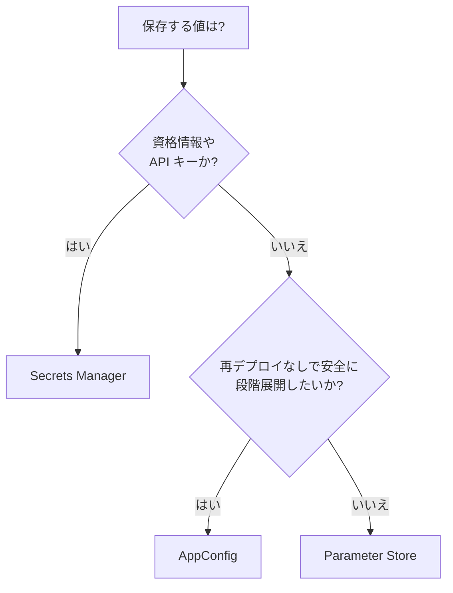
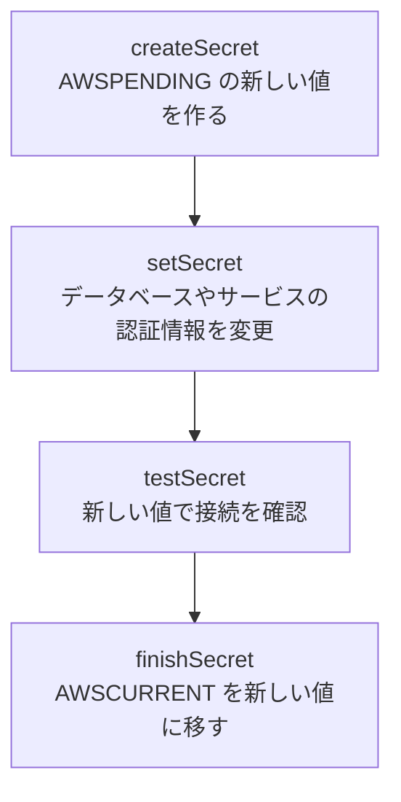

# Secrets Manager、Parameter Store、AppConfig

アプリの資格情報や設定値を、コードの外で安全に管理するためのサービス群です。資格情報なら Secrets Manager、一般の設定値なら Parameter Store、安全に段階展開したい設定や機能フラグなら AppConfig を使います。

[](../assets/diagrams/secrets-config.png)

## 3 つのサービスの比較 {#comparison}

| 観点 | Parameter Store | AppConfig | Secrets Manager |
| --- | --- | --- | --- |
| 主な用途 | 設定値、低リスクの秘密情報 | 機能フラグ、動的設定 | 資格情報、API キー |
| 自動ローテーション | なし | なし | あり |
| 暗号化 | `SecureString` と KMS で任意 | 保存時に暗号化。カスタマー管理キーも可 | KMS で必須 |
| 展開の制御 | バージョンのみ。事前検証やロールバックなし | 段階展開、事前検証、自動ロールバック | ステージングラベル |
| 料金 | スタンダードは無料。アドバンストと高スループットは有料 | リクエスト単位 | シークレット単位の月額と API 呼び出し |
| 値のサイズ上限 | 4 KB または 8 KB | - | 65,536 バイト |
| クロスアカウント | アドバンストで共有可 | - | リソースポリシー |

判断の目安は次のとおりです。



## Secrets Manager {#secrets-manager}

シークレットの暗号化、取得、ローテーション、監査を担います。値は文字列かバイナリで、複数の値は JSON にまとめるのが推奨です。

| API | 用途 | 注意点 |
| --- | --- | --- |
| `GetSecretValue` | 値の取得 | `secretsmanager:GetSecretValue` が必要。カスタマー管理キーなら `kms:Decrypt` も必要 |
| `BatchGetSecretValue` | 複数の取得 | 上限は秒間 100 回 |
| `PutSecretValue`, `UpdateSecret` | 値の更新 | 新しいバージョンができる |
| `RotateSecret` | ローテーションの実行 | |
| `DeleteSecret` | 削除 | 復旧期間は既定 30 日、最短 7 日 |
| `ReplicateSecretToRegion` | 他リージョンへの複製 | |

`GetSecretValue` の上限は秒間 10,000 回です。呼び出しのたびに料金もかかるので、キャッシュを前提にします。

### バージョンとステージングラベル {#version-labels}

| ラベル | 意味 |
| --- | --- |
| `AWSCURRENT` | 現在の値。指定がなければこれを返す |
| `AWSPREVIOUS` | 1 つ前の値 |
| `AWSPENDING` | ローテーション中の新しい値 |

前の値に戻すときは、`UpdateSecretVersionStage` でラベルを付け替えます。

### ローテーション {#rotation}

| 方式 | 対象 | Lambda |
| --- | --- | --- |
| マネージドローテーション | 他のサービスが管理するシークレット（RDS など） | 不要 |
| マネージド外部シークレット | パートナーが持つシークレット | 不要 |
| Lambda 関数によるローテーション | その他のシークレット | 必要 |

Lambda によるローテーションは、次の 4 ステップで呼ばれます。



データベースのシークレットには、2 つの戦略があります。

| 戦略 | 動作 | 向いている場面 |
| --- | --- | --- |
| シングルユーザー | 1 ユーザーのパスワードを更新。切り替えの一瞬に拒否される可能性あり | ほとんどの場合。一時的な利用者 |
| 交代ユーザー | 2 ユーザーを交互に更新。常に有効な資格情報がある | 高い可用性が必要な場合。別途 `superuser` のシークレットが必要 |

スケジュールは `rate()` または `cron()` で指定し、最短 4 時間ごと、ウィンドウは最短 1 時間です。VPC 内の Lambda で動かす場合、Secrets Manager への経路（VPC エンドポイントなど）が必要です。

### 取得とクライアント側キャッシュ {#retrieval-caching}

```python
import json
import boto3

client = boto3.client("secretsmanager")
secret = json.loads(
    client.get_secret_value(SecretId="prod/orders/db")["SecretString"]
)
```

Python のキャッシュコンポーネントを使うと、呼び出しの回数とレイテンシーを減らせます。

```python
import boto3
from aws_secretsmanager_caching import SecretCache, SecretCacheConfig

client = boto3.client("secretsmanager")
cache = SecretCache(config=SecretCacheConfig(), client=client)

value = cache.get_secret_string("prod/orders/db")
```

- 必要な権限は `secretsmanager:DescribeSecret` と `secretsmanager:GetSecretValue`。
- 既定で 1 時間ごとに更新し、あふれたときは LRU で破棄する。
- キャッシュを無効化する機能はないので、ローテーション直後は古い値が返ることがある。接続エラー時に取り直す処理を入れる。

### Lambda 拡張 {#lambda-extension}

AWS Parameters and Secrets Lambda Extension をレイヤーとして追加すると、ローカルの HTTP サーバー経由で値を取得でき、実行環境内にキャッシュされます。Secrets Manager と Parameter Store の両方に対応します。

```python
import json
import os
import urllib.request

URL = "http://localhost:2773/secretsmanager/get?secretId=prod/orders/db"


def get_secret():
    req = urllib.request.Request(
        URL,
        headers={"X-Aws-Parameters-Secrets-Token": os.environ["AWS_SESSION_TOKEN"]},
    )
    with urllib.request.urlopen(req) as res:
        return json.loads(json.loads(res.read())["SecretString"])
```

| 設定 | 既定 | 環境変数 |
| --- | --- | --- |
| HTTP ポート | 2773 | `PARAMETERS_SECRETS_EXTENSION_HTTP_PORT` |
| キャッシュの有効化 | TRUE | `PARAMETERS_SECRETS_EXTENSION_CACHE_ENABLED` |
| キャッシュの件数 | 1000 | `PARAMETERS_SECRETS_EXTENSION_CACHE_SIZE` |
| Secrets Manager の TTL | 300 秒 | `SECRETS_MANAGER_TTL` |
| Parameter Store の TTL | 300 秒 | `SSM_PARAMETER_STORE_TTL` |

実行ロールには、シークレットの取得権限が必要です。拡張は TTL が切れるまで変更を検知しないので、ローテーションの頻度に応じて TTL を短くします。VPC 内の関数には VPC エンドポイントが必要です。

### クロスアカウントでの利用 {#secrets-cross-account}

別アカウントからシークレットを読むには、次の 3 つが必要です。

1. シークレットのリソースポリシーで相手の主体を許可する。
2. 相手の主体の IAM ポリシーで `secretsmanager:GetSecretValue` を許可する。
3. シークレットをカスタマー管理キーで暗号化し、キーポリシーで相手に `kms:Decrypt` を許可する。

既定の `aws/secretsmanager` は AWS 管理キーなのでポリシーを変更できず、この構成には使えません。

## Systems Manager Parameter Store {#parameter-store}

設定値を階層的に保存するサービスです。`String`、`StringList`、`SecureString` の 3 種類の型があります。

### ティア {#parameter-tiers}

| 観点 | スタンダード | アドバンスト |
| --- | --- | --- |
| パラメータ数（アカウント、リージョンごと） | 10,000 | 100,000 |
| 値の最大サイズ | 4 KB | 8 KB |
| パラメータポリシー | 不可 | 可 |
| 他アカウントとの共有 | 不可 | 可 |
| 料金 | 追加料金なし | 有料 |
| ティアの変更 | アドバンストに変更可 | スタンダードに戻せない |

既定のティアは `Standard`、`Advanced`、`Intelligent-Tiering` から設定できます。

スループットはティアとは別の設定で、取得系 API の上限は次のとおりです。

| API | 既定 | 高スループット（有料） |
| --- | --- | --- |
| `GetParameter`, `GetParameters`, `GetParametersByPath` | 3 つの合計で 40 TPS | - |
| `GetParameter` | - | 10,000 TPS |
| `GetParameters` | - | 1,000 TPS |
| `GetParametersByPath` | - | 100 TPS |

上限を超えると、スロットリングのエラーになります。キャッシュと再試行で対処します。

### SecureString {#securestring}

`SecureString` は、値を KMS で暗号化します。パラメータ名は平文のままです。

| ティア | 暗号化の方法 | 呼ばれる KMS API |
| --- | --- | --- |
| スタンダード | KMS キーで直接暗号化 | `Encrypt`, `Decrypt` |
| アドバンスト | エンベロープ暗号化 | `GenerateDataKey`, `Decrypt` |

キーを指定しなければ、AWS 管理キー `aws/ssm` を使います。読むときは `WithDecryption=True` を指定します。カスタマー管理キーの場合、実行ロールに `kms:Decrypt` も必要です。

```python
import boto3

ssm = boto3.client("ssm")

ssm.put_parameter(
    Name="/prod/orders/api-endpoint",
    Value="https://api.example.com",
    Type="SecureString",
    KeyId="alias/app-key",
    Overwrite=True,
)

value = ssm.get_parameter(
    Name="/prod/orders/api-endpoint",
    WithDecryption=True,
)["Parameter"]["Value"]
```

### 階層 {#parameter-hierarchy}

スラッシュで階層を作ります。最大 15 階層です。

```text
/prod/orders/db/host
/prod/orders/db/port
/dev/orders/db/host
```

環境ごとの取得は、パスを変えるだけです。IAM でもパス単位で権限を絞れます。

```python
import boto3

ssm = boto3.client("ssm")
pages = ssm.get_paginator("get_parameters_by_path").paginate(
    Path="/prod/orders/",
    Recursive=True,
    WithDecryption=True,
)
config = {p["Name"]: p["Value"] for page in pages for p in page["Parameters"]}
```

```json
{
  "Effect": "Allow",
  "Action": ["ssm:GetParameter", "ssm:GetParametersByPath"],
  "Resource": "arn:aws:ssm:ap-northeast-1:111122223333:parameter/prod/orders/*"
}
```

### その他の機能 {#parameter-other}

- **バージョンとラベル**: 変更のたびにバージョン番号が増える。ラベルは特定のバージョンの別名で、`/app/ami:prod` のように参照できる。
- **パラメータポリシー**（アドバンストのみ）: `Expiration`、`ExpirationNotification`、`NoChangeNotification`。通知は EventBridge に届く。
- **Secrets Manager の参照**: `/aws/reference/secretsmanager/シークレット名` を `GetParameter` で読むと、Secrets Manager の値を取得できる。
- **自動ローテーションがない**: 資格情報の定期的な更新が必要なら Secrets Manager を使う。

## AWS AppConfig {#appconfig}

再デプロイせずにアプリの動作を変えるためのサービスです。機能フラグや動的な設定を、検証しながら段階的に配布し、問題があれば自動で戻します。

| 概念 | 意味 |
| --- | --- |
| アプリケーション | 設定をまとめる単位 |
| 環境 | `Beta`、`Production` などの配布先のグループ。CloudWatch アラームを設定できる |
| 設定プロファイル | 設定データの場所と種類、バリデーター |
| デプロイ戦略 | 配布の速さと監視時間 |

### 設定プロファイル {#config-profiles}

| 種類 | 保存先 | 用途 |
| --- | --- | --- |
| 機能フラグ | AppConfig のホスト型ストア | 機能のオンオフ、属性付きのフラグ、マルチバリアントのフラグ |
| フリーフォーム | ホスト型ストア、S3、CodePipeline、Secrets Manager、Parameter Store、SSM ドキュメント | 任意の設定データ |

AWS は、できるだけホスト型ストアを使うことを推奨しています。

### 機能フラグ {#feature-flags}

コードに新機能を入れたまま無効にしておき、デプロイと公開を分けられます。

```json
{
  "newCheckout": {"enabled": true, "maxItems": 20},
  "betaSearch": {"enabled": false}
}
```

機能フラグは自動で JSON スキーマの検証を受けます。マルチバリアントのフラグを使うと、ユーザーの情報に応じて異なる値を返せます。

### バリデーター {#validators}

設定プロファイルには、最大 2 つのバリデーターを指定できます。不正な設定を配布前に止めるためのものです。

| 種類 | 対応 | 検証の内容 |
| --- | --- | --- |
| JSON Schema | フリーフォーム | 構造の検証 |
| Lambda 関数 | 機能フラグ、フリーフォーム | 独自のロジックによる検証 |

### デプロイ戦略 {#deployment-strategies}

| 設定 | 意味 |
| --- | --- |
| デプロイタイプ | `Linear` または `Exponential` |
| ステップ割合（growth factor） | 各ステップで増やす割合 |
| デプロイ時間 | 配布を処理する時間。タイムアウトではない |
| ベイク時間 | 100% 配布後にアラームを監視する時間 |

用意されている戦略は次のとおりです。

| 名前 | 動作 | 位置づけ |
| --- | --- | --- |
| `AppConfig.Linear20PercentEvery6Minutes` | 6 分ごとに 20%、計 30 分 | AWS 推奨 |
| `AppConfig.Canary10Percent20Minutes` | 10% の成長率で指数的に 20 分 | AWS 推奨 |
| `AppConfig.AllAtOnce` | すべてに即時 | 急ぐとき |
| `AppConfig.Linear50PercentEvery30Seconds` | 30 秒ごとに 50% | テスト、デモ |

### ロールバック {#appconfig-rollback}

環境に CloudWatch アラームを設定すると、配布中とベイク時間中にアラームが発生した場合、自動でロールバックします。AppConfig がアラームを読むための IAM ロールが必要です。手動なら `StopDeployment` で停止します。

### 設定の取得 {#appconfig-retrieval}

取得用のデータプレーン API は 2 つです。

```python
import boto3

client = boto3.client("appconfigdata")

token = client.start_configuration_session(
    ApplicationIdentifier="orders",
    EnvironmentIdentifier="prod",
    ConfigurationProfileIdentifier="flags",
)["InitialConfigurationToken"]

resp = client.get_latest_configuration(ConfigurationToken=token)
token = resp["NextPollConfigurationToken"]  # 次の呼び出しではこれを使う
config = resp["Configuration"].read()       # 変更がなければ空
```

- トークンは毎回新しいものを使う。有効期間は最大 24 時間。
- Lambda では AppConfig Agent の Lambda 拡張が推奨で、`localhost:2772` から取得できる。キャッシュにより、呼び出し回数とコストを抑えられる。

## 環境ごとの設定 {#environment-config}

コードは同じまま、環境ごとに値を変えます。

| 手段 | 使い方 | 向いている値 |
| --- | --- | --- |
| Lambda 環境変数 | 関数のバージョンごとに固定 | テーブル名、参照先のパラメータ名 |
| Lambda エイリアス | `dev`、`prod` のように指す先を切り替え | 環境とバージョンの対応づけ |
| API Gateway のステージ変数 | ステージごとの値。統合先の切り替えなど | Lambda のエイリアス名、バックエンド URL |
| Parameter Store | `/prod/...` のように階層で分ける | 環境ごとの設定値 |
| Secrets Manager | `prod/db` のように名前で分ける | 環境ごとの資格情報 |
| AppConfig | 環境ごとに設定を配布 | 実行中に変えたい設定、機能フラグ |
| CloudFormation、SAM のパラメータ | デプロイ時に環境の値を渡す | インフラの差異 |

```yaml
# SAM の例: 環境名を環境変数に渡し、コードはパスを組み立てる
Parameters:
  Stage:
    Type: String
Resources:
  OrdersFunction:
    Type: AWS::Serverless::Function
    Properties:
      Handler: app.handler
      Runtime: python3.13
      Environment:
        Variables:
          STAGE: !Ref Stage
          CONFIG_PATH: !Sub "/${Stage}/orders/"
```

!!! warning "ステージ変数に秘密情報を入れない"
    API Gateway のステージ変数は機密データ向けではありません。Lambda 環境変数の平文も、関数を閲覧できる人に見えます。資格情報は Secrets Manager に置き、環境変数にはその名前だけを渡します。

## データ分類 {#data-classification}

データの機密度を分類し、それに応じて保存、ログ、アクセスの扱いを決めます。

| 分類 | 意味 | 例 |
| --- | --- | --- |
| PII（個人を特定できる情報） | 個人を特定できる、または結び付けられる情報 | 氏名、住所、メールアドレス、電話番号、政府発行の番号 |
| PHI（保護対象の医療情報） | 個人に結び付く健康や医療に関する情報 | 診療記録、保険の番号、検査結果 |
| 機密（業務） | 漏えいすると事業に影響する情報 | 認証情報、暗号鍵、財務情報 |
| 公開 | 公開してよい情報 | カタログ情報 |

分類に応じて、次のように対策します。

| 対策 | 手段 |
| --- | --- |
| 収集の最小化 | 不要な項目を受け取らない、保存しない |
| 保存時の暗号化 | [KMS](kms.md)、必要ならフィールド単位のクライアント側暗号化 |
| 転送時の暗号化 | TLS |
| アクセスの制限 | IAM、キーポリシー、きめ細かいアクセス制御 |
| ログへの出力の制限 | サニタイズ、CloudWatch Logs のデータ保護 |
| 保持期間 | S3 ライフサイクル、ログの保持設定、DynamoDB TTL |
| 監査 | CloudTrail |

## サニタイズとマスキング {#sanitization-masking}

用語を整理します。

| 手法 | 動作 | 元の値に戻せるか | 例 |
| --- | --- | --- | --- |
| サニタイズ | 不要、危険な値を取り除く | 不可 | ログからパスワードを除外 |
| マスキング | 一部を隠す | 不可 | `****-****-****-1234` |
| トークン化 | 別の値に置き換え、対応表で管理 | 対応表があれば可 | `tok_a1b2` |
| ハッシュ化 | 一方向の変換 | 不可 | 突合用の識別子 |
| 暗号化 | 鍵で変換 | 鍵があれば可 | フィールド単位の暗号化 |

### アプリケーションでの処理 {#app-masking}

ログに書く直前で必ず処理します。よくある間違いは、イベントやリクエスト全体をそのままログに書くことです。

```python
import hashlib
import json
import logging
import re

logger = logging.getLogger()
logger.setLevel(logging.INFO)

EMAIL = re.compile(r"[\w.+-]+@[\w-]+\.[\w.-]+")
SENSITIVE_KEYS = {"password", "token", "authorization", "card_number"}


def sanitize(value):
    if isinstance(value, dict):
        return {
            k: "***" if k.lower() in SENSITIVE_KEYS else sanitize(v)
            for k, v in value.items()
        }
    if isinstance(value, list):
        return [sanitize(v) for v in value]
    if isinstance(value, str):
        return EMAIL.sub("***@***", value)
    return value


def mask_card(number: str) -> str:
    return "*" * (len(number) - 4) + number[-4:]


def user_key(email: str, salt: bytes) -> str:
    # 同じ人のログを追えるが、メールアドレスは残さない
    return hashlib.sha256(salt + email.encode()).hexdigest()


def lambda_handler(event, context):
    logger.info(json.dumps({"event": sanitize(event)}))
```

実装の指針は次のとおりです。

- 除外リストより許可リストを優先する。ログに書く項目を明示的に選ぶ。
- 入力のサニタイズ（検証、エスケープ）と出力のサニタイズを分けて考える。
- エラーメッセージやスタックトレースに、値が混ざらないようにする。
- API の応答でも、呼び出し元の権限に応じて項目を削る。
- メトリクスのディメンション、トレースの注釈、URL のクエリ文字列にも機密情報を入れない。
- ハッシュ化する値が推測しやすいなら、ソルトや HMAC を使う。

### CloudWatch Logs のデータ保護 {#cloudwatch-data-protection}

ロググループにデータ保護ポリシーを設定すると、取り込むログから機密データを検出してマスキングします。アプリの処理が漏れた場合の防御層になります。

```bash
aws logs put-data-protection-policy \
  --log-group-identifier /aws/lambda/orders \
  --policy-document file://policy.json
```

```json
{
  "Name": "orders-data-protection",
  "Version": "2021-06-01",
  "Statement": [
    {
      "Sid": "audit",
      "DataIdentifier": ["arn:aws:dataprotection::aws:data-identifier/EmailAddress"],
      "Operation": {"Audit": {"FindingsDestination": {}}}
    },
    {
      "Sid": "redact",
      "DataIdentifier": ["arn:aws:dataprotection::aws:data-identifier/EmailAddress"],
      "Operation": {"Deidentify": {"MaskConfig": {}}}
    }
  ]
}
```

- アカウント全体、または個別のロググループに設定できる。両方あれば両方が適用される。
- ロググループごとのポリシーは 1 つ。上限は 30,720 文字。
- 検出にはマネージドデータ識別子（金融、PHI、PII）と、正規表現のカスタムデータ識別子を使う。
- マスキングは取り込み時に行われる。ポリシー設定前のログはマスキングされない。
- Logs Insights、メトリクスフィルター、サブスクリプションフィルターなど、出口のすべてでマスキングされる。
- マスクされていないデータを見られるのは `logs:Unmask` を持つ主体のみ。

### その他のサービス {#other-data-services}

| 対象 | 使うもの |
| --- | --- |
| DynamoDB の特定の属性を隠す | IAM の `dynamodb:Attributes` 条件。`ProjectionExpression` の指定も必須にする |
| S3 の特定のプレフィックスのみ許可 | バケットポリシー、S3 Access Points |
| 生成 AI の入出力の PII | Amazon Bedrock Guardrails（[AI](ai.md) を参照） |
| 監査ログ | CloudTrail。データイベントは別途有効にする |

!!! note "Amazon Macie"
    Macie は S3 内の機密データを検出するサービスです。DVA-C03 の対象サービス一覧には載っていないので、「S3 全体を調べるサービスがある」と知っておく程度で十分です。

## マルチテナントのデータアクセス {#multi-tenant}

複数の顧客（テナント）のデータを、他のテナントから見えないように分離します。分離の単位で 3 つのモデルがあります。

| モデル | 分離の方法 | 分離の強さ | コスト、運用 |
| --- | --- | --- | --- |
| サイロ | テナントごとに専用のリソース（アカウント、テーブル、DB） | 強い | 高い。テナント数に比例して増える |
| プール | リソースを共有し、テナント ID で分ける | アプリと条件に依存 | 低い |
| ブリッジ | 一部を共有し、一部を専用にする | 中間 | 中間 |

### パターンの比較 {#tenant-patterns}

| パターン | 仕組み | 使える場面 |
| --- | --- | --- |
| パーティションキーに分離 | DynamoDB の PK を `TENANT#a#...` にし、`dynamodb:LeadingKeys` で制限 | プール |
| S3 プレフィックス | `tenants/${aws:PrincipalTag/TenantId}/*` で制限 | プール |
| テナントごとのシークレット | `tenants/a/db` のように分け、名前やタグで制限 | サイロ、ブリッジ |
| テナントごとの KMS キー | テナント単位の監査、失効 | 暗号学的な分離が必要な場合 |
| 行レベルセキュリティ | Aurora PostgreSQL などのデータベース機能 | RDB のプール |
| アカウント分離 | テナントごとの AWS アカウント | 最も強い分離 |

### 動的なセッションによる分離 {#tenant-sessions}

コードのバグに備え、IAM でもテナントを制限します。認証で得たテナント ID を、ロールのセッションタグに入れます。

```python
import boto3

sts = boto3.client("sts")


def tenant_session(tenant_id: str) -> boto3.Session:
    # tenant_id は検証済みの JWT クレームから取る
    resp = sts.assume_role(
        RoleArn="arn:aws:iam::111122223333:role/TenantDataAccess",
        RoleSessionName=f"tenant-{tenant_id}",
        Tags=[{"Key": "TenantId", "Value": tenant_id}],
        DurationSeconds=900,
    )
    c = resp["Credentials"]
    return boto3.Session(
        aws_access_key_id=c["AccessKeyId"],
        aws_secret_access_key=c["SecretAccessKey"],
        aws_session_token=c["SessionToken"],
    )
```

ロールの許可ポリシーでは、タグの値とリソースを一致させます。信頼ポリシーには `sts:TagSession` も許可します。

```json
{
  "Effect": "Allow",
  "Action": ["dynamodb:GetItem", "dynamodb:Query", "dynamodb:PutItem"],
  "Resource": "arn:aws:dynamodb:*:*:table/SharedData",
  "Condition": {
    "ForAllValues:StringEquals": {
      "dynamodb:LeadingKeys": ["${aws:PrincipalTag/TenantId}"]
    }
  }
}
```

実装の注意点は次のとおりです。

- テナント ID は検証済みのトークンから取る。リクエストのパラメータや本文を信用しない。
- テナント ID のクレームは、利用者が書き換えられないようにする。
- キャッシュのキーにもテナント ID を含める。
- ログとメトリクスにテナント ID を付けて追跡できるようにする。
- 1 テナントがリソースを使い切らないよう、使用量プランなどで制限する。

## Secrets Manager の設定の詳細 {#secrets-manager-settings}

### ローテーションのスケジュール {#rotation-schedule}

`RotateSecret` の `RotationRules` で設定します。

| 項目 | 値 |
| --- | --- |
| `ScheduleExpression` | `rate()` または `cron()`。時刻は UTC |
| `AutomaticallyAfterDays` | 1〜1,000 日。`ScheduleExpression` とは同時に指定できない |
| `rate()` | 最短 4 時間、最長 999 日 |
| `Duration` | ローテーションウィンドウの長さ。最短 1 時間。次のウィンドウや UTC の翌日にまたがれない |
| 既定のウィンドウ | 時間単位なら 1 時間、日単位なら当日の終わりまで |
| `RotateImmediately` | 既定 `true`。`false` なら次のウィンドウまで待ち、`testSecret` で設定を試す |

```bash
aws secretsmanager rotate-secret --secret-id prod/orders/db \
  --rotation-lambda-arn arn:aws:lambda:ap-northeast-1:111122223333:function:rotate \
  --rotation-rules '{"ScheduleExpression":"cron(0 16 ? * SAT *)","Duration":"2h"}'
```

この例は毎週土曜 16:00 UTC（日本時間の日曜 1:00）から 2 時間以内に実行します。cron に JST の時刻を書くと、9 時間ずれます。

ウィンドウ内のいつかに実行されるので、正確な時刻に動くわけではありません。

### Lambda ローテーションの動き {#lambda-rotation-steps}

Secrets Manager が同じ関数を 4 回呼びます。イベントには `Step`、`SecretId`、`ClientRequestToken`（新しいバージョンの ID）が入ります。

| ステップ | すること | ラベル |
| --- | --- | --- |
| `createSecret` | `GetRandomPassword` などで新しい値を作り、保存する | 新バージョンに `AWSPENDING` |
| `setSecret` | データベースなどの認証情報を変更する | 変化なし |
| `testSecret` | `AWSPENDING` の値で接続を確認する | 変化なし |
| `finishSecret` | `AWSCURRENT` を新バージョンに移す | 旧バージョンに `AWSPREVIOUS` |

| 設定 | 注意 |
| --- | --- |
| 関数のリソースベースポリシー | `secretsmanager.amazonaws.com` からの呼び出しを許可する |
| 実行ロール | `GetSecretValue`, `PutSecretValue`, `UpdateSecretVersionStage`, `DescribeSecret`、カスタマー管理キーなら `kms:Decrypt`, `kms:GenerateDataKey` |
| ネットワーク | データベースと Secrets Manager の両方に届く。VPC 内なら VPC エンドポイントか NAT |
| 同時実行 | 予約した同時実行を 10 未満にすると、スロットリングする場合がある |
| べき等性 | 再試行されるので、各ステップは同じトークンで何度呼ばれても壊れないようにする |

`testSecret` が失敗すると、`AWSCURRENT` は動きません。アプリは前の値のままですが、シングルユーザーで `setSecret` まで進んでいるとデータベースのパスワードだけが変わっていて、接続エラーになります。

`AWSPENDING` が残っていると、次のローテーションが失敗します。CloudWatch Logs の関数のログを確認します。

### バージョンの扱い {#version-stages}

| 項目 | 内容 |
| --- | --- |
| バージョンの上限 | 100。超えるとラベルなしの古いものから削除。24 時間以内に作ったものは残す |
| ラベルの上限 | シークレット全体で 20 |
| ラベルなしのバージョン | 非推奨の扱い |
| 取得の指定 | `VersionStage` か `VersionId`。未指定なら `AWSCURRENT` |

短い間隔で値を更新し続けると、24 時間以内のバージョンが増え、上限で `LimitExceededException` になりえます。

**ロールバック**: `AWSCURRENT` を前のバージョンに移します。

```bash
aws secretsmanager update-secret-version-stage --secret-id prod/orders/db \
  --version-stage AWSCURRENT \
  --move-to-version-id <AWSPREVIOUS の ID> \
  --remove-from-version-id <今の AWSCURRENT の ID>
```

### 削除と復旧 {#recovery-window}

| 設定 | 値 |
| --- | --- |
| `RecoveryWindowInDays` | 7〜30 日。既定 30 日 |
| `ForceDeleteWithoutRecovery` | 復旧期間なしで削除。実際の削除は非同期で、少し遅れることがある。`RecoveryWindowInDays` と同時に指定できない |
| 復旧 | `RestoreSecret` で `DeletionDate` を消す |
| 削除待ちの料金 | かからない |

削除待ちの間は `GetSecretValue` に失敗します（`InvalidRequestException`）。同じ名前のシークレットも作れません。すぐに同じ名前を使いたいテストでは `ForceDeleteWithoutRecovery` を使い、作成が失敗したら間隔を空けて再試行します。

本番で使っていそうなら、CloudWatch アラームで削除待ちのシークレットへのアクセスを検知します。

### 他リージョンへの複製 {#secret-replication}

| 項目 | 内容 |
| --- | --- |
| 作成 | `ReplicateSecretToRegion` または `CreateSecret` の `AddReplicaRegions` |
| 同期 | プライマリの値と暗号化された内容が同期。ローテーションはプライマリのみで実行すれば反映 |
| レプリカの暗号化 | リージョンごとに KMS キーを指定する |
| 独立 | `StopReplicationToReplica` でスタンドアロンに昇格 |
| 削除 | プライマリを先に消せない。`RemoveRegionsFromReplication` でレプリカを消してからプライマリを消す |
| 料金 | レプリカも課金対象 |

データベースの認証情報を複製しても、値は元のデータベースのエンドポイントのままです。レプリカで使うなら、リージョンのデータベース用に値を調整します。

### リソースポリシー {#secret-resource-policy}

`PutResourcePolicy` で付与します。既存のポリシーは置き換えられます。上限は 20,480 文字です。

```bash
aws secretsmanager put-resource-policy --secret-id prod/orders/db \
  --resource-policy file://policy.json --block-public-policy
```

`--block-public-policy` を付けると、公開するポリシーを拒否します。

### 暗号化と料金 {#secret-encryption-cost}

エンベロープ暗号化を使い、バージョンごとにデータキーを作ります。

- AWS 管理キー `aws/secretsmanager` は無料。ただしクロスアカウントに使えない。
- カスタマー管理キーは KMS の料金がかかる。読む主体に `kms:Decrypt` が必要。
- `UpdateSecret` でキーを変更すると、`AWSCURRENT`, `AWSPENDING`, `AWSPREVIOUS` は新しいキーで再暗号化される。

シークレットごとの月額と、API 呼び出しの料金があります。Parameter Store より高いので、資格情報のローテーションが要らない値には Parameter Store も検討します。

### GetRandomPassword {#get-random-password}

`PasswordLength` は既定 32、1〜4,096 です。`ExcludeCharacters` で、データベースが受け付けない文字を除けます。

### キャッシュの選び方 {#caching-choice}

| 方法 | TTL | 向いている場面 |
| --- | --- | --- |
| Python などのキャッシュライブラリ | 既定 1 時間 | EC2, ECS などの長時間動くプロセス |
| Parameters and Secrets Lambda Extension | 既定 300 秒。0〜300 秒 | Lambda |
| Powertools for AWS Lambda | 既定 5 秒 | Lambda のコード内 |

拡張の追加の設定です。

| 環境変数 | 既定 | 内容 |
| --- | --- | --- |
| `SECRETS_MANAGER_TTL` | 300 | 0 でキャッシュなし。`PARAMETERS_SECRETS_EXTENSION_CACHE_SIZE` が 0 なら無視 |
| `SECRETS_MANAGER_TIMEOUT_MILLIS` | 0（無制限） | リクエストのタイムアウト |
| `SSM_PARAMETER_STORE_TIMEOUT_MILLIS` | 0（無制限） | 同上 |

`secretId` は URL エンコードします。`X-Aws-Parameters-Secrets-Token` がないと拒否されます。ローテーションで古い値が使えなくなったら、`versionStage=AWSCURRENT` を指定するか、TTL を短くします。

### CloudFormation の動的参照 {#dynamic-references}

```yaml
Resources:
  Database:
    Type: AWS::RDS::DBInstance
    Properties:
      MasterUsername: '{{resolve:secretsmanager:prod/orders/db:SecretString:username}}'
      MasterUserPassword: '{{resolve:secretsmanager:prod/orders/db:SecretString:password}}'
  Queue:
    Type: AWS::SQS::Queue
    Properties:
      QueueName: '{{resolve:ssm:/prod/orders/queue-name:3}}'
```

| 種類 | 形式 |
| --- | --- |
| Parameter Store の平文 | `{{resolve:ssm:名前:バージョン}}`。`Parameters` セクションではバージョン必須 |
| `SecureString` | `{{resolve:ssm-secure:名前:バージョン}}`。対応するプロパティのみ |
| Secrets Manager | `{{resolve:secretsmanager:ID:SecretString:JSONキー:ステージ:バージョンID}}` |

| 注意点 | 内容 |
| --- | --- |
| 数 | テンプレートあたり 60 個 |
| 使えない場所 | 機密値のカスタムリソース、`AWS::CloudFormation::Init`、EC2 の `UserData` |
| 値の更新 | シークレットを更新しても自動で反映されない。そのプロパティを持つリソースの更新時のみ取得する |
| ドリフト | 検出の対象外 |
| 共有パラメータ | 別アカウントから共有されたパラメータは参照できない |
| ロールバック | `ssm-secure` の指定のバージョンがなくなると、ロールバックが失敗する |

## Parameter Store の設定の詳細 {#parameter-store-settings}

### PutParameter の設定 {#put-parameter-settings}

```bash
aws ssm put-parameter --name /prod/orders/timeout --type String \
  --value 30 --allowed-pattern '^\d+$' --tier Intelligent-Tiering --overwrite
```

| パラメータ | 内容 |
| --- | --- |
| `Name` | 大文字と小文字を区別。階層なら先頭に `/`。階層は 15 まで |
| `Type` | `String`, `StringList`（カンマ区切り）, `SecureString` |
| `Overwrite` | 既定 `false`。既存の名前を `false` で更新すると `ParameterAlreadyExists` |
| `AllowedPattern` | 値を検証する正規表現 |
| `KeyId` | `SecureString` の KMS キー。省略で既定のキー |
| `Tier` | `Standard`, `Advanced`, `Intelligent-Tiering` |
| `Policies` | パラメータポリシーの JSON |
| `DataType` | `text`, `aws:ec2:image` など |

### ティアの選択 {#tier-selection}

**既定のティアは個別のティアとは別の設定**で、アカウントとリージョンごとに持ちます。変えても、既存のパラメータには影響しません。

Intelligent-Tiering は、次のどれかに当たれば Advanced に、それ以外なら Standard にします。

- 値が 4 KB より大きい
- パラメータポリシーを使う
- そのアカウントとリージョンに、すでに 10,000 個のパラメータがある

5 KB の値を `Standard` で書き込むと失敗します。一度 Advanced になると Standard には戻せません。戻したいなら削除して作り直します。

### パラメータポリシー {#parameter-policies}

Advanced のみ使えます。1 つのパラメータに複数を設定できます。

```json
[
  {"Type": "Expiration", "Version": "1.0",
   "Attributes": {"Timestamp": "2026-12-31T15:00:00.000Z"}},
  {"Type": "ExpirationNotification", "Version": "1.0",
   "Attributes": {"Before": "15", "Unit": "Days"}},
  {"Type": "NoChangeNotification", "Version": "1.0",
   "Attributes": {"After": "20", "Unit": "Days"}}
]
```

| 種類 | 動作 |
| --- | --- |
| `Expiration` | 指定の日時にパラメータを削除する |
| `ExpirationNotification` | 期限の前に EventBridge にイベントを送る。単位は日または時間 |
| `NoChangeNotification` | 指定の期間変更がなければ EventBridge にイベントを送る |

ポリシーは非同期の定期スキャンで実行されます。指定の時刻ちょうどとは限りません。

### 階層と取得 {#parameter-retrieval}

| API | 動作 | 上限 |
| --- | --- | --- |
| `GetParameter` | 1 つ取得 | |
| `GetParameters` | 複数を名前で取得 | 1 回 10 個。存在しない名前は `InvalidParameters` に入る |
| `GetParametersByPath` | パス配下を取得 | `MaxResults` は 1〜10。`NextToken` でページング |

`GetParametersByPath` は `Recursive` が既定で `false` です。`/prod/orders` だけ指定すると、`/prod/orders/db/host` は返りません。応答が空のページでも `NextToken` があれば続きがあるので、ページネーターを使います。

IAM ではパスを `Resource` で絞ります。`SecureString` を読むなら、`kms:Decrypt` も必要です。

`GetParametersByPath` では、`/a` へのアクセスを持つ主体は、`/a/b` を IAM で明示的に拒否していても、`Recursive=true` で取得できます。配下を隠したいなら、上の階層の権限を渡さないように設計します。

### バージョンとラベル {#parameter-versions}

| 項目 | 内容 |
| --- | --- |
| 履歴 | 100 バージョン。超えると最も古いものを削除 |
| 例外 | 最古のバージョンにラベルがあると削除されず、`PutParameter` が失敗する（`ParameterMaxVersionLimitExceeded`） |
| ラベルの数 | 1 バージョンに 10 個 |
| ラベルの一意性 | 同じラベルを別のバージョンに付けられない。移動はできる |
| 作成時のラベル | 指定できない。後から `LabelParameterVersion` で付ける |
| 参照 | `name:3`（バージョン）、`name:prod`（ラベル） |

存在しないバージョンやラベルを指定すると失敗します。最新の値には戻りません。

### スループット {#parameter-throughput}

| API | 既定 | 高スループット |
| --- | --- | --- |
| `GetParameter`, `GetParameters`, `GetParametersByPath` | 合計 40 TPS | 10,000 / 1,000 / 100 TPS |
| `DeleteParameter`, `DeleteParameters` | 3 TPS | 5 TPS |
| `PutParameter`, `DescribeParameters`, `GetParameterHistory`, `LabelParameterVersion`, `UnlabelParameterVersion` | 3 TPS | 10 TPS |

アカウントとリージョン単位で共有します。Lambda が 100 個同時に起動し、それぞれ 1 回 `GetParameter` を呼ぶと、40 TPS を超えて `ThrottlingException` になります。

パラメータごとの設定ではなく、`update-service-setting` でアカウント全体に有効にします。高スループットは API 呼び出しごとに課金されるので、まずキャッシュを検討します。

### パブリックパラメータ {#public-parameters}

AWS が公開する値です。最新の AMI ID をハードコードせずに取得できます。

```bash
aws ssm get-parameters-by-path \
  --path /aws/service/ami-amazon-linux-latest --query 'Parameters[].Name'
```

CloudFormation のパラメータ型 `AWS::SSM::Parameter::Value<AWS::EC2::Image::Id>` と組み合わせると、デプロイ時に最新の AMI を解決できます。

### 共有パラメータ {#shared-parameters}

AWS RAM で共有します。Advanced のみです。共有された側は ARN で読みます。`SecureString` はカスタマー管理キーを別に共有します。既定の AWS 管理キーのものは共有できません。

## AppConfig の設定の詳細 {#appconfig-settings}

### 構成要素の階層 {#appconfig-hierarchy}

1 つのアプリケーションの下に、環境と設定プロファイルを作ります。デプロイは「環境、プロファイルのバージョン、戦略」を指定します。

環境には、一度に 1 つの設定しかデプロイできません。別の環境には同時にデプロイできます。

### デプロイ戦略の項目 {#strategy-fields}

| API の項目 | 範囲 | 内容 |
| --- | --- | --- |
| `DeploymentDurationInMinutes` | 0〜1,440 | 配布にかける時間 |
| `FinalBakeTimeInMinutes` | 0〜1,440 | 100% 配布後に監視する時間 |
| `GrowthFactor` | 1.0〜100.0 | 各ステップの割合 |
| `GrowthType` | `LINEAR`, `EXPONENTIAL` | 増え方 |
| `ReplicateTo` | `NONE`, `SSM_DOCUMENT` | 戦略の保存先 |

`EXPONENTIAL` は `G*(2^N)` です。`GrowthFactor` が 2 なら、2%、4%、8% と増えます。

`LINEAR` で `GrowthFactor=20`、`DeploymentDurationInMinutes=30` なら、6 分ごとに 20% ずつ増えます。

| 事前定義の戦略 | 配布 | 監視（ベイク） |
| --- | --- | --- |
| `AppConfig.Linear20PercentEvery6Minutes` | 6 分ごとに 20%、30 分 | 30 分 |
| `AppConfig.Canary10Percent20Minutes` | 成長率 10% で指数的に 20 分 | 10 分 |
| `AppConfig.AllAtOnce` | 即時 | 10 分 |
| `AppConfig.Linear50PercentEvery30Seconds` | 30 秒ごとに 50%、1 分 | 1 分 |

### バリデーターの動き {#validator-details}

| 項目 | 内容 |
| --- | --- |
| 数 | プロファイルあたり 2 つまで |
| Lambda | イベントに base64 の内容と URI が入る。例外を投げると検証失敗（`X-Amz-Function-Error`） |
| JSON Schema | フリーフォーム向け。機能フラグは自動で検証される |

Lambda バリデーターを使うときは、AppConfig からの呼び出しを許可します。検証に失敗するとデプロイは開始されません。

### アラームとロールバック {#alarm-rollback}

環境の `Monitors` に、`AlarmArn` と `AlarmRoleArn` を設定します。ロールには `cloudwatch:DescribeAlarms` が必要です。

```bash
aws appconfig create-environment --application-id abc123 --name Production \
  --monitors AlarmArn=arn:aws:cloudwatch:ap-northeast-1:111122223333:alarm:errors,AlarmRoleArn=arn:aws:iam::111122223333:role/AppConfigMonitor
```

| 状況 | 動作 |
| --- | --- |
| デプロイ中、ベイク中にアラームが `ALARM` | 自動ロールバック |
| アラームのアクションが無効 | 自動ロールバックしない |
| 進行中に止める | `StopDeployment` |
| 完了後に前のバージョンに戻す | `StopDeployment` の `AllowRevert` |

`FinalBakeTimeInMinutes` が 0 だと、完了後に発生したアラームではロールバックしません。

### 取得とポーリング {#polling-settings}

| 項目 | 値 |
| --- | --- |
| `RequiredMinimumPollIntervalInSeconds` | 15〜86,400 |
| トークン | 1 回限り。最大 24 時間有効。期限切れは `BadRequestException` |
| `GetConfiguration`（旧 API） | 非推奨。暗号化された設定に未対応 |
| 空の応答 | クライアントがすでに最新を持っているという意味 |

`StartConfigurationSession` は、アプリケーション、環境、プロファイル、クライアントごとに 1 回だけ呼びます。ループの中で毎回呼ぶと無駄が増えます。

応答の `NextPollIntervalInSeconds` の間隔を守り、`NextPollConfigurationToken` を次の呼び出しに使います。

`Configuration` が空だからといって設定が消えたわけではありません。前回の値を保持する必要があります。これを忘れると、2 回目の呼び出しで設定が空になるバグになります。

### AppConfig Agent {#appconfig-agent-settings}

AWS が推奨する取得方法で、EC2、ECS、EKS、Lambda で使えます。

```text
GET http://localhost:2772/applications/orders/environments/prod/configurations/flags
```

| 環境変数（Lambda 拡張） | 既定 | 内容 |
| --- | --- | --- |
| `AWS_APPCONFIG_EXTENSION_HTTP_PORT` | 2772 | ローカルのポート |
| `AWS_APPCONFIG_EXTENSION_POLL_INTERVAL_SECONDS` | 45 | ポーリングの間隔 |
| `AWS_APPCONFIG_EXTENSION_POLL_TIMEOUT_MILLIS` | 3000 ミリ秒 | 取得の待ち時間。超えるとキャッシュの値を返す |
| `AWS_APPCONFIG_EXTENSION_PREFETCH_LIST` | なし | 起動時に取得する設定。コールドスタートを短くする |
| `AWS_APPCONFIG_EXTENSION_ROLE_ARN` | なし | 取得に引き受けるロール |

最初の呼び出しはキャッシュがないので遅くなります。ポーリング間隔を短くすると変更の反映が早くなりますが、その分の API 料金が増えます。

## 既定値と上限のまとめ {#numbers}

| 項目 | 値 |
| --- | --- |
| シークレットの値 | 65,536 バイト |
| シークレットのバージョン | 100 |
| シークレットのラベル | 20 |
| リソースポリシー | 20,480 文字 |
| 復旧期間 | 既定 30 日。7〜30 日 |
| ローテーションの最短間隔 | 4 時間 |
| ローテーションウィンドウ | 最短 1 時間 |
| `AutomaticallyAfterDays` | 1〜1,000 |
| `GetSecretValue` | 秒間 10,000 |
| `BatchGetSecretValue` | 秒間 100 |
| `GetRandomPassword` の長さ | 既定 32。1〜4,096 |
| CloudFormation の動的参照 | テンプレートあたり 60 |
| パラメータ数 | Standard 10,000。Advanced 100,000 |
| パラメータの値 | Standard 4 KB。Advanced 8 KB |
| パラメータの階層 | 15 |
| パラメータの履歴 | 100 バージョン |
| ラベル | バージョンあたり 10 |
| `GetParameters` | 1 回 10 個 |
| `GetParametersByPath` の `MaxResults` | 1〜10 |
| 取得のスループット | 既定 40 TPS。高スループットは最大 10,000 TPS |
| Lambda 拡張の TTL | 既定 300 秒。0〜300 |
| Lambda 拡張のポート | Secrets Manager と Parameter Store は 2773。AppConfig は 2772 |
| AppConfig の時間の項目 | 0〜1,440 分 |
| AppConfig のバリデーター | 2 つ |
| AppConfig の最小ポーリング間隔 | 15〜86,400 秒 |
| AppConfig Agent のポーリング | 既定 45 秒 |
| AppConfig のトークン | 最大 24 時間 |

## 試験のポイント {#exam-points}

| こう問われたら | 答え |
| --- | --- |
| データベースのパスワードを自動ローテーション | Secrets Manager |
| 低コストで設定値を階層的に保存 | Parameter Store |
| 再デプロイせずに機能を段階的に公開 | AppConfig の機能フラグ |
| 不正な設定を配布前に防ぐ | AppConfig のバリデーター（JSON Schema、Lambda） |
| 設定の配布でエラーが増えたら自動で戻す | AppConfig と CloudWatch アラーム |
| Lambda のコールドスタートごとにシークレット取得が遅い、高い | Parameters and Secrets Lambda Extension でキャッシュ |
| Lambda 拡張の呼び出し先 | `localhost:2773`、`X-Aws-Parameters-Secrets-Token` ヘッダー |
| 高可用性の DB ローテーション | 交代ユーザー戦略 |
| Lambda のローテーションの手順 | `createSecret`、`setSecret`、`testSecret`、`finishSecret` |
| ローテーション中の新しい値のラベル | `AWSPENDING` |
| 8 KB のパラメータや有効期限の設定 | アドバンストティアとパラメータポリシー |
| `SecureString` を読むと暗号文が返る | `WithDecryption=True` と `kms:Decrypt` |
| Parameter Store の取得で上限に達した | 高スループットの有効化、キャッシュ |
| 環境ごとに異なる値を同じコードで | 階層、ステージ変数、環境変数、AppConfig の環境 |
| ログのメールアドレスを自動でマスク | CloudWatch Logs のデータ保護ポリシー |
| マスクされていないログを見る権限 | `logs:Unmask` |
| ポリシー設定前のログもマスクされるか | されない |
| 共有テーブルでテナントを分離 | `dynamodb:LeadingKeys` とセッションタグ |
| 別アカウントからシークレットを読む | リソースポリシー、IAM、カスタマー管理キーのキーポリシー |
| 削除の復旧期間 | 既定 30 日。7〜30 日 |
| シークレットの値を更新しても CloudFormation に反映されない | そのプロパティのリソースを更新するまで取得しない |
| `GetParametersByPath` で孫の階層が取れない | `Recursive=true` |
| 4 KB を超えるときだけ Advanced にする | Intelligent-Tiering |
| AppConfig の 2 回目の応答が空 | 変更なし。前回の値を使う |
| AppConfig Agent の既定のポート | 2772 |

## 関連ページ {#related}

- [KMS](kms.md): 暗号化、Lambda 環境変数の暗号化
- [IAM と STS](iam.md): セッションタグ、ABAC
- [Cognito](cognito.md): アプリケーションレベルの認可
- [Lambda](lambda.md): 環境変数、エイリアス、拡張
- [API Gateway](api-gateway.md): ステージ変数
- [オブザーバビリティ](observability.md): CloudWatch Logs
- [AI](ai.md): Bedrock Guardrails

## 参考 {#references}

- [What's in a Secrets Manager secret?](https://docs.aws.amazon.com/secretsmanager/latest/userguide/whats-in-a-secret.html)
- [Rotate AWS Secrets Manager secrets](https://docs.aws.amazon.com/secretsmanager/latest/userguide/rotating-secrets.html)
- [Lambda function rotation strategies](https://docs.aws.amazon.com/secretsmanager/latest/userguide/rotation-strategy.html)
- [Rotation by Lambda function](https://docs.aws.amazon.com/secretsmanager/latest/userguide/rotate-secrets_lambda.html)
- [Lambda rotation function steps](https://docs.aws.amazon.com/secretsmanager/latest/userguide/rotate-secrets_lambda-functions.html)
- [Rotation schedules](https://docs.aws.amazon.com/secretsmanager/latest/userguide/rotate-secrets_schedule.html)
- [Secrets Manager quotas](https://docs.aws.amazon.com/secretsmanager/latest/userguide/reference_limits.html)
- [GetSecretValue API](https://docs.aws.amazon.com/secretsmanager/latest/apireference/API_GetSecretValue.html)
- [DeleteSecret API](https://docs.aws.amazon.com/secretsmanager/latest/apireference/API_DeleteSecret.html)
- [Get a secret value using Python with client-side caching](https://docs.aws.amazon.com/secretsmanager/latest/userguide/retrieving-secrets_cache-python.html)
- [Use Secrets Manager secrets in Lambda functions](https://docs.aws.amazon.com/lambda/latest/dg/with-secrets-manager.html)
- [AWS Systems Manager Parameter Store](https://docs.aws.amazon.com/systems-manager/latest/userguide/systems-manager-parameter-store.html)
- [Choosing parameter tiers](https://docs.aws.amazon.com/systems-manager/latest/userguide/parameter-store-advanced-parameters.html)
- [Managing Parameter Store throughput](https://docs.aws.amazon.com/systems-manager/latest/userguide/parameter-store-throughput.html)
- [SecureString parameters and KMS](https://docs.aws.amazon.com/systems-manager/latest/userguide/secure-string-parameter-kms-encryption.html)
- [Parameter hierarchies](https://docs.aws.amazon.com/systems-manager/latest/userguide/sysman-paramstore-hierarchies.html)
- [Parameter policies](https://docs.aws.amazon.com/systems-manager/latest/userguide/parameter-store-policies.html)
- [Parameter labels](https://docs.aws.amazon.com/systems-manager/latest/userguide/sysman-paramstore-labels.html)
- [Referencing Secrets Manager secrets from Parameter Store](https://docs.aws.amazon.com/systems-manager/latest/userguide/integration-ps-secretsmanager.html)
- [Using Parameter Store parameters in Lambda functions](https://docs.aws.amazon.com/systems-manager/latest/userguide/ps-integration-lambda-extensions.html)
- [What is AWS AppConfig?](https://docs.aws.amazon.com/appconfig/latest/userguide/what-is-appconfig.html)
- [Creating a configuration profile](https://docs.aws.amazon.com/appconfig/latest/userguide/appconfig-creating-configuration-profile.html)
- [Understanding validators](https://docs.aws.amazon.com/appconfig/latest/userguide/appconfig-creating-configuration-and-profile-validators.html)
- [Working with deployment strategies](https://docs.aws.amazon.com/appconfig/latest/userguide/appconfig-creating-deployment-strategy.html)
- [Predefined deployment strategies](https://docs.aws.amazon.com/appconfig/latest/userguide/appconfig-creating-deployment-strategy-predefined.html)
- [About the AWS AppConfig data plane](https://docs.aws.amazon.com/appconfig/latest/userguide/about-data-plane.html)
- [AWS AppConfig Agent with Lambda](https://docs.aws.amazon.com/appconfig/latest/userguide/appconfig-integration-lambda-extensions.html)
- [Use stage variables for a REST API](https://docs.aws.amazon.com/apigateway/latest/developerguide/stage-variables.html)
- [Help protect sensitive log data with masking](https://docs.aws.amazon.com/AmazonCloudWatch/latest/logs/mask-sensitive-log-data.html)
- [Create a data protection policy for a single log group](https://docs.aws.amazon.com/AmazonCloudWatch/latest/logs/mask-sensitive-log-data-start.html)
- [What is Amazon Macie?](https://docs.aws.amazon.com/macie/latest/user/what-is-macie.html)
- [DynamoDB fine-grained access control](https://docs.aws.amazon.com/amazondynamodb/latest/developerguide/specifying-conditions.html)
- [SaaS tenant isolation](https://docs.aws.amazon.com/whitepapers/latest/saas-architecture-fundamentals/tenant-isolation.html)
