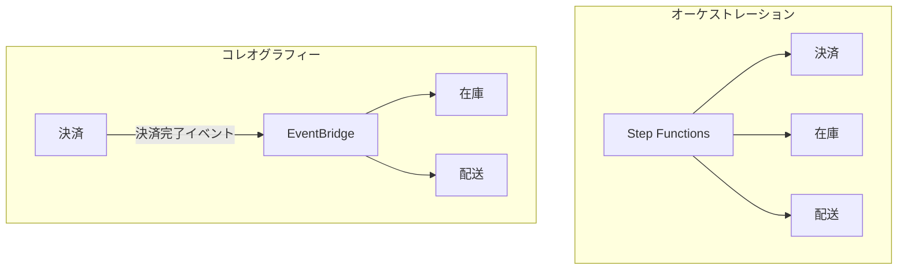
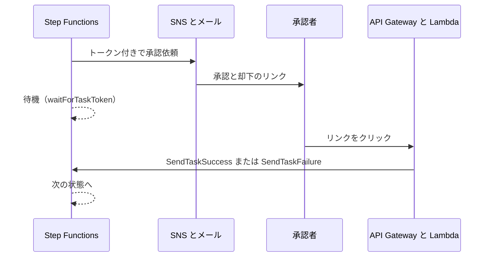

# AWS Step Functions

複数の処理を状態遷移図（ステートマシン）として定義し、順番、分岐、並列、再試行を管理するサービス。Lambda や他の AWS サービスを組み合わせたワークフローを、コードを増やさずに作るときに使う。

[](../assets/diagrams/step-functions-order.png)

## オーケストレーションとコレオグラフィー {#orchestration-choreography}

複数のサービスを協調させる方法は2つある。

| | オーケストレーション | コレオグラフィー |
| --- | --- | --- |
| 制御 | 中央の指揮者がすべて呼ぶ | 各サービスがイベントに反応する |
| AWS の例 | Step Functions | EventBridge、SNS |
| 全体の流れ | 定義を見れば分かる | 分散していて見えにくい |
| 結合 | 指揮者は各サービスを知っている | サービス同士は互いを知らない |
| エラー処理 | 一箇所に集約できる | 各サービスに分散する |
| 向いている場面 | 順序が重要な業務、補償処理が必要な場面 | 独立したサービスの連携、後から消費者を増やす場面 |



両者は併用できる。サービスの中の手順は Step Functions で、サービス間の連携はイベントで、という組み合わせが多い。アーキテクチャパターン全体は [SDK と耐障害性](sdk-resilience.md) を参照する。

## Standard と Express {#standard-express}

作成時に選び、後から変更できない。既定は Standard。

| | Standard | Express |
| --- | --- | --- |
| 最大実行時間 | 1 年 | 5 分 |
| 実行の保証 | 正確に1回 | 非同期: 少なくとも1回、同期: 最大1回 |
| 料金 | 状態遷移の数 | 実行回数、時間、メモリ |
| 実行履歴 | API で取得可能（完了後 90 日） | CloudWatch Logs を有効にして確認 |
| 統合パターン | すべて（`.sync`、`.waitForTaskToken`） | Request Response のみ |
| Distributed Map、アクティビティ | 使える | 使えない |
| 向いている場面 | 長時間の業務、監査、人の承認、冪等でない処理 | 大量で短いイベント処理、IoT、モバイルのバックエンド |

Express には2つの起動方式がある。

| 方式 | API | 動き |
| --- | --- | --- |
| 非同期 | `StartExecution` | 開始の確認だけ返す。結果は CloudWatch Logs で確認 |
| 同期 | `StartSyncExecution` | 完了まで待って結果を返す。マイクロサービスの連携向け |

```python
import json

import boto3

sfn = boto3.client("stepfunctions")

# Standard と Express の非同期。name は同じ値で再開始を防ぐのに使える
sfn.start_execution(
    stateMachineArn="arn:aws:states:ap-northeast-1:111122223333:stateMachine:order",
    name="order-123",
    input=json.dumps({"orderId": "123"}),
)
```

## Amazon States Language {#asl}

ワークフローは JSON の Amazon States Language（ASL）で定義する。`StartAt` が最初の状態で、`States` に各状態を書く。

```json
{
  "Comment": "注文処理",
  "StartAt": "Validate",
  "States": {
    "Validate": {
      "Type": "Task",
      "Resource": "arn:aws:states:::lambda:invoke",
      "Parameters": {
        "FunctionName": "validate-order",
        "Payload.$": "$"
      },
      "OutputPath": "$.Payload",
      "Next": "IsLarge"
    },
    "IsLarge": {
      "Type": "Choice",
      "Choices": [
        { "Variable": "$.amount", "NumericGreaterThan": 100000, "Next": "Approve" }
      ],
      "Default": "Save"
    },
    "Approve": { "Type": "Pass", "Next": "Save" },
    "Save": {
      "Type": "Task",
      "Resource": "arn:aws:states:::dynamodb:putItem",
      "Parameters": {
        "TableName": "orders",
        "Item": { "id": { "S.$": "$.orderId" } }
      },
      "End": true
    }
  }
}
```

データの参照に使う言語は `QueryLanguage` で選ぶ。既定は JSONPath で、JSONata も使える。JSONata に移行するときは状態ごとに切り替えられる。

### 状態の種類 {#state-types}

| 状態 | 役割 |
| --- | --- |
| `Task` | 1つの作業を実行する（Lambda、サービス統合、アクティビティ） |
| `Choice` | 入力の値で分岐する。`Default` を書かず一致もしないと失敗する |
| `Wait` | 指定の秒数、または時刻まで待つ |
| `Parallel` | 固定の複数ブランチを並列に実行する |
| `Map` | 配列の要素ごとに同じ手順を実行する |
| `Pass` | 入力をそのまま渡す。値の追加や変換もできる |
| `Succeed` | 成功で終了する |
| `Fail` | 失敗で終了する |

`Map` には2つのモードがある。

| モード | 同時実行 | 向いている場面 |
| --- | --- | --- |
| Inline | 最大 40 | 小さな配列 |
| Distributed | 最大 10,000 の子実行 | S3 上の大量データの処理 |

### 入出力の制限 {#payload-limit}

タスク、状態、実行の入出力は 256 KiB まで。超えると `States.DataLimitExceeded` になる。大きなデータは [S3](s3.md) に置き、状態の間では S3 のキーを渡す。

実行履歴は 25,000 イベントまで。長いループは新しい実行に引き継ぐ。

## エラー処理 {#error-handling}

状態でエラーが起きると、既定では実行全体が失敗する。`Retry` と `Catch` を `Task`、`Parallel`、`Map` に書いて制御する。

```json
{
  "Type": "Task",
  "Resource": "arn:aws:states:::lambda:invoke",
  "Parameters": { "FunctionName": "charge", "Payload.$": "$" },
  "TimeoutSeconds": 30,
  "Retry": [
    {
      "ErrorEquals": ["Lambda.TooManyRequestsException", "States.Timeout"],
      "IntervalSeconds": 2,
      "MaxAttempts": 3,
      "BackoffRate": 2,
      "MaxDelaySeconds": 30,
      "JitterStrategy": "FULL"
    }
  ],
  "Catch": [
    {
      "ErrorEquals": ["States.ALL"],
      "ResultPath": "$.error",
      "Next": "NotifyFailure"
    }
  ],
  "Next": "Done"
}
```

### Retry のフィールド {#retry}

| フィールド | 既定 | 意味 |
| --- | --- | --- |
| `ErrorEquals` | 必須 | 対象のエラー名 |
| `IntervalSeconds` | 1 | 最初の再試行までの秒数 |
| `MaxAttempts` | 3 | 最大回数。0 で再試行しない |
| `BackoffRate` | 2.0 | 間隔の倍率 |
| `MaxDelaySeconds` | なし | 間隔の上限 |
| `JitterStrategy` | `NONE` | `FULL` で間隔をランダム化 |

### Catch {#catch}

再試行で解決しないと `Catch` に移る。`Next` に復旧やロールバックの状態を指定する。

`ResultPath` を指定すると、エラー情報を入力に追加して次へ渡せる。指定しないと、次の状態の入力はエラー情報だけになる。この仕組みで **Saga パターン** の補償処理（失敗時に前の処理を取り消す）を作れる。

### 主なエラー名 {#error-names}

| エラー | 内容 |
| --- | --- |
| `States.ALL` | ほぼすべてのエラー。単独で最後に書く。`States.DataLimitExceeded` と `States.Runtime` は捕まらない |
| `States.TaskFailed` | タスクの失敗。`States.Timeout` 以外の既知のエラーに一致する |
| `States.Timeout` | `TimeoutSeconds` の超過、ハートビートの途絶 |
| `States.HeartbeatTimeout` | ハートビートの途絶 |
| `States.Permissions` | 実行ロールの権限不足 |
| `States.DataLimitExceeded` | 入出力のサイズ超過 |
| `States.Runtime` | 処理できない例外。再試行されない |
| `Lambda.Unknown`、`Sandbox.Timedout` | Lambda のタイムアウトやランタイムのエラー |

!!! warning "タイムアウトは明示する"
    `TimeoutSeconds` を書かないと既定値は 99,999,999 秒で、外部サービスが応答しない場合に実行が長く止まる。`Task` には適切な値を設定する。

## サービス統合パターン {#integration-patterns}

`Task` の `Resource` の書き方で、待ち方が変わる。

| パターン | Resource の例 | 動き | 対応 |
| --- | --- | --- | --- |
| Request Response | `arn:aws:states:::sns:publish` | HTTP 応答を受けたらすぐ次へ | Standard、Express |
| Run a Job | `arn:aws:states:::ecs:runTask.sync` | ジョブの完了まで待つ | Standard |
| Wait for Callback | `arn:aws:states:::lambda:invoke.waitForTaskToken` | タスクトークンが返るまで待つ | Standard |

対応はサービスで異なる。たとえば Lambda、SNS、SQS は `.sync` が使えず `.waitForTaskToken` が使える。ECS と Step Functions 自身は両方使える。DynamoDB は Request Response のみ。200 以上のサービスは AWS SDK 統合（`arn:aws:states:::aws-sdk:...`）で呼べる。

### コールバック（waitForTaskToken） {#wait-for-callback}

外部の処理が終わるまで、課金を増やさず待つ仕組み。トークンを相手に渡し、相手が API で返す。

```json
{
  "Type": "Task",
  "Resource": "arn:aws:states:::sqs:sendMessage.waitForTaskToken",
  "Parameters": {
    "QueueUrl": "https://sqs.ap-northeast-1.amazonaws.com/111122223333/jobs",
    "MessageBody": {
      "orderId.$": "$.orderId",
      "TaskToken.$": "$$.Task.Token"
    }
  },
  "HeartbeatSeconds": 3600,
  "TimeoutSeconds": 86400,
  "Next": "Done"
}
```

```python
import json

import boto3

sfn = boto3.client("stepfunctions")

sfn.send_task_success(taskToken=token, output=json.dumps({"approved": True}))
# 失敗のとき
sfn.send_task_failure(taskToken=token, error="Rejected", cause="承認者が却下")
# 長い処理の生存通知
sfn.send_task_heartbeat(taskToken=token)
```

- `$$.Task.Token` はコンテキストオブジェクトからトークンを取り出す。JSONata では `$states.context.Task.Token`。
- `TimeoutSeconds` がないと、トークンが返らないときに実行が長く止まる。
- `HeartbeatSeconds` を設定すると、間隔内に `SendTaskHeartbeat` が来ないとタイムアウトになる。
- Standard のみ。Express では使えない。

### 人の承認 {#human-approval}

コールバックの代表的な使い方。



1. `waitForTaskToken` の状態で Lambda を呼び、トークンを含む承認リンクをメールで送る。
2. 承認者のクリックで API Gateway から Lambda が動き、`SendTaskSuccess` か `SendTaskFailure` を呼ぶ。
3. 次の `Choice` で結果に応じて分岐する。

待つ時間は最大 1 年。承認依頼の通知には [SNS](messaging.md) を使う。AI エージェントの承認フローでも同じ考え方が使える。詳細は [AI サービス](ai.md) を参照する。

## 起動元 {#start-sources}

| 起動元 | 使い方 |
| --- | --- |
| API Gateway | HTTP リクエストで開始。同期 Express なら結果をそのまま返せる |
| EventBridge | イベントやスケジュールで開始 |
| SDK | `StartExecution`、`StartSyncExecution` |
| 別のステートマシン | 入れ子で開始（`.sync` も可） |

実行ロールには、呼び出す先のサービスへの権限が必要。不足すると `States.Permissions` になる。

## 試験のポイント {#exam-points}

| こう問われたら | 答え |
| --- | --- |
| 15 分を超える複数の処理を管理 | Step Functions |
| 長時間の業務を監査したい、最大 1 年 | Standard |
| 大量で短い処理、5 分以内、低コスト | Express |
| 冪等でない処理を正確に1回 | Standard |
| Express でコールバックを使いたい | 使えない。Standard に変更する |
| ワークフローの種類を後から変えたい | できない。作り直す |
| 一時的なエラーを再試行 | `Retry`、`BackoffRate`、`JitterStrategy` |
| 失敗時に別の処理へ | `Catch` と `Next` |
| エラー情報を保ったまま次へ | `Catch` の `ResultPath` |
| 人の承認を待つ | `.waitForTaskToken` と `SendTaskSuccess` |
| 別のジョブの完了まで待つ | `.sync` |
| 外部処理の生存確認 | `HeartbeatSeconds` と `SendTaskHeartbeat` |
| 配列の各要素に処理 | `Map` |
| 複数の処理を同時に | `Parallel` |
| 入力値で分岐 | `Choice` |
| 256 KiB を超えるデータを渡す | S3 に置いて参照を渡す |
| 実行がずっと止まっている | `TimeoutSeconds` の設定、トークンの返却を確認 |
| 中央で流れを管理したい | オーケストレーション（Step Functions） |
| 各サービスをイベントで連携したい | コレオグラフィー（EventBridge） |

## 関連ページ {#related}

- [Lambda](lambda.md)
- [メッセージング](messaging.md)
- [API Gateway](api-gateway.md)
- [SDK と耐障害性](sdk-resilience.md)
- [IAM](iam.md)
- [オブザーバビリティ](observability.md)

## 参考 {#references}

- [Choosing workflow type](https://docs.aws.amazon.com/step-functions/latest/dg/choosing-workflow-type.html)
- [State machine structure](https://docs.aws.amazon.com/step-functions/latest/dg/statemachine-structure.html)
- [Workflow states](https://docs.aws.amazon.com/step-functions/latest/dg/workflow-states.html)
- [Task state](https://docs.aws.amazon.com/step-functions/latest/dg/state-task.html)
- [Choice state](https://docs.aws.amazon.com/step-functions/latest/dg/state-choice.html)
- [Map state](https://docs.aws.amazon.com/step-functions/latest/dg/state-map.html)
- [Handling errors](https://docs.aws.amazon.com/step-functions/latest/dg/concepts-error-handling.html)
- [Service integration patterns](https://docs.aws.amazon.com/step-functions/latest/dg/connect-to-resource.html)
- [Human approval tutorial](https://docs.aws.amazon.com/step-functions/latest/dg/tutorial-human-approval.html)
- [Service quotas](https://docs.aws.amazon.com/step-functions/latest/dg/service-quotas.html)
- [Transforming data with JSONata](https://docs.aws.amazon.com/step-functions/latest/dg/transforming-data.html)
