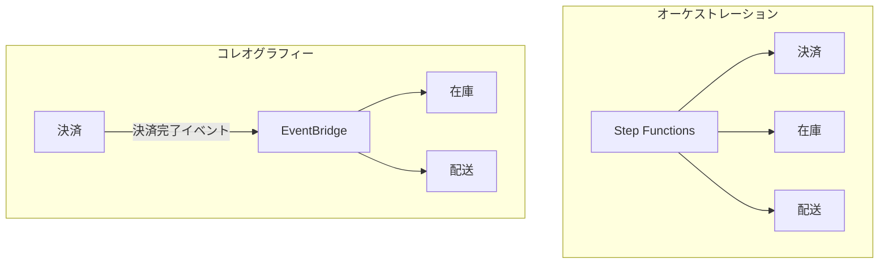
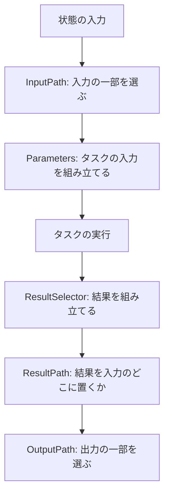
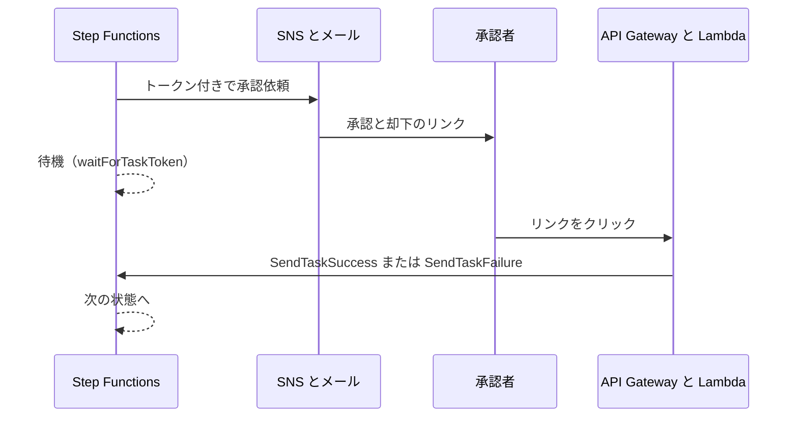

# AWS Step Functions

[:material-sprout: CLF](../courses/clf/services.md){ .exam-badge .exam-foundational } [:material-certificate: SAA](../courses/saa/services.md){ .exam-badge .exam-associate } [:material-certificate: DVA](../courses/dva/services.md){ .exam-badge .exam-associate } [:material-certificate: SOA](../courses/soa/services.md){ .exam-badge .exam-associate } [:material-certificate: DEA](../courses/dea/services.md){ .exam-badge .exam-associate } [:material-certificate: MLA](../courses/mla/services.md){ .exam-badge .exam-associate } [:material-star-circle: SAP](../courses/sap/services.md){ .exam-badge .exam-professional } [:material-star-circle: DOP](../courses/dop/services.md){ .exam-badge .exam-professional } [:material-star-circle: AIP](../courses/aip/services.md){ .exam-badge .exam-professional } [:material-target: SCS](../courses/scs/services.md){ .exam-badge .exam-specialty }

複数の処理を状態遷移図（ステートマシン）として定義し、順番、分岐、並列、再試行を管理するサービス。Lambda や他の AWS サービスを組み合わせたワークフローを、コードを増やさずに作るときに使う。

**提供単位:** リージョン。AZ は選ばない。**VPC:** 外。VPC の中から呼ぶときは、インターフェイスエンドポイントか NAT を通す（[リソースの提供単位](resource-scope.md#scope-regional-outside)）。

[](../assets/diagrams/step-functions-order.png)

## オーケストレーションとコレオグラフィー {#orchestration-choreography}

複数のサービスを協調させる方法は2つある。

| | オーケストレーション | コレオグラフィー |
| --- | --- | --- |
| 制御 | 中央の指揮者がすべて呼ぶ | 各サービスがイベントに反応する |
| AWS の例 | Step Functions | EventBridge、SNS |
| 全体の流れ | 定義を見れば分かる | 分散していて見えにくい |
| 結合 | 指揮者は各サービスを知っている | サービス同士は互いを知らない |
| エラー処理 | 一箇所に集約できる | 各サービスに分散する |
| 向いている場面 | 順序が重要な業務、補償処理が必要な場面 | 独立したサービスの連携、後から消費者を増やす場面 |



両者は併用できる。サービスの中の手順は Step Functions で、サービス間の連携はイベントで、という組み合わせが多い。アーキテクチャパターン全体は [SDK と耐障害性](sdk-resilience.md) を参照する。

**判断の例:** 決済 → 在庫 → 配送の順に進み、配送で失敗したら在庫と決済を取り消す処理は、順序と補償があるのでオーケストレーション。注文完了のイベントを、メール、集計、ポイントの 3 サービスが別々に受ける処理は、後から 4 つ目を足しやすいのでコレオグラフィー。

## Standard と Express {#standard-express}

作成時に選び、後から変更できない。既定は Standard。

| | Standard | Express |
| --- | --- | --- |
| 最大実行時間 | 1 年 | 5 分 |
| 実行の保証 | 正確に1回 | 非同期: 少なくとも1回、同期: 最大1回 |
| 料金 | 状態遷移の数 | 実行回数、時間、メモリ |
| 実行履歴 | API で取得可能（完了後 90 日） | CloudWatch Logs を有効にして確認 |
| 統合パターン | すべて（`.sync`、`.waitForTaskToken`） | Request Response のみ |
| Distributed Map、アクティビティ | 使える | 使えない |
| 向いている場面 | 長時間の業務、監査、人の承認、冪等でない処理 | 大量で短いイベント処理、IoT、モバイルのバックエンド |

追加で押さえる違いは次の通り。

| | Standard | Express |
| --- | --- | --- |
| 同じ名前の実行 | 実行中の同名の実行には冪等に応答し、新しい実行は始まらない | 冪等性は管理されず、同名で並行して動く |
| 状態の永続化 | 状態遷移ごとに内部で保存する | 保存しない |
| 開いている実行の上限 | アカウントのリージョンごとに 1,000,000 | 対象外 |
| 再実行（redrive） | 14 日以内なら失敗した状態から再開できる | 使えない |

**例:** 決済は Standard にする。リトライを指定しない限り同じ状態が二重に動かないため。非同期 Express は 1 つのイベントで複数回動くことがあるので、`PutItem` のような冪等な処理に向く。

**計算例（料金の単位）:** 5 つの状態を通るワークフローを 1 日 100 万回動かす。Standard は状態遷移の数で課金され、1 日 500 万遷移を数える。Express は 100 万回の実行と、その時間とメモリで課金される。件数が多く短い処理ほど Express が有利になる。

**例（実行時間）:** 夜間に 2 時間かかるバッチは、5 分で打ち切られるので Express では動かない。

**例（同じ名前）:** Standard で `name: "order-123"` を指定して開始する。

| 2 回目の呼び出し | 結果 |
| --- | --- |
| 実行中で、名前も入力も同じ | 成功。最初と同じ応答を返し、新しい実行は始まらない |
| 実行中で、入力が違う | `ExecutionAlreadyExists`（400） |
| 終了済み | `ExecutionAlreadyExists`（400）。名前を再利用できるのは終了の 90 日後 |

**誤ると:** Express で同じ名前を使っても重複は防げない。`order-123` が並行して 2 回動く。

Express には2つの起動方式がある。

| 方式 | API | 動き |
| --- | --- | --- |
| 非同期 | `StartExecution` | 開始の確認だけ返す。結果は CloudWatch Logs で確認 |
| 同期 | `StartSyncExecution` | 完了まで待って結果を返す。マイクロサービスの連携向け |

- **例（同期）:** API Gateway から同期 Express を呼ぶ。REST API の統合タイムアウトが 29 秒なら、実行は 5 分まで許されていても、29 秒を超えるとクライアントには 504 が返る。
- **誤ると（コンソール）:** コンソールから同期 Express を動かすと、`StartSyncExecution` のリクエストは 60 秒で期限切れになる。5 分まで試すなら SDK か CLI を使う。

```python
import json

import boto3

sfn = boto3.client("stepfunctions")

# Standard と Express の非同期。name は同じ値で再開始を防ぐのに使える
sfn.start_execution(
    stateMachineArn="arn:aws:states:ap-northeast-1:111122223333:stateMachine:order",
    name="order-123",
    input=json.dumps({"orderId": "123"}),
)
```

## Amazon States Language {#asl}

ワークフローは JSON の Amazon States Language（ASL）で定義する。`StartAt` が最初の状態で、`States` に各状態を書く。

```json
{
  "Comment": "注文処理",
  "StartAt": "Validate",
  "States": {
    "Validate": {
      "Type": "Task",
      "Resource": "arn:aws:states:::lambda:invoke",
      "Parameters": {
        "FunctionName": "validate-order",
        "Payload.$": "$"
      },
      "OutputPath": "$.Payload",
      "Next": "IsLarge"
    },
    "IsLarge": {
      "Type": "Choice",
      "Choices": [
        { "Variable": "$.amount", "NumericGreaterThan": 100000, "Next": "Approve" }
      ],
      "Default": "Save"
    },
    "Approve": { "Type": "Pass", "Next": "Save" },
    "Save": {
      "Type": "Task",
      "Resource": "arn:aws:states:::dynamodb:putItem",
      "Parameters": {
        "TableName": "orders",
        "Item": { "id": { "S.$": "$.orderId" } }
      },
      "End": true
    }
  }
}
```

データの参照に使う言語は `QueryLanguage` で選ぶ。既定は JSONPath で、JSONata も使える。JSONata に移行するときは状態ごとに切り替えられる。

最上位のフィールドは次の通り。

| フィールド | 必須 | 内容 |
| --- | --- | --- |
| `StartAt` | はい | 最初の状態の名前 |
| `States` | はい | 状態の一覧 |
| `Comment` | いいえ | 説明 |
| `TimeoutSeconds` | いいえ | 実行全体の上限。超えると `States.Timeout` |
| `QueryLanguage` | いいえ | `JSONPath`（既定）か `JSONata`。AWS は新しいステートマシンに JSONata を勧めている |

- **例（`TimeoutSeconds`）:** 全体を 1 時間で打ち切るなら、最上位に `"TimeoutSeconds": 3600` を書く。超えると実行全体が `States.Timeout` で失敗し、`Catch` では受けられない。
- **例（`StartAt`）:** `"StartAt": "Validate"` は `States` の中のキーと完全に一致させる。一致しなければ、定義の作成時にエラーになる。
- **例（名前と `Comment`）:** 実行名は 80 文字まで。`Comment` は説明で、動きに影響しない。

### 状態の種類 {#state-types}

| 状態 | 役割 |
| --- | --- |
| `Task` | 1つの作業を実行する（Lambda、サービス統合、アクティビティ） |
| `Choice` | 入力の値で分岐する。`Default` を書かず一致もしないと失敗する |
| `Wait` | 指定の秒数、または時刻まで待つ |
| `Parallel` | 固定の複数ブランチを並列に実行する |
| `Map` | 配列の要素ごとに同じ手順を実行する |
| `Pass` | 入力をそのまま渡す。値の追加や変換もできる |
| `Succeed` | 成功で終了する |
| `Fail` | 失敗で終了する |

**例（使い分け）:** 注文の処理なら、検証は `Task`、金額での分岐は `Choice`、入金待ちの 1 時間は `Wait`、在庫と与信の同時確認は `Parallel`、明細ごとの処理は `Map`、固定値の追加は `Pass`、却下の終了は `Fail`、完了の終了は `Succeed` にする。

`Map` には2つのモードがある。

| モード | 同時実行 | 向いている場面 |
| --- | --- | --- |
| Inline | 最大 40 | 小さな配列 |
| Distributed | 最大 10,000 の子実行 | S3 上の大量データの処理 |

**判断の例:** 明細 20 件を 5 件ずつ並列に処理するなら Inline。S3 の 100 万行を 1,000 並列で処理するなら Distributed。

### 状態ごとのフィールド {#state-fields}

| 状態 | 主なフィールド |
| --- | --- |
| `Task` | `Resource`、`Parameters` または `Arguments`、`TimeoutSeconds`、`HeartbeatSeconds`、`Credentials`、`Retry`、`Catch` |
| `Choice` | `Choices`、`Default`。JSONPath は `Variable` と比較演算子、JSONata は `Condition` |
| `Wait` | `Seconds`、`Timestamp`。JSONPath では `SecondsPath`、`TimestampPath` も使える |
| `Parallel` | `Branches`、`Retry`、`Catch` |
| `Map` | `ItemProcessor`、`MaxConcurrency`、`Items` または `ItemsPath`、`ItemSelector`、`Retry`、`Catch` |
| `Pass` | `Result`、`ResultPath`（JSONPath のみ）、`Output`（JSONata） |
| `Succeed` | なし。`Next` は書けない |
| `Fail` | `Error`、`Cause`。JSONPath では `ErrorPath`、`CausePath` も使える |

状態の遷移には `Next` か `End: true` を使う。`Choice` は `Choices` の中で `Next` を書く。

- **`Choice` の罠:** `Default` を省くと、どの条件にも一致しないときに実行が失敗する。
- **`Wait` の例:** `"Seconds": 300` は 5 分待つ。`"Timestamp": "2026-11-30T00:00:00Z"` は時刻まで待つ。時刻は大文字の `T` と `Z` を使う RFC3339 形式にする。
- **`Fail` の例:** `"Error": "OrderRejected"`、`"Cause": "在庫なし"` で終わらせると、呼び出し元や親のステートマシンでこの名前を判定できる。`States.` で始まるエラー名は自分では使えない。
- **`Credentials`:** ステートマシンから別のアカウントのリソースを呼ぶとき、引き受けるロールを指定する。

- **`Task` の例:** `"Resource": "arn:aws:states:::dynamodb:getItem"` で DynamoDB を直接読む。Lambda を間に置かなくてよい。
- **`Parameters` と `Arguments`:** JSONPath は `Parameters`、JSONata は `Arguments` に、呼び出す API の引数を書く。
- **`Choice` の例（JSONPath）:** `{"Variable": "$.amount", "NumericGreaterThan": 100000, "Next": "Approve"}`。金額が 100,000 なら一致しない。100,001 から `Approve` へ進む。
- **`Choice` の例（JSONata）:** `{"Condition": "", "Next": "Approve"}`。
- **`Choice` の例（キーがないかも）:** `StringEquals` の前に `IsPresent` を `And` で組み合わせる。キーがなくても失敗せず、次の条件へ進む。
- **`Wait` の例（入力から）:** 入力が `{"delay": 60}` なら `"SecondsPath": "$.delay"` で 60 秒待つ。`Seconds` の範囲は 0〜99,999,999。
- **`Wait` の罠:** `"Timestamp": "2026-11-30 00:00:00"` のように `T` と `Z` がないと受け付けない。
- **`Pass` の例:** 入力が `{"a": 1}` で、`"Result": {"b": 2}`、`"ResultPath": "$.x"` なら、出力は `{"a": 1, "x": {"b": 2}}`。
- **`Succeed` の例:** `Choice` で「処理不要」と判定した注文を、すぐ成功で終える。
- **`Fail` の例（入力から）:** `"ErrorPath": "$.code"`、`"CausePath": "$.message"` で、入力の値をエラーにする。`Cause` と `CausePath` は同時に書けない。
- **`Credentials` の例:** `{"RoleArn": "arn:aws:iam::444455556666:role/orders-reader"}`。相手のロールの信頼ポリシーで、ステートマシンの実行ロールを信頼しておく。
- **誤ると（遷移）:** `Next` と `End` がない `Task` は定義の検証で失敗する。`Choice` には `End` を書けない。

### JSONPath の入出力処理 {#io-jsonpath}

JSONPath では、5 つのフィールドが次の順に働く。



**例:** 入力が `{"order": {"id": "1"}, "user": "a"}` で、Lambda が `{"Payload": {"ok": true}, "StatusCode": 200}` を返すとする。

```json
{
  "InputPath": "$.order",
  "Parameters": { "FunctionName": "check", "Payload": { "id.$": "$.id" } },
  "ResultSelector": { "ok.$": "$.Payload.ok" },
  "ResultPath": "$.check",
  "OutputPath": "$"
}
```

`InputPath` の時点で入力は `{"id": "1"}` になる。出力は `{"id": "1", "check": {"ok": true}}` で、`user` は残らない。元の入力をすべて残すなら `InputPath` を省く。

`ResultPath` の動きは値で変わる。

| 値 | 動き |
| --- | --- |
| 省略、または `"$"` | 入力全体を結果で置き換える |
| `"$.check"` | 入力の `check` に結果を入れる |
| `null` | 結果を捨て、入力をそのまま出力する |

- **`.$` の罠:** パスや組み込み関数を値にするキーは、名前を `.$` で終える。`"id": "$.id"` だと文字列のまま渡る。
- **`$$` :** コンテキストオブジェクトで、`$$.Execution.Input`、`$$.Task.Token`、`$$.Map.Item.Value` などを読める。
- **null の罠:** null の入力に `InputPath` や `OutputPath` を適用すると `States.Runtime` になり、再試行もキャッチもできない。

- **`OutputPath` の例:** 上の例で `"OutputPath": "$.check"` にすると、出力は `{"ok": true}` だけになる。
- **`ResultSelector` の例:** Lambda の結果には `StatusCode` や `ExecutedVersion` が付く。`{"ok.$": "$.Payload.ok"}` で必要な値だけを残す。
- **`ResultPath: null` の例:** 通知の結果が不要なら、入力 `{"id": "1"}` がそのまま次へ渡る。
- **`$$` の例:** `"startedAt.$": "$$.Execution.StartTime"` で、実行の開始時刻を入力に足せる。
- **誤ると:** `"ResultPath"` を省くと入力が結果で置き換わる。後の状態で `$.orderId` を読むと、値がなくて実行が失敗する。

### JSONata {#jsonata}

JSONata では、`InputPath`、`Parameters`、`ResultSelector`、`ResultPath`、`OutputPath` の 5 つが `Arguments` と `Output` の 2 つに減る。式は `` で囲み、キーに `.$` は付けない。

```json
{
  "QueryLanguage": "JSONata",
  "Type": "Task",
  "Resource": "arn:aws:states:::lambda:invoke",
  "Arguments": {
    "FunctionName": "check",
    "Payload": { "id": "" }
  },
  "Output": {
    "id": "",
    "ok": ""
  },
  "End": true
}
```

| 変数 | 内容 |
| --- | --- |
| `$states.input` | 状態の入力。常に元の入力 |
| `$states.result` | タスクの結果 |
| `$states.errorOutput` | `Catch` の `Output` と `Assign` でのエラー情報 |
| `$states.context` | コンテキストオブジェクト。`$states.context.Task.Token` など |

- **罠:** `` の後に空白があると、式として評価されない。
- **罠:** `$eval` は使えない。`$parse` を使う。
- `QueryLanguage` を最上位か状態に書く。状態ごとに書けば、少しずつ移行できる。
- JSONPath 専用の `TimeoutSecondsPath` などは使えない。`"TimeoutSeconds": ""` のように式で書く。

- **例（`$states.input`）:** 入力が `{"order": {"id": "1"}}` なら、`` は `"1"`。上の定義の `Output` は `{"id": "1", "ok": true}` になる。
- **例（`$states.result`）:** `Output` と `Assign` で読める。`Arguments` ではタスクがまだ動いていないので使えない。
- **例（`$states.errorOutput`）:** `Catch` の中で `"Output": {"error": ""}` と書くと、エラー名を次の状態へ渡せる。
- **例（計算）:** `"total": ""` は、価格が 100、200 なら 300 になる。JSONPath ならこの計算に Lambda か組み込み関数が要る。

### 変数 {#variables}

`Assign` で変数に保存すると、後の状態で `$name` として読める。`Pass`、`Task`、`Map`、`Parallel`、`Choice`、`Wait` で使える。

```json
{ "Assign": { "customerId": "" } }
```

- **サイズ:** 変数は 1 つ 256 KiB まで、1 つの `Assign` の合計も 256 KiB まで、実行全体で 10 MiB まで。
- **スコープ:** `Parallel` と `Map` の内側は外側の変数を読めるが、内側で作った変数は外から読めない。
- **罠:** `Assign` と `Output` は同時に評価する。`Assign` で加工した値は、同じ状態の `Output` では使えない。

- **例（複数の状態で使う）:** 最初の状態で `customerId` を保存すれば、5 つ先の状態でも `$customerId` で読める。入力と出力に毎回通さなくてよい。
- **例（スコープ）:** `Map` の外の `$taxRate` は中から読める。中で `Assign` した `$lineTotal` は外から読めない。集計は `Map` の `Output` で返す。
- **計算例（サイズ）:** 200 KiB の変数は 1 つなら入る。60 個作ると 12,000 KiB で、実行全体の 10 MiB を超えて失敗する。大きなデータは S3 に置く。

### Map の設定 {#map-settings}

| 設定 | 内容 |
| --- | --- |
| `ItemProcessor.ProcessorConfig.Mode` | `INLINE`（既定）か `DISTRIBUTED` |
| `ExecutionType` | Distributed で必須。`STANDARD` か `EXPRESS` |
| `Items`、`ItemsPath` | 配列の場所（`ItemsPath` は JSONPath のみ） |
| `ItemSelector` | 各要素の入力を組み立てる。`$$.Map.Item.Index` などを使える |
| `MaxConcurrency` | 同時実行の上限。既定 0（制限なし）。1 なら順番に処理する |
| `ToleratedFailurePercentage`、`ToleratedFailureCount` | Distributed の失敗の許容量 |
| `ItemReader` | Distributed で S3 からデータを読む |
| `ItemBatcher` | Distributed で要素をまとめる（`MaxItemsPerBatch` など） |
| `ResultWriter` | Distributed で結果を S3 に書く |

- **例:** 1 秒に 5 件しか受けない外部 API を呼ぶなら、`MaxConcurrency` を小さくする。`MaxConcurrency: 1` なら入力の順に 1 件ずつ処理する。
- **例:** S3 の 100 万行の CSV を処理するなら、Distributed で `ItemReader` と `MaxConcurrency: 1000` にする。子の実行が短く冪等なら `ExecutionType: EXPRESS` を選べる。
- **失敗の許容:** `ToleratedFailurePercentage: 5` にすると、失敗が 5% を超えたときに `States.ExceedToleratedFailureThreshold` で Map が失敗する。
- **使い分け:** 履歴が 25,000 イベントを超えるとき、40 を超える同時実行が必要なとき、データが 256 KiB を超えるときは Distributed にする。
- **罠:** Inline では 0 にしても、同時に動くのは最大 40。Distributed で 0 なら最大 10,000 の子実行が動く。
- `States.ItemReaderFailed` と `States.ResultWriterFailed` は読み書きの失敗を示す。

**Distributed の設定例:**

```json
{
  "Type": "Map",
  "Label": "ImportOrders",
  "MaxConcurrency": 1000,
  "ToleratedFailurePercentage": 5,
  "ItemReader": {
    "Resource": "arn:aws:states:::s3:getObject",
    "ReaderConfig": { "InputType": "CSV", "CSVHeaderLocation": "FIRST_ROW", "MaxItems": 1000 },
    "Parameters": { "Bucket": "my-bucket", "Key": "orders.csv" }
  },
  "ItemBatcher": { "MaxItemsPerBatch": 100 },
  "ItemProcessor": {
    "ProcessorConfig": { "Mode": "DISTRIBUTED", "ExecutionType": "EXPRESS" },
    "StartAt": "Save",
    "States": { "Save": { "Type": "Pass", "End": true } }
  },
  "ResultWriter": {
    "Resource": "arn:aws:states:::s3:putObject",
    "Parameters": { "Bucket": "my-bucket", "Prefix": "results/" }
  },
  "End": true
}
```

- **計算例（`MaxConcurrency`）:** 1 件 2 秒かかる API を毎秒 5 件までに抑えるなら、`MaxConcurrency` は 5 × 2 = 10。
- **計算例（`ItemBatcher`）:** 100 万行を `MaxItemsPerBatch: 100` で束ねると、子実行は 100 万 ÷ 100 = 1 万回で済む。束ねないと 100 万回になる。
- **`MaxInputBytesPerBatch` の例:** 1 バッチの大きさの上限で、最大 256 KiB。1 行 5 KiB で 256 KiB を指定すると、51 行で 255 KiB になり、52 行目は次のバッチに入る。
- **計算例（開始の速さ）:** 子実行の開始は `EXPRESS` で毎秒 1,000 回、`STANDARD` で毎秒 100 回まで。1 万回なら、開始だけで `EXPRESS` は 10 秒、`STANDARD` は 100 秒かかる。
- **`ExecutionType` の例:** 子の処理が 5 分以内で冪等なら `EXPRESS`。1 時間かかる、または正確に 1 回が要るなら `STANDARD`。
- **`ItemReader` の例:** `InputType` は `CSV`、`JSON`、`JSONL`、`PARQUET`、`MANIFEST`。`MaxItems: 1000` なら、CSV が 100 万行でも最初の 1,000 行だけを読む。本番前の試行に使える。
- **`CSVHeaderLocation` の例:** 1 行目が見出しなら `FIRST_ROW`。見出しがない CSV は `GIVEN` にして、`CSVHeaders` に列名を書く。
- **`ItemSelector` の例:** `{"index.$": "$$.Map.Item.Index", "item.$": "$$.Map.Item.Value", "tenant.$": "$.tenant"}` で、要素に番号と共通の値を足す。
- **`Items` の例:** JSONata で `"Items": ""`、JSONPath で `"ItemsPath": "$.lines"`。配列（Distributed は JSON オブジェクトも可）を指定する。それ以外だと実行時に失敗する。
- **`ResultWriter` の例:** `results/` の下に結果を書く。`Transformation` に `FLATTEN` を指定すると、子の配列の結果を平らにする。
- **計算例（許容量）:** 1,000 件で `ToleratedFailurePercentage: 5` なら、50 件までの失敗は続行する。51 件目で Map が失敗する。`ToleratedFailureCount: 10` なら、11 件目で失敗する。
- **誤ると:** 許容量を書かないと 1 件の失敗で Map 全体が失敗する。`ResultWriter` がないと、大きな結果が状態の出力に載り、256 KiB を超えて `States.DataLimitExceeded` になる。

### Parallel の設定 {#parallel-settings}

`Branches` に複数のステートマシンを書く。各ブランチは独立していて、外の状態に `Next` できない。すべて終わると、各ブランチの出力の配列を出力にする。

**例:** 在庫確認と与信確認を同時に実行する。出力は `[在庫の結果, 与信の結果]` の順になる。

- **罠:** どれか 1 つが失敗すると、`Parallel` 全体が失敗し、残りのブランチも止まる。ただし既に呼んだ Lambda 関数や、タスクトークンを持つアクティビティのワーカーは止まらない。後続の処理は重複しても問題ないように作る。
- `Parallel` に `MaxConcurrency` はない。ブランチを同時に制限したいなら `Map` を使う。

- **誤ると（出力）:** 次の状態で `$.credit` と読んでも値がない。出力は配列なので、`$[1].credit` のように順番で読むか、`ResultSelector` で組み立てる。
- **例（`Retry`）:** 外側に `Retry` を書くと、失敗時に全ブランチをやり直す。成功済みのブランチも再度動く。

### 入出力の制限 {#payload-limit}

タスク、状態、実行の入出力は 256 KiB まで。超えると `States.DataLimitExceeded` になる。大きなデータは [S3](s3.md) に置き、状態の間では S3 のキーを渡す。

実行履歴は 25,000 イベントまで。長いループは新しい実行に引き継ぐ。

- **計算例（サイズ）:** 256 KiB は 262,144 バイト。1 件 3 KB の明細が 100 件で 300,000 バイトになり、超える。明細は S3 の `orders/123.json` に置き、状態の間では `{"key": "orders/123.json"}` だけを渡す。
- **計算例（履歴）:** 1 周 6 イベントのループは、25,000 ÷ 6 ≒ 4,166 周で上限に達して失敗する。4,000 周ごとに `StartExecution` で新しい実行を始め、続きの位置を入力で渡す。
- **誤ると:** サイズは UTF-8 で数える。日本語は 1 文字 3 バイトが多いので、英字より早く上限に達する。

## エラー処理 {#error-handling}

状態でエラーが起きると、既定では実行全体が失敗する。`Retry` と `Catch` を `Task`、`Parallel`、`Map` に書いて制御する。

```json
{
  "Type": "Task",
  "Resource": "arn:aws:states:::lambda:invoke",
  "Parameters": { "FunctionName": "charge", "Payload.$": "$" },
  "TimeoutSeconds": 30,
  "Retry": [
    {
      "ErrorEquals": ["Lambda.TooManyRequestsException", "States.Timeout"],
      "IntervalSeconds": 2,
      "MaxAttempts": 3,
      "BackoffRate": 2,
      "MaxDelaySeconds": 30,
      "JitterStrategy": "FULL"
    }
  ],
  "Catch": [
    {
      "ErrorEquals": ["States.ALL"],
      "ResultPath": "$.error",
      "Next": "NotifyFailure"
    }
  ],
  "Next": "Done"
}
```

### Retry のフィールド {#retry}

| フィールド | 既定 | 意味 |
| --- | --- | --- |
| `ErrorEquals` | 必須 | 対象のエラー名 |
| `IntervalSeconds` | 1 | 最初の再試行までの秒数。最大 99,999,999 |
| `MaxAttempts` | 3 | 最大回数。0 で再試行しない。最大 99,999,999 |
| `BackoffRate` | 2.0 | 間隔の倍率 |
| `MaxDelaySeconds` | なし | 間隔の上限。0 より大きく 31,622,401 未満 |
| `JitterStrategy` | `NONE` | `FULL` で間隔を 0 からその値までの間でランダム化 |

**計算例（すべて既定）:** `ErrorEquals` だけを書くと、1 秒後、2 秒後、4 秒後の 3 回再試行し、待ち時間は合計 7 秒になる。

**計算例（上限あり）:** `IntervalSeconds: 2`、`MaxAttempts: 3`、`BackoffRate: 2`、`MaxDelaySeconds: 5` なら、待ち時間は 2 秒、4 秒、5 秒で合計 11 秒になる。3 回目は 8 秒のはずが 5 秒で止まる。

**ジッターの例:** 同じ設定で `JitterStrategy: FULL` にすると、0〜2 秒、0〜4 秒、0〜5 秒のランダムな待ちになる。多数の実行が同じ瞬間に再試行するのを防げる。

`Retry` は配列で、上から順に見る。エラー名が一致した最初の項目を使う。回数は項目ごとに数える。`States.ALL` は単独で書き、最後の項目にする。

Lambda を呼ぶ状態には、一時的なサービスのエラーの再試行を入れる。

- **計算例（一定の間隔）:** `IntervalSeconds: 3`、`MaxAttempts: 2`、`BackoffRate: 1` なら、3 秒後と、その 3 秒後の 2 回で、待ち時間は合計 6 秒。
- **計算例（上限なしの増え方）:** `IntervalSeconds: 60`、`MaxAttempts: 10`、`BackoffRate: 2` なら、10 回目の待ちは 60 × 2^9 = 30,720 秒で、8 時間を超える。`MaxDelaySeconds: 300` で 5 分に抑える。
- **例（`MaxAttempts: 0`）:** 決済のように再試行したくないエラーは、配列の先頭で `{"ErrorEquals": ["PaymentDeclined"], "MaxAttempts": 0}` と書く。次の `States.ALL` の項目に流れない。
- **計算例（項目ごとに数える）:** `ErrorA` が `MaxAttempts: 2`、`ErrorB` が `MaxAttempts: 2` なら、両方が混ざって最大 4 回再試行する。

```json
{
  "ErrorEquals": [
    "Lambda.ClientExecutionTimeoutException",
    "Lambda.ServiceException",
    "Lambda.AWSLambdaException",
    "Lambda.SdkClientException"
  ],
  "IntervalSeconds": 2,
  "MaxAttempts": 6,
  "BackoffRate": 2
}
```

### Catch {#catch}

再試行で解決しないと `Catch` に移る。`Next` に復旧やロールバックの状態を指定する。

`ResultPath` を指定すると、エラー情報を入力に追加して次へ渡せる。指定しないと、次の状態の入力はエラー情報だけになる。この仕組みで **Saga パターン** の補償処理（失敗時に前の処理を取り消す）を作れる。

| フィールド | 必須 | 内容 |
| --- | --- | --- |
| `ErrorEquals` | はい | 対象のエラー名 |
| `Next` | はい | 移る状態の名前 |
| `ResultPath` | いいえ | JSONPath のみ。エラー情報を入れる場所 |
| `Output`、`Assign` | いいえ | JSONata のみ。`$states.errorOutput` を使う |

`Catch` の対象は `Task`、`Parallel`、`Map` で、実行全体の失敗は捕まえられない。エラー情報は `Error` と `Cause` の 2 つのフィールドになる。

**例:** `"ResultPath": "$.error"` なら、入力が `{"orderId": "1"}` のとき、次の状態の入力は `{"orderId": "1", "error": {"Error": "...", "Cause": "..."}}` になる。

**罠:** `Retry` と `Catch` を両方書くと、先に `Retry` を使い切ってから `Catch` に移る。

**Saga の例:** 決済 → 在庫 → 配送の順で、配送が失敗したとする。配送の `Catch` から `ReleaseStock`、`RefundPayment` の順に進み、最後に `Fail` で終わる。

- **例（順序）:** `Catch` も配列で上から見る。`{"ErrorEquals": ["OutOfStock"], "Next": "Backorder"}` を先に、`States.ALL` を最後に書く。
- **誤ると（`ResultPath` なし）:** 次の状態の入力が `{"Error": "...", "Cause": "..."}` だけになり、`$.orderId` を読めなくなる。

### 主なエラー名 {#error-names}

| エラー | 内容 |
| --- | --- |
| `States.ALL` | ほぼすべてのエラー。単独で最後に書く。`States.DataLimitExceeded` と `States.Runtime` は捕まらない。`States.DataLimitExceeded` は名前を明示すれば捕まえられる |
| `States.TaskFailed` | タスクの失敗。`States.Timeout` 以外の既知のエラーに一致する。タイムアウトも捕まえたいなら名前を足す |
| `States.Timeout` | `TimeoutSeconds` の超過、ハートビートの途絶 |
| `States.HeartbeatTimeout` | ハートビートの途絶 |
| `States.Permissions` | 実行ロールの権限不足 |
| `States.DataLimitExceeded` | 入出力のサイズ超過 |
| `States.Runtime` | 処理できない例外。再試行もキャッチもできず、必ず実行が失敗する |
| `States.ExceedToleratedFailureThreshold` | Map の失敗が許容量を超えた |
| `States.Http.Socket` | HTTP タスクが 60 秒でタイムアウトした |
| `Lambda.Unknown`、`Sandbox.Timedout` | Lambda のタイムアウトやランタイムのエラー |

- **`States.Permissions` の例:** 実行ロールに `lambda:InvokeFunction` がないと、再試行しても直らない。ロールを直す。
- **`States.TaskFailed` の例:** `ErrorEquals: ["States.TaskFailed"]` だけでは `TimeoutSeconds` の超過を受けられない。`["States.TaskFailed", "States.Timeout"]` と書く。
- **`States.DataLimitExceeded` の例:** 300 KB の結果を返す Lambda はこのエラーになる。`States.ALL` では受けられないので、名前を書いて受け、S3 に置く処理へ進める。
- **自分のエラー名の例:** Python の関数が `raise OutOfStock()` すると、エラー名は `OutOfStock` になる。`ErrorEquals: ["OutOfStock"]` で受けられる。
- **`Lambda.Unknown` の例:** 未処理のエラーの古い名前で、新しいランタイムでは関数のタイムアウトが `Sandbox.Timedout` で届く。両方を書くか、`States.TaskFailed` や `States.ALL` で受ける。

### タイムアウトとハートビート {#timeouts}

| 設定 | 既定 | 内容 |
| --- | --- | --- |
| `TimeoutSeconds`（Request Response） | タスクの種類ごとの既定値 | 待ち続けないように Step Functions が既定のタイムアウトをかける |
| `TimeoutSeconds`（`.sync`、`.waitForTaskToken`、アクティビティ） | なし | 実行の上限まで待ち続ける |
| `HeartbeatSeconds` | 99,999,999 | `TimeoutSeconds` より小さい正の整数。間隔が空くと `States.Timeout` |
| `TimeoutSeconds`（最上位） | なし | 実行全体の上限 |

!!! warning "タイムアウトは明示する"
    コールバックや `.sync` は既定のタイムアウトがなく、外部が応答しないと実行が最大 1 年止まる。`TimeoutSeconds` を必ず設定する。

    以前は「タスクの既定のタイムアウトは 99,999,999 秒」と説明されることがあったが、現在の Request Response タスクには既定のタイムアウトがかかる。`TimeoutSeconds` は API 呼び出し自体の待ち時間を伸ばすものではない。

**例:** 人の承認を 3 日待つなら、`TimeoutSeconds` を 259,200 にする。ワーカーが長い処理をするなら `HeartbeatSeconds: 600` にし、10 分以内に `SendTaskHeartbeat` を呼ぶ。

**罠:** Lambda の呼び出しは、`TimeoutSeconds` を長くしても関数のタイムアウトは変わらない。HTTP タスクは指定に関係なく 60 秒が上限になる。入れ子のステートマシンが `States.Timeout` を出すと、親には `States.TaskFailed` として届く。

- **計算例（`TimeoutSeconds`）:** 関数のタイムアウトが 60 秒なら、`Retry` を含まない 1 回の試行を 70 秒で切る。`TimeoutSeconds: 70` にする。30 秒にすると、まだ動いている関数を置いて状態だけが `States.Timeout` になり、再試行で関数が二重に動く。
- **計算例（ハートビート）:** `HeartbeatSeconds: 600`、`TimeoutSeconds: 3600` のタスクで、ワーカーが 11 分報告しなければ、1 時間を待たずに `States.Timeout` で失敗する。
- **誤ると:** `HeartbeatSeconds` が `TimeoutSeconds` 以上だと定義の作成時にエラーになる。

### 再実行とログ {#redrive-logging}

**redrive** は、失敗、中止、タイムアウトした Standard の実行を、失敗した状態から再開する機能。完了から 14 日以内に使える。再実行された `Task` などの `Retry` の回数は 0 に戻る。Express では使えない。

CloudWatch Logs のログレベルは `ALL`、`ERROR`、`FATAL`、`OFF` から選ぶ。実行ロールにログの権限がないと `AccessDeniedException` で設定に失敗する。Express の実行の確認には、このログが必要になる。

**redrive の例:** 5 つの状態のうち 3 つ目で失敗した。1、2 つ目は再実行せず、同じ入力と定義のまま 3 つ目から再開する。

```bash
aws stepfunctions redrive-execution \
  --execution-arn arn:aws:states:ap-northeast-1:111122223333:execution:order:order-123
```

- **誤ると（redrive）:** 成功した実行、14 日を過ぎた実行、履歴が 24,999 イベント以上の実行は再開できない。
- **例（ログレベル）:** `ERROR` は `ExecutionFailed` や `LambdaFunctionFailed` を記録し、`ExecutionStarted` などは記録しない。`FATAL` は `ExecutionFailed`、`ExecutionAborted`、`ExecutionTimedOut` など、実行の終わりの失敗だけを記録する。

```bash
aws stepfunctions update-state-machine \
  --state-machine-arn arn:aws:states:ap-northeast-1:111122223333:stateMachine:order \
  --logging-configuration '{"level":"ERROR","includeExecutionData":false,"destinations":[{"cloudWatchLogsLogGroup":{"logGroupArn":"arn:aws:logs:ap-northeast-1:111122223333:log-group:/sfn/order:*"}}]}'
```

- **例（`includeExecutionData`）:** `false` なら入出力をログに残さない。個人情報を含むワークフローで使う。

## サービス統合パターン {#integration-patterns}

`Task` の `Resource` の書き方で、待ち方が変わる。

| パターン | Resource の例 | 動き | 対応 |
| --- | --- | --- | --- |
| Request Response | `arn:aws:states:::sns:publish` | HTTP 応答を受けたらすぐ次へ | Standard、Express |
| Run a Job | `arn:aws:states:::ecs:runTask.sync` | ジョブの完了まで待つ | Standard |
| Wait for Callback | `arn:aws:states:::lambda:invoke.waitForTaskToken` | タスクトークンが返るまで待つ | Standard |

対応はサービスで異なる。たとえば Lambda、SNS、SQS は `.sync` が使えず `.waitForTaskToken` が使える。ECS と Step Functions 自身は両方使える。DynamoDB は Request Response のみ。200 以上のサービスは AWS SDK 統合（`arn:aws:states:::aws-sdk:...`）で呼べる。

| サービス | Request Response | `.sync` | `.waitForTaskToken` |
| --- | --- | --- | --- |
| Lambda、SNS、SQS | あり | なし | あり |
| ECS/Fargate、Step Functions | あり | あり | あり |
| AWS Batch | あり | あり | なし |
| DynamoDB | あり | なし | なし |

**例:** ECS タスクの完了まで待つなら `arn:aws:states:::ecs:runTask.sync` にする。末尾を付け忘れると、タスクの開始を確認した時点で次の状態へ進む。

**罠:** Express では Request Response しか使えない。定義に `.sync` があると使えない。`.sync` には追加の IAM 権限が必要で、Step Functions が EventBridge で完了を監視するものもある。

- **例（入れ子）:** `arn:aws:states:::states:startExecution.sync:2` は子の完了を待ち、子の出力を JSON で受け取る。末尾が `.sync` だと、出力は JSON の文字列で届くので、解析が要る。
- **例（親子のリンク）:** 子の入力に `"AWS_STEP_FUNCTIONS_STARTED_BY_EXECUTION_ID.$": "$$.Execution.Id"` を入れると、コンソールで親から子へたどれる。
- **例（AWS SDK 統合）:** `arn:aws:states:::aws-sdk:s3:listObjectsV2` で、Lambda を書かずに S3 の一覧を取れる。パラメーター名は API の名前に合わせる。

### コールバック（waitForTaskToken） {#wait-for-callback}

外部の処理が終わるまで、課金を増やさず待つ仕組み。トークンを相手に渡し、相手が API で返す。

```json
{
  "Type": "Task",
  "Resource": "arn:aws:states:::sqs:sendMessage.waitForTaskToken",
  "Parameters": {
    "QueueUrl": "https://sqs.ap-northeast-1.amazonaws.com/111122223333/jobs",
    "MessageBody": {
      "orderId.$": "$.orderId",
      "TaskToken.$": "$$.Task.Token"
    }
  },
  "HeartbeatSeconds": 3600,
  "TimeoutSeconds": 86400,
  "Next": "Done"
}
```

```python
import json

import boto3

sfn = boto3.client("stepfunctions")

sfn.send_task_success(taskToken=token, output=json.dumps({"approved": True}))
# 失敗のとき
sfn.send_task_failure(taskToken=token, error="Rejected", cause="承認者が却下")
# 長い処理の生存通知
sfn.send_task_heartbeat(taskToken=token)
```

- `$$.Task.Token` はコンテキストオブジェクトからトークンを取り出す。JSONata では `$states.context.Task.Token`。
- `TimeoutSeconds` がないと、トークンが返らないときに実行が長く止まる。
- `HeartbeatSeconds` を設定すると、間隔内に `SendTaskHeartbeat` が来ないとタイムアウトになる。
- Standard のみ。Express では使えない。

- **計算例:** 上の定義なら、1 時間（3,600 秒）報告がないか、24 時間（86,400 秒）経つと `States.Timeout` になる。
- **例（失敗の名前）:** `send_task_failure(error="Rejected")` のエラー名は、`Catch` の `ErrorEquals: ["Rejected"]` で受けられる。
- **誤ると:** `send_task_success` の `output` に JSON でない文字列を渡すと `InvalidOutput` で拒否され、状態は待ったままになる。

### 人の承認 {#human-approval}

コールバックの代表的な使い方。



1. `waitForTaskToken` の状態で Lambda を呼び、トークンを含む承認リンクをメールで送る。
2. 承認者のクリックで API Gateway から Lambda が動き、`SendTaskSuccess` か `SendTaskFailure` を呼ぶ。
3. 次の `Choice` で結果に応じて分岐する。

待つ時間は最大 1 年。承認依頼の通知には [SNS](messaging.md) を使う。AI エージェントの承認フローでも同じ考え方が使える。詳細は [AI サービス](ai.md) を参照する。

**例:** 金額が 100,000 円を超える注文に部長の承認を求める。3 営業日の期限を見て `TimeoutSeconds: 432000`（5 日）にする。期限切れは `Catch` の `States.Timeout` から `AutoReject` へ進める。

## 起動元 {#start-sources}

| 起動元 | 使い方 |
| --- | --- |
| API Gateway | HTTP リクエストで開始。同期 Express なら結果をそのまま返せる |
| EventBridge | イベントやスケジュールで開始 |
| SDK | `StartExecution`、`StartSyncExecution` |
| 別のステートマシン | 入れ子で開始（`.sync` も可） |

実行ロールには、呼び出す先のサービスへの権限が必要。不足すると `States.Permissions` になる。

- **例（API Gateway）:** `POST /orders` を `StartSyncExecution` につなぐと、同期 Express の結果を HTTP の応答で返せる。API Gateway の IAM ロールに `states:StartSyncExecution` を許可する。
- **例（EventBridge）:** `rate(1 hour)` のスケジュールで毎時開始する。ターゲットのロールに `states:StartExecution` を許可する。
- **例（実行ロール）:** `states.amazonaws.com` を信頼するロールに、呼び先の権限だけを付ける。DynamoDB を書くだけなら `dynamodb:PutItem` だけでよい。

## 既定値と上限のまとめ {#numbers}

| 項目 | 値 |
| --- | --- |
| 最大実行時間 | Standard 1 年、Express 5 分 |
| 入出力の上限 | 256 KiB |
| 実行履歴 | 25,000 イベント |
| 履歴の保持 | 実行の終了後 90 日 |
| 定義のサイズ | 1 MB |
| 開いている実行 | 1,000,000（Standard） |
| `IntervalSeconds` | 既定 1 |
| `MaxAttempts` | 既定 3 |
| `BackoffRate` | 既定 2.0 |
| `JitterStrategy` | 既定 `NONE` |
| `HeartbeatSeconds` | 既定 99,999,999 |
| HTTP タスク | 60 秒 |
| Inline Map | 同時 40 |
| Distributed Map | 子実行 10,000 |
| `MaxConcurrency` | 既定 0（制限なし） |
| 変数 | 1 個 256 KiB、1 実行 10 MiB |
| redrive | 14 日以内 |

## 試験のポイント {#exam-points}

| こう問われたら | 答え |
| --- | --- |
| 15 分を超える複数の処理を管理 | Step Functions |
| 長時間の業務を監査したい、最大 1 年 | Standard |
| 大量で短い処理、5 分以内、低コスト | Express |
| 冪等でない処理を正確に1回 | Standard |
| Express でコールバックを使いたい | 使えない。Standard に変更する |
| ワークフローの種類を後から変えたい | できない。作り直す |
| 一時的なエラーを再試行 | `Retry`、`BackoffRate`、`JitterStrategy` |
| 失敗時に別の処理へ | `Catch` と `Next` |
| エラー情報を保ったまま次へ | `Catch` の `ResultPath` |
| 人の承認を待つ | `.waitForTaskToken` と `SendTaskSuccess` |
| 別のジョブの完了まで待つ | `.sync` |
| 外部処理の生存確認 | `HeartbeatSeconds` と `SendTaskHeartbeat` |
| 配列の各要素に処理 | `Map` |
| 複数の処理を同時に | `Parallel` |
| 入力値で分岐 | `Choice` |
| 256 KiB を超えるデータを渡す | S3 に置いて参照を渡す |
| 実行がずっと止まっている | `TimeoutSeconds` の設定、トークンの返却を確認 |
| 中央で流れを管理したい | オーケストレーション（Step Functions） |
| 各サービスをイベントで連携したい | コレオグラフィー（EventBridge） |
| `Catch` が `States.TaskFailed` だけでタイムアウトを捕まえない | `States.Timeout` も書く |
| `States.ALL` で捕まらない | `States.DataLimitExceeded` を明示する。`States.Runtime` は捕まらない |
| 再試行の待ちが長くなりすぎる | `MaxDelaySeconds` |
| 同時の再試行で下流に負荷が集中する | `JitterStrategy: FULL` |
| 結果を捨てて入力を残す | `ResultPath: null` |
| 外部 API の負荷を抑えて配列を処理 | `MaxConcurrency` |
| 大量の S3 データを処理 | Distributed Map と `ItemReader` |
| 一部の失敗を許容して続ける | `ToleratedFailurePercentage` |
| JSONata でタスクの入力と出力を変換 | `Arguments` と `Output` |
| 失敗した状態から再開 | redrive（Standard、14 日以内） |

## 関連ページ {#related}

- [Lambda](lambda.md)
- [メッセージング](messaging.md)
- [API Gateway](api-gateway.md)
- [SDK と耐障害性](sdk-resilience.md)
- [IAM](iam.md)
- [オブザーバビリティ](observability.md)

## 参考 {#references}

- [Choosing workflow type](https://docs.aws.amazon.com/step-functions/latest/dg/choosing-workflow-type.html)
- [State machine structure](https://docs.aws.amazon.com/step-functions/latest/dg/statemachine-structure.html)
- [Workflow states](https://docs.aws.amazon.com/step-functions/latest/dg/workflow-states.html)
- [Task state](https://docs.aws.amazon.com/step-functions/latest/dg/state-task.html)
- [Choice state](https://docs.aws.amazon.com/step-functions/latest/dg/state-choice.html)
- [Map state](https://docs.aws.amazon.com/step-functions/latest/dg/state-map.html)
- [Handling errors](https://docs.aws.amazon.com/step-functions/latest/dg/concepts-error-handling.html)
- [Service integration patterns](https://docs.aws.amazon.com/step-functions/latest/dg/connect-to-resource.html)
- [Human approval tutorial](https://docs.aws.amazon.com/step-functions/latest/dg/tutorial-human-approval.html)
- [Service quotas](https://docs.aws.amazon.com/step-functions/latest/dg/service-quotas.html)
- [Transforming data with JSONata](https://docs.aws.amazon.com/step-functions/latest/dg/transforming-data.html)
- [Task state](https://docs.aws.amazon.com/step-functions/latest/dg/state-task.html)
- [Parallel state](https://docs.aws.amazon.com/step-functions/latest/dg/state-parallel.html)
- [Inline Map](https://docs.aws.amazon.com/step-functions/latest/dg/state-map-inline.html)
- [Distributed Map](https://docs.aws.amazon.com/step-functions/latest/dg/state-map-distributed.html)
- [Processing input and output](https://docs.aws.amazon.com/step-functions/latest/dg/concepts-input-output-filtering.html)
- [Variables](https://docs.aws.amazon.com/step-functions/latest/dg/workflow-variables.html)
- [Redrive](https://docs.aws.amazon.com/step-functions/latest/dg/redrive-executions.html)
- [Logging](https://docs.aws.amazon.com/step-functions/latest/dg/cw-logs.html)
