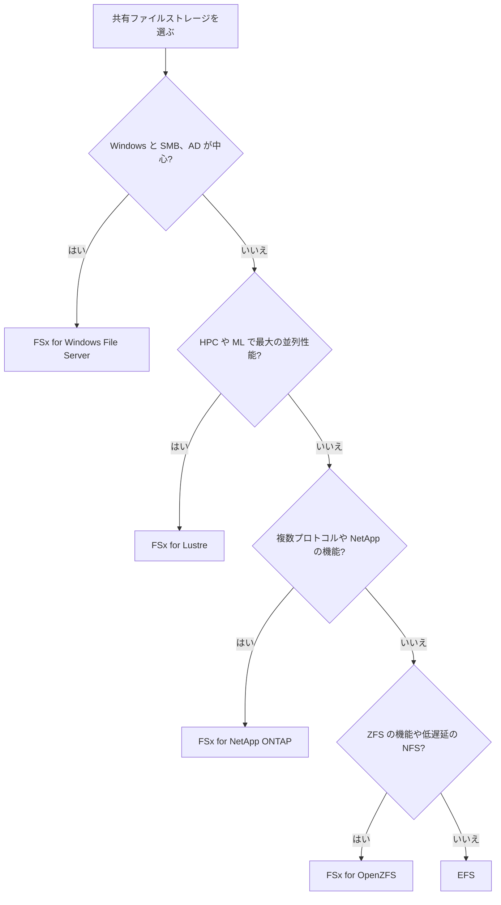
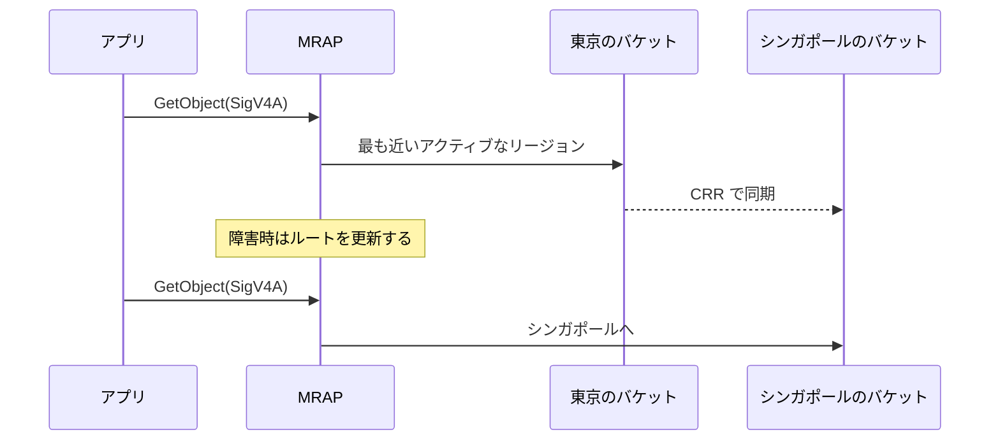

# 高度なストレージ(FSx、インスタンスストア、S3 の設計)

[:material-sprout: CLF](../courses/clf/services.md){ .exam-badge .exam-foundational } [:material-certificate: SAA](../courses/saa/services.md){ .exam-badge .exam-associate } [:material-certificate: SOA](../courses/soa/services.md){ .exam-badge .exam-associate } [:material-certificate: MLA](../courses/mla/services.md){ .exam-badge .exam-associate } [:material-star-circle: SAP](../courses/sap/services.md){ .exam-badge .exam-professional } [:material-star-circle: DOP](../courses/dop/services.md){ .exam-badge .exam-professional } [:material-target: SCS](../courses/scs/services.md){ .exam-badge .exam-specialty }

FSx は、Windows、Lustre、NetApp ONTAP、OpenZFS のファイルシステムをマネージドで提供します。既存のプロトコルや機能が必要なときに選びます。あわせて、インスタンスストアと、アーキテクト向けの S3 の機能をまとめます。

[](../assets/diagrams/storage-advanced-fsx.png)

## FSx の選び方 {#fsx-selection}

[:material-sprout: CLF](../courses/clf/services.md){ .exam-badge .exam-foundational } [:material-certificate: SAA](../courses/saa/services.md){ .exam-badge .exam-associate } [:material-certificate: SOA](../courses/soa/services.md){ .exam-badge .exam-associate } [:material-certificate: MLA](../courses/mla/services.md){ .exam-badge .exam-associate } [:material-star-circle: SAP](../courses/sap/services.md){ .exam-badge .exam-professional }

| 観点 | [Windows File Server](#fsx-windows) | [Lustre](#fsx-lustre) | [NetApp ONTAP](#fsx-ontap) | [OpenZFS](#fsx-openzfs) |
| --- | --- | --- | --- | --- |
| 向く用途 | Windows のファイル共有、SQL Server | HPC、機械学習、動画処理 | マルチプロトコル、NetApp からの移行 | ZFS や Linux のファイルサーバーの移行 |
| プロトコル | SMB 2.0〜3.1.1 | Lustre(POSIX) | NFS、SMB、iSCSI、NVMe | NFS v3〜v4.2 |
| クライアント | Windows、Linux | Linux | Linux、Windows、macOS | Linux、Windows、macOS |
| Multi-AZ | あり | なし(Intelligent-Tiering はデータを複数 AZ に複製) | あり | あり |
| 容量 | 32 GiB〜64 TiB(HDD は 2,000 GiB から) | 1.2 TiB から | 1 TiB/HA ペアから | 64 GiB〜512 TiB |
| 特徴の機能 | AD、シャドウコピー、DFS | S3 との連携、最大の並列性能 | 自動階層化、SnapMirror、FlexClone | 高速スナップショット、クローン、圧縮 |
| ID の連携 | Active Directory(必須) | POSIX | AD は SMB で任意 | Unix の権限 |



## EBS、EFS、S3、FSx の比較 {#storage-comparison}

EBS、EFS の設定は [ストレージの選び方](storage.md)、S3 は [S3](s3.md) を参照してください。

| 観点 | インスタンスストア | EBS | EFS | FSx | S3 |
| --- | --- | --- | --- | --- | --- |
| 種類 | ブロック(一時) | ブロック | ファイル(NFS) | ファイル(一部ブロック) | オブジェクト |
| 同時接続 | 1 台 | 通常 1 台 | 多数 | 多数 | 多数 |
| 耐久性の範囲 | インスタンスの寿命の間 | 1 つの AZ | リージョン(Regional) | タイプによる | リージョン(One Zone を除く) |
| 容量 | 固定 | 確保 | 自動 | 確保(一部自動) | 自動 |
| 課金の中心 | インスタンス料金に含む | 確保した容量 | 使った容量 | 確保した容量と性能 | 使った容量とリクエスト |
| 向く用途 | キャッシュ、スクラッチ | ブート、1 台の DB | Linux の共有、コンテナ | 特定のプロトコルと機能 | データレイク、配信、バックアップ |

| 要件 | 選択 |
| --- | --- |
| Linux の複数台で共有、容量管理をしたくない | EFS |
| Windows の共有フォルダと NTFS の ACL | FSx for Windows File Server |
| S3 のデータを高速に並列処理 | FSx for Lustre |
| S3 のデータをそのままファイルとして共有 | S3 Files(下記) |
| iSCSI の LUN を複数の用途で | FSx for NetApp ONTAP |
| 最小の遅延のディスク、データは消えてよい | インスタンスストア |
| EC2 1 台の永続ディスク | EBS |

**例**: Linux の Web サーバー 10 台で 500 GB の画像を共有するなら EFS です。Windows の 300 人の部署の共有フォルダを AD の権限で使うなら FSx for Windows です。ML の学習で S3 の 100 TB を 1 週間だけ高速に読むなら FSx for Lustre です。

**誤ると**: EFS と違って FSx の多くは確保した容量に課金されます。100 GB しか使わない共有に 2 TB を確保すると、使わない分にも費用がかかります。

## インスタンスストア {#instance-store}

ホストの物理ディスクに置く一時的なブロックストレージです。追加料金はなく、インスタンスの料金に含まれます。

**提供単位**: インスタンスと同じホストにあるので AZ 単位です。VPC とは関係なく、そのインスタンスからしか使えません([リソースの提供単位](resource-scope.md#scope-zonal))。

| イベント | データ |
| --- | --- |
| 再起動 | 残る |
| 停止 | 消える |
| 休止 | 消える |
| 終了 | 消える |
| インスタンスタイプの変更 | 残らない |
| AMI の作成 | AMI に含まれない |

- 起動時にしかアタッチできず、後から付けられません。別のインスタンスにも移せません。
- 容量と本数はインスタンスタイプで決まり、すべてのタイプにあるわけではありません。
- 停止、休止、終了のとき、各ブロックは暗号学的に消去されます。
- NVMe のインスタンスストアは、XTS-AES-256 で暗号化されます。

**向く用途**: バッファ、キャッシュ、スクラッチ、複数台で複製するデータです。

**例**: Cassandra のような 3 台の複製を持つデータベースなら、1 台が消えても他から戻せるので、低遅延のインスタンスストアを使えます。

**例**: 動画変換の作業領域です。S3 から 50 GB を読み、NVMe のインスタンスストアで変換して、結果を S3 へ戻します。途中でインスタンスが消えても、やり直せます。

**例**: `reboot` の後はデータが残ります。`aws ec2 stop-instances` の後に起動すると、ディスクは空になります。

**落とし穴**: EBS と違ってスナップショットを取れません。残したいデータは EBS や S3 へコピーします。コストのために夜間停止すると、データが消えます。

## FSx for Windows File Server {#fsx-windows}

[:material-star-circle: DOP](../courses/dop/services.md){ .exam-badge .exam-professional }

Windows Server で動くマネージドのファイルサーバーです。既存の Windows アプリを変更せずに移せます。

**提供単位**: ファイルシステムはリージョンの VPC の中に作ります。Single-AZ は 1 つの AZ、Multi-AZ は 2 つの AZ のサブネットに置きます([リソースの提供単位](resource-scope.md#two-axes))。

### 主な設定 {#fsx-windows-settings}

| 設定 | 値と範囲 | 動作と例 | 誤ったときの症状 |
| --- | --- | --- | --- |
| デプロイタイプ | `SINGLE_AZ_1`、`SINGLE_AZ_2`、`MULTI_AZ_1` | 本番は Multi-AZ を推奨 | Single-AZ は AZ の障害で止まる |
| ストレージタイプ | SSD、HDD | HDD は Single-AZ 2 と Multi-AZ のみ | 高い IOPS の処理を HDD に置くと遅い |
| 容量 | SSD 32 GiB〜64 TiB、HDD 2,000 GiB〜64 TiB | 増やすだけ。1 回 10% 以上、次は 6 時間後 | 減らせない |
| 変更後の制限 | 6 時間または最適化の完了の長いほう | | すぐに連続で増やせない |
| スループット | 32〜12,288 MBps | 512 MBps など段階で選ぶ。メモリ量もここで決まる | 小さいとキャッシュが効かず遅い |
| SSD IOPS | 自動は 3 IOPS/GiB、最大 400,000。手動は 96〜400,000 で 3〜50 IOPS/GiB(東京など一部のリージョンは 3〜500) | 2,048 GiB なら自動で 6,144 IOPS | 不足すると待ち時間が伸びる |
| AD | AWS Managed Microsoft AD か自己管理の AD | 作成時に参加 | AD のサブネット、ポートが違うと作成に失敗 |
| 自動バックアップ | 既定で有効。コンソールの保持は 30 日、0〜90 日 | 0 は無効 | 消えた後に復元できない |

性能の上限は 2 GBps、80,000 IOPS で、一部のリージョンでは 12 GBps、400,000 IOPS です。

```bash
aws fsx create-file-system --file-system-type WINDOWS \
  --storage-capacity 2048 --storage-type SSD \
  --subnet-ids subnet-aaaa1111 subnet-bbbb2222 \
  --windows-configuration \
    "ActiveDirectoryId=d-1234567890,DeploymentType=MULTI_AZ_1,PreferredSubnetId=subnet-aaaa1111,ThroughputCapacity=512,AutomaticBackupRetentionDays=30"
```

**計算の例**(上の 2,048 GiB、512 MBps の場合):

| 項目 | 計算 | 結果 |
| --- | --- | --- |
| 自動の SSD IOPS | 2,048 × 3 | 6,144 IOPS |
| 手動の SSD IOPS の上限 | 2,048 × 50 | 102,400 IOPS(東京などは 2,048 × 500 でも上限の 400,000 IOPS まで) |
| 次に増やせる最小の容量 | 2,048 × 1.1 | 約 2,253 GiB 以上 |
| サーバーのメモリ | スループットの表より | 32 GB |

**スループットの例**: `ThroughputCapacity=32` はメモリ 4 GB、`12288` はメモリ 512 GB です。数百人が同じファイルを読む環境でメモリが小さいと、キャッシュに載らずディスクの読み取りが増えます。

**誤ると**: 空き容量は常に 20% 以上残すことが推奨です。全容量を使い切ると、性能が落ち、データの不整合を招くおそれがあります。増やす要求の後は 6 時間と最適化の完了のどちらか長いほうを待つので、一杯になってからでは間に合いません。

### デプロイタイプの違い {#fsx-windows-deployment}

| タイプ | SSD | HDD | DFS 名前空間 | DFS レプリケーション | 継続的に利用可能な共有 |
| --- | --- | --- | --- | --- | --- |
| Single-AZ 1 | 可 | 不可 | 可 | 可 | 不可 |
| Single-AZ 2 | 可 | 可 | 可 | 不可 | 可 |
| Multi-AZ | 可 | 可 | 可 | 不可 | 可 |

**Multi-AZ のフェイルオーバー**:

- 優先ファイルサーバーと、別の AZ のスタンバイで構成し、データは AZ の間で同期します。
- AZ の障害、サーバーの障害、計画メンテナンスで自動で切り替わり、通常 30 秒以内に完了します。
- DNS 名は変わりません。優先サブネットが回復すれば自動で戻ります。
- **Linux クライアント**: DNS による自動切り替えに対応していません。優先サーバーへ戻った後に再開します。

**SQL Server**: 継続的に利用可能(CA)な共有を Multi-AZ で使います。

**スループットの変更**: Multi-AZ ではサーバーの入れ替えでフェイルオーバーとフェイルバックが起きます。アイドルの時間帯に行います。

**例**: 部署の共有で DFS レプリケーションが必要なら Single-AZ 1、SQL Server の共有なら Multi-AZ です。安価な大容量のアーカイブ共有なら Multi-AZ の HDD にします。

**誤ると**: SQL Server の共有を Single-AZ 1 に作ると、継続的に利用可能な共有を使えません。業務時間中にスループットを変えると、Multi-AZ で 2 回切り替わります。

### Windows の機能 {#fsx-windows-features}

| 機能 | 内容 | 例 |
| --- | --- | --- |
| シャドウコピー | ユーザーが前のバージョンを自分で戻せる。**既定では無効** | 誤って上書きしたファイルをエクスプローラーから戻す |
| データ重複除去 | 重複を減らして容量を節約 | ホームディレクトリ |
| ユーザーストレージクォータ | ユーザーやグループごとの上限 | 1 人 100 GiB |
| DFS 名前空間 | 複数のファイルシステムを 1 つの名前で見せる | 大きなデータを複数に分散 |
| SMB マルチチャネル | 1 クライアントから全性能を出す | 動画編集 |
| ACL、暗号化 | NTFS の ACL、KMS、SMB の Kerberos | 転送中も自動で暗号化 |

**シャドウコピーの注意の例**: シャドウコピーはファイルシステムの容量を変更分だけ使います。バックアップの代わりにはなりません。ファイルシステムごと消した場合は、バックアップがないと戻せません。

**落とし穴**: 通信は TCP 445 です。セキュリティグループと、AD へのポートを許可します。オンプレミスからは Direct Connect か VPN で接続します。

## FSx for Lustre {#fsx-lustre}

[:material-star-circle: DOP](../courses/dop/services.md){ .exam-badge .exam-professional } [:material-target: SCS](../courses/scs/services.md){ .exam-badge .exam-specialty }

高速な並列ファイルシステムです。HPC、機械学習、動画処理、金融モデルに使います。POSIX 準拠で、Linux のみです。

**提供単位**: ファイルシステムは 1 つの AZ のサブネットに置き、VPC の中から接続します。Intelligent-Tiering のクラスはデータを複数の AZ に複製します([リソースの提供単位](resource-scope.md#two-axes))。

### デプロイとストレージクラス {#fsx-lustre-deployment}

| タイプ | データの複製 | スループット(MBps/TiB) | 向く場面 |
| --- | --- | --- | --- |
| `SCRATCH_2` | なし | 200(バーストで最大 6 倍) | 短期の処理。コスト優先 |
| `PERSISTENT_2`(SSD) | 同じ AZ | 125、250、500、1000 | 長期で最大の性能 |
| `PERSISTENT_2`(Intelligent-Tiering) | 複数の AZ | 別途プロビジョニング | ほとんどの処理に推奨 |
| `PERSISTENT_1`(SSD) | 同じ AZ | 50、100、200 | 前世代。CLI と API のみで作成 |
| `PERSISTENT_1`(HDD) | 同じ AZ | 12、40 | 大容量で SSD 読み取りキャッシュも可 |

| 比較 | Scratch | Persistent |
| --- | --- | --- |
| サーバーの故障 | 置き換えない。データは失われ I/O エラー | 数分で自動的に置き換える。クライアントはリトライする |
| バックアップ | 不可 | S3 にリンクしていない場合のみ。既定 0 日、最大 90 日 |
| 使う場面 | 数時間から数日の処理 | 数週間以上の利用 |

**スループットの計算**: 容量に比例します。

| 構成 | 計算 | 結果 |
| --- | --- | --- |
| Scratch 2 の 2.4 TiB | 2.4 × 200 | 480 MBps(バーストで最大 2,880) |
| Persistent 2 の 12 TiB、250 MBps/TiB | 12 × 250 | 3,000 MBps |
| Persistent 2 の 4.8 TiB、1000 MBps/TiB | 4.8 × 1000 | 4,800 MBps |

**容量の刻み**: SSD は 1.2 TiB、2.4 TiB、以降 2.4 TiB ごとです。増やすだけで、減らせません。

```bash
aws fsx create-file-system --file-system-type LUSTRE \
  --file-system-type-version 2.15 \
  --storage-capacity 2400 \
  --subnet-ids subnet-aaaa1111 \
  --lustre-configuration \
    "DeploymentType=PERSISTENT_2,PerUnitStorageThroughput=250,DataCompressionType=LZ4"
```

`--storage-capacity` は GiB の値で、2400 は 2.4 TiB です。上の例の性能は 2.4 × 250 で 600 MBps です。

**例**: 3 時間で 900 GB を読む処理は、900,000 MB ÷ 10,800 秒で約 83 MBps が必要です。Scratch 2 の 1.2 TiB なら容量に収まり、1.2 × 200 で 240 MBps あります。

**誤ると**: 3,000 のような刻みに合わない容量は作れません。Scratch で学習中のサーバーが故障すると、データが失われて I/O エラーになります。数週間の処理で Scratch を選んではいけません。

### S3 との連携 {#fsx-lustre-s3}

S3 バケットをリンクすると、オブジェクトをファイルとして見せられます。

| 機能 | 動作 |
| --- | --- |
| データリポジトリの関連付け | ファイルシステムのパスとバケットのプレフィックスを対応させる |
| インポート | メタデータを先に読み、データは初回アクセスで取得する |
| 自動インポート | バケットの変更を反映 |
| 自動エクスポート | ファイルの変更をバケットへ |
| データリポジトリタスク | 一括でインポート、エクスポート |

**例**: S3 の学習データ 100 TB を GPU インスタンスで読みます。Lustre を S3 にリンクし、学習中だけ Scratch 2 を作り、結果をエクスポートしたら消します。

```bash
# ファイルシステムの /train/ を S3 のプレフィックスに対応させる
aws fsx create-data-repository-association \
  --file-system-id fs-0123456789abcdef0 \
  --file-system-path /train/ \
  --data-repository-path s3://train-data/images/ \
  --s3 "AutoImportPolicy={Events=[NEW,CHANGED,DELETED]},AutoExportPolicy={Events=[NEW,CHANGED,DELETED]}"

# 結果を一括で S3 へ書き出す
aws fsx create-data-repository-task --type EXPORT_TO_REPOSITORY \
  --file-system-id fs-0123456789abcdef0 --report Enabled=false
```

**例**: インポート直後の `ls` はメタデータだけなので速く終わりますが、最初の `cat` は S3 からデータを読むので遅くなります。

**誤ると**: Scratch を消す前にエクスポートを実行し忘れると、Lustre の中だけにある結果を失います。

**落とし穴**:

- 自動エクスポートとエクスポートタスクは、同じファイルシステムで同時に使えません。
- `SCRATCH_1` と Lustre 2.10 では、データリポジトリの関連付けや自動エクスポートが使えません。
- 通信は Lustre の TCP 988、1018〜1023 です。セキュリティグループで許可します。

### 複数 AZ と接続 {#fsx-lustre-access}

EC2、ECS(EC2 上)、EKS(CSI ドライバー)で接続します。同じ VPC の別の AZ からも接続できますが、ファイルシステムと同じ AZ がもっとも低遅延です。オンプレミスからは Direct Connect か VPN を使います。

## FSx for NetApp ONTAP {#fsx-ontap}

[:material-star-circle: DOP](../courses/dop/services.md){ .exam-badge .exam-professional }

NetApp の ONTAP を使うマネージドのファイルシステムです。複数のプロトコルで同じデータを見せられ、NetApp の運用をそのまま使えます。

**提供単位**: ファイルシステムはリージョンの VPC の中に作ります。Single-AZ は 1 つの AZ、Multi-AZ は 2 つの AZ のサブネットに HA ペアを置きます([リソースの提供単位](resource-scope.md#two-axes))。

### デプロイタイプ {#fsx-ontap-deployment}

| タイプ | 世代 | HA ペア | 向く場面 |
| --- | --- | --- | --- |
| `SINGLE_AZ_1` | 第 1 世代 | 1 | 開発、テスト、別の場所のコピー |
| `SINGLE_AZ_2` | 第 2 世代 | 1〜12 | 大きなスケールアウト |
| `MULTI_AZ_1` | 第 1 世代 | 1 | 重要な本番 |
| `MULTI_AZ_2` | 第 2 世代 | 1 | 重要な本番で高い性能 |

Multi-AZ はスタンバイを別の AZ に置き、AZ の障害でも継続します。Single-AZ のペアは同じ AZ の別の障害ドメインに置きます。

| 上限 | 値 |
| --- | --- |
| SSD の最小 | HA ペアあたり 1,024 GiB |
| SSD の最大 | 第 2 世代の Single-AZ は HA ペアあたり 512 TiB、全体で 1 PiB。第 2 世代の Multi-AZ は 512 TiB |
| SSD の削減 | 9% 以上小さく、使用率は前後で 80% 以下 |
| スループットの最小 | 第 2 世代の 1 HA ペアは 384 MBps |
| スループットの最大 | 第 2 世代の Single-AZ は 73,728 MBps、Multi-AZ は 6,144 MBps |
| ボリュームあたりのスナップショット | 1,023 |

**例**:

- **SSD の削減**: 10 TiB を減らすなら 9% 以上小さくするので、9.1 TiB 以下です。7 TiB を使っている状態で 9 TiB にすると、前は 70%、後は約 78% で条件を満たします。8 TiB を使っていると、後が約 89% になるので減らせません。
- **スケールアウト**: `SINGLE_AZ_2` で 6 HA ペアなら、1 ペアあたりの SSD の上限 512 TiB まで置けますが、全体は 1 PiB が上限です。
- **スナップショット**: 1 時間に 1 回取り続けると、1,023 ÷ 24 で約 42 日で上限に達します。古いものを消すポリシーにします。

### ストレージ階層と階層化ポリシー {#fsx-ontap-tiering}

| 階層 | 内容 |
| --- | --- |
| SSD(プライマリ) | 頻繁に使うデータとメタデータ。確保した容量 |
| キャパシティプール | 自動で伸びる低コストの階層 |

| ポリシー | 動作 | クーリング期間 |
| --- | --- | --- |
| Auto | ユーザーデータとスナップショットの冷えたものを移す。読むと SSD に戻る | 既定 31 日、2〜183 日 |
| Snapshot Only | スナップショットだけを移す | 既定 2 日、2〜183 日 |
| All | すべて冷たいものとして扱う。読んでも SSD に戻らない | なし |
| None | SSD に置き続ける | なし |

```bash
aws fsx create-volume --volume-type ONTAP --name data \
  --ontap-configuration \
    "StorageVirtualMachineId=svm-0123456789abcdef0,JunctionPath=/data,SizeInMegabytes=1048576,StorageEfficiencyEnabled=true,TieringPolicy={Name=AUTO,CoolingPeriod=31}"
```

**サイズの目安**: キャパシティプールに置くデータ 10 GiB あたり、SSD にメタデータ用 1 GiB を見込みます。書き込みは最初に SSD へ入るので、移行中は SSD を多めにします。

**例**: 100 TiB のうち 90% が冷たいデータなら、SSD は 19 TiB(冷たい 90 TiB のメタデータ 9 TiB + 頻繁に使う 10 TiB)以上を見込みます。

**ポリシーごとの例**:

- **Auto**: `CoolingPeriod=31` なら、31 日読まれないブロックがキャパシティプールへ移ります。読むと SSD へ戻ります。
- **Snapshot Only**: 業務データは SSD のまま、既定の 2 日で古いスナップショットの分を移します。DB のボリュームに向きます。
- **All**: 読まない前提のバックアップのコピーです。
- **None**: 常に低遅延が必要な DB です。**誤ると**: 冷たいデータも SSD に残り、確保する SSD が増えます。

**落とし穴**: 長期保存のデータを最初から All にすると、読んでも SSD に戻らず遅いままです。移行は Auto で、最低 2 日のクーリングを使います。

### データ管理の機能 {#fsx-ontap-features}

| 機能 | 内容 | 例 |
| --- | --- | --- |
| SVM | ストレージ仮想マシン。プロトコルと AD の単位 | 部門ごとに分ける |
| ボリューム | データを入れる論理単位 | 容量はシンプロビジョニング |
| スナップショット | ボリュームの時点コピー | ユーザーの誤削除から戻す |
| SnapMirror | ボリュームのレプリケーション | 別リージョンへの DR、オンプレミスの NetApp からの移行 |
| 圧縮、重複除去、コンパクション | 容量を節約 | 開発用のコピー |
| iSCSI、NVMe | ブロックアクセス | LUN を使う DB |

**例**: オンプレミスの NetApp があるなら、SnapMirror でそのまま AWS へ複製し、切り替えられます。

**例**: 同じボリュームを Linux から NFS で、Windows から SMB で読みます。部門ごとに SVM を分けます。

```bash
aws fsx create-storage-virtual-machine \
  --file-system-id fs-0123456789abcdef0 --name dept-a
```

**誤ると**: SMB を使う SVM を AD に参加させていないと、Windows のユーザーは AD の権限で接続できません。

## FSx for OpenZFS {#fsx-openzfs}

[:material-star-circle: DOP](../courses/dop/services.md){ .exam-badge .exam-professional }

ZFS や Linux のファイルサーバーをアプリの変更なしで移せます。NFS でアクセスし、スナップショットとクローンが高速です。

**提供単位**: ファイルシステムはリージョンの VPC の中に作ります。Single-AZ は 1 つの AZ、Multi-AZ は 2 つの AZ のサブネットに置きます([リソースの提供単位](resource-scope.md#two-axes))。

### デプロイタイプと性能 {#fsx-openzfs-deployment}

| タイプ | 構成 | フェイルオーバー | 向く場面 |
| --- | --- | --- | --- |
| Multi-AZ(HA) | 2 つの AZ に HA ペア | 通常 60 秒未満 | 重要な本番と DB |
| Single-AZ(HA) | 同じ AZ の 2 台のサーバー | 通常 60 秒以内 | 分析、EDA |
| Single-AZ(非 HA) | 1 台 | 障害時に約 30 分の停止 | 開発、テスト、復旧できるデータ |

| タイプ | スループット(MBps) |
| --- | --- |
| Single-AZ 2(HA、非 HA)、Multi-AZ | 160、320、640、1280、2560、3840、5120、7680、10240 |
| Single-AZ 1(HA) | 128、256、512、1024、2048、3072、4096 |
| Single-AZ 1(非 HA) | 64、128、256、512、1024、2048、3072、4096 |

性能はキャッシュから最大 21 GBps、ディスクから 10 GBps、400,000 IOPS です。Single-AZ 2 には最大 2.5 TB の NVMe 読み取りキャッシュがあります。

ストレージクラスは SSD と Intelligent-Tiering です。

```bash
aws fsx create-file-system --file-system-type OPENZFS \
  --storage-capacity 1024 \
  --subnet-ids subnet-aaaa1111 \
  --open-zfs-configuration \
    "DeploymentType=SINGLE_AZ_HA_2,ThroughputCapacity=640,RootVolumeConfiguration={DataCompressionType=ZSTD}"
```

**例**: `DeploymentType` は、開発用なら非 HA、分析なら Single-AZ の HA、重要な本番の DB なら Multi-AZ です。

**誤ると**: 非 HA に本番を置くと、ファイルサーバーの障害で約 30 分止まります。`ThroughputCapacity=640` は Single-AZ 2 の値です。Single-AZ 1 では 512 や 1024 を選ぶので、640 は使えません。

### 機能 {#fsx-openzfs-features}

| 機能 | 内容 | 例 |
| --- | --- | --- |
| 圧縮 | `NONE`、`LZ4`(書き込みが速い)、`ZSTD`(圧縮率が高い) | ログや CSV を `ZSTD` で |
| スナップショット | ほぼ瞬時。ファイルシステムあたり 700 | デプロイ前に取る |
| クローン | スナップショットからの書き込み可能なコピー。ほぼ瞬時で容量は差分のみ | テスト環境を数秒で作る |
| フルコピー | 独立した書き込み可能なコピー。全データ転送で時間がかかる | 本番から完全に分離 |
| ボリューム | 圧縮、NFS エクスポート、クォータの単位。最大 100 | チームごとに分ける |
| オンデマンドレプリケーション | スナップショットをファイルシステムの間、リージョン間、アカウント間で転送 | 読み取りレプリカ、DR |
| S3 アクセスポイント | S3 の API でも読み書きできる | 分析ツールから読む |

**ボリュームの例**: チーム A に 500 GiB の上限を付け、圧縮して作ります。

```bash
aws fsx create-volume --volume-type OPENZFS --name team-a \
  --open-zfs-configuration \
    "ParentVolumeId=fsvol-0123456789abcdef0,StorageCapacityQuotaGiB=500,DataCompressionType=ZSTD"
```

**例**: 圧縮率が 3 倍のログなら、300 GiB のデータが 100 GiB に収まります。圧縮率は例で、データによって変わります。

**例**: 1 日 24 回スナップショットを取ると、700 ÷ 24 で約 29 日で上限に達します。

**落とし穴**:

- SMB には対応していません。Windows からは NFS クライアントで接続します。Windows の共有なら FSx for Windows File Server か ONTAP です。
- スループットを変更すると、HA ではフェイルオーバーが起きます。
- 通信は NFS の TCP/UDP 2049 に加え、TCP/UDP 111 と 20001〜20003 も使います。セキュリティグループで許可します。

## FSx のバックアップと世代管理 {#fsx-protection}

SOA では、ファイルを前の状態へ戻す方法が問われます。

| タイプ | ユーザーが戻す | バックアップ | 別リージョン |
| --- | --- | --- | --- |
| Windows | シャドウコピー(既定で無効) | 自動は既定で有効、0〜90 日 | バックアップのコピー、DFS レプリケーション(Single-AZ 1) |
| Lustre | なし(S3 のバージョニングを使う) | Persistent で S3 にリンクなしのみ。既定 0 日、最大 90 日 | バックアップのコピー |
| ONTAP | スナップショット | 自動と手動。最大 90 日 | SnapMirror |
| OpenZFS | スナップショット、クローン | 自動は保持 0〜90 日、コンソールの既定は 30 日 | バックアップのコピー、オンデマンドレプリケーション |

いずれも AWS Backup で一元管理できます。詳しくは [AWS Backup](resilience.md#backup) を参照してください。

**例**: Lustre を S3 にリンクしているなら、S3 が保管の主体です。S3 のバージョニングで世代を管理します。

**例**: Windows の共有で `AutomaticBackupRetentionDays=30` なら、30 日前までのバックアップが残ります。0 にすると自動バックアップは止まります。

```bash
aws fsx create-backup --file-system-id fs-0123456789abcdef0 \
  --tags Key=reason,Value=before-upgrade
```

**誤ると**: Lustre の Persistent で既定の 0 日のままだと、自動バックアップはありません。S3 にリンクしたファイルシステムではバックアップ自体を使えないので、S3 への書き出しを確認します。

## S3 の高度な機能 {#s3-advanced}

S3 の基本は [S3](s3.md) にあります。ここではマルチリージョンの設計を中心に述べます。

| 機能 | 用途 | 詳細 |
| --- | --- | --- |
| Multi-Region Access Points | 1 つのエンドポイントで複数リージョン | [下記](#mrap) |
| CRR、SRR | 別のバケットへの非同期コピー | [レプリケーション](s3.md#replication) |
| アクセスポイント | 用途ごとの入口とポリシー | [アクセスポイント](s3.md#access-points) |
| Transfer Acceleration | 遠い拠点からのアップロード | [Transfer Acceleration](s3.md#transfer-acceleration) |
| Object Lock | WORM | [Object Lock](s3.md#object-lock) |
| S3 Tables | Iceberg のテーブル | [下記](#s3-tables) |
| S3 Files | S3 をファイルシステムとしてマウント | [下記](#s3-files) |

### Multi-Region Access Points {#mrap}

グローバルなエンドポイントを 1 つ持ち、複数のリージョンのバケットへ振り分けます。

**提供単位**: MRAP はグローバルで VPC の外にあり、裏のバケットはそれぞれリージョン単位です。VPC からはインターフェイスエンドポイントで接続します。

| 構成 | 動作 | 使う場面 |
| --- | --- | --- |
| アクティブ/アクティブ | 最も近いアクティブなリージョンに振り分ける | 世界中の低遅延の読み書き |
| アクティブ/パッシブ | 通常は 1 つだけ。フェイルオーバーで切り替える | DR |



**設定と制約**:

| 項目 | 内容 | 誤ったときの症状 |
| --- | --- | --- |
| リージョン数 | 1 つの MRAP で最大 17 | |
| バケットの変更 | 作成後に追加、削除できない | 変更するには MRAP を作り直す |
| レプリケーション | MRAP はデータを同期しない。自分で CRR を設定する | 別のリージョンに切り替わると、オブジェクトがない |
| 署名 | SigV4A が必要 | 古い SDK で署名エラー |
| VPC からの接続 | インターフェイスエンドポイント | ゲートウェイエンドポイントでは使えない |
| CloudFront | カスタムオリジンとして設定 | |
| コントロールプレーン | 作成と管理は us-west-2 | 他のリージョンに送ると失敗 |
| フェイルオーバーの操作 | us-east-1、us-west-2、ap-southeast-2、ap-northeast-1、eu-west-1 のいずれか | 他のリージョンに送ると失敗 |
| 名前 | 3〜50 文字。小文字、数字、ハイフン。作成後に変更できない | |

**フェイルオーバー**: 各バケットのトラフィックの割合(`TrafficDialPercentage`)を更新します。数分で切り替わります。

```bash
aws s3control submit-multi-region-access-point-routes \
  --region ap-northeast-1 \
  --account-id 111122223333 \
  --mrap arn:aws:s3::111122223333:accesspoint/mfzwi23gnjvgw.mrap \
  --route-updates \
    Bucket=app-tokyo,TrafficDialPercentage=0 \
    Bucket=app-singapore,TrafficDialPercentage=100
```

**同期を保つ**: 切り替えの前後でどちらのバケットにも書けるように、双方向の CRR を設定します。複製の時間を保証したいなら RTC を使います。大半のオブジェクトは数秒で複製され、99.9% が 15 分以内です。

**例**: 東京とシンガポールのバケットを MRAP でつなぎます。東京が障害になったら、東京を 0、シンガポールを 100 にします。障害を試すときも同じ操作をします。

**誤ると**: 同じ切り替えの `--region` に `ap-southeast-1` を指定すると失敗します。使えるのは上の表の 5 つのリージョンだけです。東京が落ちたときに備えて、`us-west-2` なども使える手順にします。CRR がないと、切り替えの直後に `GetObject` が 404 になります。

| 問い | 答え |
| --- | --- |
| アプリの URL を変えずに別リージョンの S3 に切り替える | MRAP のフェイルオーバーコントロール |
| 1 つのバケットへのアップロードを速くする | Transfer Acceleration |
| 別リージョンにコピーを持つだけ | CRR |
| 大きなオブジェクトのアップロード | マルチパート |

### S3 Tables {#s3-tables}

分析向けの**テーブルバケット**です。Apache Iceberg 形式で保存し、Athena、Redshift などから SQL でクエリします。自前で管理するテーブルより高い TPS とスループットを出します。同じリージョン、別のリージョン、別のアカウントへのレプリケーションにも対応します。

**提供単位**: テーブルバケットはリージョン単位で VPC の外にあります。

**例**: 毎日 10 GB ずつ増える注文の履歴を、汎用バケットの Parquet の代わりにテーブルとして持ちます。Athena から `SELECT` し、行の更新や削除も Iceberg の形で扱えます。

分析の全体像は [データエンジニアリング](data-engineering.md) を参照してください。

### S3 Files {#s3-files}

S3 バケットやプレフィックスを、EC2、Lambda、EKS、ECS からファイルシステムとしてマウントする機能です。データの正本は S3 に残ります。

**提供単位**: バケットはリージョン単位です。ファイルシステムへの接続は、VPC の AZ ごとに最大 1 つのマウントターゲットを通ります。

| 項目 | 内容 |
| --- | --- |
| 動作 | オブジェクトをファイルとして見せ、使うデータを高性能ストレージに読み込む |
| サイズのしきい値 | 高性能ストレージに読み込むファイルのサイズ。既定 128 KiB 未満で変更可 |
| 大きな読み取り | 1 MiB 以上の読み取りは、高性能ストレージにあっても S3 から直接読む |
| 期限切れ | 読まれないデータを高性能ストレージから外す。1〜365 日、既定 30 日 |
| 同期 | ファイルシステムとバケットを双方向で同期 |

**例**: `ls /mnt/s3files/data/images/` を初めて実行すると、1,000 ファイルのメタデータを読み込むので数秒かかることがあります。2 回目以降の `ls` は低遅延です。50 KB のファイルのデータは高性能ストレージへ入り、10 MB のファイルは S3 から直接読みます。

**誤ると**: 期限切れを 1 日にすると、毎週読むファイルも高性能ストレージから外れ、次の読み取りが S3 からの取得で遅くなります。

| 迷う組み合わせ | 見分け方 |
| --- | --- |
| S3 Files と EFS | データの正本を S3 に置きたいなら S3 Files、独立したファイルシステムなら EFS |
| S3 Files と FSx for Lustre | 汎用の共有なら S3 Files、HPC で最大の並列性能なら Lustre |

## 選び方の比較 {#choosing}

| 迷う組み合わせ | 見分け方 |
| --- | --- |
| EFS と FSx for Windows | Linux の NFS なら EFS、SMB と AD なら FSx for Windows |
| FSx for Windows と ONTAP | Windows の機能中心なら Windows、NFS と SMB の両方や NetApp の機能なら ONTAP |
| EFS と OpenZFS | 自動で伸びる汎用の共有は EFS、低遅延や ZFS の機能は OpenZFS |
| Lustre の Scratch と Persistent | 短期でコスト優先なら Scratch、長期で可用性が必要なら Persistent |
| インスタンスストアと EBS | 消えてよく最速ならインスタンスストア、残すなら EBS |
| CRR と MRAP | コピーするだけなら CRR、エンドポイントをまとめて切り替えるなら MRAP(CRR と併用) |
| Storage Gateway と FSx | オンプレミスに置くのが [Storage Gateway](migration.md#storage-gateway)、AWS 上のファイルサーバーが FSx |

## 既定値と上限のまとめ {#numbers}

| 項目 | 値 |
| --- | --- |
| FSx for Windows の容量 | SSD 32 GiB〜64 TiB、HDD 2,000 GiB〜64 TiB |
| FSx for Windows のスループット | 32〜12,288 MBps |
| FSx for Windows の SSD IOPS | 自動 3 IOPS/GiB、最大 400,000 |
| FSx for Windows の容量の増加 | 10% 以上、6 時間の間隔 |
| FSx for Windows のフェイルオーバー | 通常 30 秒以内 |
| FSx のバックアップ保持 | 自動は最大 90 日 |
| Lustre Scratch 2 | 200 MBps/TiB、最大 6 倍のバースト |
| Lustre Persistent 2 | 125、250、500、1000 MBps/TiB |
| Lustre の容量の刻み(SSD) | 1.2 TiB、2.4 TiB、以降 2.4 TiB ごと |
| ONTAP の SSD の最小 | 1,024 GiB/HA ペア |
| ONTAP の HA ペア | Single-AZ 2 で最大 12 |
| ONTAP の Auto のクーリング | 既定 31 日、2〜183 日 |
| ONTAP のメタデータの目安 | 10 GiB あたり SSD 1 GiB |
| OpenZFS の容量 | 64 GiB〜512 TiB |
| OpenZFS のスループット | 64〜10,240 MBps |
| OpenZFS のボリューム | 100 |
| OpenZFS のスナップショット | 700 |
| OpenZFS のフェイルオーバー | 通常 60 秒未満 |
| MRAP のリージョン | 17 |

## 試験のポイント {#exam-points}

| こう問われたら | 答え |
| --- | --- |
| Windows の共有フォルダ、AD、NTFS の ACL | FSx for Windows File Server |
| Windows の共有を AZ の障害でも使う | FSx for Windows の Multi-AZ |
| SQL Server の共有ストレージ | FSx for Windows の Multi-AZ と CA 共有 |
| 誤って上書きしたファイルをユーザーが自分で戻す | シャドウコピー(既定で無効) |
| HPC や ML で S3 のデータを高速に処理 | FSx for Lustre |
| 短期の処理で最安 | Lustre の Scratch |
| 長期の処理でファイルサーバーの故障に耐える | Lustre の Persistent |
| Linux と Windows から同じデータ、iSCSI も | FSx for NetApp ONTAP |
| オンプレミスの NetApp をそのまま移行 | ONTAP と SnapMirror |
| 冷たいデータを自動で安くする | ONTAP の Auto ポリシーでキャパシティプールへ |
| ZFS のファイルサーバーをアプリの変更なしで | FSx for OpenZFS |
| テスト環境を数秒で作る | OpenZFS のクローン(または ONTAP の FlexClone) |
| OpenZFS を Windows の SMB で使いたい | 使えない。FSx for Windows か ONTAP |
| Linux の共有で容量管理をしたくない | EFS |
| 最も遅延の低い一時ディスク | インスタンスストア |
| 停止したらインスタンスストアのデータは | 消える。再起動なら残る |
| インスタンスストアのデータを AMI に入れたい | 含まれない。別のストレージへコピー |
| アプリの URL を変えずに複数リージョンの S3 | Multi-Region Access Points |
| MRAP でバケット間のデータが揃わない | CRR を設定する |
| MRAP に VPC からつなぎたい | インターフェイスエンドポイント |
| S3 のデータをマウントしたい | S3 Files |
| Iceberg のテーブルをマネージドで | S3 Tables |
| FSx を組織全体でバックアップ | AWS Backup |

## 関連ページ {#related}

- [ストレージの選び方(EBS、EFS、S3)](storage.md)
- [S3](s3.md)
- [耐障害性と DR](resilience.md)
- [移行と転送](migration.md)
- [データエンジニアリング](data-engineering.md)
- [SageMaker](sagemaker.md)

## 参考 {#references}

- [What is FSx for Windows File Server?](https://docs.aws.amazon.com/fsx/latest/WindowsGuide/what-is.html)
- [FSx for Windows availability and durability](https://docs.aws.amazon.com/fsx/latest/WindowsGuide/high-availability-multiAZ.html)
- [FSx for Windows performance](https://docs.aws.amazon.com/fsx/latest/WindowsGuide/performance.html)
- [Managing FSx for Windows storage](https://docs.aws.amazon.com/fsx/latest/WindowsGuide/managing-storage-configuration.html)
- [Managing FSx for Windows throughput](https://docs.aws.amazon.com/fsx/latest/WindowsGuide/managing-throughput-capacity.html)
- [FSx for Windows backups](https://docs.aws.amazon.com/fsx/latest/WindowsGuide/using-backups.html)
- [FSx for Windows shadow copies](https://docs.aws.amazon.com/fsx/latest/WindowsGuide/shadow-copies-fsxW.html)
- [Working with Microsoft Active Directory in FSx](https://docs.aws.amazon.com/fsx/latest/WindowsGuide/aws-ad-integration-fsxW.html)
- [CreateFileSystem](https://docs.aws.amazon.com/fsx/latest/APIReference/API_CreateFileSystem.html)
- [What is Amazon FSx for Lustre?](https://docs.aws.amazon.com/fsx/latest/LustreGuide/what-is.html)
- [FSx for Lustre deployment and storage class options](https://docs.aws.amazon.com/fsx/latest/LustreGuide/using-fsx-lustre.html)
- [FSx for Lustre performance](https://docs.aws.amazon.com/fsx/latest/LustreGuide/performance.html)
- [FSx for Lustre data repositories](https://docs.aws.amazon.com/fsx/latest/LustreGuide/overview-dra-data-repo.html)
- [FSx for Lustre backups](https://docs.aws.amazon.com/fsx/latest/LustreGuide/using-backups-fsx.html)
- [What is Amazon FSx for NetApp ONTAP?](https://docs.aws.amazon.com/fsx/latest/ONTAPGuide/what-is-fsx-ontap.html)
- [FSx for ONTAP availability and deployment options](https://docs.aws.amazon.com/fsx/latest/ONTAPGuide/high-availability-AZ.html)
- [FSx for ONTAP volume storage capacity and tiering](https://docs.aws.amazon.com/fsx/latest/ONTAPGuide/volume-storage-capacity.html)
- [FSx for ONTAP quotas](https://docs.aws.amazon.com/fsx/latest/ONTAPGuide/limits.html)
- [Replicating data with NetApp SnapMirror](https://docs.aws.amazon.com/fsx/latest/ONTAPGuide/scheduled-replication.html)
- [What is Amazon FSx for OpenZFS?](https://docs.aws.amazon.com/fsx/latest/OpenZFSGuide/what-is-fsx.html)
- [FSx for OpenZFS availability and durability](https://docs.aws.amazon.com/fsx/latest/OpenZFSGuide/availability-durability.html)
- [FSx for OpenZFS throughput capacity](https://docs.aws.amazon.com/fsx/latest/OpenZFSGuide/managing-throughput-capacity.html)
- [FSx for OpenZFS snapshots](https://docs.aws.amazon.com/fsx/latest/OpenZFSGuide/snapshots-openzfs.html)
- [FSx for OpenZFS on-demand replication](https://docs.aws.amazon.com/fsx/latest/OpenZFSGuide/on-demand-replication.html)
- [FSx for OpenZFS quotas](https://docs.aws.amazon.com/fsx/latest/OpenZFSGuide/limits.html)
- [Instance store temporary block storage](https://docs.aws.amazon.com/AWSEC2/latest/UserGuide/InstanceStorage.html)
- [Data persistence for instance store volumes](https://docs.aws.amazon.com/AWSEC2/latest/UserGuide/instance-store-lifetime.html)
- [SSD instance store volumes](https://docs.aws.amazon.com/AWSEC2/latest/UserGuide/ssd-instance-store.html)
- [Multi-Region Access Points](https://docs.aws.amazon.com/AmazonS3/latest/userguide/MultiRegionAccessPoints.html)
- [Multi-Region Access Points failover controls](https://docs.aws.amazon.com/AmazonS3/latest/userguide/MrapFailover.html)
- [Multi-Region Access Point restrictions](https://docs.aws.amazon.com/AmazonS3/latest/userguide/MultiRegionAccessPointRestrictions.html)
- [submit-multi-region-access-point-routes](https://docs.aws.amazon.com/cli/latest/reference/s3control/submit-multi-region-access-point-routes.html)
- [Working with Amazon S3 Tables](https://docs.aws.amazon.com/AmazonS3/latest/userguide/s3-tables.html)
- [S3 Tables replication](https://docs.aws.amazon.com/AmazonS3/latest/userguide/s3-tables-replication-tables.html)
- [Working with Amazon S3 Files](https://docs.aws.amazon.com/AmazonS3/latest/userguide/s3-files.html)
- [S3 Replication Time Control](https://docs.aws.amazon.com/AmazonS3/latest/userguide/replication-time-control.html)
