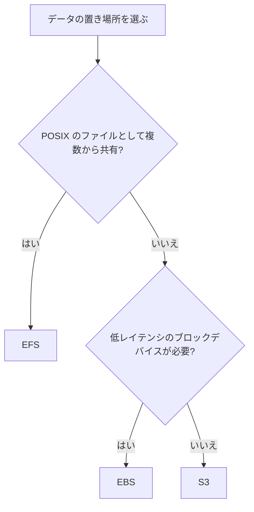

# ストレージの選び方(EBS、EFS、S3)

[:material-sprout: CLF](../courses/clf/services.md){ .exam-badge .exam-foundational } [:material-certificate: SAA](../courses/saa/services.md){ .exam-badge .exam-associate } [:material-certificate: DVA](../courses/dva/services.md){ .exam-badge .exam-associate } [:material-certificate: SOA](../courses/soa/services.md){ .exam-badge .exam-associate } [:material-certificate: DEA](../courses/dea/services.md){ .exam-badge .exam-associate } [:material-certificate: MLA](../courses/mla/services.md){ .exam-badge .exam-associate } [:material-star-circle: SAP](../courses/sap/services.md){ .exam-badge .exam-professional } [:material-star-circle: DOP](../courses/dop/services.md){ .exam-badge .exam-professional } [:material-star-circle: AIP](../courses/aip/services.md){ .exam-badge .exam-professional } [:material-target: SCS](../courses/scs/services.md){ .exam-badge .exam-specialty }

EC2 のディスクなら EBS、複数のコンピューティングで共有するファイルシステムなら EFS、HTTPS でアクセスするオブジェクトなら S3 が基本です。

[](../assets/diagrams/storage-options.png)

## 比較 {#comparison}

| 観点 | EBS | EFS | S3 |
| --- | --- | --- | --- |
| 種類 | ブロック | ファイル(NFS) | オブジェクト |
| アクセス方法 | インスタンスのディスクとしてマウント | ファイルシステムとしてマウント | HTTPS API |
| 範囲 | 1 つの AZ | リージョン内の複数 AZ のマウントターゲットから | リージョン |
| 同時接続 | 通常 1 インスタンス(io1、io2 は Multi-Attach 可) | 多数のクライアント | 多数のクライアント |
| 容量 | 事前に確保 | 自動で増減 | 自動で増減 |
| Lambda から | 使えない | 使える(VPC 内) | SDK で使える |
| 代表的な用途 | ブートボリューム、単一インスタンスの DB | コンテンツや設定の共有、機械学習モデルの共有 | ファイル配信、バックアップ、データレイク |



インスタンスストアは一時データ用です。インスタンスを終了すると内容が失われます。

**提供単位**:

| サービス | 単位 | VPC |
| --- | --- | --- |
| EBS ボリューム | AZ。スナップショットはリージョン | 外。同じ AZ のインスタンスに付ける |
| EFS(Regional) | リージョン | 接続はサブネットのマウントターゲット |
| EFS One Zone | AZ | 接続はサブネットのマウントターゲット |
| S3 バケット | リージョン | 外 |

詳しくは [リソースの提供単位](resource-scope.md) を参照してください。

**選び方の例**:

- 1 台の EC2 で動く PostgreSQL のデータは、低遅延のブロックが必要なので EBS です。
- 10 台の EC2 と Lambda で同じ設定ファイルと 20 GB のモデルを読むなら EFS です。
- スマホから投稿された 100 万枚の画像を HTTPS で配るなら S3 です。

**誤ると**: Lambda に EBS を付けることはできません。別の AZ の EC2 から同じ EBS を読むこともできません。

## EBS のボリュームタイプ {#ebs-volume-types}

**提供単位**: ボリュームは AZ 単位で、VPC には属しません。同じ AZ のインスタンスにだけ付けられます([リソースの提供単位](resource-scope.md#scope-zonal))。

| タイプ | 特徴 | サイズ | 最大 IOPS | 最大スループット | ブート | Multi-Attach |
| --- | --- | --- | --- | --- | --- | --- |
| `gp3` | 汎用 SSD。性能をサイズと独立に設定 | 1 GiB〜64 TiB | 80,000 | 2,000 MiB/s | 可 | 不可 |
| `gp2` | 汎用 SSD。IOPS はサイズに比例 | 1 GiB〜16 TiB | 16,000 | 250 MiB/s | 可 | 不可 |
| `io2` Block Express | 高性能 SSD。低レイテンシ | 4 GiB〜64 TiB | 256,000 | 4,000 MiB/s | 可 | 可 |
| `io1` | 高性能 SSD | 4 GiB〜16 TiB | 64,000 | 1,000 MiB/s | 可 | 可 |
| `st1` | スループット最適化 HDD。ログ、ビッグデータ | 125 GiB〜16 TiB | 500 | 500 MiB/s | 不可 | 不可 |
| `sc1` | コールド HDD。最低コスト | 125 GiB〜16 TiB | 250 | 250 MiB/s | 不可 | 不可 |

| ポイント | 内容 |
| --- | --- |
| `gp3` のベースライン | サイズによらず 3,000 IOPS と 125 MiB/s。追加分は別途設定 |
| `gp2` のベースライン | 3 IOPS/GiB(最小 100、最大 16,000)。1 TiB 未満は 3,000 IOPS までバースト |
| `gp2` から `gp3` | 稼働中に変更でき、GiB 単価は最大 20% 低い |
| HDD | ブートボリュームにできない |

**タイプごとの例**:

- **`gp3`**: Web サーバーのルートや、中規模の DB です。既定の 3,000 IOPS で足りることが多く、まず検討します。
- **`gp2`**: 1,000 GiB なら 3,000 IOPS、5,334 GiB で上限の 16,000 IOPS です。
- **`io2` Block Express**: 1 ミリ秒未満の遅延と 100,000 IOPS が必要な基幹 DB です。100,000 ÷ 1,000 で 100 GiB 以上にします。
- **`st1`**: 5 TiB のログ処理です。ベースラインは 5 × 40 で 200 MiB/s です。
- **`sc1`**: 月に数回しか読まない 10 TiB のデータです。ベースラインは 10 × 12 で 120 MiB/s です。

**誤ると**: 小さなランダム I/O の DB を `st1` に置くと、IOPS が最大 500 なので遅くなります。`st1` をブートに指定した起動は失敗します。

### IOPS とスループットの設定 {#ebs-performance-settings}

| タイプ | 設定できるもの | 計算の決まり |
| --- | --- | --- |
| `gp3` | サイズ、IOPS、スループット | IOPS はサイズ 1 GiB あたり最大 500。スループットは 1 IOPS あたり最大 0.25 MiB/s |
| `gp2` | サイズのみ | 3 IOPS/GiB。スループットは 128〜250 MiB/s |
| `io2` Block Express | サイズ、IOPS | IOPS はサイズ 1 GiB あたり最大 1,000。Nitro 以外では最大 32,000 IOPS |
| `io1` | サイズ、IOPS | IOPS はサイズ 1 GiB あたり最大 50。100〜64,000 IOPS |
| `st1` | サイズのみ | 1 TiB あたりベースライン 40 MiB/s、バースト 250 MiB/s |
| `sc1` | サイズのみ | 1 TiB あたりベースライン 12 MiB/s、バースト 80 MiB/s |

**計算の例**:

| 条件 | 計算 | 結果 |
| --- | --- | --- |
| `gp2` の 200 GiB | 200 × 3 | 600 IOPS。3,000 までバースト |
| `gp2` の 2 TiB | 2,048 × 3 | 6,144 IOPS |
| `gp3` の 100 GiB で最大の IOPS | 100 × 500 | 50,000 IOPS |
| `gp3` の 80,000 IOPS に必要なサイズ | 80,000 ÷ 500 | 160 GiB |
| `gp3` の 2,000 MiB/s に必要な IOPS | 2,000 ÷ 0.25 | 8,000 IOPS |
| `io1` の 100 GiB で最大の IOPS | 100 × 50 | 5,000 IOPS |
| `io2` の 256,000 IOPS に必要なサイズ | 256,000 ÷ 1,000 | 256 GiB |
| `st1` の最大スループットに必要なサイズ | 500 ÷ 40 | 12.5 TiB |

**例**: 100 GiB の DB に 6,000 IOPS が必要なら、`gp2` では 2,000 GiB 確保することになります。`gp3` なら 100 GiB のまま 6,000 IOPS を指定できます。

```bash
aws ec2 create-volume --availability-zone ap-northeast-1a --size 100 \
  --volume-type gp3 --iops 6000 --throughput 250 --encrypted
```

**誤ると**:

- `gp3` の 100 GiB に `--iops 60000` を指定すると、100 × 500 の 50,000 を超えるので拒否されます。
- `gp3` で `--iops 3000 --throughput 1000` を指定すると、3,000 × 0.25 の 750 MiB/s を超えるので拒否されます。4,000 IOPS 以上にします。
- `io1` の 100 GiB に 6,000 IOPS を指定すると、100 × 50 の 5,000 を超えるので拒否されます。
- インスタンス側の EBS 帯域が 500 MiB/s なら、ボリュームを 1,000 MiB/s にしても 500 MiB/s しか出ません。

### ボリュームの変更と AZ の制約 {#ebs-modify}

Elastic Volumes で、サイズ、タイプ、IOPS、スループットを稼働中に変更できます。

| 項目 | 内容 |
| --- | --- |
| サイズ | 増やすだけ。減らせない。小さなボリュームを作ってデータを移す |
| 回数 | 24 時間で 4 回まで。前の変更が `completed` になるまで次はできない |
| 所要時間 | 1 TiB で最大 6 時間程度。サイズの拡張は `optimizing` になった時点で効く |
| OS の作業 | サイズを増やしたらファイルシステムを拡張する |
| ルートボリューム | `st1`、`sc1` には変更できない |

!!! note "変更の制限は緩和された"
    古い資料には変更の間隔は 6 時間とあります。現在は 24 時間の中で 4 回までです。

**例**: 100 GiB の `gp2` を 200 GiB の `gp3` にして、6,000 IOPS を指定します。

```bash
aws ec2 modify-volume --volume-id vol-0123456789abcdef0 \
  --size 200 --volume-type gp3 --iops 6000
# ボリュームが optimizing になったら、OS 側を広げる(XFS の例)
sudo growpart /dev/nvme0n1 1
sudo xfs_growfs -d /
```

**誤ると**: OS の拡張を忘れると、`df` は 100 GiB のままです。24 時間の中で 5 回目の変更は失敗するので、次に変更できる時刻を待ちます。

ボリュームは 1 つの AZ に属し、同じ AZ のインスタンスにしかアタッチできません。

**例**: `ap-northeast-1a` のボリュームを `1c` のインスタンスで使うなら、スナップショットを取り、`1c` にボリュームを作ります。

| Multi-Attach の条件 | 内容 |
| --- | --- |
| 対象 | `io1`、`io2` のみ |
| アタッチできる数 | 同じ AZ の Nitro インスタンス 16 台まで |
| Windows | `io2` のみ |
| ファイルシステム | XFS や EXT4 は同時利用を想定していない。クラスター対応のものを使う |

**例**: クラスター型のアプリの 3 台で 1 つの `io2` を共有します。3 台は同じ AZ の Nitro インスタンスで、書き込みの順序はアプリが制御します。

**誤ると**: 2 台で同じボリュームを EXT4 としてマウントして書くと、データが壊れることがあります。17 台目はアタッチできません。Multi-Attach のボリュームはブートに使えません。

### スナップショット {#ebs-snapshots}

[:material-star-circle: SAP](../courses/sap/services.md){ .exam-badge .exam-professional } [:material-target: SCS](../courses/scs/services.md){ .exam-badge .exam-specialty }

ボリュームの増分バックアップです。S3 に保存されますが、S3 の API やコンソールからは見えません。

**提供単位**: スナップショットはリージョン単位で、VPC の外にあります。同じリージョンの任意の AZ にボリュームを作れます。

| 項目 | 内容 | 落とし穴 |
| --- | --- | --- |
| 増分 | 前回から変わったブロックだけ保存 | スナップショットを消しても、他が参照するデータは残る。容量が減るとは限らない |
| 範囲 | リージョン内の全 AZ に複製 | 任意の AZ に復元できる |
| 作成 | 非同期で、完了まで `pending` | 一貫性のため書き込みを止めるかアンマウントする。ルートならインスタンスを止める |
| リージョン間コピー | 全量のコピーを作る | 費用が増える |
| 別の KMS キーでコピー | 全量のコピーを作る | 費用が増える |
| 自動化 | Data Lifecycle Manager、AWS Backup | AWS は自動ではバックアップしない |

| 機能 | 内容 |
| --- | --- |
| Fast Snapshot Restore | スナップショットと AZ の組み合わせごとに有効にする。作成時から全性能を出せる |
| Snapshots Archive | 全量に変換して保存する。90 日以上保持する場合、費用を最大 75% 下げられる |
| Recycle Bin | 誤って消したスナップショット、ボリューム、AMI を保持期間内なら戻せる |

**例**: 数 TB のスナップショットから作ったボリュームで、最初の読み取りが遅いなら Fast Snapshot Restore を検討します。通常はブロックに初めてアクセスするときに遅延が発生します。

**増分の計算**: 100 GiB を使っているボリュームで 1 回目を取ると 100 GiB です。5 GiB を書き換えて 2 回目を取ると、増えるのは 5 GiB で合計 105 GiB です。1 回目を消しても、2 回目が参照するデータは残るので、減るのは書き換えられた古い 5 GiB だけで約 100 GiB です。

**Fast Snapshot Restore のクレジットの計算**: 同時に作れるボリューム数は、スナップショットのサイズで決まります。バケットの大きさは `MAX(1, MIN(10, 1024 ÷ サイズ GiB))` で、1 時間の補充数は `MIN(10, 1024 ÷ サイズ GiB)` です。

| スナップショット | バケット | 補充 |
| --- | --- | --- |
| 128 GiB | 8 | 毎時 8 個 |
| 1,024 GiB | 1 | 毎時 1 個 |
| 2,048 GiB | 1 | 毎時 0.5 個 |

**誤ると**: 128 GiB のスナップショットは有効にした直後はクレジットが 0 です。9 個目のボリュームやクレジットがない時点で作ったボリュームは、通常の遅い復元になります。

**DR のコピーの例**:

```bash
aws ec2 copy-snapshot --region ap-southeast-1 \
  --source-region ap-northeast-1 \
  --source-snapshot-id snap-0123456789abcdef0 \
  --encrypted --kms-key-id alias/dr
```

**誤ると**: 整合性を考えずに書き込み中の DB のスナップショットを取ると、復元後にリカバリが必要になることがあります。AWS は自動で取らないので、Data Lifecycle Manager か AWS Backup を設定しないと、誰も取っていない状態が続きます。

## EBS の暗号化 {#ebs-encryption}

[:material-sprout: CLF](../courses/clf/services.md){ .exam-badge .exam-foundational } [:material-certificate: SAA](../courses/saa/services.md){ .exam-badge .exam-associate } [:material-certificate: DVA](../courses/dva/services.md){ .exam-badge .exam-associate } [:material-certificate: SOA](../courses/soa/services.md){ .exam-badge .exam-associate } [:material-certificate: DEA](../courses/dea/services.md){ .exam-badge .exam-associate } [:material-certificate: MLA](../courses/mla/services.md){ .exam-badge .exam-associate } [:material-star-circle: SAP](../courses/sap/services.md){ .exam-badge .exam-professional } [:material-star-circle: DOP](../courses/dop/services.md){ .exam-badge .exam-professional } [:material-star-circle: AIP](../courses/aip/services.md){ .exam-badge .exam-professional }

KMS キーを使い、保存データと、インスタンスとボリュームの間の転送データを暗号化します。すべてのインスタンスタイプが対応しています。

- **デフォルトでの暗号化**: リージョンごとに有効化すると、新しいボリュームとスナップショットのコピーが自動で暗号化されます。
- **既存の未暗号化ボリューム**: 直接は暗号化できません。スナップショットを取り、そこから暗号化したボリュームを作ります。未暗号化のスナップショットは、暗号化ありでコピーします。
- **引き継ぎ**: 暗号化されたボリュームのスナップショットと、そこから作るボリュームも暗号化されます。解除はできません。
- **キーの変更**: 既存のボリュームやスナップショットのキーは変えられません。スナップショットのコピー時に別のキーを指定します。
- **共有**: 暗号化されたスナップショットは公開できません。特定のアカウントとは共有できます。
- **デフォルトでの暗号化の範囲**: リージョンごとの設定です。既存のボリュームやスナップショットは変わりません。有効にすると、そのリージョンの個々のボリュームやスナップショットでは無効にできません。
- **内部の動作**: AES-256 のデータキーを KMS が作り、暗号化したものをボリュームと一緒に保存します。アタッチ時に EC2 が `CreateGrant` を呼び、復号したキーをメモリに持ちます。キーポリシーで EBS の利用を許可していないと、アタッチに失敗します。

**例**: 暗号化されていない本番のボリュームを暗号化するには次の順に行います。

1. スナップショットを取ります。
2. `--encrypted` と KMS キーを指定して、スナップショットをコピーします。
3. そこからボリュームを作って付け替えます。

**デフォルト暗号化の例**:

```bash
aws ec2 enable-ebs-encryption-by-default --region ap-northeast-1
aws ec2 modify-ebs-default-kms-key-id --region ap-northeast-1 --kms-key-id alias/ebs-app
```

**誤ると**:

- 東京で有効にしても、シンガポールのボリュームは暗号化されません。リージョンごとに有効にします。
- カスタマーマネージドキーのキーポリシーで EC2 の利用を許可していないと、ボリュームのアタッチやインスタンスの起動に失敗します。
- キーを無効にすると、アタッチ済みのボリュームも再アタッチの時に使えなくなります。

## EFS の設定 {#efs-settings}

[:material-sprout: CLF](../courses/clf/services.md){ .exam-badge .exam-foundational } [:material-certificate: SAA](../courses/saa/services.md){ .exam-badge .exam-associate } [:material-certificate: DVA](../courses/dva/services.md){ .exam-badge .exam-associate } [:material-certificate: SOA](../courses/soa/services.md){ .exam-badge .exam-associate } [:material-certificate: DEA](../courses/dea/services.md){ .exam-badge .exam-associate } [:material-certificate: MLA](../courses/mla/services.md){ .exam-badge .exam-associate } [:material-star-circle: SAP](../courses/sap/services.md){ .exam-badge .exam-professional } [:material-star-circle: DOP](../courses/dop/services.md){ .exam-badge .exam-professional } [:material-star-circle: AIP](../courses/aip/services.md){ .exam-badge .exam-professional } [:material-target: SCS](../courses/scs/services.md){ .exam-badge .exam-specialty }

**提供単位**: Regional はリージョン単位で、One Zone は AZ 単位です。接続は VPC のサブネットに置くマウントターゲットを通ります([リソースの提供単位](resource-scope.md#scope-regional-vpc))。

### ファイルシステムのタイプとパフォーマンスモード {#efs-performance-mode}

| 設定 | 値 | 動作 |
| --- | --- | --- |
| タイプ | Regional | 複数の AZ にデータを保存する |
| タイプ | One Zone | 1 つの AZ。マウントターゲットも 1 つ。パフォーマンスモードは常に General Purpose |
| パフォーマンスモード | General Purpose(デフォルト) | 操作あたりの遅延が最も低い。推奨 |
| パフォーマンスモード | Max I/O | 前世代。遅延が大きい。One Zone と Elastic では使えない |

パフォーマンスモードは作成後に変更できません。General Purpose で IOPS の上限が気になるなら、`PercentIOLimit` を監視します。

**例**: 1 つの AZ で作り直せる開発用のデータなら One Zone にします。本番の共有ファイルは Regional です。

```bash
aws efs create-file-system --encrypted \
  --performance-mode generalPurpose --throughput-mode elastic \
  --tags Key=Name,Value=shared
```

**誤ると**: One Zone の AZ が止まると、そのデータは読めません。別の AZ の EC2 からのマウントには AZ 間の通信料もかかります。

### スループットモード {#efs-throughput-mode}

| モード | 動作 | 向く場面 |
| --- | --- | --- |
| Elastic(デフォルト、推奨) | 使った分だけ自動で増減し、使った分を課金 | 急増する、予測しにくい。平均がピークの 5% 以下 |
| Provisioned | 指定した量を確保 | 必要な量がわかっている。平均がピークの 5% 以上 |
| Bursting | 容量に比例する。Standard の 1 TiB あたり 50 MiB/s。バーストは最低 100 MiB/s | 容量とともに必要な性能も増える |

**計算の例**: Bursting で Standard に 100 GiB あるなら、ベースラインは 5 MiB/s です。24 時間アイドルで 432,000 MiB のクレジットがたまり、100 MiB/s で 72 分書けます。`BurstCreditBalance` がなくなるとベースラインまで落ちます。

**落とし穴**: Provisioned に切り替えるか量を変更した後、24 時間は他のモードへの切り替えと量の削減ができません。

**モードの選び方の計算**: ピークが 1,000 MiB/s のとき、平均が 30 MiB/s なら 3% なので Elastic です。平均が 200 MiB/s なら 20% なので Provisioned を検討します。

**Bursting のバーストの計算**: Standard に 2 TiB あるなら、ベースラインは 2 × 50 で 100 MiB/s、クレジットがあれば 2 × 100 で 200 MiB/s まで出ます。

```bash
aws efs update-file-system --file-system-id fs-12345678 \
  --throughput-mode provisioned --provisioned-throughput-in-mibps 256
```

**誤ると**: 小さな Bursting のファイルシステムで `BurstCreditBalance` が尽きると、100 GiB なら 5 MiB/s まで落ち、アプリのファイル操作が急に遅くなります。Provisioned を大きくしすぎると、使わない分にも課金されます。

### 暗号化とアクセス制御 {#efs-encryption}

| 項目 | 内容 |
| --- | --- |
| 保存時の暗号化 | 作成時のみ。コンソールではデフォルトで有効、CLI、API、SDK では明示が必要 |
| 既存の未暗号化を暗号化 | できない。別のファイルシステムにレプリケートする |
| 転送中の暗号化 | マウントオプション `tls`。EFS マウントヘルパーを推奨 |
| 強制 | IAM の `elasticfilesystem:Encrypted` で未暗号化の作成を拒否 |

```bash
sudo mount -t efs -o tls,accesspoint=fsap-12345678 fs-12345678:/ /mnt/shared
```

**強制の例**: 未暗号化のファイルシステムの作成を拒否します。

```json
{
  "Effect": "Deny",
  "Action": "elasticfilesystem:CreateFileSystem",
  "Resource": "*",
  "Condition": {"Bool": {"elasticfilesystem:Encrypted": "false"}}
}
```

**誤ると**: CLI で `--encrypted` を付け忘れると、未暗号化のまま作られ、後から暗号化できません。マウントに `tls` を付けないと、NFS の通信は暗号化されません。

### ライフサイクルとストレージクラス {#efs-lifecycle}

| ポリシー | デフォルト | 動作 |
| --- | --- | --- |
| IA への移行 | 30 日アクセスなし | Standard から IA へ |
| Archive への移行 | 90 日アクセスなし | Standard や IA から Archive へ |
| Standard への移行 | なし(戻らない) | 「初回アクセス時」を選ぶと戻る |

Standard は読み取りの遅延が最短 1 ミリ秒です。IA と Archive は数十ミリ秒です。`ls` などのメタデータ操作はアクセスに数えません。

値は `AFTER_1_DAY`、`AFTER_7_DAYS`、`AFTER_14_DAYS`、`AFTER_30_DAYS`、`AFTER_60_DAYS`、`AFTER_90_DAYS`、`AFTER_180_DAYS`、`AFTER_270_DAYS`、`AFTER_365_DAYS` から選びます。

**例**: 既定の値に、初回アクセスで戻す設定を加えます。

```bash
aws efs put-lifecycle-configuration --file-system-id fs-12345678 \
  --lifecycle-policies \
  '[{"TransitionToIA":"AFTER_30_DAYS"},{"TransitionToArchive":"AFTER_90_DAYS"},{"TransitionToPrimaryStorageClass":"AFTER_1_ACCESS"}]'
```

**例**: 31 日読んでいない 1 GB のログは IA へ移ります。`ls` で一覧しても移動は止まりません。IA のファイルへの書き込みは、まず Standard に入り、24 時間後から再び移行の対象になります。

**誤ると**: 小さなファイルを多く読むアプリで「戻さない」既定のままにすると、IA へ移ったファイルを読むたびに数十ミリ秒かかり、読み取りの料金もかかり続けます。

### アクセスポイント {#efs-access-points}

アプリごとの入口です。ファイルシステムごとに最大 10,000 個で、作成後は変更できません。

| 設定 | 動作 |
| --- | --- |
| POSIX ユーザー(`Uid`、`Gid`) | すべてのファイル操作を、この ID として実行する。クライアント側の ID を無視する |
| ルートディレクトリ | 指定したパスをルートとして見せる。デフォルトは `/` |
| 作成時の権限(`OwnerUid`、`OwnerGid`、`Permissions`) | ルートディレクトリがなければ、この権限で作る |

**例**: アプリ A に `/app-a`(UID 1001)のアクセスポイントを渡すと、`/app-b` は見えません。IAM ポリシーでアプリ A に使えるアクセスポイントを限定すれば、ほかのチームのデータに触れません。

```bash
aws efs create-access-point --file-system-id fs-12345678 \
  --posix-user Uid=1001,Gid=1001 \
  --root-directory "Path=/app-a,CreationInfo={OwnerUid=1001,OwnerGid=1001,Permissions=750}"
```

`Permissions=750` なので、所有者の UID 1001 は読み書きでき、同じグループは読むだけで、他は入れません。

**落とし穴**: ルートディレクトリが存在せず、作成時の権限も指定していないと、EFS はディレクトリを作らず、マウントに失敗します。セキュリティグループはアクセスポイントではなくマウントターゲットに付きます。

**誤ると**: `Uid=1001` のアクセスポイントで、所有者が UID 1002、権限が 700 のファイルを読むと `Permission denied` です。アプリの実行ユーザーが何であっても、1001 として判定されます。

## EFS を Lambda とコンテナで使う {#efs}

EFS は NFS(ポート 2049)でマウントします。VPC の各 AZ にマウントターゲットを作り、セキュリティグループで 2049 番を許可します。

**例**: マウントターゲットのセキュリティグループ `sg-efs` は、TCP 2049 の送信元を Lambda や ECS タスクの `sg-app` にします。`0.0.0.0/0` にはしません。

### Lambda {#efs-lambda}

| 要件 | 内容 |
| --- | --- |
| ネットワーク | 関数を VPC に接続し、マウントターゲットと通信できるサブネットに置く |
| 接続先 | EFS アクセスポイントを指定する |
| マウントパス | `/mnt/` で始める |
| 実行ロール | `elasticfilesystem:ClientMount`、書き込みには `elasticfilesystem:ClientWrite`(ポリシーが設定されている場合)、VPC 接続の権限 |
| 設定者の権限 | `elasticfilesystem:DescribeMountTargets` |

`/tmp` は実行環境ごとの一時領域で、他の実行環境と共有されません。関数の間でファイルを共有したい、大きなモデルを置きたい場合に EFS を使います。

**例**: 20 GB の推論モデルは、[`/tmp` の上限](lambda.md#ephemeral-storage)の 10,240 MB に入りません。EFS に置いて `/mnt/models` で読みます。

**誤ると**: `LocalMountPath=/models` は `/mnt/` で始まらないので設定できません。`Arn` にファイルシステムの ARN を渡しても拒否されます。

関数の設定は `FileSystemConfigs` です。

| 項目 | 値 |
| --- | --- |
| `Arn` | EFS アクセスポイントの ARN。ファイルシステムの ARN ではない |
| `LocalMountPath` | `/mnt/` で始まるパス。例: `/mnt/models` |

```bash
aws lambda update-function-configuration --function-name infer \
  --file-system-configs \
  Arn=arn:aws:elasticfilesystem:ap-northeast-1:111122223333:access-point/fsap-12345678abcdef012,LocalMountPath=/mnt/models
```

ポリシーが設定されていないファイルシステムは、マウントターゲットに接続できるクライアントなら誰でも使えます。ポリシーがあるときだけ、実行ロールに `ClientMount` と `ClientWrite` が必要です。

接続の問題は、関数の呼び出し時に次のエラーで現れます。

| エラー | HTTP | 原因と対処 |
| --- | --- | --- |
| `EFSMountConnectivityException` | 408 | ネットワークに接続できない。セキュリティグループの 2049 番とルートを確認する |
| `EFSMountTimeoutException` | 408 | 接続できたがマウントがタイムアウトした |
| `EFSMountFailureException` | 403 | 権限か設定の問題。ファイルシステムのポリシーや実行ロールを確認する |
| `EFSIOException` | 410 | 読み書き中のエラー |

**例**: 複数の AZ のサブネットに接続した関数で、一部の呼び出しだけ `EFSMountConnectivityException` になるなら、一部の AZ にマウントターゲットがないか、そこから 2049 番が通っていないことを確認します。関数が接続する AZ ごとにマウントターゲットを作ります。

Lambda は S3 バケットをファイルシステムとしてマウントする Amazon S3 Files にも対応しています。1 つの関数で使えるのは EFS か S3 Files のどちらかです。

### ECS と EKS {#efs-containers}

ECS ではタスク定義の `volumes` に `efsVolumeConfiguration` を指定し、コンテナの `mountPoints` で参照します。Fargate は Linux プラットフォームバージョン 1.4.0 以降で使えます。

```json
{
  "volumes": [{
    "name": "shared",
    "efsVolumeConfiguration": {
      "fileSystemId": "fs-12345678",
      "transitEncryption": "ENABLED",
      "authorizationConfig": {"accessPointId": "fsap-12345678", "iam": "ENABLED"}
    }
  }]
}
```

- アクセスポイントを指定する場合、`rootDirectory` は省略するか `/` にします。パスはアクセスポイント側で決まります。
- アクセスポイントで POSIX ユーザーとルートディレクトリを強制し、タスクロールで使えるアクセスポイントを制限できます。
- Fargate のタスクには EBS ボリュームも付けられますが、タスク間で共有したいなら EFS です。

**例**: `"mountPoints": [{"sourceVolume": "shared", "containerPath": "/data"}]` なら、アプリは `/data` として読み書きします。`transitEncryption` が `ENABLED` なので、通信も暗号化されます。

**誤ると**: `authorizationConfig` にアクセスポイントを指定したまま `rootDirectory` に `/app` を書くと、タスクの起動に失敗します。Fargate の 1.3.0 では EFS を使えません。

コンテナの全体像は [コンテナ](containers.md) を参照してください。

## データの保持 {#retention}

| サービス | 仕組み | 内容 |
| --- | --- | --- |
| EBS | `DeleteOnTermination` | インスタンス終了時に削除するか残すかを決める |
| EBS | スナップショット | S3 に保存される増分バックアップ。ボリュームを消しても残る |
| EFS | ライフサイクルポリシー | デフォルトでは 30 日未アクセスで IA、90 日で Archive へ移行 |
| S3 | ライフサイクル | クラスの移行と失効。詳しくは [S3](s3.md) |
| S3 | Object Lock | 期間内の削除や上書きを防ぐ |
| DynamoDB | TTL | 期限切れの項目を自動削除。詳しくは [DynamoDB](dynamodb.md) |

`DeleteOnTermination` のデフォルトは次のとおりです。残したボリュームには課金が続きます。

| ボリューム | アタッチのタイミング | デフォルト |
| --- | --- | --- |
| ルート | 起動時 | 削除 |
| ルート | 起動後 | 残す |
| データ | 起動時(コンソール) | 残す |
| データ | 起動時(CLI) | 削除 |
| データ | 起動後 | 残す |

EFS の IA や Archive にあるファイルは、デフォルトではアクセスされても Standard に戻りません。性能が重要なら、初回アクセスで Standard に戻す設定にします。ファイルのメタデータは常に Standard に置かれます。

**例**: 起動中のインスタンスのルートボリュームを残すようにします。

```bash
aws ec2 modify-instance-attribute --instance-id i-0123456789abcdef0 \
  --block-device-mappings '[{"DeviceName":"/dev/xvda","Ebs":{"DeleteOnTermination":false}}]'
```

**誤ると**: CLI で起動時に付けたデータボリュームは既定で削除されるので、終了と一緒にデータが消えます。逆に Auto Scaling で残す設定にすると、インスタンスが入れ替わるたびに使わないボリュームが増え、100 GiB ずつ課金が続きます。

## 既定値と上限のまとめ {#numbers}

| 項目 | 値 |
| --- | --- |
| `gp3` のベースライン | 3,000 IOPS、125 MiB/s |
| `gp3` の最大 | 80,000 IOPS、2,000 MiB/s、64 TiB |
| `gp3` の比率 | 500 IOPS/GiB、0.25 MiB/s/IOPS |
| `gp2` | 3 IOPS/GiB、最大 16,000 IOPS、250 MiB/s |
| `io2` Block Express | 1,000 IOPS/GiB、最大 256,000 IOPS、4,000 MiB/s、64 TiB |
| `io1` | 50 IOPS/GiB、最大 64,000 IOPS、1,000 MiB/s、16 TiB |
| `st1` | 最大 500 MiB/s、500 IOPS |
| `sc1` | 最大 250 MiB/s、250 IOPS |
| HDD のサイズ | 125 GiB〜16 TiB |
| Multi-Attach | 同じ AZ の 16 台まで |
| ボリュームの変更 | 24 時間で 4 回 |
| Snapshots Archive | 90 日以上の保持向け |
| EFS のポート | 2049 |
| EFS のライフサイクル | 30 日で IA、90 日で Archive |
| EFS のアクセスポイント | ファイルシステムごとに 10,000 |
| EFS の接続数 | ファイルシステムごとに 25,000 |
| Bursting のベースライン | 1 TiB あたり 50 MiB/s |
| Provisioned の変更後の制限 | 24 時間 |
| Lambda のマウントパス | `/mnt/` で始まる |

## 試験のポイント {#exam-points}

| こう問われたら | 答え |
| --- | --- |
| 複数の EC2 と Lambda でファイルを共有 | EFS |
| Lambda で `/tmp` では足りない、永続化したい | EFS(`/mnt/` にマウント)、または S3 |
| EC2 の起動ディスク | EBS(`gp3` など) |
| HDD をブートに使えるか | 使えない |
| サイズを増やさずに IOPS を上げたい | `gp3` |
| 16,000 IOPS を超える、低レイテンシが必須 | `io2` Block Express |
| 未暗号化の EBS を暗号化 | スナップショットから暗号化ありで作り直す |
| 新しいボリュームを必ず暗号化 | リージョンのデフォルト暗号化 |
| インスタンス終了後もデータを残す | `DeleteOnTermination` を `false` |
| EBS を別の AZ に移す | スナップショットから作成 |
| EFS に接続できない | セキュリティグループのポート 2049、マウントターゲット |
| EBS のサイズを小さくしたい | できない。小さなボリュームにデータを移す |
| `gp3` で 500 IOPS/GiB を超えて指定できない | サイズを増やす |
| 別リージョンの DR に EBS を持っていく | スナップショットをコピーする |
| スナップショットからの復元直後が遅い | Fast Snapshot Restore |
| アプリごとに EFS のディレクトリと ID を分ける | アクセスポイント |
| EFS の未暗号化を暗号化 | 作成時のみ。新しいファイルシステムにレプリケートする |
| EFS の負荷が急増する、読めない | Elastic スループット |
| Lambda のマウントで `EFSMountConnectivityException` | セキュリティグループの 2049 番、AZ ごとのマウントターゲット |

## 関連ページ {#related}

- [S3](s3.md)
- [EC2 と Elastic Beanstalk](ec2-beanstalk.md)
- [コンテナ](containers.md)
- [Lambda](lambda.md)
- [KMS](kms.md)

## 参考 {#references}

- [Amazon EBS volume types](https://docs.aws.amazon.com/ebs/latest/userguide/ebs-volume-types.html)
- [Amazon EBS General Purpose SSD volumes](https://docs.aws.amazon.com/ebs/latest/userguide/general-purpose.html)
- [Amazon EBS encryption](https://docs.aws.amazon.com/ebs/latest/userguide/ebs-encryption.html)
- [Preserve data when an instance is terminated](https://docs.aws.amazon.com/AWSEC2/latest/UserGuide/preserving-volumes-on-termination.html)
- [Configuring Amazon EFS file system access (Lambda)](https://docs.aws.amazon.com/lambda/latest/dg/configuration-filesystem-efs.html)
- [Configuring file system access for Lambda](https://docs.aws.amazon.com/lambda/latest/dg/configuration-filesystem.html)
- [Use Amazon EFS volumes with Amazon ECS](https://docs.aws.amazon.com/AmazonECS/latest/developerguide/efs-volumes.html)
- [Managing EFS storage lifecycle](https://docs.aws.amazon.com/efs/latest/ug/lifecycle-management-efs.html)
- [Amazon EBS Provisioned IOPS SSD volumes](https://docs.aws.amazon.com/ebs/latest/userguide/provisioned-iops.html)
- [Amazon EBS Throughput Optimized and Cold HDD volumes](https://docs.aws.amazon.com/ebs/latest/userguide/hdd-vols.html)
- [Modify an Amazon EBS volume](https://docs.aws.amazon.com/ebs/latest/userguide/ebs-modify-volume.html)
- [Multi-Attach](https://docs.aws.amazon.com/ebs/latest/userguide/ebs-volumes-multi.html)
- [Amazon EBS snapshots](https://docs.aws.amazon.com/ebs/latest/userguide/ebs-snapshots.html)
- [Fast snapshot restore](https://docs.aws.amazon.com/ebs/latest/userguide/ebs-fast-snapshot-restore.html)
- [Encryption by default](https://docs.aws.amazon.com/ebs/latest/userguide/encryption-by-default.html)
- [Amazon EFS performance specifications](https://docs.aws.amazon.com/efs/latest/ug/performance.html)
- [Working with EFS access points](https://docs.aws.amazon.com/efs/latest/ug/efs-access-points.html)
- [Encryption of data at rest (EFS)](https://docs.aws.amazon.com/efs/latest/ug/encryption-at-rest.html)
- [FileSystemConfig (Lambda API)](https://docs.aws.amazon.com/lambda/latest/dg/API_FileSystemConfig.html)
- [Invoke errors (Lambda API)](https://docs.aws.amazon.com/lambda/latest/dg/API_Invoke.html)
