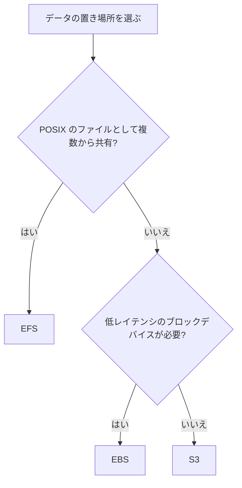

# ストレージの選び方(EBS、EFS、S3)

EC2 のディスクなら EBS、複数のコンピューティングで共有するファイルシステムなら EFS、HTTPS でアクセスするオブジェクトなら S3 が基本です。

[](../assets/diagrams/storage-options.png)

## 比較 {#comparison}

| 観点 | EBS | EFS | S3 |
| --- | --- | --- | --- |
| 種類 | ブロック | ファイル(NFS) | オブジェクト |
| アクセス方法 | インスタンスのディスクとしてマウント | ファイルシステムとしてマウント | HTTPS API |
| 範囲 | 1 つの AZ | リージョン内の複数 AZ のマウントターゲットから | リージョン |
| 同時接続 | 通常 1 インスタンス(io1、io2 は Multi-Attach 可) | 多数のクライアント | 多数のクライアント |
| 容量 | 事前に確保 | 自動で増減 | 自動で増減 |
| Lambda から | 使えない | 使える(VPC 内) | SDK で使える |
| 代表的な用途 | ブートボリューム、単一インスタンスの DB | コンテンツや設定の共有、機械学習モデルの共有 | ファイル配信、バックアップ、データレイク |



インスタンスストアは一時データ用です。インスタンスを終了すると内容が失われます。

## EBS のボリュームタイプ {#ebs-volume-types}

| タイプ | 特徴 | サイズ | 最大 IOPS | 最大スループット | ブート | Multi-Attach |
| --- | --- | --- | --- | --- | --- | --- |
| `gp3` | 汎用 SSD。性能をサイズと独立に設定 | 1 GiB〜64 TiB | 80,000 | 2,000 MiB/s | 可 | 不可 |
| `gp2` | 汎用 SSD。IOPS はサイズに比例 | 1 GiB〜16 TiB | 16,000 | 250 MiB/s | 可 | 不可 |
| `io2` Block Express | 高性能 SSD。低レイテンシ | 4 GiB〜64 TiB | 256,000 | 4,000 MiB/s | 可 | 可 |
| `io1` | 高性能 SSD | 4 GiB〜16 TiB | 64,000 | 1,000 MiB/s | 可 | 可 |
| `st1` | スループット最適化 HDD。ログ、ビッグデータ | 125 GiB〜16 TiB | 500 | 500 MiB/s | 不可 | 不可 |
| `sc1` | コールド HDD。最低コスト | 125 GiB〜16 TiB | 250 | 250 MiB/s | 不可 | 不可 |

| ポイント | 内容 |
| --- | --- |
| `gp3` のベースライン | サイズによらず 3,000 IOPS と 125 MiB/s。追加分は別途設定 |
| `gp2` のベースライン | 3 IOPS/GiB(最小 100、最大 16,000)。1 TiB 未満は 3,000 IOPS までバースト |
| `gp2` から `gp3` | 稼働中に変更でき、GiB 単価は最大 20% 低い |
| HDD | ブートボリュームにできない |

## EBS の暗号化 {#ebs-encryption}

KMS キーを使い、保存データと、インスタンスとボリュームの間の転送データを暗号化します。すべてのインスタンスタイプが対応しています。

- **デフォルトでの暗号化**: リージョンごとに有効化すると、新しいボリュームとスナップショットのコピーが自動で暗号化されます。
- **既存の未暗号化ボリューム**: 直接は暗号化できません。スナップショットを取り、そこから暗号化したボリュームを作ります。未暗号化のスナップショットは、暗号化ありでコピーします。
- **引き継ぎ**: 暗号化されたボリュームのスナップショットと、そこから作るボリュームも暗号化されます。解除はできません。
- **キーの変更**: 既存のボリュームやスナップショットのキーは変えられません。スナップショットのコピー時に別のキーを指定します。
- **共有**: 暗号化されたスナップショットは公開できません。特定のアカウントとは共有できます。

## EFS を Lambda とコンテナで使う {#efs}

EFS は NFS(ポート 2049)でマウントします。VPC の各 AZ にマウントターゲットを作り、セキュリティグループで 2049 番を許可します。

### Lambda {#efs-lambda}

| 要件 | 内容 |
| --- | --- |
| ネットワーク | 関数を VPC に接続し、マウントターゲットと通信できるサブネットに置く |
| 接続先 | EFS アクセスポイントを指定する |
| マウントパス | `/mnt/` で始める |
| 実行ロール | `elasticfilesystem:ClientMount`、書き込みには `elasticfilesystem:ClientWrite`(ポリシーが設定されている場合)、VPC 接続の権限 |
| 設定者の権限 | `elasticfilesystem:DescribeMountTargets` |

`/tmp` は実行環境ごとの一時領域で、他の実行環境と共有されません。関数の間でファイルを共有したい、大きなモデルを置きたい場合に EFS を使います。

Lambda は S3 バケットをファイルシステムとしてマウントする Amazon S3 Files にも対応しています。1 つの関数で使えるのは EFS か S3 Files のどちらかです。

### ECS と EKS {#efs-containers}

ECS ではタスク定義の `volumes` に `efsVolumeConfiguration` を指定し、コンテナの `mountPoints` で参照します。Fargate は Linux プラットフォームバージョン 1.4.0 以降で使えます。

```json
{
  "volumes": [{
    "name": "shared",
    "efsVolumeConfiguration": {
      "fileSystemId": "fs-12345678",
      "transitEncryption": "ENABLED",
      "authorizationConfig": {"accessPointId": "fsap-12345678", "iam": "ENABLED"}
    }
  }]
}
```

- アクセスポイントを指定する場合、`rootDirectory` は省略するか `/` にします。パスはアクセスポイント側で決まります。
- アクセスポイントで POSIX ユーザーとルートディレクトリを強制し、タスクロールで使えるアクセスポイントを制限できます。
- Fargate のタスクには EBS ボリュームも付けられますが、タスク間で共有したいなら EFS です。

コンテナの全体像は [コンテナ](containers.md) を参照してください。

## データの保持 {#retention}

| サービス | 仕組み | 内容 |
| --- | --- | --- |
| EBS | `DeleteOnTermination` | インスタンス終了時に削除するか残すかを決める |
| EBS | スナップショット | S3 に保存される増分バックアップ。ボリュームを消しても残る |
| EFS | ライフサイクルポリシー | デフォルトでは 30 日未アクセスで IA、90 日で Archive へ移行 |
| S3 | ライフサイクル | クラスの移行と失効。詳しくは [S3](s3.md) |
| S3 | Object Lock | 期間内の削除や上書きを防ぐ |
| DynamoDB | TTL | 期限切れの項目を自動削除。詳しくは [DynamoDB](dynamodb.md) |

`DeleteOnTermination` のデフォルトは次のとおりです。残したボリュームには課金が続きます。

| ボリューム | アタッチのタイミング | デフォルト |
| --- | --- | --- |
| ルート | 起動時 | 削除 |
| ルート | 起動後 | 残す |
| データ | 起動時(コンソール) | 残す |
| データ | 起動時(CLI) | 削除 |
| データ | 起動後 | 残す |

EFS の IA や Archive にあるファイルは、デフォルトではアクセスされても Standard に戻りません。性能が重要なら、初回アクセスで Standard に戻す設定にします。ファイルのメタデータは常に Standard に置かれます。

## 試験のポイント {#exam-points}

| こう問われたら | 答え |
| --- | --- |
| 複数の EC2 と Lambda でファイルを共有 | EFS |
| Lambda で `/tmp` では足りない、永続化したい | EFS(`/mnt/` にマウント)、または S3 |
| EC2 の起動ディスク | EBS(`gp3` など) |
| HDD をブートに使えるか | 使えない |
| サイズを増やさずに IOPS を上げたい | `gp3` |
| 16,000 IOPS を超える、低レイテンシが必須 | `io2` Block Express |
| 未暗号化の EBS を暗号化 | スナップショットから暗号化ありで作り直す |
| 新しいボリュームを必ず暗号化 | リージョンのデフォルト暗号化 |
| インスタンス終了後もデータを残す | `DeleteOnTermination` を `false` |
| EBS を別の AZ に移す | スナップショットから作成 |
| EFS に接続できない | セキュリティグループのポート 2049、マウントターゲット |

## 関連ページ {#related}

- [S3](s3.md)
- [EC2 と Elastic Beanstalk](ec2-beanstalk.md)
- [コンテナ](containers.md)
- [Lambda](lambda.md)
- [KMS](kms.md)

## 参考 {#references}

- [Amazon EBS volume types](https://docs.aws.amazon.com/ebs/latest/userguide/ebs-volume-types.html)
- [Amazon EBS General Purpose SSD volumes](https://docs.aws.amazon.com/ebs/latest/userguide/general-purpose.html)
- [Amazon EBS encryption](https://docs.aws.amazon.com/ebs/latest/userguide/ebs-encryption.html)
- [Preserve data when an instance is terminated](https://docs.aws.amazon.com/AWSEC2/latest/UserGuide/preserving-volumes-on-termination.html)
- [Configuring Amazon EFS file system access (Lambda)](https://docs.aws.amazon.com/lambda/latest/dg/configuration-filesystem-efs.html)
- [Configuring file system access for Lambda](https://docs.aws.amazon.com/lambda/latest/dg/configuration-filesystem.html)
- [Use Amazon EFS volumes with Amazon ECS](https://docs.aws.amazon.com/AmazonECS/latest/developerguide/efs-volumes.html)
- [Managing EFS storage lifecycle](https://docs.aws.amazon.com/efs/latest/ug/lifecycle-management-efs.html)
