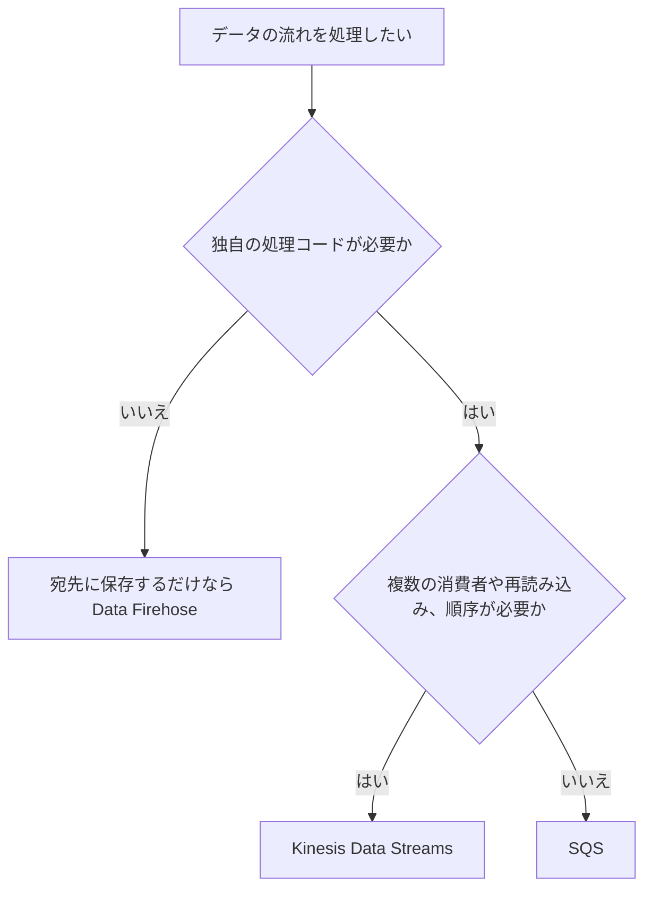

# ストリーミングとデータ分析（Kinesis、Firehose、Athena、OpenSearch）

流れ続けるデータを受け取り、処理して、分析できる形で保存するサービス群。Kinesis Data Streams で受け、Data Firehose で届け、Athena と OpenSearch Service で検索する組み合わせが基本になる。

[](../assets/diagrams/streaming-pipeline.png)

## Kinesis Data Streams {#kinesis-data-streams}

順序付きのレコードをためて、複数の消費者が読めるようにするサービス。読んでもレコードは消えず、保持期間の間は何度でも読み直せる。

| 用語 | 意味 |
| --- | --- |
| ストリーム | シャードの集まり |
| シャード | 容量の単位。レコードの順序付きの列 |
| レコード | シーケンス番号、パーティションキー、データ本体 |
| パーティションキー | どのシャードに入れるかを決める値 |
| シーケンス番号 | シャード内の順序を表す。Kinesis が割り当てる |
| 保持期間 | 既定 24 時間、最大 8,760 時間（365 日）。24 時間を超えると追加料金 |

### シャードの容量 {#shards}

| 方向 | 1シャードあたりの上限 |
| --- | --- |
| 書き込み | 1 MB/秒、1,000 レコード/秒（パーティションキーを含む） |
| 読み取り（共有） | 2 MB/秒、5 トランザクション/秒 |
| 読み取り（拡張ファンアウト） | 消費者ごとに 2 MB/秒 |

`GetRecords` は1回で 10 MB または 10,000 レコードまで。10 MB を返すと、次の 5 秒間の呼び出しは `ProvisionedThroughputExceededException` になる。

必要なシャード数は、書き込み量と読み取り量のうち多いほうから見積もる。

```text
例: 1 KB のレコードを毎秒 3,000 件書く
書き込み: 3,000 KB/秒 ÷ 1,000 KB/秒 = 3 シャード
件数: 3,000 件/秒 ÷ 1,000 件/秒 = 3 シャード
```

レコードの最大サイズは、既定で 1 MiB。ストリームの設定（`MaxRecordSizeInKiB`、既存のストリームは `UpdateMaxRecordSize`）で最大 10 MiB まで上げられる。1〜10 MiB の大きなレコードはバースト容量で断続的に扱う前提で、シャードの平常の書き込み上限（1 MB/秒）は変わらない。AWS は大きなレコードを全トラフィックの 2% 未満に抑えることを勧めている。

### パーティションキー {#partition-key}

キーの MD5 ハッシュでシャードが決まる。キーは 256 文字までの Unicode 文字列。

- **順序が保証されるのは同じシャードの中だけ**。同じキーのレコードは同じシャードに入る。
- 値の種類が少ないキーは特定のシャードに偏る（**ホットシャード**）。ユーザー ID のように、種類が多く分散するキーを選ぶ。
- 順序が不要なら、ランダムなキーで分散させる。
- `ExplicitHashKey` で明示的にシャードを選べる。

```python
import json

import boto3

kinesis = boto3.client("kinesis")

kinesis.put_record(
    StreamName="clicks",
    Data=json.dumps({"userId": "u-1", "page": "/"}).encode(),
    PartitionKey="u-1",
)

# まとめて書く。1 リクエスト 500 レコード、10 MiB まで
res = kinesis.put_records(
    StreamName="clicks",
    Records=[
        {"Data": json.dumps(r).encode(), "PartitionKey": r["userId"]} for r in rows
    ],
)
# 一部だけ失敗することがある
if res["FailedRecordCount"] > 0:
    failed = [
        rows[i] for i, r in enumerate(res["Records"]) if "ErrorCode" in r
    ]
    # failed をバックオフして再送する
```

!!! warning "PutRecords は例外なしで部分失敗する"
    `PutRecords` は一部のレコードが失敗しても、呼び出し自体は成功する。`FailedRecordCount` を確認し、失敗分だけ再送する。

### キャパシティモード {#capacity-modes}

| モード | シャード管理 | 料金 | 向いている場面 |
| --- | --- | --- | --- |
| Provisioned | シャード数を自分で指定 | シャード時間 | 予測できる流量、コスト優先 |
| On-demand Standard | 自動 | データ量とストリームごとの固定料金 | 流量が読めない |
| On-demand Advantage | 自動。ウォーム容量を設定可能 | 固定料金なし。最低利用量あり | 常に大量に流す |

- On-demand の新規ストリームは 4 MB/秒の書き込み、8 MB/秒の読み取りから始まる。
- 過去 30 日のピークの 2 倍まで対応する。これを超える急増では、約 15 分間エラーが出る場合がある。
- 上限は書き込み 200 MB/秒または 10 GB/秒で、リージョンにより異なる。
- モードの切り替えは 24 時間に 2 回まで。
- On-demand でも、1つのパーティションキーがシャードの上限（1 MB/秒、1,000 件/秒）を超えると解決できない。

### 消費者と拡張ファンアウト {#enhanced-fan-out}

| | 共有スループット | 拡張ファンアウト |
| --- | --- | --- |
| 読み取り容量 | シャードごとに全消費者で 2 MB/秒 | 消費者ごとに 2 MB/秒 |
| 配信方式 | `GetRecords`（プル、HTTP） | `SubscribeToShard`（プッシュ、HTTP/2） |
| 遅延の目安 | 1 消費者で約 200 ms、5 消費者で約 1,000 ms | 約 70 ms |
| 料金 | 追加なし | データ取得とシャード時間の追加料金 |
| 登録数 | | 20（On-demand Advantage は 50） |

消費者が複数で遅延が問題なら、拡張ファンアウトを使う。`RegisterStreamConsumer` で登録する。

自前の消費者を作るなら **Kinesis Client Library（KCL）** が便利。シャードの割り当てとチェックポイントを管理し、その情報を DynamoDB のリーステーブルに保存する。テーブルの容量が足りないと、イテレーターの期限切れを招くことがある。

### リシャーディング {#resharding}

Provisioned モードでシャード数を変える操作。

| 操作 | API | 効果 |
| --- | --- | --- |
| 分割 | `SplitShard` | 容量と費用が増える。ホットシャードに使う |
| 結合 | `MergeShards` | 容量と費用が減る。コールドシャードに使う |
| 均等な変更 | `UpdateShardCount` | 全体を指定の数にする |

- 分割と結合は 2 シャード単位で行う。
- 親シャードは `OPEN` → `CLOSED` → `EXPIRED` と変わる。
- 親シャードには読み残しがあり得る。順序を守るには、**親を読み終えてから子を読む**。KCL はこれを自動で扱う。

### エラーと監視 {#kinesis-errors}

| エラーやメトリクス | 意味 | 対処 |
| --- | --- | --- |
| `ProvisionedThroughputExceededException`（書き込み） | シャードの上限超過 | バックオフと再送、`PutRecords` の利用、シャード追加、キーの分散 |
| `ProvisionedThroughputExceededException`（読み取り） | 5 回/秒や 2 MB/秒の超過 | 拡張ファンアウト、消費者の整理、バックオフ |
| `ExpiredIteratorException` | シャードイテレーターの期限切れ（5 分） | 取得し直す。KCL のリーステーブルの容量も確認 |
| `GetRecords.IteratorAgeMilliseconds` | 消費の遅れ | 増え続けるなら消費者を強化 |
| `WriteProvisionedThroughputExceeded`、`ReadProvisionedThroughputExceeded` | スロットリング数 | シャードレベルのメトリクスでホットシャードを特定 |
| KMS の権限エラー | 暗号化ストリームへのアクセス権がない | KMS キーの権限を付ける |

## Lambda とストリーム {#lambda-streams}

イベントソースマッピングで Lambda がシャードを読み、同期で関数を呼ぶ。

```yaml
# AWS SAM の抜粋
Events:
  Stream:
    Type: Kinesis
    Properties:
      Stream: !GetAtt ClickStream.Arn
      StartingPosition: LATEST
      BatchSize: 100
      MaximumBatchingWindowInSeconds: 5
      ParallelizationFactor: 2
      BisectBatchOnFunctionError: true
      MaximumRetryAttempts: 3
      MaximumRecordAgeInSeconds: 3600
      FunctionResponseTypes:
        - ReportBatchItemFailures
      DestinationConfig:
        OnFailure:
          Destination: !GetAtt FailedRecordsQueue.Arn
```

| 設定 | 既定 | 用途 |
| --- | --- | --- |
| `BatchSize` | 100（最大 10,000） | 1回で渡すレコード数 |
| `MaximumBatchingWindowInSeconds` | 0（最大 300） | バッチをためる時間 |
| `ParallelizationFactor` | 1（最大 10） | シャードごとの同時処理数 |
| `StartingPosition` | 必須 | `TRIM_HORIZON`、`LATEST`、`AT_TIMESTAMP` |
| `BisectBatchOnFunctionError` | false | エラー時にバッチを半分に分けて再試行 |
| `MaximumRetryAttempts` | -1（無限） | 再試行の回数 |
| `MaximumRecordAgeInSeconds` | -1（無限） | 古いレコードを諦める時間 |
| `DestinationConfig` | なし | 失敗の記録先（SQS、SNS、S3） |
| `TumblingWindowInSeconds` | なし | 時間枠での集計 |

エラーの扱いが SQS と大きく違う。

- 既定では、失敗すると **そのシャードの処理が止まり**、レコードが期限切れになるまで同じバッチを再試行する。
- 毒レコードで止めないように、再試行の上限、バッチ分割、失敗の記録先を組み合わせる。
- 処理が追いつかなければ、`ParallelizationFactor` を上げるかシャードを増やす。並列数を上げてもパーティションキー単位の順序は保たれる。

処理の詳細と部分バッチレスポンスは [Lambda](lambda.md) を参照する。

## Amazon Data Firehose {#firehose}

ストリーミングデータをためて、宛先に **届ける** マネージドサービス。自前の消費者コードやシャード管理が要らない。

| 項目 | 内容 |
| --- | --- |
| 入力 | Direct PUT（`PutRecord`、`PutRecordBatch`）、Kinesis Data Streams、MSK など |
| 宛先 | S3、Redshift、OpenSearch Service、OpenSearch Serverless、Apache Iceberg テーブル、Splunk、Snowflake、HTTP エンドポイント |
| レコードの上限 | Base64 エンコード前で 1,000 KiB |
| 配信 | 少なくとも1回。再試行で重複があり得る |
| 保持 | Direct PUT は宛先が使えないときに最大 24 時間 |

### バッファ {#firehose-buffering}

バッファのサイズか時間のどちらかに達すると配信する。そのため「ほぼリアルタイム」になる。

| 宛先 | サイズ（既定） | 時間（既定） |
| --- | --- | --- |
| S3 | 1〜128 MB（5 MB） | 0〜900 秒（300 秒） |

小さくすると遅延は減るが、S3 の小さなオブジェクトが増える。

### Lambda による変換 {#firehose-transform}

宛先に届く前に Lambda でレコードを変換できる。

```python
import base64
import json


def handler(event, context):
    output = []
    for record in event["records"]:
        data = json.loads(base64.b64decode(record["data"]))
        data["processed"] = True
        output.append(
            {
                "recordId": record["recordId"],  # 入力と同じ値にする
                "result": "Ok",  # Ok、Dropped、ProcessingFailed
                "data": base64.b64encode(json.dumps(data).encode()).decode(),
            }
        )
    return {"records": output}
```

- 関数の実行時間は最大 5 分まで。
- 変換用のバッファは 0.2〜3 MB（既定 1 MB）、0〜900 秒（既定 60 秒）。
- 元データや失敗データは S3 にバックアップできる。

### その他の機能 {#firehose-features}

| 機能 | 内容 |
| --- | --- |
| 形式の変換 | JSON を Parquet や ORC に変換して S3 に保存する。Athena で速く安く検索できる |
| 動的パーティショニング | レコードの値で S3 のプレフィックスを分ける |
| 圧縮と暗号化 | S3 への配信時に指定できる |

## Kinesis Data Streams、Firehose、SQS の選び方 {#choosing}

| | Kinesis Data Streams | Data Firehose | SQS |
| --- | --- | --- | --- |
| 主な目的 | 順序付きストリームの処理 | 宛先への配信 | タスクのキューイング |
| 消費者 | 複数が独立して読める | 宛先に届ける | 1メッセージを1消費者が処理 |
| 読み直し | 保持期間内なら可能 | 不可 | 不可（削除まで） |
| 順序 | シャード内 | 保証を前提にしない | FIFO のグループ内 |
| 容量管理 | シャード、または On-demand | 自動 | 自動 |
| 遅延 | リアルタイム | バッファ分の遅れ | 消費者次第 |
| 向いている場面 | クリックストリーム、ログの集計、複数アプリでの処理 | ログを S3 や OpenSearch へ保存 | 非同期ジョブ、個別の再試行 |



[SQS と他のメッセージングサービスの比較](messaging.md) も参照する。

## Amazon Athena {#athena}

S3 のデータに標準 SQL で問い合わせるサーバーレスのサービス。インフラの管理が要らず、実行したクエリの分だけ払う。ログ分析やアドホックな調査に使う。

```sql
-- パーティションを指定すると、スキャン量が減る
SELECT status, COUNT(*) AS cnt
FROM alb_logs
WHERE day = '2026/10/30'
GROUP BY status
ORDER BY cnt DESC;
```

```python
import boto3

athena = boto3.client("athena")
qid = athena.start_query_execution(
    QueryString="SELECT * FROM alb_logs LIMIT 10",
    QueryExecutionContext={"Database": "logs"},
    ResultConfiguration={"OutputLocation": "s3://my-athena-results/"},
)["QueryExecutionId"]

# 非同期なので完了を確認してから結果を取る
state = athena.get_query_execution(QueryExecutionId=qid)["QueryExecution"]["Status"]["State"]
if state == "SUCCEEDED":
    rows = athena.get_query_results(QueryExecutionId=qid)
```

### S3 上のログを問い合わせる {#athena-logs}

CloudTrail、CloudFront、ALB、Classic Load Balancer、VPC フローログなどの AWS サービスログを、テーブルを定義して検索できる。AWS のドキュメントにテーブル定義の例がある。

ログの調査では、[CloudWatch Logs Insights](observability.md) と使い分ける。

| | CloudWatch Logs Insights | Athena |
| --- | --- | --- |
| データの場所 | CloudWatch Logs | S3 |
| クエリ言語 | 専用の言語など | SQL |
| 向いている場面 | 直近のログの調査 | 長期保管した大量のログの分析 |

### 速く、安くするコツ {#athena-performance}

| 方法 | 効果 |
| --- | --- |
| パーティション | `WHERE` で指定した範囲だけを読む。年月日で分けるのが一般的 |
| 列指向形式（Parquet、ORC） | 必要な列だけを読み、圧縮も効く |
| パーティション射影 | パーティションが多いテーブルの処理を速くし、管理を自動化する |
| CTAS | クエリ結果から、変換済みの新しいテーブルを作る |
| ワークグループ | チームを分け、メトリクスの追跡とコストの管理をする |

- テーブル定義は AWS Glue Data Catalog で管理する。
- 新しい Hive 形式のパーティションは `MSCK REPAIR TABLE` で読み込む。CloudTrail や Firehose のような Hive 形式でないパスは `ALTER TABLE ADD PARTITION` で追加する。
- 問い合わせ結果は S3 に自動で保存される。読むには `s3:GetObject` などが必要。
- S3 以外のデータは Athena Federated Query で問い合わせできる。

## Amazon OpenSearch Service {#opensearch}

OpenSearch の検索と分析のクラスターを管理するサービス。全文検索、ログ分析、リアルタイムのアプリケーション監視、クリックストリーム分析に使う。OpenSearch Dashboards で可視化できる。

| 形態 | 特徴 |
| --- | --- |
| マネージドクラスター（ドメイン） | インスタンスの種類、数、ストレージを指定する |
| OpenSearch Serverless | クラスターの設定なしで使う。コレクション単位で管理する |

### データの入れ方 {#opensearch-ingestion}

| 経路 | 内容 |
| --- | --- |
| OpenSearch Ingestion | サードパーティなしで直接取り込む |
| Data Firehose、CloudWatch Logs | OpenSearch を標準でサポート |
| S3、Kinesis Data Streams、DynamoDB | Lambda で変換してインデックスする |
| DynamoDB のゼロ ETL | OpenSearch Ingestion の DynamoDB プラグイン |

### データストアの選び方 {#specialized-store}

データストアは、アクセスパターンで選ぶ。

| 必要なこと | 選択肢 |
| --- | --- |
| キーによる高速な読み書き | [DynamoDB](dynamodb.md) |
| 全文検索、あいまい検索、ファセット | OpenSearch Service |
| ログの検索とダッシュボード | OpenSearch Service |
| S3 上のデータに対する単発の SQL | Athena |
| トランザクションと結合 | [RDS、Aurora](databases.md) |
| ミリ秒のキャッシュ | [ElastiCache](databases.md) |

DynamoDB はキーと属性で検索する設計で、部分一致の全文検索には向かない。DynamoDB のデータを全文検索したいときは、OpenSearch に同期する。

## 試験のポイント {#exam-points}

| こう問われたら | 答え |
| --- | --- |
| 複数のアプリが同じデータを順序付きで読む | Kinesis Data Streams |
| 読み直しが必要 | Kinesis Data Streams（保持期間を延長） |
| 消費者が増えて読み取りが遅い | 拡張ファンアウト |
| `ProvisionedThroughputExceededException` | バックオフ、シャード追加、パーティションキーの分散 |
| 一部のシャードだけスロットリング | キーが偏っている。キーを変えるか分割する |
| 流量が読めない、管理したくない | On-demand モード |
| 順序が必要 | 同じパーティションキーを使う |
| 親と子のシャードでの順序 | 親を読み終えてから子を読む |
| シャードの処理が止まる | Lambda のバッチ分割、最大再試行、失敗の記録先 |
| 処理の遅れを検知 | `IteratorAge`、`GetRecords.IteratorAgeMilliseconds` |
| Lambda の処理が追いつかない | `ParallelizationFactor`、シャード追加 |
| ログを S3 に保存、運用は最小限 | Data Firehose |
| 保存前に変換 | Firehose と Lambda 変換 |
| Firehose の `recordId` を変えた | 不一致はエラーになる。同じ値を返す |
| JSON を Parquet で保存 | Firehose の形式変換 |
| ほぼリアルタイムで十分か、即時か | Firehose はバッファ分の遅延あり |
| S3 のログを SQL で分析 | Athena |
| Athena のコストを下げたい | パーティションと Parquet |
| 全文検索がしたい | OpenSearch Service |
| DynamoDB のデータを全文検索 | ゼロ ETL で OpenSearch に連携 |

## 関連ページ {#related}

- [Lambda](lambda.md)
- [メッセージング](messaging.md)
- [DynamoDB](dynamodb.md)
- [データベース](databases.md)
- [S3](s3.md)
- [オブザーバビリティ](observability.md)

## 参考 {#references}

- [Kinesis Data Streams key concepts](https://docs.aws.amazon.com/streams/latest/dev/key-concepts.html)
- [Kinesis Data Streams quotas](https://docs.aws.amazon.com/streams/latest/dev/service-sizes-and-limits.html)
- [Choosing the data stream capacity mode](https://docs.aws.amazon.com/streams/latest/dev/how-do-i-size-a-stream.html)
- [Enhanced fan-out consumers](https://docs.aws.amazon.com/streams/latest/dev/enhanced-consumers.html)
- [Resharding](https://docs.aws.amazon.com/streams/latest/dev/kinesis-using-sdk-java-resharding.html)
- [After resharding](https://docs.aws.amazon.com/streams/latest/dev/kinesis-using-sdk-java-after-resharding.html)
- [Extended retention](https://docs.aws.amazon.com/streams/latest/dev/kinesis-extended-retention.html)
- [Troubleshooting producers](https://docs.aws.amazon.com/streams/latest/dev/troubleshooting-producers.html)
- [Troubleshooting consumers](https://docs.aws.amazon.com/streams/latest/dev/troubleshooting-consumers.html)
- [PutRecords API](https://docs.aws.amazon.com/kinesis/latest/APIReference/API_PutRecords.html)
- [PutRecord API](https://docs.aws.amazon.com/kinesis/latest/APIReference/API_PutRecord.html)
- [Using Lambda with Kinesis](https://docs.aws.amazon.com/lambda/latest/dg/with-kinesis.html)
- [Kinesis event source mapping parameters](https://docs.aws.amazon.com/lambda/latest/dg/services-kinesis-parameters.html)
- [What is Amazon Data Firehose](https://docs.aws.amazon.com/firehose/latest/dev/what-is-this-service.html)
- [Firehose data transformation](https://docs.aws.amazon.com/firehose/latest/dev/data-transformation.html)
- [Firehose buffering hints](https://docs.aws.amazon.com/firehose/latest/dev/create-configure-backup.html)
- [Firehose data delivery](https://docs.aws.amazon.com/firehose/latest/dev/basic-deliver.html)
- [Firehose quotas](https://docs.aws.amazon.com/firehose/latest/dev/limits.html)
- [What is Amazon Athena](https://docs.aws.amazon.com/athena/latest/ug/what-is.html)
- [Athena partitions](https://docs.aws.amazon.com/athena/latest/ug/partitions.html)
- [Athena columnar storage](https://docs.aws.amazon.com/athena/latest/ug/columnar-storage.html)
- [Athena partition projection](https://docs.aws.amazon.com/athena/latest/ug/partition-projection.html)
- [Query AWS service logs](https://docs.aws.amazon.com/athena/latest/ug/querying-aws-service-logs.html)
- [Athena CTAS](https://docs.aws.amazon.com/athena/latest/ug/ctas.html)
- [What is Amazon OpenSearch Service](https://docs.aws.amazon.com/opensearch-service/latest/developerguide/what-is.html)
- [OpenSearch Serverless](https://docs.aws.amazon.com/opensearch-service/latest/developerguide/serverless-overview.html)
- [Loading streaming data into OpenSearch Service](https://docs.aws.amazon.com/opensearch-service/latest/developerguide/integrations.html)
- [DynamoDB zero-ETL with OpenSearch Service](https://docs.aws.amazon.com/amazondynamodb/latest/developerguide/OpenSearchIngestionForDynamoDB.html)
