# ストリーミングとデータ分析（Kinesis、Firehose、Athena、OpenSearch）

[:material-sprout: CLF](../courses/clf/services.md){ .exam-badge .exam-foundational } [:material-sprout: AIF](../courses/aif/services.md){ .exam-badge .exam-foundational } [:material-certificate: SAA](../courses/saa/services.md){ .exam-badge .exam-associate } [:material-certificate: DVA](../courses/dva/services.md){ .exam-badge .exam-associate } [:material-certificate: SOA](../courses/soa/services.md){ .exam-badge .exam-associate } [:material-certificate: DEA](../courses/dea/services.md){ .exam-badge .exam-associate } [:material-certificate: MLA](../courses/mla/services.md){ .exam-badge .exam-associate } [:material-star-circle: SAP](../courses/sap/services.md){ .exam-badge .exam-professional } [:material-star-circle: DOP](../courses/dop/services.md){ .exam-badge .exam-professional } [:material-star-circle: AIP](../courses/aip/services.md){ .exam-badge .exam-professional } [:material-target: SCS](../courses/scs/services.md){ .exam-badge .exam-specialty }

流れ続けるデータを受け取り、処理して、分析できる形で保存するサービス群。Kinesis Data Streams で受け、Data Firehose で届け、Athena と OpenSearch Service で検索する組み合わせが基本になる。

[](../assets/diagrams/streaming-pipeline.png)

## なぜストリーミングの仕組みが要るのか {#why}

従来の分析は、1 日分のログをファイルにまとめ、夜間のバッチで処理する形が多かった。これでは、不正な注文や障害に気づくのが翌朝になる。ストリーミングは、データが発生したらすぐ受け取り、順に処理する形にするための仕組みである。

| 困りごと | 仕組みがないと起きること | 使うサービス |
| --- | --- | --- |
| 発生してすぐ反応したい | 夜間バッチの後まで気づけない | Kinesis Data Streams と Lambda |
| 同じデータを複数のシステムが使う | 生産者が送り先ごとに送り直し、送り先が増えるたびに改修する | Kinesis Data Streams の複数の消費者 |
| 大量のログを保存先に届けたい | 配送のコード、バッファ、再試行を自分で書く | Data Firehose |
| ためたログを SQL で調べたい | 分析用のサーバーを常に動かす | Athena |
| 文字列であいまいに探したい | RDB の `LIKE` で全件を読む | OpenSearch Service |

オンプレミスで同じことをする場合と対応させると、次のようになる。

| AWS | オンプレミスでの相当 | 違う点（AWS ならでは） |
| --- | --- | --- |
| Kinesis Data Streams | Apache Kafka のクラスター（トピックとパーティション） | ブローカーの台数、ディスク、ZooKeeper などを管理しない。容量はシャードか On-demand で決める |
| Data Firehose | Fluentd、Logstash などのログ転送 | 配送先ごとのバッファと再試行が組み込み。サーバーを持たない |
| Athena | Hadoop の上の SQL エンジンのクラスター | クラスターを持たず、スキャンした量だけ払う |
| OpenSearch Service | 自前の Elasticsearch、OpenSearch のクラスター | 故障したノードの検出と置き換えを AWS が行う |

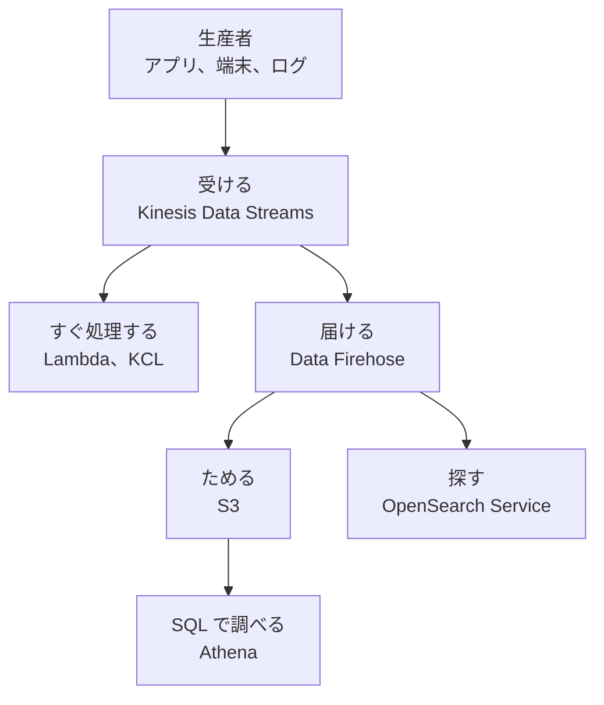

## 使いどころと具体例 {#use-cases}

4 つのサービスは役割が分かれている。すぐ反応する、または複数のアプリで読むなら Kinesis Data Streams、保存先へ届けるだけなら Firehose、ためたものを SQL で調べるなら Athena、言葉であいまいに探すなら OpenSearch Service である。

ここでは、場面ごとの選び方と、架空のサービスでの組み方を示す。設定の詳細は各節へのリンク先にある。

### 使う場面 {#use-cases-fit}

| 場面 | 具体例 | 使う機能 |
| --- | --- | --- |
| 秒単位で不正に反応する | オンラインゲームで、1 秒に 50 回の攻撃操作を送るチートを数秒以内に見つける | [Kinesis Data Streams](#kinesis-data-streams)、[拡張ファンアウト](#enhanced-fan-out) |
| 同じデータを複数のチームが読む | 同じ行動ログを、不正検知、ランキング、分析の 3 チームが別々に読む | [消費者と拡張ファンアウト](#enhanced-fan-out) |
| バグを直した後で読み直す | 集計のバグを直し、3 日前からのレコードを処理し直す | [保持期間](#retention)、[シャードイテレーター](#shard-iterators) |
| 機器ごとに順序を守る | 工場の設備センサーで、同じ設備の温度の記録を時刻順に処理する | [パーティションキー](#partition-key) |
| 流量が読めない | 生放送の視聴ログで、番組によって流量が 20 倍変わる | [キャパシティモード](#capacity-modes) |
| 一定時間ごとに集計する | IoT で、設備ごとの 5 分間の平均温度を出す | [Lambda とストリーム](#lambda-streams)の `TumblingWindowInSeconds` |
| ログを保存先に届けるだけ | ニュースサイトのアクセスログを、5 分ごとに S3 へ Parquet で保存する | [Data Firehose](#firehose)、[その他の機能](#firehose-features) |
| 届けるついでに整形する | ログから個人のメールアドレスを消してから S3 に置く | [Lambda による変換](#firehose-transform) |
| ためたログを SQL で調べる | 自治体のサイトで、3 年分の CloudFront のログから月ごとのアクセス数を出す | [Athena](#athena)、[S3 上のログを問い合わせる](#athena-logs) |
| 分析者の使いすぎを止める | 1 クエリのスキャン量を 100 GB で打ち切る | [ワークグループ](#athena-workgroups) |
| 商品をあいまいに探す | 家具の EC サイトで、「北欧 ソファ 2人掛け」の検索に関係の近い順で答える | [OpenSearch Service](#opensearch)、[データの入れ方](#opensearch-ingestion) |
| アプリのログを検索して画面で見る | SaaS の障害調査で、直近 10 日のログを数秒で検索する | [開発者が知っておく用語と設定](#opensearch-concepts) |

### 使わない方がよい場面 {#use-cases-avoid}

| 場面 | 理由 | 代わりの選択肢 |
| --- | --- | --- |
| 1 件ずつ独立した仕事を多数のワーカーで分け合う | Kinesis はシャードを 1 つの消費者が順に読む。失敗した 1 件だけを後回しにしにくい | [SQS](messaging.md#sqs) |
| 1 秒未満で保存先に届けたい | Firehose はバッファの分だけ遅れる | Kinesis Data Streams と Lambda で直接書く |
| アプリの画面から 1 件をミリ秒で取る | Athena は非同期で、結果が返るまで秒単位かかる。スキャン量で払う | [DynamoDB](dynamodb.md) |
| 数百人が開くダッシュボードを Athena の直接クエリで動かす | 開くたびにスキャンの料金がかかり、同時実行の上限にも当たる | [Redshift](data-engineering.md#redshift)、[Quick Sight の SPICE](data-engineering.md#quick-sight) |
| OpenSearch を唯一の保存先にする | 正本のデータベースではない。トランザクションや結合に向かない | 正本は [RDS、Aurora](databases.md) や DynamoDB に置き、OpenSearch に同期する |
| 1 日数 MB のログを保存する | ストリームのシャード時間などの固定の費用が、データ量に見合わない | アプリから S3 に直接書くか、CloudWatch Logs |

### 例: オンラインゲームのチート検知 {#use-case-game}

**状況:** 同時接続 30 万人の対戦ゲーム。プレイヤーの操作ログが 1 件 0.5 KB で、平常は毎秒 2 万件、新シーズンの開始日には毎秒 6 万件になる。同じログを、チート検知（数秒以内）、ランキング（1 分ごと）、分析用の S3 保存の 3 つで使う。運用は 3 人。

**構成:**

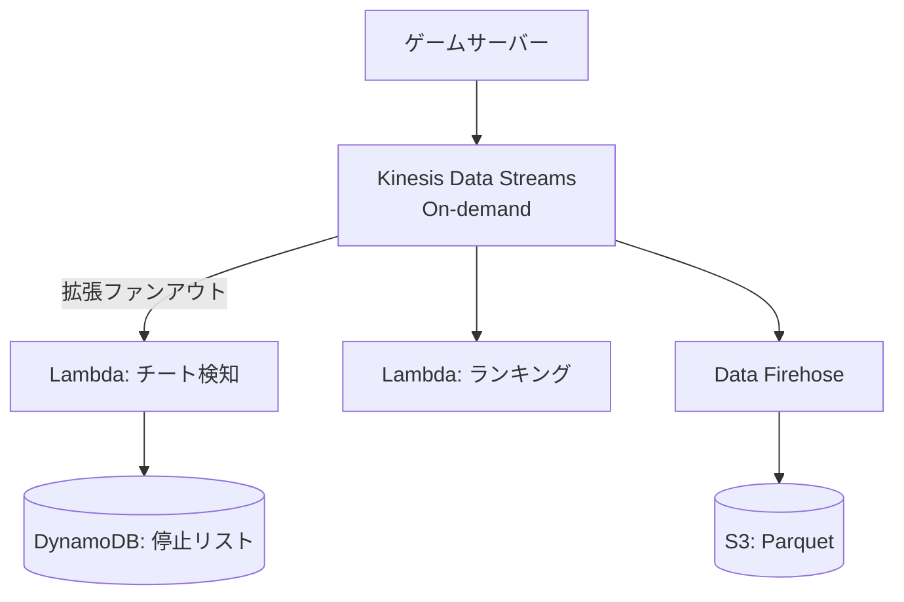

**設定値:**

| 設定 | 値 | 理由 |
| --- | --- | --- |
| キャパシティモード | On-demand Standard | 平常 10 MB/秒、ピーク 30 MB/秒。過去 30 日のピークの 2 倍まで受けられる（[キャパシティモード](#capacity-modes)） |
| パーティションキー | プレイヤー ID | 同じプレイヤーの操作の順序を守り、30 万人に散らす |
| 保持期間 | 72 時間 | 週末に集計のバグが見つかっても月曜に読み直せる |
| チート検知の読み方 | 拡張ファンアウトの消費者を登録し、Lambda に指定する | 他の 2 つの読み取りと枠を分け合わず、遅延は約 70 ms |
| チート検知の `BatchSize`、ウィンドウ | 100、1 秒 | 検知の遅れを最大 1 秒に抑える |
| `MaximumRetryAttempts`、`BisectBatchOnFunctionError` | 3、`true` | 壊れたログ 1 件でシャードを止めない（[値を入れた例](#lambda-streams-examples)） |

**なぜこのサービスか:** 同じログを 3 つの処理が別々の速さで読み、後から読み直したい。SQS は 1 件を 1 つの消費者が処理して消すので、3 つに配るには SNS とキューが 3 本要り、読み直しもできない。Firehose だけでは数秒以内の検知のコードを差し込めない。

**つまずきやすい点:**

- 新シーズンの開始日に、過去 30 日のピークの 2 倍を超えると、約 15 分間エラーが出ることがある。既知の日なら事前に Provisioned で十分なシャードにするか、On-demand Advantage のウォーム容量で備える。
- パーティションキーをサーバー ID にすると、人気のサーバーのシャードだけが詰まる（[パーティションキー](#partition-key)）。
- 拡張ファンアウトの消費者は登録直後は `CREATING` で、すぐには使えない。

### 例: 食品工場の設備センサー {#use-case-factory}

**状況:** 全国 6 工場、設備 1,200 台の食品メーカー。設備ごとに 1 秒に 1 回、温度と振動を 0.2 KB で送る。設備ごとの 5 分平均が基準を超えたら保全担当に知らせる。流量は 24 時間ほぼ一定で、費用を読みやすくしたい。

**構成:**

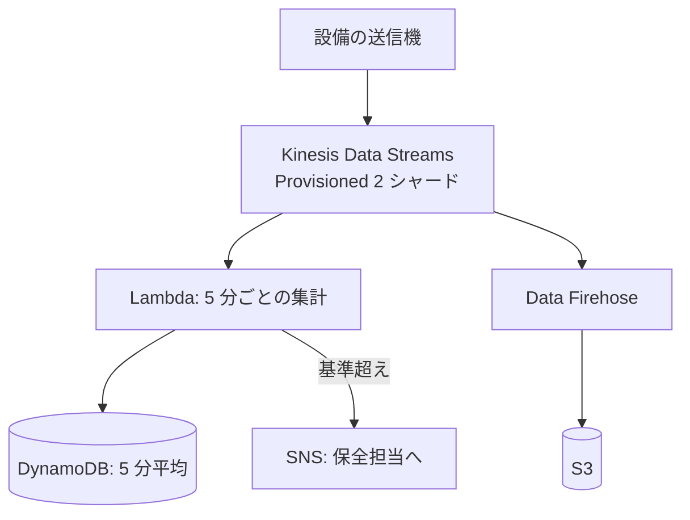

**設定値:**

| 設定 | 値 | 理由 |
| --- | --- | --- |
| シャード数 | 2 | 1,200 件/秒は件数で 2 シャード、サイズは 240 KB/秒で 1 シャード。多い方を取る（[シャード数の計算](#shard-calculation)） |
| パーティションキー | 設備 ID | 設備ごとの順序を守る |
| `TumblingWindowInSeconds` | 300 | 5 分ごとの窓で集計する |
| `ParallelizationFactor` | 1 | 1 シャード 600 件/秒なら 1 本で追いつく |
| 保持期間 | 24 時間（既定） | 生データは Firehose で S3 に残すので、ストリームで長く持たない |
| `IteratorAgeMilliseconds` のアラーム | 1 時間 | 集計の遅れに早く気づく |

**なぜこのサービスか:** 設備ごとの順序と時間窓の集計が要り、流量が一定なので Provisioned で費用を読める。新規の取り込みで既存の Kafka の資産もないので、Lambda や Firehose とつなぎやすい Kinesis にする（[Kinesis と MSK の違い](data-engineering.md#msk-vs-kinesis)）。

**つまずきやすい点:**

- 1 件 0.2 KB と小さいので、サイズだけで計算すると 1 シャードと誤る。件数の上限 1,000 件/秒で詰まる。
- タンブリングウィンドウの集計はシャードごとなので、同じ設備が別のシャードに入らないよう、キーは設備 ID で固定する。
- 工場が増えて設備が 2,500 台になると、件数で 3 シャードが必要になる。`UpdateShardCount` は 2 倍までなので 2 → 3 は 1 回でできる（[リシャーディング](#resharding)）。

### 例: ニュースサイトのアクセスログの保存 {#use-case-news}

**状況:** 月間 1 億 PV のニュースサイト。アクセスログが平常で毎秒 2 MB、速報の直後は毎秒 8 MB になる。記者と編集者は、前日までの記事ごとの閲覧数を朝に見られればよい。データ基盤の担当は 1 人。

**構成:**

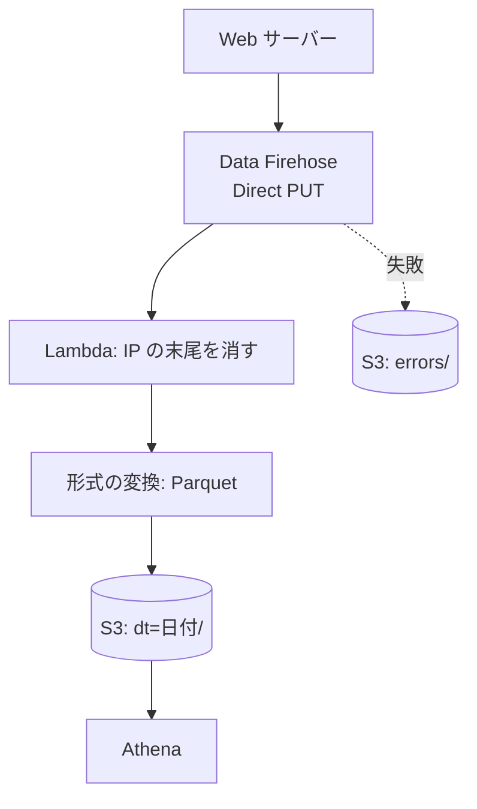

**設定値:**

| 設定 | 値 | 理由 |
| --- | --- | --- |
| バッファ | 128 MB、900 秒 | 朝に見られればよいので、大きなファイルにまとめて Athena を速くする（[バッファ](#firehose-buffering)） |
| 形式の変換 | Parquet。スキーマは Glue Data Catalog | 記事 ID と日時の列だけ読むので、スキャン量が減る |
| プレフィックス | `logs/dt=!{timestamp:yyyy-MM-dd}/` | Hive 形式にして、日付で絞れるようにする |
| `CustomTimeZone` | `Asia/Tokyo` | 日本時間の日付で分ける（[配信の失敗の扱い](#firehose-failure)） |
| `ErrorOutputPrefix` | `errors/!{firehose:error-output-type}/!{timestamp:yyyy-MM-dd}/` | 変換の失敗を種類ごとに分けて残す |
| Athena のパーティション | 射影（`date` 型） | `MSCK REPAIR TABLE` を毎日流さなくて済む（[パーティションの設定](#athena-partitions)） |

**なぜこのサービスか:** 処理は「整形して届ける」だけで、独自の消費者のコードは要らない。Kinesis Data Streams にすると、読み出し、まとめ、書き込み、再試行を自分で書くことになり、1 人では保守しにくい。

**つまずきやすい点:**

- 東京の Direct PUT の既定は 1 MiB/秒で、平常の毎秒 2 MB でも超える。Firehose が自動で引き上げるが、速報の毎秒 8 MB ではスロットリングが起こり得るので、事前に申請する（[Amazon Data Firehose](#firehose)）。
- Glue のスキーマに新しい列を足し忘れると、その列は Parquet に入らない。エラーにならないので、後で気づく。
- 変換の Lambda のタイムアウトを既定の 3 秒のままにすると、変換が失敗し、データが `errors/` にたまる。

### 例: 市役所の Web サイトのアクセス分析 {#use-case-city}

**状況:** 人口 40 万人の市の公式サイト。CloudFront の標準ログを S3 に 3 年分ためている。広報課が月に 2〜3 回、「どのページがよく見られたか」「大雨の日にアクセスがどれだけ増えたか」を調べる。予算は年度で固定で、分析用のサーバーは置きたくない。

**構成:**

| 部品 | 役割 |
| --- | --- |
| CloudFront の標準ログ（v2） | S3 に `{yyyy}/{MM}/{dd}` のフォルダに分けて出す |
| Glue Data Catalog | ログのテーブル定義を持つ |
| Athena のワークグループ `koho` | 広報課のクエリを分け、上限をかける |
| SNS | 月の合計のスキャン量が目安を超えたら担当者に知らせる |

**設定値:**

| 設定 | 値 | 理由 |
| --- | --- | --- |
| ログの出力形式 | Parquet | 必要な列だけ読むので、スキャン量が減る。変換には別に料金がかかる |
| パーティション | 射影。年、月、日を `integer` 型 | 3 年で約 1,100 日分の登録を不要にする（[パーティションの設定](#athena-partitions)） |
| クエリごとのデータ制限 | 50 GB | 日付の条件を書き忘れた 3 年分のスキャンを止める（[ワークグループ](#athena-workgroups)） |
| ワークグループ全体のデータ制限 | 1 か月 2 TB で SNS に通知 | 予算の残りに担当者が早めに気づく |
| `EnforceWorkGroupConfiguration` | `true` | 結果の置き場を広報課のバケットにそろえる |

**なぜこのサービスか:** 調べるのは月に数回で、料金はスキャンした量で決まる。常に動く DWH やサーバーを置くより、使わない月の費用が小さくなりやすい。ログはすでに S3 にあるので、取り込みの作業もない（[S3 上のログを問い合わせる](#athena-logs)）。

**つまずきやすい点:**

- 従来の標準ログ（レガシー）は日付のフォルダに分かれていない。v2 に切り替える前の 3 年分は別のプレフィックスに置き、別のテーブルにする。
- `{yyyy}/{MM}/{dd}` は Hive 形式ではないので、`MSCK REPAIR TABLE` では読み込めない。射影か `ALTER TABLE ADD PARTITION` を使う。
- 射影の `storage.location.template` が実際のパスと違うと、エラーなしで 0 件になる。
- クエリごとの制限で止まったクエリも、止まるまでのスキャン分は課金される。

### 例: 家具 EC サイトの商品検索 {#use-case-search}

**状況:** 商品 40 万点の家具 EC サイト。商品の正本は DynamoDB にあり、在庫や価格が 1 日 5 万回更新される。「北欧 ソファ 2人掛け」のような言葉で探し、色や価格帯で絞り込みたい。

**構成:**

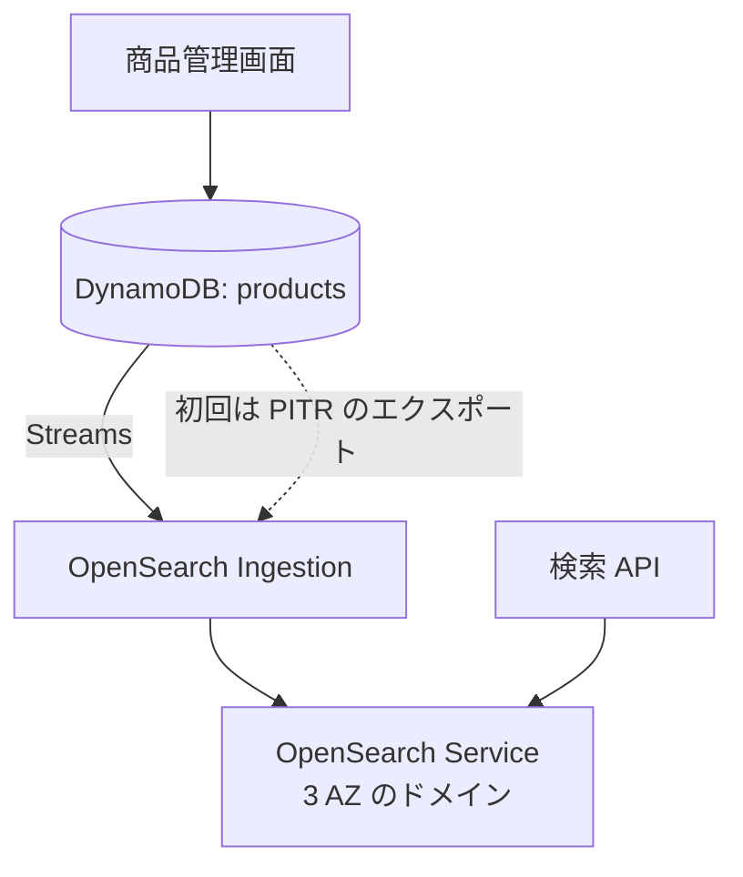

**設定値:**

| 設定 | 値 | 理由 |
| --- | --- | --- |
| 取り込み | OpenSearch Ingestion の DynamoDB のパイプライン | 変換の Lambda を書かずに同期する（[データの入れ方](#opensearch-ingestion)） |
| DynamoDB の前提 | Streams を `NEW_IMAGE` で有効、初回の全件のために PITR も有効 | パイプラインが変更を読み、最初は全件をエクスポートする |
| プライマリシャード | 2 | 商品データは約 20 GiB で、1 年で 2 倍の 40 GiB を見込む。40 × 1.1 ÷ 30 ≈ 1.5 で 2（[開発者が知っておく用語と設定](#opensearch-concepts)） |
| レプリカ | 1 | 1 ノードが落ちても検索を続ける |
| 専用マスターノード | 3 台 | 過半数を保てる |
| `category`、`color` のマッピング | `keyword` | 絞り込みとファセットに使う。文字列の既定は `text` になる |

**なぜこのサービスか:** DynamoDB はキーで引く設計で、部分一致や関連度の順の検索に向かない。正本は DynamoDB のまま、検索用の写しを OpenSearch に持つ（[データストアの選び方](#specialized-store)）。

**つまずきやすい点:**

- DynamoDB Streams は 24 時間しか持たない。初回のエクスポートに 24 時間以上かかると、その間の変更の一部を失う。パイプラインの OCU を十分にする。
- 価格を最初の商品で整数、次の商品で小数にすると、型の自動判定に失敗して取り込めない。マッピングを先に決める。
- パイプラインと DynamoDB のテーブルは同じアカウント、同じリージョンに置く。

### 例: 勤怠管理 SaaS のログ検索 {#use-case-saas-logs}

**状況:** 契約企業 3,000 社の勤怠管理 SaaS。アプリのログが 1 日 200 GB 出る。障害の問い合わせでは、直近 10 日のログを企業 ID とエラーの文言で数秒以内に探したい。90 日より前のログは画面で見る必要がなく、S3 に残せばよい。

**構成:**

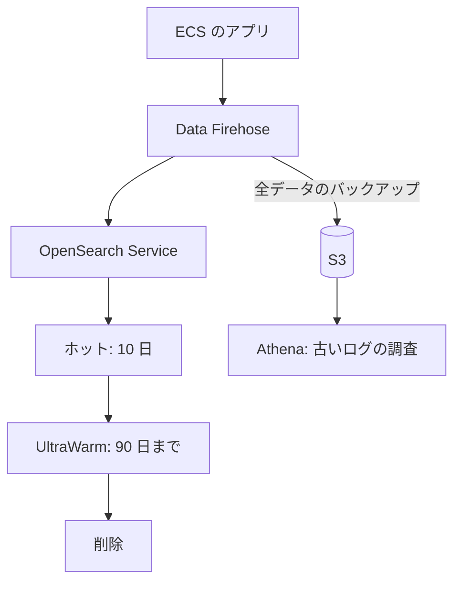

**設定値:**

| 設定 | 値 | 理由 |
| --- | --- | --- |
| Firehose のバッファ | 5 MB、60 秒 | 障害の調査で 1 分の遅れまでは許す |
| `RetryOptions.DurationInSeconds` | 3,600 | OpenSearch の一時的な不調でも 1 時間は送り直す |
| S3 のバックアップ | 全データ | 届かなかった分も、90 日より前のログも S3 に残る |
| インデックス | 1 日 1 つ（`app-logs-2026.11.13`） | 古い日を丸ごと移動、削除できる |
| プライマリシャード | 1 日あたり 5 | 200 × 1.1 ÷ 50 ≈ 4.4。書き込みが多いので 1 シャード 50 GiB を目安にする |
| Index State Management | 10 日で UltraWarm、90 日で削除 | 直近だけを速いストレージに置く |

**なぜこのサービスか:** 文言での検索と、企業ごとの絞り込みを数秒で返す必要がある。Athena でも S3 のログは検索できるが、毎回のスキャンに時間がかかり、問い合わせのたびに料金がかかる。直近は OpenSearch、古いものは Athena と分けると、両方の得意を使える（[S3 上のログを問い合わせる](#athena-logs)）。

**つまずきやすい点:**

- CloudWatch Logs に出したログは、Firehose 経由で OpenSearch へ配信できない。アプリから直接 Firehose に送るか、サブスクリプションフィルターを使う。
- 1 回の `_bulk` がインスタンスの HTTP リクエストの上限を超えると拒否される。Firehose のバッファの上限（100 MB）とインスタンスの上限を合わせる。
- UltraWarm に移したインデックスは読み取り専用になる。後から書き足す運用はできない。

## Kinesis Data Streams {#kinesis-data-streams}

[:material-sprout: CLF](../courses/clf/services.md){ .exam-badge .exam-foundational } [:material-certificate: SAA](../courses/saa/services.md){ .exam-badge .exam-associate } [:material-certificate: DVA](../courses/dva/services.md){ .exam-badge .exam-associate } [:material-certificate: DEA](../courses/dea/services.md){ .exam-badge .exam-associate } [:material-certificate: MLA](../courses/mla/services.md){ .exam-badge .exam-associate } [:material-star-circle: SAP](../courses/sap/services.md){ .exam-badge .exam-professional } [:material-star-circle: DOP](../courses/dop/services.md){ .exam-badge .exam-professional } [:material-star-circle: AIP](../courses/aip/services.md){ .exam-badge .exam-professional }

順序付きのレコードをためて、複数の消費者が読めるようにするサービス。読んでもレコードは消えず、保持期間の間は何度でも読み直せる。

**使う場面:** 対戦ゲームで、プレイヤーの操作ログを、チート検知、ランキング、分析保存の 3 つが別々の速さで読む（[例](#use-case-game)）。

提供単位はリージョンで、AZ は選ばない。VPC の外のサービスで、VPC 内からはインターフェイスエンドポイントか NAT を経由して呼ぶ（[リソースの提供単位](resource-scope.md#two-axes)）。

### なぜ必要か {#kinesis-data-streams-why}

生産者が送り先に直接送ると、送り先が止まればデータを失い、送り先が増えるたびに生産者を直すことになる。Kinesis Data Streams は、間に「順序付きの記録」を置いて、生産者と消費者を切り離すためのものである。

読んでも消えないのが、キューとの一番の違いである。消費者はそれぞれ自分の読んだ位置を持つので、新しい消費者を後から足したり、バグを直した後に読み直したりできる。その代わり、どこまで読んだかは消費者が管理する。

**身近なものにたとえる**と、次のようになる。

| 仕組み | たとえ | 読んだ後 |
| --- | --- | --- |
| Kinesis Data Streams | 防犯カメラの録画。何人でも巻き戻して見られ、一定期間で消える | 残る（保持期間まで） |
| SQS | 郵便受け。取り出した人が処理する | 削除すると消える |
| SNS | 館内放送。その場にいる人に一斉に届く | 残らない |

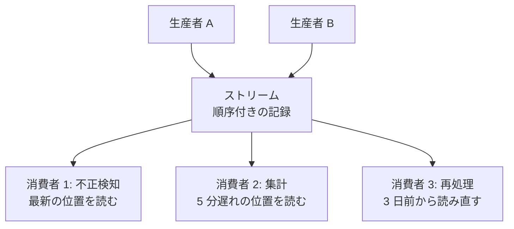

| 用語 | 意味 |
| --- | --- |
| ストリーム | シャードの集まり |
| シャード | 容量の単位。レコードの順序付きの列 |
| レコード | シーケンス番号、パーティションキー、データ本体 |
| パーティションキー | どのシャードに入れるかを決める値 |
| シーケンス番号 | シャード内の順序を表す。Kinesis が割り当てる |
| 保持期間 | 既定 24 時間、最大 8,760 時間（365 日）。24 時間を超えると追加料金 |

- **例:** レコード `{"userId":"u-1","page":"/"}` を `PartitionKey="u-1"` で書くと、シャード `shardId-000000000002` に入り、シーケンス番号が応答で返る。`u-1` のレコードはシャードが変わらない限り同じシャードに入り続ける。

### シャードの容量 {#shards}

| 方向 | 1シャードあたりの上限 |
| --- | --- |
| 書き込み | 1 MB/秒、1,000 レコード/秒（パーティションキーを含む） |
| 読み取り（共有） | 2 MB/秒、5 トランザクション/秒 |
| 読み取り（拡張ファンアウト） | 消費者ごとに 2 MB/秒 |

`GetRecords` は1回で 10 MB または 10,000 レコードまで。10 MB を返すと、次の 5 秒間の呼び出しは `ProvisionedThroughputExceededException` になる。

容量を「シャード」という固定の単位で切っているのは、1 本あたりの性能を予測できるようにするためである。必要な量をシャードの本数で表せるので、容量と料金を同じ計算で見積もれる。その代わり、偏った書き込みは 1 本の上限で詰まる。

高速道路の車線にたとえると分かりやすい。

| Kinesis | 高速道路でのたとえ |
| --- | --- |
| シャード | 1 本の車線。通れる台数に上限がある |
| パーティションキー | 行き先ごとに決まった車線 |
| ホットシャード | 1 つの車線だけが渋滞している |
| リシャーディング | 車線を増やす、減らす |

Kafka のパーティションと同じ考え方である。違う点は、ブローカーやディスクを持たず、1 シャードあたりの上限が AWS によって決まっていることである。

必要なシャード数は、書き込み量と読み取り量のうち多いほうから見積もる。

```text
例: 1 KB のレコードを毎秒 3,000 件書く
書き込み: 3,000 KB/秒 ÷ 1,000 KB/秒 = 3 シャード
件数: 3,000 件/秒 ÷ 1,000 件/秒 = 3 シャード
```

レコードの最大サイズは、既定で 1 MiB。ストリームの設定（`MaxRecordSizeInKiB`、既存のストリームは `UpdateMaxRecordSize`）で最大 10 MiB まで上げられる。1〜10 MiB の大きなレコードはバースト容量で断続的に扱う前提で、シャードの平常の書き込み上限（1 MB/秒）は変わらない。AWS は大きなレコードを全トラフィックの 2% 未満に抑えることを勧めている。

- **例（最大サイズ）:** 5 MiB の画像を時々送るなら、`MaxRecordSizeInKiB=10240` で 10 MiB まで広げられる。全体の 2% 未満に収める。常に 5 MiB を流すと、シャードの 1 MB/秒の上限で頭打ちになる。
- **誤ると:** 上限を 1 MiB のまま 2 MiB のレコードを送ると、書き込みが失敗する。S3 に本体を置き、キーだけをレコードにする方法もある。

### シャード数の計算 {#shard-calculation}

書き込みのサイズ、書き込みの件数、読み取りの 3 つを計算し、最も大きい値を使う。

```text
条件: 2 KB のレコードを毎秒 2,500 件書き、3 つのアプリがすべて読む

書き込みサイズ: 2 KB × 2,500 = 5,000 KB/秒 → 5 シャード
書き込み件数:   2,500 ÷ 1,000 = 2.5 → 3 シャード
読み取り（共有）: 5,000 KB/秒 × 3 アプリ = 15 MB/秒
                15 ÷ 2 MB/秒 = 7.5 → 8 シャード

結果: 共有スループットなら 8 シャード
      拡張ファンアウトなら、各アプリが 2 MB/秒を占有するので 5 シャード
```

小さいレコードでは件数が先に上限に達する。100 バイトを毎秒 5,000 件なら、サイズは 500 KB/秒で 1 シャードで足りるが、件数の条件で 5 シャード必要になる。

読み取りの回数の上限も効く。共有スループットは 1 シャードにつき 5 回/秒なので、5 つのアプリがそれぞれ毎秒 1 回読むと上限いっぱいになる。

- **例（5 回/秒）:** 上の条件で 6 つのアプリが毎秒 1 回読むと 6 回/秒で、5 回/秒を超えてスロットリングされる。アプリを減らすか、読む間隔を伸ばすか、拡張ファンアウトにする。
- **例（遊びを見る）:** ピークが平常の 2 倍なら、平常の値ではなくピークで計算する。平常 3 シャードでピークが 6 シャード相当なら、6 シャードにするか、ピークの前にリシャーディングする。

### パーティションキー {#partition-key}

キーの MD5 ハッシュでシャードが決まる。キーは 256 文字までの Unicode 文字列。

キーは「順序を守りたい単位」と「負荷を散らす単位」を同時に決める。同じキーは必ず同じシャードに入るので順序が守られるが、1 つのキーに集中するとシャードを増やしても散らない。

**使う場面:** 食品工場で、設備 ID をキーにして、同じ設備の温度の記録を時刻順に集計する（[例](#use-case-factory)）。

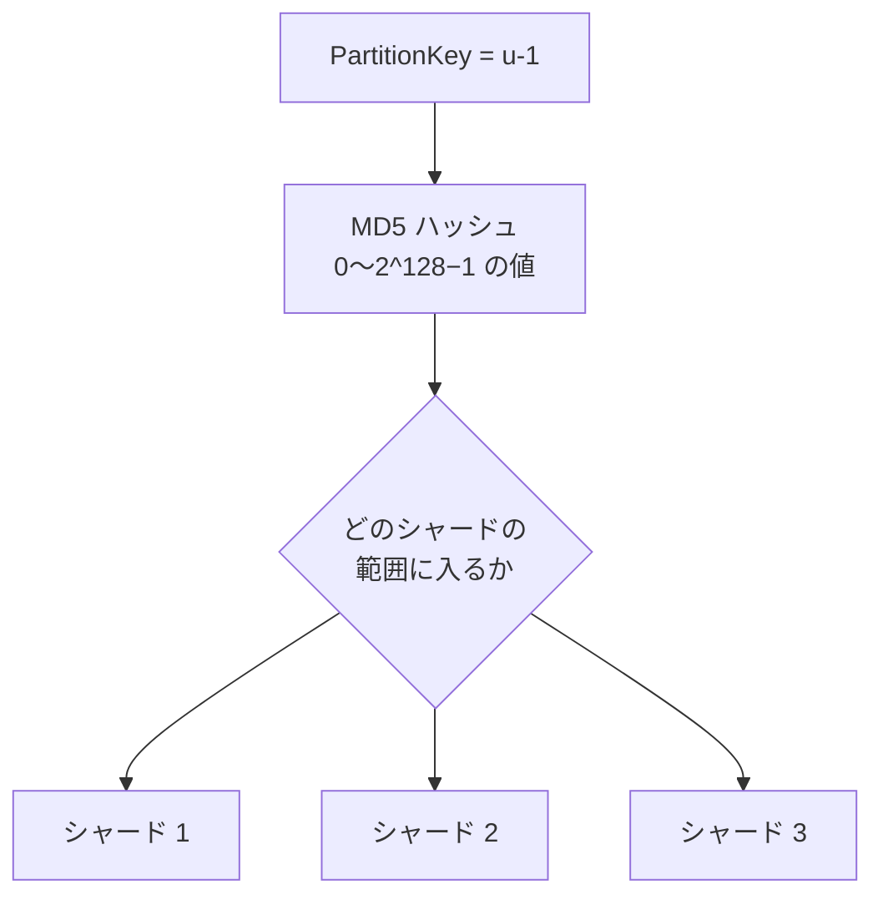

- **順序が保証されるのは同じシャードの中だけ**。同じキーのレコードは同じシャードに入る。
- 値の種類が少ないキーは特定のシャードに偏る（**ホットシャード**）。ユーザー ID のように、種類が多く分散するキーを選ぶ。
- 順序が不要なら、ランダムなキーで分散させる。
- `ExplicitHashKey` で明示的にシャードを選べる。

キーを `"prod"` に固定すると、シャードを 10 本に増やしても全レコードが 1 本に入る。そのシャードだけ `WriteProvisionedThroughputExceeded` が増え、他は空いたままになる。増やしても解決しないので、キーを変える。

パーティションキーは 1 MB/秒の計算にも含まれる。

- **例（順序と分散の両立）:** 注文の順序をユーザーごとに守るなら `PartitionKey=userId`。ユーザーが 10 万人いれば、4 シャードにほぼ均等に散る。
- **例（`ExplicitHashKey`）:** ハッシュキーは 0〜2^128−1 の値で、シャードごとの範囲が決まっている。キーの偏りを自分で調整したいときに、特定のシャードの範囲の値を指定する。
- **誤ると:** ランダムなキーにすると分散はするが、同じユーザーのレコードの順序は保証されなくなる。

### シーケンス番号 {#sequence-numbers}

書き込むと Kinesis が割り当てて `PutRecord` の応答で返す。自分では指定しない。

- シャードの中で時間とともに増えるが、**シャードをまたいで比較はできない**。
- 厳密に増える順序が必要なら、同じシャードに 1 つずつ書き、`SequenceNumberForOrdering` に前のレコードのシーケンス番号を渡す。
- `PutRecords` にはこの指定がない。1 回のリクエストの中の順序は保証されないので、順序が重要なら `PutRecord` を使う。
- 再試行すると同じデータが別の番号で書かれることがある。消費者で重複を扱う。

- **例（重複）:** `PutRecord` の応答がタイムアウトして再送すると、最初の書き込みも成功していれば同じ内容が 2 レコードできる。本文に `eventId` を入れ、消費者が処理済みの ID を DynamoDB で確認する。
- **誤ると:** 別のシャードの番号を比べて新旧を判断すると、誤った順序になる。比較は同じシャードの中だけにする。

```python
seq = None
for row in rows:
    params = {"StreamName": "clicks", "Data": row, "PartitionKey": "u-1"}
    if seq:
        params["SequenceNumberForOrdering"] = seq
    seq = kinesis.put_record(**params)["SequenceNumber"]
```

### 保持期間 {#retention}

既定は 24 時間で、最大 8,760 時間（365 日）。下限は 24 時間で、これより短くできない。

保持期間は、消費者が止まったり間違えたりしたときに、やり直せる時間の長さである。長くすれば安全だが、24 時間を超えた分は料金が増える。

**使う場面:** 決済サービスで、週末に集計のバグが見つかっても、月曜に金曜夜からのレコードを読み直せるよう 72 時間にする。

```bash
aws kinesis increase-stream-retention-period --stream-name clicks --retention-period-hours 72
aws kinesis decrease-stream-retention-period --stream-name clicks --retention-period-hours 24
```

- **延ばす** と、古いレコードの削除は数分以内に止まる。
- **縮める** と、新しい期間より古いレコードはほぼ即座に読めなくなる。
- 24 時間を超えると追加料金がかかる。

消費者が週末に止まっても読み直したい、バグの修正後に 3 日分を再処理したい、といった場面で延ばす。消費者が保持期間を超えて遅れると、レコードは読めずに失われる。`GetRecords.IteratorAgeMilliseconds` が保持期間に近づいたら危険のサイン。

- **例（週末）:** 金曜 18 時に消費者が止まり、月曜 9 時に復旧すると 63 時間になる。既定の 24 時間なら、日曜 9 時より前の 39 時間分が消える。`--retention-period-hours 72` なら全部読める。
- **例（アラーム）:** 保持期間が 24 時間なら 86,400,000 ミリ秒で失われ始める。`GetRecords.IteratorAgeMilliseconds` の 12 時間（43,200,000）にアラームを置くと、半分の時点で気づける。
- **誤ると:** 23 時間のような 24 時間未満の値は指定できない。

```python
import json

import boto3

kinesis = boto3.client("kinesis")

kinesis.put_record(
    StreamName="clicks",
    Data=json.dumps({"userId": "u-1", "page": "/"}).encode(),
    PartitionKey="u-1",
)

# まとめて書く。1 リクエスト 500 レコード、10 MiB まで
res = kinesis.put_records(
    StreamName="clicks",
    Records=[
        {"Data": json.dumps(r).encode(), "PartitionKey": r["userId"]} for r in rows
    ],
)
# 一部だけ失敗することがある
if res["FailedRecordCount"] > 0:
    failed = [
        rows[i] for i, r in enumerate(res["Records"]) if "ErrorCode" in r
    ]
    # failed をバックオフして再送する
```

!!! warning "PutRecords は例外なしで部分失敗する"
    `PutRecords` は一部のレコードが失敗しても、呼び出し自体は成功する。`FailedRecordCount` を確認し、失敗分だけ再送する。

### キャパシティモード {#capacity-modes}

| モード | シャード管理 | 料金 | 向いている場面 |
| --- | --- | --- | --- |
| Provisioned | シャード数を自分で指定 | シャード時間 | 予測できる流量、コスト優先 |
| On-demand Standard | 自動 | データ量とストリームごとの固定料金 | 流量が読めない |
| On-demand Advantage | 自動。ウォーム容量を設定可能 | 固定料金なし。最低利用量あり | 常に大量に流す |

モードは「容量を自分で計算する手間」と「料金の読みやすさ」の交換である。Provisioned は計算とリシャーディングが要るが、シャード時間で費用が決まる。On-demand は計算が要らないが、流した量で費用が変わる。

**使う場面:** 生放送の配信サービスで、番組によって視聴ログの流量が 20 倍変わるので On-demand にする。24 時間一定の工場のセンサーなら Provisioned にする。

- On-demand の新規ストリームは 4 MB/秒の書き込み、8 MB/秒の読み取りから始まる。
- 過去 30 日のピークの 2 倍まで対応する。これを超える急増では、約 15 分間エラーが出る場合がある。
- 上限は書き込み 200 MB/秒または 10 GB/秒で、リージョンにより異なる。
- モードの切り替えは 24 時間に 2 回まで。
- On-demand でも、1つのパーティションキーがシャードの上限（1 MB/秒、1,000 件/秒）を超えると解決できない。

```bash
# On-demand で作る。ShardCount は指定しない
aws kinesis create-stream --stream-name clicks \
  --stream-mode-details StreamMode=ON_DEMAND

# Provisioned で作る
aws kinesis create-stream --stream-name orders --shard-count 4
```

On-demand の例を示す。過去 30 日のピークが 50 MB/秒なら、100 MB/秒までは問題なく受けられる。急に 200 MB/秒が来ると、約 15 分は書き込みや読み取りの例外が出ることがある。再試行で書き切る。既知のイベントの前なら、On-demand Advantage のウォーム容量で備えられる。

読み取りの容量は書き込みに比例して増え、書き込みの 2 倍以上が確保される。

- **例（Provisioned）:** 毎秒 3 MB で安定した流量なら、シャードは 3 本で済む。流量が予測できるのでシャード時間の料金で見積もれる。
- **例（On-demand Standard）:** ゲーム配信で平常 10 MB/秒、不定期に 40 MB/秒が来るなら、シャードの調整は要らない。過去 30 日のピークが 25 MB/秒以上なら、その 2 倍で 40 MB/秒は受けられる。
- **誤ると（切り替え）:** 同じストリームのモードの切り替えは 24 時間に 2 回まで。3 回目はエラーになる。切り替え作業の手順に、この回数を入れておく。
- **誤ると（キーの偏り）:** On-demand で 1 つのキーに 3 MB/秒を流すと、シャードが増えてもそのキーのシャードの 1 MB/秒で詰まる。

### シャードイテレーター {#shard-iterators}

`GetRecords` はシャードイテレーターを受け取って読む。最初に `GetShardIterator` で取得し、以降は応答の `NextShardIterator` を使う。

| `ShardIteratorType` | 読み始める位置 |
| --- | --- |
| `TRIM_HORIZON` | 保持されている最も古いレコード |
| `LATEST` | 最新のレコードの直後。これ以降に書かれたものだけ読む |
| `AT_SEQUENCE_NUMBER` | 指定したシーケンス番号から |
| `AFTER_SEQUENCE_NUMBER` | 指定したシーケンス番号の次から |
| `AT_TIMESTAMP` | 指定した時刻から |

イテレーターは、録画のどこから再生するかを決める「再生位置」である。読んでも消えない設計なので、位置を消費者が指定する。

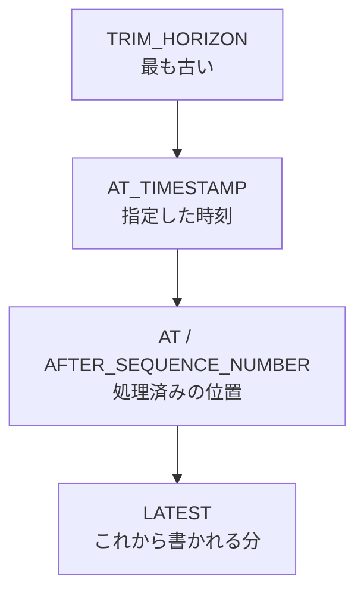

```python
it = kinesis.get_shard_iterator(
    StreamName="clicks",
    ShardId="shardId-000000000000",
    ShardIteratorType="AFTER_SEQUENCE_NUMBER",
    StartingSequenceNumber=last_processed,   # 再起動後は処理済みの次から
)["ShardIterator"]

while it:
    res = kinesis.get_records(ShardIterator=it, Limit=1000)
    process(res["Records"])
    print(res["MillisBehindLatest"])         # 最新からの遅れ
    it = res.get("NextShardIterator")        # None ならシャードは閉じている
```

- イテレーターは **5 分で期限切れ** になる。切れると `ExpiredIteratorException`。処理が 5 分を超えるループなら、最後に処理した番号で取り直す。
- `NextShardIterator` が `null` ならシャードは閉じている。子シャードに移る。
- `Records` が空でも読み終わりとは限らない。`NextShardIterator` を使い続ける。
- `Limit` の既定と最大は 10,000。

障害の後に読み直すつもりで `LATEST` を選ぶと、停止中のレコードを読み飛ばす。処理済みの続きからなら `AFTER_SEQUENCE_NUMBER`、最初からなら `TRIM_HORIZON` を使う。

- **例（`LATEST`）:** 10:00 に止まり 11:00 に再起動すると、10:00〜11:00 のレコードは読まれない。リアルタイムの画面表示のように過去が不要な処理なら問題ない。
- **例（`AT_TIMESTAMP`）:** 15:00（UTC）以降にバグが入ったなら、`ShardIteratorType="AT_TIMESTAMP"`、`Timestamp="2026-10-30T15:00:00Z"` で読み直す。
- **例（`AT` と `AFTER`）:** 最後に処理した番号が `...123` のとき、`AT_SEQUENCE_NUMBER` は `...123` からなので 1 件を二重に処理する。`AFTER_SEQUENCE_NUMBER` はその次から読む。
- **例（`Limit`）:** `Limit=1000` なら 1 回で最大 1,000 レコード。10 MB の上限の方が先に効くこともある。

### 消費者と拡張ファンアウト {#enhanced-fan-out}

| | 共有スループット | 拡張ファンアウト |
| --- | --- | --- |
| 読み取り容量 | シャードごとに全消費者で 2 MB/秒 | 消費者ごとに 2 MB/秒 |
| 配信方式 | `GetRecords`（プル、HTTP） | `SubscribeToShard`（プッシュ、HTTP/2） |
| 遅延の目安 | 1 消費者で約 200 ms、5 消費者で約 1,000 ms | 約 70 ms |
| 料金 | 追加なし | データ取得とシャード時間の追加料金 |
| 登録数 | | 20（On-demand Advantage は 50） |

消費者が複数で遅延が問題なら、拡張ファンアウトを使う。`RegisterStreamConsumer` で登録する。

**使う場面:** ネット証券で、約定のストリームを 6 つのシステムが読み、不正な注文の検知だけは 1 秒以内に反応させたい。

共有スループットでは、1 本のシャードの読み取り枠を全員で分け合う。消費者を足すほど 1 人あたりの枠が減り、ほかのチームの読み取りの影響も受ける。拡張ファンアウトは、消費者ごとに専用の枠を割り当て、互いの影響をなくすための仕組みである。その分、追加の料金がかかる。

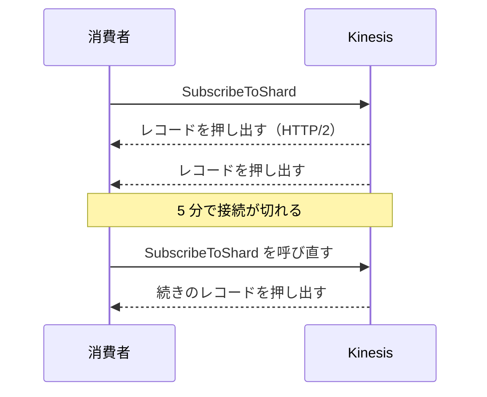

拡張ファンアウトの細かい動きは次の通り。

- `SubscribeToShard` の接続は最大 5 分。続けて受け取るには呼び直す。
- 同じ消費者とシャードで 5 秒以内に呼び直すと `ResourceInUseException`。5 秒以上後なら古い接続を引き継ぐ。
- 同時に `CREATING` 状態にできる消費者は 5 個まで。`RegisterStreamConsumer` は `ACTIVE` になるまで待ってから使う。

- **例（選び方）:** 1 シャードに 1 MB/秒を書き、3 つのアプリが読むと 3 MB/秒必要で、共有の 2 MB/秒を超える。拡張ファンアウトなら 3 アプリがそれぞれ 2 MB/秒を使える。
- **例（遅延）:** 5 つのアプリが共有で読むと遅延は約 1,000 ms、拡張ファンアウトなら約 70 ms。詐欺の検知のように秒未満で反応したいなら拡張ファンアウトにする。
- **例（接続の更新）:** 接続は 5 分で切れるので、1 シャードを 1 時間読むと `SubscribeToShard` を 12 回呼ぶ。KCL やイベントソースマッピングならこの処理は任せられる。
- **誤ると（登録）:** Provisioned で 21 個目の消費者は登録できない。登録直後の `CREATING` の間に `SubscribeToShard` を呼ぶと失敗する。

```bash
aws kinesis register-stream-consumer \
  --stream-arn arn:aws:kinesis:ap-northeast-1:111122223333:stream/clicks \
  --consumer-name fraud-check
```

### KCL {#kcl}

自前の消費者を作るなら **Kinesis Client Library（KCL）** が便利。シャードの割り当てとチェックポイントを管理し、その情報を DynamoDB のリーステーブルに保存する。テーブルの容量が足りないと、イテレーターの期限切れを招くことがある。

**使う場面:** 配車サービスで、車両の位置を読む Java の常駐アプリを ECS で 8 台動かし、1 台が落ちたら残りがそのシャードを引き継ぐ。

`GetRecords` だけで消費者を作ると、どのワーカーがどのシャードを読むか、ワーカーが落ちたら誰が引き継ぐか、どこまで読んだか、リシャーディングで親子のシャードをどう読むか、をすべて自分で書くことになる。KCL はこれらをまとめて引き受ける。Kafka のコンシューマーグループと、オフセットの記録に当たる。

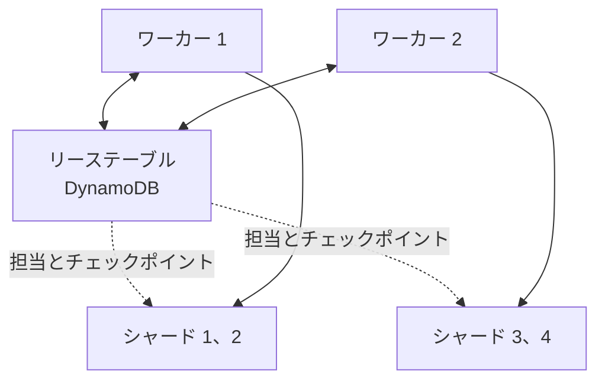

| 用語 | 意味 |
| --- | --- |
| ワーカー | 消費者アプリの実行単位。複数を動かして分散する |
| レコードプロセッサー | 自分で書く処理のロジック |
| リース | シャードとワーカーの割り当て。1 シャードを持つワーカーは同時に 1 つ |
| リーステーブル | リースを管理する DynamoDB テーブル |
| チェックポイント | 処理済みの位置の記録。再開はここから |

- リーステーブルの名前は **アプリケーション名** から作られる。同じ名前の別のアプリを動かすと同じテーブルを奪い合うので、アプリ名は一意にする。
- KCL 3.x は既定でテーブルをオンデマンドで作り、ワーカーのメトリクスとコーディネーターの状態の 2 つのテーブルも使う。
- 実行ロールには Kinesis に加えて DynamoDB と CloudWatch の権限が要る。

具体例を示す。シャードが 4 本でワーカーが 2 台なら、2 台で 4 本を分担する。ワーカーを 8 台に増やしても 1 シャードは同時に 1 台しか持てないので、半分のワーカーは担当がなく遊ぶ。チェックポイントを頻繁に書きすぎると、リーステーブルの消費が増える。

再起動後は最後のチェックポイントから再開するので、そこまでに処理したレコードをもう一度受け取ることがある。処理は冪等にする。

- **例（アプリ名）:** アプリ名 `clicks-analytics` のリーステーブルは `clicks-analytics` になる。同じ名前で別のアプリを動かすと、チェックポイントを奪い合って読み飛ばしや二重処理が起きる。
- **例（`failoverTimeMillis`）:** 既定は 10,000 ミリ秒。ワーカーが落ちてから 10 秒ほどで、別のワーカーがリースを引き継げる。シャードが多いアプリでは、リーステーブルの読み書きが増えるので値を大きくする。
- **例（`maxRecords`）:** 既定は 10,000。`idleTimeBetweenReadsInMillis` の既定 1,500 と組み合わせて、ポーリングの量を調整する。
- **例（チェックポイント）:** 100 レコードごとに記録すると、落ちたときに最大 100 件を再処理する。毎レコード記録すると重複は減るが、DynamoDB の書き込みが増える。
- **誤ると（権限）:** ロールに DynamoDB の権限がないと、リーステーブルを作れず、ワーカーが処理を始められない。

### リシャーディング {#resharding}

Provisioned モードでシャード数を変える操作。

| 操作 | API | 効果 |
| --- | --- | --- |
| 分割 | `SplitShard` | 容量と費用が増える。ホットシャードに使う |
| 結合 | `MergeShards` | 容量と費用が減る。コールドシャードに使う |
| 均等な変更 | `UpdateShardCount` | 全体を指定の数にする |

流量は時間とともに変わるので、シャード数も合わせて変える。増やせば溢れを防げるが、シャード時間の費用が増える。

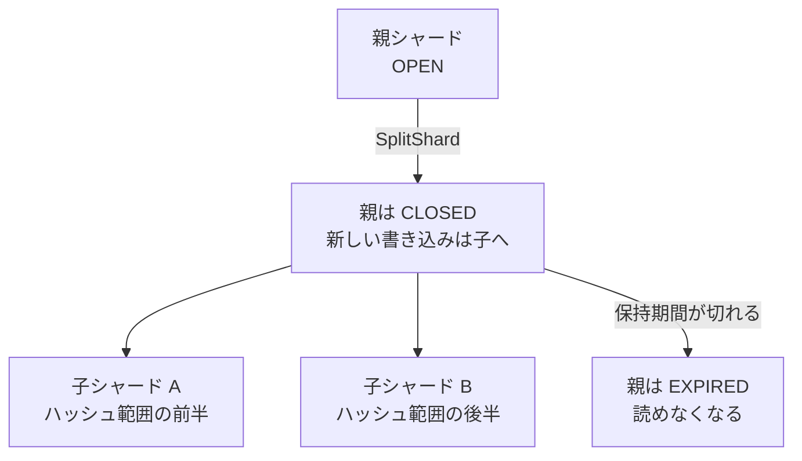

- 分割と結合は 2 シャード単位で行う。
- 親シャードは `OPEN` → `CLOSED` → `EXPIRED` と変わる。
- 親シャードには読み残しがあり得る。順序を守るには、**親を読み終えてから子を読む**。KCL はこれを自動で扱う。

`MergeShards` で結合できるのは隣り合う（ハッシュキーの範囲が連続する）シャードだけ。`SplitShard` は非同期で、ストリームは `UPDATING` になる。

`UpdateShardCount` には次の制限がある。

| 制限 | 値 |
| --- | --- |
| 回数 | 24 時間のローリング期間に 10 回まで |
| 増やす幅 | 現在の 2 倍まで |
| 減らす幅 | 現在の半分まで |
| 既定の上限 | 10,000 シャード |
| 推奨 | 現在の数の 25% 刻みの目標値 |

4 シャードから一度に 20 シャードにはできない。8、16、20 と段階を踏む。

`CLOSED` のシャードも保持期間が切れるまで読める。`EXPIRED` になると読めず、シャードの一覧にも出なくなる。リシャーディング直後に子だけを読むと、親に残ったレコードより新しいレコードを先に処理してしまう。

```bash
aws kinesis update-shard-count --stream-name orders \
  --target-shard-count 8 --scaling-type UNIFORM_SCALING
```

- **例（増やす）:** 4 シャードは 4 MB/秒。毎秒 7 MB になったら 8 シャードにする。`UpdateShardCount` は 2 倍までなので 8 は 1 回で届く。
- **例（減らす）:** 20 シャードを 5 シャードにするなら、半分までの制限で 20 → 10 → 5 の 2 回に分ける。
- **例（分割）:** 1 シャードだけ 1.8 MB/秒で溢れているなら、そのシャードに `SplitShard` を実行する。ハッシュキーの範囲を分ける値を `NewStartingHashKey` に指定する。
- **例（結合）:** 夜間に 0.1 MB/秒しか流れない隣り合う 2 シャードを `MergeShards` でまとめ、シャード時間の料金を減らす。
- **誤ると（24 時間）:** `UpdateShardCount` を 11 回目に呼ぶとエラーになる。自動スケールを自作するなら、回数を数える。

### 暗号化 {#kinesis-encryption}

サーバー側の暗号化は KMS キーを使い、書き込みの前に暗号化して、読み出すときに復号する。

- 有効にした **後** に書かれたレコードだけが暗号化される。既存のレコードは対象外。
- 生産者も消費者もコードの変更は要らず、権限だけが要る。

| 役割 | 必要な KMS の権限 |
| --- | --- |
| 生産者 | `kms:GenerateDataKey` |
| 消費者 | `kms:Decrypt` |

他のアカウントと共有するなら、キーポリシーと相手の IAM ポリシーの両方で許可する。権限が足りないと書き込みや読み取りが KMS の権限エラーになる。

```bash
aws kinesis start-stream-encryption --stream-name orders \
  --encryption-type KMS --key-id alias/orders-key
```

- **例（既存のレコード）:** 保持期間が 24 時間のストリームで暗号化を有効にすると、それ以前の未暗号化レコードは 24 時間で消える。24 時間後には全レコードが暗号化された状態になる。
- **誤ると（権限）:** 生産者に `kms:GenerateDataKey` がないと、暗号化を有効にした瞬間から書き込みが失敗する。切り替えの前に権限を付ける。

### エラーと監視 {#kinesis-errors}

| エラーやメトリクス | 意味 | 対処 |
| --- | --- | --- |
| `ProvisionedThroughputExceededException`（書き込み） | シャードの上限超過 | バックオフと再送、`PutRecords` の利用、シャード追加、キーの分散 |
| `ProvisionedThroughputExceededException`（読み取り） | 5 回/秒や 2 MB/秒の超過 | 拡張ファンアウト、消費者の整理、バックオフ |
| `ExpiredIteratorException` | シャードイテレーターの期限切れ（5 分） | 取得し直す。KCL のリーステーブルの容量も確認 |
| `GetRecords.IteratorAgeMilliseconds` | 消費の遅れ | 増え続けるなら消費者を強化 |
| `WriteProvisionedThroughputExceeded`、`ReadProvisionedThroughputExceeded` | スロットリング数 | シャードレベルのメトリクスでホットシャードを特定 |
| KMS の権限エラー | 暗号化ストリームへのアクセス権がない | KMS キーの権限を付ける |

`ProvisionedThroughputExceededException` は SDK が再試行するが、再試行を使い切ると例外がコードに届く。全体では余裕があるのに出るなら、特定のシャードに偏っている。シャードレベルのメトリクスは既定で無効なので、`EnableEnhancedMonitoring` で有効にする（追加料金）。

`GetRecords` が 10 MB を返すと、次の 5 秒間は同じシャードの呼び出しが例外になる。1 シャードに複数のアプリがあると、誰かの大きな読み取りで他のアプリも失敗する。

`GetShardIterator` を呼びすぎても同じ例外が出る。ループで毎回取り直さず `NextShardIterator` を使う。

```bash
aws kinesis enable-enhanced-monitoring --stream-name orders \
  --shard-level-metrics IncomingBytes WriteProvisionedThroughputExceeded
```

- **例（ホットシャード）:** 10 シャードで全体は 3 MB/秒しかないのに例外が出る。シャードレベルで見ると、1 本に 1.5 MB/秒が集中していた。キーを変えるか、そのシャードを分割する。
- **例（`IteratorAge`）:** 値が増え続けるのは、消費が書き込みに追いつかない状態。書き込みが毎秒 2,000 件で消費が毎秒 1,500 件なら、1 時間で (2,000 − 1,500) × 3,600 = 1,800,000 件遅れる。
- **例（10 MB の読み取り）:** 1 回の `GetRecords` で 10 MB を返すと 5 秒間は読めない。平均すると 10 MB ÷ 5 秒 = 2 MB/秒で、シャードの読み取り上限と一致する。

## Lambda とストリーム {#lambda-streams}

イベントソースマッピングで Lambda がシャードを読み、同期で関数を呼ぶ。

```yaml
# AWS SAM の抜粋
Events:
  Stream:
    Type: Kinesis
    Properties:
      Stream: !GetAtt ClickStream.Arn
      StartingPosition: LATEST
      BatchSize: 100
      MaximumBatchingWindowInSeconds: 5
      ParallelizationFactor: 2
      BisectBatchOnFunctionError: true
      MaximumRetryAttempts: 3
      MaximumRecordAgeInSeconds: 3600
      FunctionResponseTypes:
        - ReportBatchItemFailures
      DestinationConfig:
        OnFailure:
          Destination: !GetAtt FailedRecordsQueue.Arn
```

| 設定 | 既定 | 用途 |
| --- | --- | --- |
| `BatchSize` | 100（最大 10,000） | 1回で渡すレコード数 |
| `MaximumBatchingWindowInSeconds` | 0（最大 300） | バッチをためる時間 |
| `ParallelizationFactor` | 1（最大 10） | シャードごとの同時処理数 |
| `StartingPosition` | 必須 | `TRIM_HORIZON`、`LATEST`、`AT_TIMESTAMP` |
| `BisectBatchOnFunctionError` | false | エラー時にバッチを半分に分けて再試行 |
| `MaximumRetryAttempts` | -1（無限、最大 10,000） | 再試行の回数 |
| `MaximumRecordAgeInSeconds` | -1（無限、最大 604,800） | 古いレコードを諦める時間 |
| `DestinationConfig` | なし | 失敗の記録先（SQS、SNS、S3） |
| `TumblingWindowInSeconds` | なし（最大 900） | 時間枠での集計 |
| `FunctionResponseTypes` | なし | `ReportBatchItemFailures` で失敗の位置を返す |

`StartingPosition` を `LATEST` にすると、マッピングの作成前のレコードは処理されない。過去の分も処理するなら `TRIM_HORIZON` にする。

`ParallelizationFactor` を 2 にすると、シャードごとに同時 2 バッチになる。シャードが 4 本なら関数は最大 8 個同時に動く。Lambda の同時実行の枠も確認する。

エラーの扱いが SQS と大きく違う。

- 既定では、失敗すると **そのシャードの処理が止まり**、レコードが期限切れになるまで同じバッチを再試行する。
- 毒レコードで止めないように、再試行の上限、バッチ分割、失敗の記録先を組み合わせる。
- 処理が追いつかなければ、`ParallelizationFactor` を上げるかシャードを増やす。並列数を上げてもパーティションキー単位の順序は保たれる。

シャードを止めるのは、順序を守るためである。失敗したバッチを飛ばして次へ進むと、後のレコードが先に処理され、順序が崩れる。SQS の標準キューは順序を約束しないので、失敗したメッセージだけを後回しにできる。順序と、止まらないことのどちらを優先するかを、次の設定で決める。

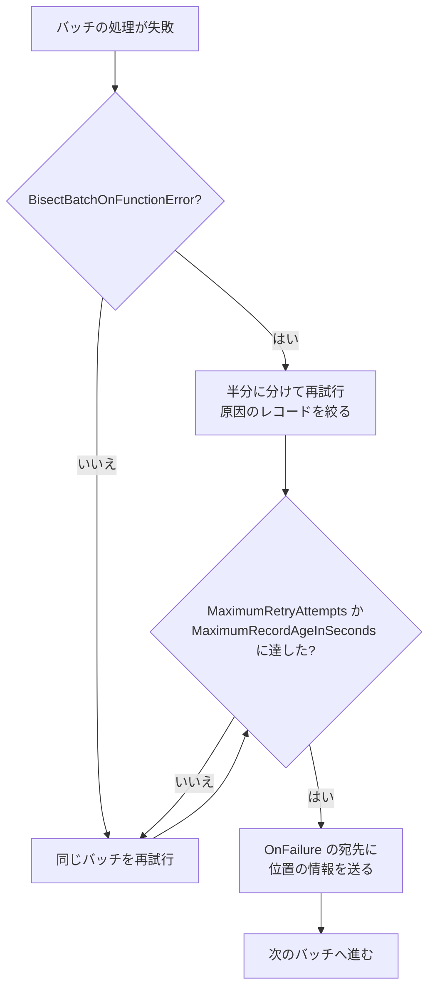

### 値を入れた例 {#lambda-streams-examples}

- **例（`BatchSize`）:** 1 レコード 20 ms なら、100 件で 2 秒。関数のタイムアウトはその数倍の 10 秒以上にする。1 件 100 KB なら 100 件で 10 MB になり、同期呼び出しの 6 MB を超えるので、実際のバッチは 60 件未満になる。
- **例（`MaximumBatchingWindowInSeconds`）:** 毎秒 10 件で `BatchSize=100`、ウィンドウ 5 秒なら、5 秒ごとに 50 件で呼ばれる。件数がそろわなくても呼ばれるので、遅延の上限を決められる。
- **例（`ParallelizationFactor`）:** シャード 4 本、並列 2、バッチ 100 件を 1 秒で処理すると、4 × 2 × 100 = 800 件/秒を処理できる。並列 1 なら 400 件/秒。
- **例（`StartingPosition`）:** 再処理なら `AT_TIMESTAMP` と `StartingPositionTimestamp` で開始時刻を指定する。
- **例（`MaximumRetryAttempts`）:** 3 にすると、最初の 1 回と再試行 3 回の計 4 回で諦める。`DestinationConfig` があれば失敗の情報を送り、次のバッチに進む。
- **例（`MaximumRecordAgeInSeconds`）:** 3,600 なら 1 時間より古いレコードは捨てて進む。-1 のままだと、毒レコード 1 件でそのシャードは保持期間が切れるまで止まる。AWS は既定の設定で最大 1 週間止まることがあると説明している。指定できる最小値は 60 秒。
- **例（`BisectBatchOnFunctionError`）:** 100 件のバッチが失敗すると 50 件ずつに分けて再試行し、毒レコードを含まない方は成功する。残りをさらに分けて、原因を絞り込む。
- **例（`DestinationConfig`）:** SQS や SNS の宛先に届くのは、シャード ID とシーケンス番号の範囲などのメタデータ。レコードの本文は入らないので、保持期間の間に元のストリームから読み直す。
- **例（`ReportBatchItemFailures`）:** 100 件の 40 番目で失敗し、`{"batchItemFailures":[{"itemIdentifier":"<40 番目のシーケンス番号>"}]}` を返すと、40 番目以降だけ再試行する。空の配列なら全件成功の扱い。
- **例（`TumblingWindowInSeconds`）:** 300 なら 5 分ごとの窓で集計する。関数が返した `state` が次の呼び出しに渡され、窓の終わりに合計を保存する。シャードごとの集計になる。
- **誤ると（同時実行）:** シャード 100 本で `ParallelizationFactor=10` なら最大 1,000 同時実行で、アカウントの既定の枠を使い切る。他の関数がスロットリングされる。

処理の詳細と部分バッチレスポンスは [Lambda](lambda.md) を参照する。

## Amazon Data Firehose {#firehose}

[:material-certificate: DVA](../courses/dva/services.md){ .exam-badge .exam-associate } [:material-certificate: SOA](../courses/soa/services.md){ .exam-badge .exam-associate } [:material-certificate: DEA](../courses/dea/services.md){ .exam-badge .exam-associate } [:material-certificate: MLA](../courses/mla/services.md){ .exam-badge .exam-associate } [:material-star-circle: DOP](../courses/dop/services.md){ .exam-badge .exam-professional }

ストリーミングデータをためて、宛先に **届ける** マネージドサービス。自前の消費者コードやシャード管理が要らない。

**使う場面:** ニュースサイトで、アクセスログを 15 分ごとに Parquet にまとめて S3 に置く。消費者のコードは書かない（[例](#use-case-news)）。

ログを S3 や OpenSearch に保存するだけなら、処理のコードは要らない。ところが Kinesis Data Streams だけで作ると、読み出し、まとめ、宛先への書き込み、失敗時の再試行を自分で書くことになる。Firehose は、この「届けるだけ」の部分を引き受けるためのものである。

宅配便の集荷にたとえると、荷物（レコード）を一定の量か時間までためてから、まとめて届ける。届け先が留守なら持ち帰って再配達し、それでも届かなければ、S3 以外の宛先なら S3 に保管する。その代わり、届くまでにバッファの分だけ遅れる。

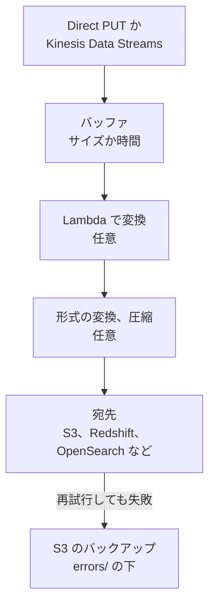

提供単位はリージョンで、AZ は選ばない。VPC の外のサービスで、VPC 内からはインターフェイスエンドポイントか NAT を経由して呼ぶ。VPC 内の OpenSearch へ配信するときは、指定したサブネットに ENI を置く（[リソースの提供単位](resource-scope.md#two-axes)）。

| 項目 | 内容 |
| --- | --- |
| 入力 | Direct PUT（`PutRecord`、`PutRecordBatch`）、Kinesis Data Streams、MSK など |
| 宛先 | S3、Redshift、OpenSearch Service、OpenSearch Serverless、Apache Iceberg テーブル、Splunk、Snowflake、HTTP エンドポイント |
| レコードの上限 | Base64 エンコード前で 1,000 KiB |
| 配信 | 少なくとも1回。再試行で重複があり得る |
| 保持 | Direct PUT は宛先が使えないときに最大 24 時間。Kinesis Data Streams がソースならストリームの保持期間に従う |
| `PutRecordBatch` | 500 レコードまたは 4 MiB（変更不可） |

`PutRecordBatch` は部分的に失敗する。`FailedPutCount` が 0 より大きいなら、`RequestResponses` を見て失敗分だけ再送する。全部を再送すると重複が増える。

Direct PUT の既定のクォータは、バージニア北部、オレゴン、アイルランドで 5 MiB/秒、それ以外で 1 MiB/秒。超えると Firehose が自動で引き上げるが、スロットリングは起こり得る。

既定のクォータは全部で 3 つあり、同時に効く。バージニア北部、オレゴン、アイルランドでは 500,000 レコード/秒、2,000 リクエスト/秒、5 MiB/秒。それ以外のリージョンでは 100,000 レコード/秒、1,000 リクエスト/秒、1 MiB/秒。

- **例（`PutRecordBatch`）:** 1,200 件なら 500 + 500 + 200 の 3 回に分ける。1 件 10 KiB なら、4 MiB ÷ 10 KiB = 409.6 なので 1 回 409 件までになる。
- **例（部分失敗）:** 500 件中 `FailedPutCount` が 3 なら、`RequestResponses` のうち `ErrorCode` のある 3 件だけ再送する。
- **例（Direct PUT）:** 東京で毎秒 3 MiB を送ると、既定の 1 MiB/秒を超えてスロットリングされることがある。Firehose が自動で引き上げるが、ピークが読めるなら事前に申請する。

### バッファ {#firehose-buffering}

バッファのサイズか時間のどちらかに達すると配信する。そのため「ほぼリアルタイム」になる。

| 宛先 | サイズ（既定） | 時間（既定） |
| --- | --- | --- |
| S3、Apache Iceberg テーブル、Redshift | 1〜128 MB（5 MB） | 0〜900 秒（300 秒） |
| OpenSearch Service、OpenSearch Serverless | 1〜100 MB（5 MB） | 0〜900 秒（300 秒） |
| Splunk | 1〜5 MB（5 MB） | 0〜60 秒（60 秒） |

小さくすると遅延は減るが、S3 の小さなオブジェクトが増える。

```bash
aws firehose update-destination ... \
  --extended-s3-destination-update \
  '{"BufferingHints": {"SizeInMBs": 64, "IntervalInSeconds": 60}}'
```

具体例を示す。毎秒 1 MB を受ける場合、既定の 5 MB、300 秒ならサイズが先に達して 5 秒ごとに配信される。毎秒 1 KB なら 300 秒で約 300 KB のオブジェクトになる。

- 値は **ヒント** で、最適なら Firehose が別の値を使うことがある。
- 片方を指定するならもう片方も指定する。
- 時間を 60 秒未満にすると S3 にはマルチパートアップロードで配信し、`PUT` の料金が少し増える。
- 時間を 0 秒にするとバッファせず数秒で届く。ただし動的パーティショニングでは使えない。

- **例（上のコマンドの設定）:** `SizeInMBs=64`、`IntervalInSeconds=60` で、毎秒 2 MB なら 64 ÷ 2 = 32 秒でサイズが先に達する。毎秒 0.5 MB なら 60 秒で先に時間が来て、30 MB のオブジェクトになる。
- **例（小さなファイル）:** 毎秒 1 KB で時間を 60 秒にすると、1 日に 1,440 個の 60 KB のファイルができる。Athena が遅くなるので、遅延が許されるなら 900 秒にする。96 個に減る。
- **誤ると:** 「数秒で S3 に届く」想定で既定の 300 秒のままだと、流量が少ないとき最大 5 分遅れる。

### 配信の失敗の扱い {#firehose-failure}

配信は少なくとも1回で、宛先ごとに再試行のしかたが違う。

| 宛先 | 再試行 | 失敗したデータ |
| --- | --- | --- |
| S3 | Direct PUT は最大 24 時間。ストリームや MSK がソースなら保持期間まで | 期限を過ぎると失われる |
| Redshift | 0〜7,200 秒（既定 3,600 秒） | スキップしたオブジェクトの情報を S3 の `errors/` にマニフェストで保存 |
| OpenSearch | 0〜7,200 秒（既定 300 秒） | S3 に保存 |
| Splunk、HTTP エンドポイント | 0〜7,200 秒 | S3 に保存 |

`RetryOptions.DurationInSeconds` を 0 にすると再試行しない。S3 への配信が失敗し続ける主な原因は、バケットの削除やロールの権限不足。Firehose の配信ロールに `s3:PutObject` などがあるか確認する。

S3 へのバックアップは次の 2 通り。

| 設定 | 動き |
| --- | --- |
| 失敗したデータのみ | OpenSearch や Splunk などの配信失敗を S3 に保存する |
| 全データ | 元のレコードも S3 に保存する。Lambda で変換する場合の元データの確保に使う |

エラーは `ErrorOutputPrefix` の下に保存される。`!{firehose:error-output-type}` は `processing-failed` や `format-conversion-failed` などに置き換わる。S3 のキーのタイムスタンプは既定で UTC だが、`Asia/Tokyo` などを指定できる。

- **例（`RetryOptions`）:** `{"RetryOptions":{"DurationInSeconds":600}}` の OpenSearch 宛てなら、20 分の障害で、再試行を 10 分続けた後のデータは S3 のバックアップへ送られる。後で入れ直す必要がある。
- **例（S3 の 24 時間）:** Direct PUT で配信ロールの権限を誤ると、最大 24 時間は再試行される。24 時間以内に直せばデータは届き、過ぎると失われる。Kinesis Data Streams がソースで保持期間が 72 時間なら、72 時間の余裕がある。
- **例（`ErrorOutputPrefix`）:** `errors/!{firehose:error-output-type}/!{timestamp:yyyy-MM-dd}/` なら、変換に失敗したデータは `errors/processing-failed/2026-10-31/` に入る。
- **例（`CustomTimeZone`）:** 既定の UTC では、日本時間 2026-10-31 08:00 のデータは `2026-10-30T23:00` なので、`dt=2026-10-30` に入る。日本時間で分けたいなら `Asia/Tokyo` を指定する。

### Lambda による変換 {#firehose-transform}

宛先に届く前に Lambda でレコードを変換できる。

**使う場面:** 通販のアクセスログから、メールアドレスや電話番号のような個人情報を消してから保存する。

```python
import base64
import json


def handler(event, context):
    output = []
    for record in event["records"]:
        data = json.loads(base64.b64decode(record["data"]))
        data["processed"] = True
        output.append(
            {
                "recordId": record["recordId"],  # 入力と同じ値にする
                "result": "Ok",  # Ok、Dropped、ProcessingFailed
                "data": base64.b64encode(json.dumps(data).encode()).decode(),
            }
        )
    return {"records": output}
```

- 関数の実行時間は最大 5 分まで。
- 変換用のバッファは 0.2〜3 MB（既定 1 MB）、0〜900 秒（既定 60 秒）。
- 元データや失敗データは S3 にバックアップできる。

| 戻り値の項目 | 値 | 動き |
| --- | --- | --- |
| `recordId` | 入力と同じ | 違うと変換の失敗として扱う |
| `result` | `Ok` | 変換に成功 |
| `result` | `Dropped` | 意図して捨てる。失敗ではない |
| `result` | `ProcessingFailed` | 失敗。S3 の `processing-failed` に保存する |
| `data` | Base64 の文字列 | 変換後のデータ |

Lambda の呼び出し自体が失敗すると、既定で 3 回再試行する。回数は設定で変えられる。それでも失敗したバッチは失敗として扱い、S3 に保存する。

同期呼び出しの上限があり、リクエストと応答はそれぞれ 6 MB まで。変換で大きくなると応答が上限を超える。関数のタイムアウトを既定の短いままにすると、タイムアウトエラーになる。

- **例（バッファ）:** 既定の 1 MB、60 秒なら、1 件 200 KB のレコードは約 5 件ずつ関数に渡る。毎秒 1 KB しかなければ、60 秒ごとに約 60 KB で呼ばれる。
- **例（タイムアウト）:** 1 レコード 10 ms で 1,000 レコードなら 10 秒かかる。Lambda の既定の 3 秒のままなら全部タイムアウトする。60 秒にする。上限は 5 分。
- **例（サイズ）:** 3 MB の入力が変換で 2.5 倍に膨らむと 7.5 MB で、応答の 6 MB を超えて失敗する。バッファを 1 MB にすれば 2.5 MB に収まる。
- **例（`Dropped`）:** `DEBUG` レベルのログだけ捨てるなら `result` を `Dropped` にする。`ProcessingFailed` にすると、エラーとして `processing-failed` に溜まる。
- **誤ると（`recordId`）:** 新しい ID を作って返すと、Firehose は変換の失敗として扱う。

### その他の機能 {#firehose-features}

| 機能 | 内容 |
| --- | --- |
| 形式の変換 | JSON を Parquet や ORC に変換して S3 に保存する。Athena で速く安く検索できる |
| 動的パーティショニング | レコードの値で S3 のプレフィックスを分ける |
| 圧縮と暗号化 | S3 への配信時に指定できる |

**形式の変換** には AWS Glue Data Catalog のスキーマが必要。スキーマにない属性は変換後のデータから落ちる。ネストした JSON は `STRUCT` 型で定義する。

- **例:** スキーマが `user_id` と `page` だけなら、`{"user_id":"u-1","page":"/","device":"ios"}` の `device` は Parquet に入らない。後から列を足したら、新しいデータから入る。
- **誤ると:** スキーマと合わない JSON は `format-conversion-failed` の下に保存され、宛先のテーブルには入らない。

**動的パーティショニング** は `customer_id` のような値でプレフィックスを分ける。アクティブなパーティションは既定で 500 個まで。バッファの時間内に現れるパーティションの数で決まるので、毎秒 3 個で 60 秒のバッファなら平均 180 個になる。リクエスト ID のように種類の多すぎる値は使わない。

```text
Prefix:            data/customer=!{partitionKeyFromQuery:customer}/dt=!{timestamp:yyyy-MM-dd}/
ErrorOutputPrefix: errors/!{firehose:error-output-type}/!{timestamp:yyyy-MM-dd}/
```

上のように Hive 形式のプレフィックスにすると、Athena の `MSCK REPAIR TABLE` で読み込める。

- **例（`partitionKeyFromQuery`）:** レコード `{"customer":"c-10","amount":1}` は `data/customer=c-10/dt=2026-10-31/` に入る。
- **誤ると（500 個）:** 60 秒のバッファで毎秒 10 個のパーティションが現れると 10 × 60 = 600 個で、既定の 500 個を超える。バッファの時間を短くするか、キーの種類を減らすか、引き上げを申請する。

**圧縮** は GZIP、Snappy、Zip、Hadoop 互換の Snappy から選ぶ。Redshift が宛先なら GZIP のみ。

- **例:** Parquet に変換するなら、圧縮は Parquet 側の設定で行う。GZIP で JSON のまま保存すると Athena はファイル全体を読むが、スキャン量は小さくなる。

**暗号化** はソースで異なる。ストリームがソースなら Kinesis 側の暗号化が使われる。Direct PUT なら `StartDeliveryStreamEncryption` で有効にする。カスタマーマネージドキーでは、呼び出し元とキーポリシーに `kms:GenerateDataKey` と `kms:Decrypt` が要る。

料金はレコードのサイズを 5 KB 単位に切り上げて計算する。1 KB のレコードを別々に送ると割高になるので、まとめて送る。

- **例:** 1 KB のレコード 1,000 件を別々に送ると、5 KB × 1,000 = 5,000 KB として数える。アプリで 5 件ずつ 1 レコードにまとめれば 200 レコードで、5 KB × 200 = 1,000 KB になる。

## Kinesis Data Streams、Firehose、SQS の選び方 {#choosing}

| | Kinesis Data Streams | Data Firehose | SQS |
| --- | --- | --- | --- |
| 主な目的 | 順序付きストリームの処理 | 宛先への配信 | タスクのキューイング |
| 消費者 | 複数が独立して読める | 宛先に届ける | 1メッセージを1消費者が処理 |
| 読み直し | 保持期間内なら可能 | 不可 | 不可（削除まで） |
| 順序 | シャード内 | 保証を前提にしない | FIFO のグループ内 |
| 容量管理 | シャード、または On-demand | 自動 | 自動 |
| 遅延 | リアルタイム | バッファ分の遅れ | 消費者次第 |
| 向いている場面 | クリックストリーム、ログの集計、複数アプリでの処理 | ログを S3 や OpenSearch へ保存 | 非同期ジョブ、個別の再試行 |

- **例（Kinesis Data Streams）:** 同じクリックを、不正検知（遅延 1 秒以内）とレコメンド学習（5 分ごと）の 2 つのアプリが別々に読む。バグの修正後に 3 日分を読み直す。
- **例（Firehose）:** 毎秒 5 MB のアクセスログを 5 分ごとに Parquet で S3 へ保存する。消費者のコードは書かない。
- **例（SQS）:** 1 件ずつ独立した動画の変換ジョブを 200 台のワーカーで処理する。失敗したジョブだけやり直す。

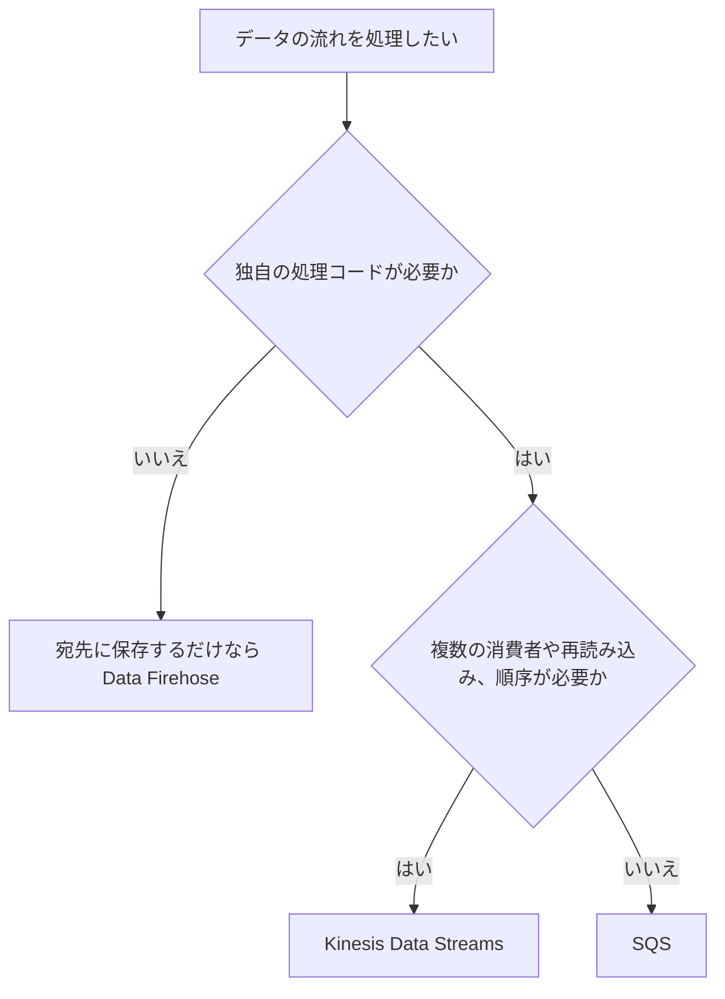

[SQS と他のメッセージングサービスの比較](messaging.md) も参照する。

## Amazon Athena {#athena}

[:material-sprout: CLF](../courses/clf/services.md){ .exam-badge .exam-foundational } [:material-certificate: SAA](../courses/saa/services.md){ .exam-badge .exam-associate } [:material-certificate: DVA](../courses/dva/services.md){ .exam-badge .exam-associate } [:material-certificate: SOA](../courses/soa/services.md){ .exam-badge .exam-associate } [:material-certificate: DEA](../courses/dea/services.md){ .exam-badge .exam-associate } [:material-certificate: MLA](../courses/mla/services.md){ .exam-badge .exam-associate } [:material-star-circle: SAP](../courses/sap/services.md){ .exam-badge .exam-professional } [:material-star-circle: DOP](../courses/dop/services.md){ .exam-badge .exam-professional } [:material-star-circle: AIP](../courses/aip/services.md){ .exam-badge .exam-professional } [:material-target: SCS](../courses/scs/services.md){ .exam-badge .exam-specialty }

S3 のデータに標準 SQL で問い合わせるサーバーレスのサービス。インフラの管理が要らず、実行したクエリの分だけ払う。ログ分析やアドホックな調査に使う。

**使う場面:** 市役所の広報課が、月に数回、S3 にためた 3 年分のアクセスログからよく見られたページを SQL で出す（[例](#use-case-city)）。

ログの調査は、障害の後や月末など、ときどきしか行わない。そのために分析用のクラスターやデータウェアハウスを常に動かすと、使わない時間も費用がかかり、データを読み込む作業も要る。Athena は、データを S3 に置いたまま、問い合わせたときだけ計算するためのものである。

| 観点 | 自前の SQL エンジンのクラスター、DWH | Athena |
| --- | --- | --- |
| サーバー | 常に動かし、台数を管理する | なし |
| データの置き場所 | クラスターのディスクに読み込む | S3 に置いたまま |
| 料金 | 使わなくても台数分 | スキャンした量だけ |
| 向くもの | 毎日の定型の大量の集計 | ときどきの調査、アドホックな分析 |

スキャン量で払う設計なので、読む量を減らす工夫がそのまま費用の削減になる。図書館にたとえると、パーティションは棚の分類、列指向の形式は必要なページだけを開くことに当たる。全部の棚を端から読むと時間も費用もかかる。

提供単位はリージョンで、AZ は選ばない。VPC の外のサービスで、VPC 内からはインターフェイスエンドポイントか NAT を経由して呼ぶ。クエリの対象は同じリージョンの Data Catalog で管理する（[リソースの提供単位](resource-scope.md#two-axes)）。

```sql
-- パーティションを指定すると、スキャン量が減る
SELECT status, COUNT(*) AS cnt
FROM alb_logs
WHERE day = '2026/10/30'
GROUP BY status
ORDER BY cnt DESC;
```

```python
import boto3

athena = boto3.client("athena")
qid = athena.start_query_execution(
    QueryString="SELECT * FROM alb_logs LIMIT 10",
    QueryExecutionContext={"Database": "logs"},
    ResultConfiguration={"OutputLocation": "s3://my-athena-results/"},
)["QueryExecutionId"]

# 非同期なので完了を確認してから結果を取る
state = athena.get_query_execution(QueryExecutionId=qid)["QueryExecution"]["Status"]["State"]
if state == "SUCCEEDED":
    rows = athena.get_query_results(QueryExecutionId=qid)
```

### S3 上のログを問い合わせる {#athena-logs}

CloudTrail、CloudFront、ALB、Classic Load Balancer、VPC フローログなどの AWS サービスログを、テーブルを定義して検索できる。AWS のドキュメントにテーブル定義の例がある。

ログの調査では、[CloudWatch Logs Insights](observability.md) と使い分ける。

| | CloudWatch Logs Insights | Athena |
| --- | --- | --- |
| データの場所 | CloudWatch Logs | S3 |
| クエリ言語 | 専用の言語など | SQL |
| 向いている場面 | 直近のログの調査 | 長期保管した大量のログの分析 |

- **例（Logs Insights）:** 5 分前からの Lambda のエラーを `filter @message like /ERROR/` で探す。
- **例（Athena）:** S3 に 3 年分保管した ALB のログから、月ごとの 5XX の件数を SQL で集計する。

### 速く、安くするコツ {#athena-performance}

| 方法 | 効果 |
| --- | --- |
| パーティション | `WHERE` で指定した範囲だけを読む。年月日で分けるのが一般的 |
| 列指向形式（Parquet、ORC） | 必要な列だけを読み、圧縮も効く |
| パーティション射影 | パーティションが多いテーブルの処理を速くし、管理を自動化する |
| CTAS | クエリ結果から、変換済みの新しいテーブルを作る |
| ワークグループ | チームを分け、メトリクスの追跡とコストの管理をする |

- テーブル定義は AWS Glue Data Catalog で管理する。
- 新しい Hive 形式のパーティションは `MSCK REPAIR TABLE` で読み込む。CloudTrail や Firehose のような Hive 形式でないパスは `ALTER TABLE ADD PARTITION` で追加する。
- 問い合わせ結果は S3 に自動で保存される。読むには `s3:GetObject` などが必要。
- S3 以外のデータは Athena Federated Query で問い合わせできる。

- **例（パーティション）:** `WHERE day = '2026/10/30'` なら、その日のフォルダだけを読む。全 365 日のうち 1 日なら、スキャン量は約 365 分の 1 になる。
- **例（CTAS）:** CSV のログを Parquet に変換して別のテーブルにする。以後のクエリは新しいテーブルに対して実行する。

### パーティションの設定 {#athena-partitions}

パーティションは S3 のパスの階層に対応する。

| 形式 | パスの例 | 読み込み方 |
| --- | --- | --- |
| Hive 形式 | `dt=2026-10-30/` | `MSCK REPAIR TABLE alb_logs` |
| Hive 形式でない | `2026/10/30/` | `ALTER TABLE ... ADD PARTITION` |
| どちらでも | | パーティション射影 |

```sql
CREATE EXTERNAL TABLE clicks (user_id string, page string)
PARTITIONED BY (dt string)
STORED AS PARQUET
LOCATION 's3://my-bucket/clicks/';

-- Hive 形式の新しいパーティションを読み込む
MSCK REPAIR TABLE clicks;

-- Hive 形式でないパスを追加する
ALTER TABLE clicks ADD PARTITION (dt = '2026-10-30')
LOCATION 's3://my-bucket/clicks/2026/10/30/';
```

- データを置いただけではパーティションは認識されない。クエリの結果が 0 件なら、まず読み込みを確認する。
- `MSCK REPAIR TABLE` は S3 のパスを小文字にしておく。`userId=1` のようなキャメルケースは追加されない。
- テーブルごとにフォルダを分ける。`MSCK REPAIR TABLE` はサブフォルダも走査する。
- `WHERE` にパーティション列がないと全件を読み、料金も全件分かかる。

パーティション射影は、テーブルのプロパティから値と場所を計算する。Glue の `GetPartitions` が要らないので、パーティションが非常に多いテーブルで速くなり、`MSCK REPAIR TABLE` も要らなくなる。

```sql
ALTER TABLE clicks SET TBLPROPERTIES (
  'projection.enabled' = 'true',
  'projection.dt.type' = 'date',
  'projection.dt.format' = 'yyyy-MM-dd',
  'projection.dt.range' = '2026-01-01,NOW',
  'storage.location.template' = 's3://my-bucket/clicks/${dt}/'
);
```

射影を有効にすると、Glue に登録したパーティションのメタデータは無視される。

射影の型は `enum`、`integer`、`date`、`injected` の 4 つ。

| 型 | 例 | 使う場面 |
| --- | --- | --- |
| `date` | `'projection.dt.range' = '2026-01-01,NOW'` | 日付のパス |
| `integer` | `'projection.hour.range' = '0,23'`、`'projection.hour.digits' = '2'` | `00`〜`23` のパス |
| `enum` | `'projection.region.values' = 'ap-northeast-1,us-east-1'` | 値の種類が少ない |
| `injected` | 型だけを指定する | 顧客 ID など。`WHERE` で値の指定が必須 |

- **例（`date`）:** 2026-10-31 の時点で `2026-01-01,NOW` なら 304 日分が候補になる。`WHERE dt = '2026-10-30'` なら 1 日分だけを見る。
- **誤ると（`injected`）:** `WHERE customer = 'c-1'` のような等価の条件がないクエリは失敗する。
- **誤ると（テンプレート）:** `storage.location.template` が実際のパスと違うと、エラーなしで 0 件が返る。

### 形式と料金 {#athena-formats-cost}

料金はスキャンしたデータ量で決まる。バージニア北部では 1 TB あたり 5 USD。

| 項目 | 内容 |
| --- | --- |
| 切り上げ | メガバイト単位。1 クエリの最小は 10 MB |
| DDL（`CREATE`、`ALTER`、`DROP`） | 無料 |
| 失敗したクエリ | 無料 |
| キャンセルしたクエリ | キャンセルまでにスキャンした分がかかる |

```text
例: 30 日分、900 GB の CSV。30 列のうち 3 列を集計する

全件スキャン: 900 GB → 約 4.5 USD
1 日に絞る:   30 GB → 約 0.15 USD
Parquet で列を絞る: 3 列分と圧縮で数 GB → 約 0.01〜0.02 USD
```

| 形式 | 特徴 |
| --- | --- |
| CSV、JSON | 全列を読む。人が読みやすい |
| Parquet、ORC | 列指向。必要な列だけ読み、述語のプッシュダウンで不要なブロックも読み飛ばす |
| GZIP、Snappy、ZSTD | 圧縮でスキャン量が減る |

既存のデータの変換には CTAS を使う。

```sql
CREATE TABLE clicks_parquet
WITH (
  format = 'PARQUET',
  write_compression = 'SNAPPY',
  external_location = 's3://my-bucket/clicks-parquet/',
  partitioned_by = ARRAY['dt']
) AS SELECT user_id, page, dt FROM clicks;
```

- CTAS と `INSERT INTO` で一度に書けるパーティションは 100 個まで。超えるなら分けて実行する。
- `external_location` は空である必要がある。データがあるとエラーになる。
- Parquet の既定の圧縮は GZIP。

- **例（100 個の上限）:** 365 日分をパーティション化するなら、365 ÷ 100 = 3.65 で 4 回に分ける。最初の CTAS で 100 日分を作り、残りは `INSERT INTO` を 3 回実行する。
- **例（最小料金）:** 1 MB しかスキャンしないクエリも 10 MB として数える。バージニア北部の料金の例では、10 MB ÷ 1,000,000 MB × 5 USD = 0.00005 USD。
- **例（料金の表）:** 上の 900 GB は 0.9 TB × 5 USD = 4.5 USD。30 GB は 0.03 TB × 5 USD = 0.15 USD。
- **誤ると（`external_location`）:** 前回の CTAS のファイルが残った場所を指定すると失敗する。別の場所を使うか、残ったファイルを消す。

### ワークグループ {#athena-workgroups}

チーム、用途ごとに分けて、設定とコストを管理する単位。IAM でワークグループ単位のアクセスも制御できる。

**使う場面:** 大学の研究室で、学生用のワークグループに 1 クエリ 20 GB の上限を付け、条件の書き忘れで予算を使い切るのを防ぐ。

| 設定 | 内容 |
| --- | --- |
| クエリごとのデータ制限 | 1 つのクエリのスキャン量の上限（10 MB〜7 EB）。超えると **クエリをキャンセル** する |
| ワークグループ全体のデータ制限 | 期間内の合計。超えると SNS に通知する。1 つのワークグループに複数設定できる |
| 結果の場所 | 結果の S3 の場所と暗号化 |
| クライアント側の設定を上書き | 既定はオフ。オンならワークグループの設定を強制する |
| CloudWatch メトリクス | クエリのメトリクスの発行 |

具体例を示す。分析者が `WHERE` を付けずに巨大なテーブルを読むのを防ぐなら、ワークグループのクエリごとの制限を 100 GB にする。超えると途中で止まり、そこまでのスキャン分は課金される。

**クライアント側の設定を上書き** がオンだと、`StartQueryExecution` の `OutputLocation` は無視される。結果が指定した場所に出ないときはこれを疑う。

```bash
aws athena update-work-group --work-group analysts --configuration-updates \
  'BytesScannedCutoffPerQuery=107374182400,EnforceWorkGroupConfiguration=true'
```

- **例（`BytesScannedCutoffPerQuery`）:** 107,374,182,400 バイトは 100 GiB。バージニア北部の料金の例なら、1 クエリの費用は約 0.5 USD で止まる。下限は 10 MB。
- **例（上書き）:** `EnforceWorkGroupConfiguration=true` でワークグループの結果の場所が `s3://team-a-results/` なら、`OutputLocation="s3://my-bucket/"` を指定しても `s3://team-a-results/` に出る。
- **例（全体の制限）:** 1 日 10 TB のアラートを SNS に送る設定は、通知するだけでクエリを止めない。止めたいならクエリごとの制限を使う。

`SELECT` と CTAS（DML）、`CREATE TABLE`（DDL）には、それぞれ同時実行の上限がある。実行中とキュー内の合計が上限を超えると `TooManyRequestsException` になるので、バックオフして再試行する。DML のタイムアウトは申請で最大 240 分まで延ばせる。上限はワークグループではなくアカウントで共有する。

- **例（同時実行）:** DML の上限が 25 で、実行中とキュー内の合計が 25 のときに 26 個目を投げると `TooManyRequestsException` になる。ワークグループを分けても上限は共有される。

同じクエリを何度も実行するなら **クエリ結果の再利用** を有効にする。同じワークグループの前回の結果を返し、スキャンの料金がかからない。結果が消されたり移動されたりしていると再利用されない。

- **例（再利用）:** ダッシュボードが 5 分ごとに同じ 200 GB のクエリを実行する。`ResultReuseConfiguration={ResultReuseByAgeConfiguration={Enabled=true,MaxAgeInMinutes=60}}` なら、1 時間に 12 回のうちスキャンは 1 回で済む。最大経過時間を指定しないときの既定は 60 分。
- **誤ると:** 1 分ごとに更新される売上の集計に 60 分を指定すると、最大 1 時間古い結果が表示される。

**マネージドクエリ結果** を有効にすれば、結果用の S3 バケットの用意と管理が要らなくなる。

## Amazon OpenSearch Service {#opensearch}

[:material-sprout: CLF](../courses/clf/services.md){ .exam-badge .exam-foundational } [:material-sprout: AIF](../courses/aif/services.md){ .exam-badge .exam-foundational } [:material-certificate: SAA](../courses/saa/services.md){ .exam-badge .exam-associate } [:material-certificate: DVA](../courses/dva/services.md){ .exam-badge .exam-associate } [:material-certificate: DEA](../courses/dea/services.md){ .exam-badge .exam-associate } [:material-certificate: MLA](../courses/mla/services.md){ .exam-badge .exam-associate } [:material-star-circle: SAP](../courses/sap/services.md){ .exam-badge .exam-professional } [:material-star-circle: DOP](../courses/dop/services.md){ .exam-badge .exam-professional } [:material-star-circle: AIP](../courses/aip/services.md){ .exam-badge .exam-professional } [:material-target: SCS](../courses/scs/services.md){ .exam-badge .exam-specialty }

OpenSearch の検索と分析のクラスターを管理するサービス。全文検索、ログ分析、リアルタイムのアプリケーション監視、クリックストリーム分析に使う。OpenSearch Dashboards で可視化できる。

**使う場面:** 家具の EC サイトで、「北欧 ソファ 2人掛け」の検索に関係の近い順で答え、色と価格帯で絞り込ませる（[例](#use-case-search)）。

RDB で「本文に『シューズ』を含む」を探すと、`LIKE '%シューズ%'` で全行を読むことになる。OpenSearch は、書き込むときに単語ごとの索引（転置インデックス）を作っておくので、検索のときは索引を引くだけで済む。本の巻末の索引から、言葉の載っているページを引くのと同じである。その代わり、書き込みのたびに索引を作る手間とディスクがかかる。

自前でクラスターを運用する場合との違いは次のとおり。OpenSearch Service は OpenSearch のほか、旧来の Elasticsearch OSS（7.10 まで）も選べる。

| 作業 | 自前の Elasticsearch、OpenSearch | OpenSearch Service |
| --- | --- | --- |
| サーバーの用意 | 自分で用意してインストール | ドメインを作れば用意される |
| 故障したノード | 自分で検知して入れ替える | 自動で検出して置き換える |
| スナップショット | 自分で設定する | 自動のスナップショットがある |
| シャード数と台数の設計 | 自分で行う | 自分で行う（Serverless なら OCU が自動） |

ドメインの提供単位はリージョンで、データノードは AZ に置かれる。作成時に VPC アクセスかパブリックアクセスを選ぶ。Serverless は VPC の外にあり、VPC エンドポイントでプライベートに接続できる（[リソースの提供単位](resource-scope.md#two-axes)）。

| 形態 | 特徴 |
| --- | --- |
| マネージドクラスター（ドメイン） | インスタンスの種類、数、ストレージを指定する |
| OpenSearch Serverless | クラスターの設定なしで使う。コレクション単位で管理する |

- **例（ドメイン）:** ログが 1 日 50 GB で量が安定している。インスタンスを選んで固定費で見積もる。
- **例（Serverless）:** 検索の負荷が不定期で、インスタンスの選定をしたくない。OCU が自動で増減する。

### 開発者が知っておく用語と設定 {#opensearch-concepts}

| 用語 | 意味 |
| --- | --- |
| インデックス | データベースのテーブルに近い |
| ドキュメント | 行に近い。JSON |
| フィールド | 列に近い |
| プライマリシャード | データを分割した単位。インデックスの作成時に数を指定する |
| レプリカシャード | プライマリのコピー。読み取りと可用性を高める。プライマリとは別のノードに置かれる |

プライマリ 5、レプリカ 1 のインデックスでは、書き込みは 10 シャードに届き、検索は 5 シャードに届く。

シャードのサイズの目安は、検索の遅延を重視するなら 10〜30 GiB、ログ分析のように書き込みが多いなら 30〜50 GiB。シャード数は `(元データ + 増える分) × 1.1 ÷ 1 シャードの目標サイズ` で見積もる。

- **例:** データが 66 GiB で増えないなら、66 × 1.1 ÷ 30 ≈ 2.4 で 3 シャード。1 年で 4 倍の 264 GiB になるなら、264 × 1.1 ÷ 30 ≈ 9.7 で 10 シャードにする。
- **例（レプリカ）:** 66 GiB でレプリカ 1 なら、データは 2 重になるので 132 GiB 以上の容量が要る。
- **誤ると（シャード数）:** プライマリの数は作成後に簡単には変えられない。1 シャードが 200 GiB に育つと遅くなる。逆に 1 GiB のシャードを数百作ると、クラスターの負荷が増える。

REST API を HTTP で呼ぶ。大量に入れるときは `_bulk` を使う。

```bash
# IAM で制限したドメインでは、リクエストに SigV4 の署名が必要
curl -XPOST "$ENDPOINT/_bulk" -H 'Content-Type: application/x-ndjson' --data-binary @docs.ndjson
curl -XGET "$ENDPOINT/products/_search?q=title:shoes"
```

| 設定 | 内容 |
| --- | --- |
| 専用マスターノード | 本番では 3 台を推奨。1 台は検証エラーになる |
| マルチ AZ | 2〜3 の AZ に分散する。スタンバイ付きを推奨 |
| ストレージ | データノードのホット。UltraWarm は読み取り専用のデータを安く保持する |
| Index State Management | 古いインデックスの移動や削除を自動化するポリシー |
| HTTP リクエストの上限 | インスタンスの種類で決まる。超えるなら `_bulk` を分割する |

- **例（専用マスター）:** 3 台なら、1 台が落ちても残り 2 台で過半数（クォーラム 2）を保てる。2 台だと 1 台の障害で新しいマスターを選べない。4 台は 3 台より良くならない。
- **例（マルチ AZ）:** スタンバイ付きの 3 AZ なら、1 つの AZ が止まってもスタンバイのノードに切り替わる。
- **例（UltraWarm）:** 直近 10 日のログはホットで検索し、古いインデックスは UltraWarm に移す。読み取り専用になるが、保持の費用を下げられる。
- **例（`_bulk`）:** HTTP リクエストの上限はインスタンスタイプで決まる。`m5.large.search` は 10 MiB、`m5.xlarge.search` は 100 MiB。上限が 100 MiB のインスタンスに 300 MB の `_bulk` を送ると拒否される。1 回を 100 MB 未満に分ける。

```json
{
  "policy": {
    "default_state": "hot",
    "states": [
      {
        "name": "hot",
        "actions": [],
        "transitions": [{ "state_name": "warm", "conditions": { "min_index_age": "10d" } }]
      },
      {
        "name": "warm",
        "actions": [{ "warm_migration": {} }],
        "transitions": [{ "state_name": "delete", "conditions": { "min_index_age": "90d" } }]
      },
      { "name": "delete", "actions": [{ "delete": {} }], "transitions": [] }
    ]
  }
}
```

上の Index State Management のポリシーは、10 日で UltraWarm へ移し、90 日で削除する。

アクセス制御は次を組み合わせる。

| 種類 | 内容 |
| --- | --- |
| リソースベースのポリシー | ドメインに付けるアクセスポリシー |
| ID ベースのポリシー | IAM のユーザーやロールのポリシー |
| IP ベースのポリシー | 送信元 IP で制限する |
| きめ細かなアクセス制御 | インデックス、ドキュメント、フィールド単位で制御する |

IAM のプリンシパルを指定したポリシーがあるドメインには、**署名付きのリクエスト**（SigV4）が必要で、署名なしの `curl` は拒否される。

- **例（IP ベース）:** ドメインのポリシーで `aws:SourceIp` に `192.0.2.0/24` を指定すると、その範囲からだけ届く。VPC 内のドメインには使わず、セキュリティグループで絞る。
- **例（きめ細かな制御）:** `support` ロールには `orders` インデックスの読み取りだけを許し、`card_number` フィールドを隠す。
- **誤ると:** 署名なしの `curl` は `403` で拒否される。SigV4 に対応するクライアントかプロキシを使う。

Serverless ではコレクションを作り、用途（ログ分析などの時系列、全文検索、ベクトル検索）を選ぶ。容量は OpenSearch Compute Unit（OCU）で測り、取り込みと検索で別々に自動で増える。1 OCU はメモリ 6 GiB とそれに応じた vCPU。

- **例（OCU）:** 取り込みと検索は別々に増えるので、夜間の大量取り込みが増えても検索用の OCU は増えない。1 OCU はメモリ 6 GiB なので、4 OCU なら 24 GiB になる。

スロークエリの調査には、検索とインデックスのスローログを CloudWatch Logs に出力する。

- **例:** 検索の遅いしきい値を 5 秒に設定し、ログを CloudWatch Logs へ出す。遅いクエリを見つけて、ワイルドカードの多用を直す。ログの出力はドメインとインデックスの両方で有効にする。

### データの入れ方 {#opensearch-ingestion}

| 経路 | 内容 |
| --- | --- |
| OpenSearch Ingestion | サードパーティなしで直接取り込む |
| Data Firehose | OpenSearch を宛先に指定できる。ただし CloudWatch Logs のログは Firehose 経由で OpenSearch へ配信できない |
| CloudWatch Logs | サブスクリプションフィルターで OpenSearch へ直接送る |
| S3、Kinesis Data Streams、DynamoDB | Lambda で変換してインデックスする |
| DynamoDB のゼロ ETL | OpenSearch Ingestion の DynamoDB プラグイン |

- **例（Firehose）:** ログを 60 秒ごとに OpenSearch へ送り、失敗したドキュメントは S3 に残す。自前の配信コードは書かない。
- **例（ゼロ ETL）:** DynamoDB の `products` テーブルを全文検索に同期する。Lambda で変換のコードを書かずに済む。

### データストアの選び方 {#specialized-store}

データストアは、アクセスパターンで選ぶ。

| 必要なこと | 選択肢 |
| --- | --- |
| キーによる高速な読み書き | [DynamoDB](dynamodb.md) |
| 全文検索、あいまい検索、ファセット | OpenSearch Service |
| ログの検索とダッシュボード | OpenSearch Service |
| S3 上のデータに対する単発の SQL | Athena |
| トランザクションと結合 | [RDS、Aurora](databases.md) |
| ミリ秒のキャッシュ | [ElastiCache](databases.md) |

DynamoDB はキーと属性で検索する設計で、部分一致の全文検索には向かない。DynamoDB のデータを全文検索したいときは、OpenSearch に同期する。

- **例:** 注文を `orderId` で 1 件取るなら DynamoDB。商品名に「軽量 シューズ」を含むものをあいまいに探すなら OpenSearch。先月の売上を 1 回だけ集計するなら、S3 に出したデータを Athena で見る。

## 既定値と上限のまとめ {#numbers}

| サービス | 項目 | 値 |
| --- | --- | --- |
| Kinesis | シャードの書き込み | 1 MB/秒、1,000 レコード/秒 |
| Kinesis | シャードの読み取り（共有） | 2 MB/秒、5 回/秒 |
| Kinesis | 拡張ファンアウト | 消費者ごとに 2 MB/秒、約 70 ms |
| Kinesis | 登録できる消費者 | 20（On-demand Advantage は 50） |
| Kinesis | `GetRecords` | 1 回 10 MB または 10,000 レコード |
| Kinesis | `PutRecords` | 500 レコード、10 MiB |
| Kinesis | レコードサイズ | 既定 1 MiB、最大 10 MiB |
| Kinesis | パーティションキー | 256 文字 |
| Kinesis | 保持期間 | 既定 24 時間、最大 8,760 時間 |
| Kinesis | シャードイテレーターの期限 | 5 分 |
| Kinesis | `SubscribeToShard` の接続 | 5 分 |
| Kinesis | `UpdateShardCount` | 24 時間に 10 回、2 倍まで、半分まで |
| Kinesis | モードの切り替え | 24 時間に 2 回 |
| Kinesis | On-demand の初期容量 | 書き込み 4 MB/秒、読み取り 8 MB/秒 |
| Lambda と Kinesis | `BatchSize` | 既定 100、最大 10,000 |
| Lambda と Kinesis | `ParallelizationFactor` | 既定 1、最大 10 |
| Lambda と Kinesis | `MaximumBatchingWindowInSeconds` | 既定 0、最大 300 |
| Lambda と Kinesis | `MaximumRetryAttempts` | 既定 -1、最大 10,000 |
| Lambda と Kinesis | `MaximumRecordAgeInSeconds` | 既定 -1、最大 604,800 |
| Firehose | レコードサイズ | Base64 前で 1,000 KiB |
| Firehose | `PutRecordBatch` | 500 レコード、4 MiB |
| Firehose | S3 のバッファ | 1〜128 MB（5 MB）、0〜900 秒（300 秒） |
| Firehose | Lambda のバッファ | 0.2〜3 MB（1 MB）、0〜900 秒（60 秒） |
| Firehose | Lambda の実行時間 | 最大 5 分 |
| Firehose | Lambda の呼び出しの再試行 | 既定 3 回 |
| Firehose | 配信の再試行（Redshift） | 0〜7,200 秒（3,600 秒） |
| Firehose | 配信の再試行（OpenSearch） | 0〜7,200 秒（300 秒） |
| Firehose | Direct PUT の保持 | 24 時間 |
| Firehose | 動的パーティション | 既定 500 個 |
| Athena | 料金 | スキャン 1 TB あたり 5 USD（バージニア北部）。最小 10 MB |
| Athena | クエリごとのデータ制限 | 10 MB〜7 EB |
| Athena | CTAS のパーティション | 100 個 |
| Athena | DML のタイムアウト | 申請で最大 240 分 |

## 試験のポイント {#exam-points}

| こう問われたら | 答え |
| --- | --- |
| シャード数の計算 | サイズ、件数、読み取りのうち最大 |
| 再起動後に処理済みの続きから読む | `AFTER_SEQUENCE_NUMBER` |
| 保持中の最初から読む | `TRIM_HORIZON` |
| `ExpiredIteratorException` | 5 分で切れる。取り直す |
| シャードの厳密な順序で書く | `SequenceNumberForOrdering` |
| 一度にシャードを 3 倍にできない | `UpdateShardCount` は 2 倍まで |
| KCL のテーブルが衝突する | アプリケーション名を一意に |
| 保持期間を縮めたらレコードが読めない | 古いレコードはほぼ即座に読めなくなる |
| `PutRecordBatch` の一部が届かない | `FailedPutCount` を見て失敗分を再送 |
| Firehose の変換で捨てたいレコード | `result` を `Dropped` |
| 変換に失敗したデータの行き先 | S3 の `processing-failed` |
| Firehose の遅延を短くしたい | `BufferingHints` の時間を小さく |
| OpenSearch に配信できなかったデータ | S3 のバックアップ |
| Athena でデータがあるのに結果が 0 件 | パーティションの読み込み |
| Athena の新しいパーティションの読み込み（Hive 形式） | `MSCK REPAIR TABLE` |
| パーティションが大量で遅い | パーティション射影 |
| 1 つのクエリのスキャン量を制限 | ワークグループのクエリごとの制限 |
| チームのスキャン量の超過を通知 | ワークグループ全体の制限と SNS |
| 指定した結果の場所が使われない | クライアント側の設定の上書き |
| CTAS で 100 を超えるパーティション | 分けて `INSERT INTO` |
| OpenSearch へ署名なしで拒否される | SigV4 で署名する |
| 複数のアプリが同じデータを順序付きで読む | Kinesis Data Streams |
| 読み直しが必要 | Kinesis Data Streams（保持期間を延長） |
| 消費者が増えて読み取りが遅い | 拡張ファンアウト |
| `ProvisionedThroughputExceededException` | バックオフ、シャード追加、パーティションキーの分散 |
| 一部のシャードだけスロットリング | キーが偏っている。キーを変えるか分割する |
| 流量が読めない、管理したくない | On-demand モード |
| 順序が必要 | 同じパーティションキーを使う |
| 親と子のシャードでの順序 | 親を読み終えてから子を読む |
| シャードの処理が止まる | Lambda のバッチ分割、最大再試行、失敗の記録先 |
| 処理の遅れを検知 | `IteratorAge`、`GetRecords.IteratorAgeMilliseconds` |
| Lambda の処理が追いつかない | `ParallelizationFactor`、シャード追加 |
| ログを S3 に保存、運用は最小限 | Data Firehose |
| 保存前に変換 | Firehose と Lambda 変換 |
| Firehose の `recordId` を変えた | 不一致はエラーになる。同じ値を返す |
| JSON を Parquet で保存 | Firehose の形式変換 |
| ほぼリアルタイムで十分か、即時か | Firehose はバッファ分の遅延あり |
| S3 のログを SQL で分析 | Athena |
| Athena のコストを下げたい | パーティションと Parquet |
| 全文検索がしたい | OpenSearch Service |
| DynamoDB のデータを全文検索 | ゼロ ETL で OpenSearch に連携 |

## 関連ページ {#related}

- [Lambda](lambda.md)
- [メッセージング](messaging.md)
- [DynamoDB](dynamodb.md)
- [データベース](databases.md)
- [S3](s3.md)
- [オブザーバビリティ](observability.md)

## 参考 {#references}

- [GetShardIterator API](https://docs.aws.amazon.com/kinesis/latest/APIReference/API_GetShardIterator.html)
- [UpdateShardCount API](https://docs.aws.amazon.com/kinesis/latest/APIReference/API_UpdateShardCount.html)
- [SubscribeToShard API](https://docs.aws.amazon.com/kinesis/latest/APIReference/API_SubscribeToShard.html)
- [KCL key concepts](https://docs.aws.amazon.com/streams/latest/dev/kcl-concepts.html)
- [KCL DynamoDB metadata tables](https://docs.aws.amazon.com/streams/latest/dev/kcl-dynamoDB.html)
- [Kinesis server-side encryption](https://docs.aws.amazon.com/streams/latest/dev/what-is-sse.html)
- [Firehose failure handling](https://docs.aws.amazon.com/firehose/latest/dev/retry.html)
- [Firehose transformation failure handling](https://docs.aws.amazon.com/firehose/latest/dev/data-transformation-failure-handling.html)
- [Firehose PutRecordBatch API](https://docs.aws.amazon.com/firehose/latest/APIReference/API_PutRecordBatch.html)
- [Firehose format conversion](https://docs.aws.amazon.com/firehose/latest/dev/record-format-conversion.html)
- [Firehose dynamic partitioning](https://docs.aws.amazon.com/firehose/latest/dev/dynamic-partitioning.html)
- [Firehose custom S3 prefixes](https://docs.aws.amazon.com/firehose/latest/dev/s3-prefixes.html)
- [Athena pricing](https://aws.amazon.com/athena/pricing/)
- [Athena data usage controls](https://docs.aws.amazon.com/athena/latest/ug/workgroups-setting-control-limits-cloudwatch.html)
- [Athena override client-side settings](https://docs.aws.amazon.com/athena/latest/ug/workgroups-settings-override.html)
- [Athena service quotas](https://docs.aws.amazon.com/athena/latest/ug/service-limits.html)
- [Athena query result reuse](https://docs.aws.amazon.com/athena/latest/ug/reusing-query-results.html)
- [Athena CTAS considerations](https://docs.aws.amazon.com/athena/latest/ug/ctas-considerations-limitations.html)
- [OpenSearch Service best practices](https://docs.aws.amazon.com/opensearch-service/latest/developerguide/bp.html)
- [OpenSearch Service indexing](https://docs.aws.amazon.com/opensearch-service/latest/developerguide/indexing.html)
- [OpenSearch Service access control](https://docs.aws.amazon.com/opensearch-service/latest/developerguide/ac.html)
- [Kinesis Data Streams key concepts](https://docs.aws.amazon.com/streams/latest/dev/key-concepts.html)
- [Kinesis Data Streams quotas](https://docs.aws.amazon.com/streams/latest/dev/service-sizes-and-limits.html)
- [Choosing the data stream capacity mode](https://docs.aws.amazon.com/streams/latest/dev/how-do-i-size-a-stream.html)
- [Enhanced fan-out consumers](https://docs.aws.amazon.com/streams/latest/dev/enhanced-consumers.html)
- [Resharding](https://docs.aws.amazon.com/streams/latest/dev/kinesis-using-sdk-java-resharding.html)
- [After resharding](https://docs.aws.amazon.com/streams/latest/dev/kinesis-using-sdk-java-after-resharding.html)
- [Extended retention](https://docs.aws.amazon.com/streams/latest/dev/kinesis-extended-retention.html)
- [Troubleshooting producers](https://docs.aws.amazon.com/streams/latest/dev/troubleshooting-producers.html)
- [Troubleshooting consumers](https://docs.aws.amazon.com/streams/latest/dev/troubleshooting-consumers.html)
- [PutRecords API](https://docs.aws.amazon.com/kinesis/latest/APIReference/API_PutRecords.html)
- [PutRecord API](https://docs.aws.amazon.com/kinesis/latest/APIReference/API_PutRecord.html)
- [Using Lambda with Kinesis](https://docs.aws.amazon.com/lambda/latest/dg/with-kinesis.html)
- [Kinesis event source mapping parameters](https://docs.aws.amazon.com/lambda/latest/dg/services-kinesis-parameters.html)
- [What is Amazon Data Firehose](https://docs.aws.amazon.com/firehose/latest/dev/what-is-this-service.html)
- [Firehose data transformation](https://docs.aws.amazon.com/firehose/latest/dev/data-transformation.html)
- [Firehose buffering hints](https://docs.aws.amazon.com/firehose/latest/dev/create-configure-backup.html)
- [Firehose data delivery](https://docs.aws.amazon.com/firehose/latest/dev/basic-deliver.html)
- [Firehose quotas](https://docs.aws.amazon.com/firehose/latest/dev/limits.html)
- [What is Amazon Athena](https://docs.aws.amazon.com/athena/latest/ug/what-is.html)
- [Athena partitions](https://docs.aws.amazon.com/athena/latest/ug/partitions.html)
- [Athena columnar storage](https://docs.aws.amazon.com/athena/latest/ug/columnar-storage.html)
- [Athena partition projection](https://docs.aws.amazon.com/athena/latest/ug/partition-projection.html)
- [Query AWS service logs](https://docs.aws.amazon.com/athena/latest/ug/querying-aws-service-logs.html)
- [Athena CTAS](https://docs.aws.amazon.com/athena/latest/ug/ctas.html)
- [What is Amazon OpenSearch Service](https://docs.aws.amazon.com/opensearch-service/latest/developerguide/what-is.html)
- [OpenSearch Serverless](https://docs.aws.amazon.com/opensearch-service/latest/developerguide/serverless-overview.html)
- [Loading streaming data into OpenSearch Service](https://docs.aws.amazon.com/opensearch-service/latest/developerguide/integrations.html)
- [DynamoDB zero-ETL with OpenSearch Service](https://docs.aws.amazon.com/amazondynamodb/latest/developerguide/OpenSearchIngestionForDynamoDB.html)
