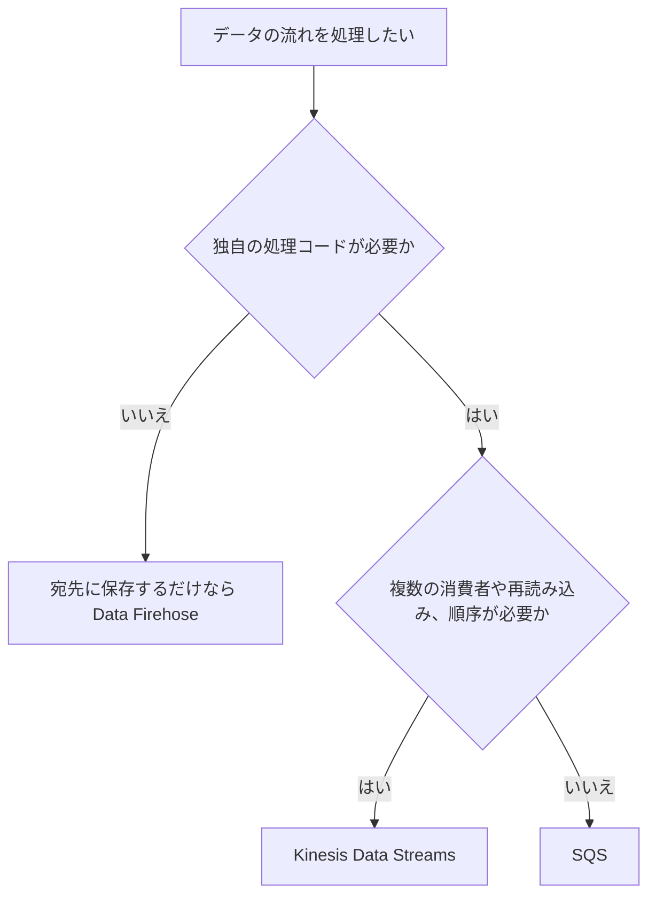

# ストリーミングとデータ分析（Kinesis、Firehose、Athena、OpenSearch）

[:material-sprout: CLF](../courses/clf/services.md){ .exam-badge .exam-foundational } [:material-sprout: AIF](../courses/aif/services.md){ .exam-badge .exam-foundational } [:material-certificate: SAA](../courses/saa/services.md){ .exam-badge .exam-associate } [:material-certificate: DVA](../courses/dva/services.md){ .exam-badge .exam-associate } [:material-certificate: SOA](../courses/soa/services.md){ .exam-badge .exam-associate } [:material-certificate: DEA](../courses/dea/services.md){ .exam-badge .exam-associate } [:material-certificate: MLA](../courses/mla/services.md){ .exam-badge .exam-associate } [:material-star-circle: SAP](../courses/sap/services.md){ .exam-badge .exam-professional } [:material-star-circle: DOP](../courses/dop/services.md){ .exam-badge .exam-professional } [:material-star-circle: AIP](../courses/aip/services.md){ .exam-badge .exam-professional } [:material-target: SCS](../courses/scs/services.md){ .exam-badge .exam-specialty }

流れ続けるデータを受け取り、処理して、分析できる形で保存するサービス群。Kinesis Data Streams で受け、Data Firehose で届け、Athena と OpenSearch Service で検索する組み合わせが基本になる。

[](../assets/diagrams/streaming-pipeline.png)

## Kinesis Data Streams {#kinesis-data-streams}

[:material-sprout: CLF](../courses/clf/services.md){ .exam-badge .exam-foundational } [:material-certificate: SAA](../courses/saa/services.md){ .exam-badge .exam-associate } [:material-certificate: DVA](../courses/dva/services.md){ .exam-badge .exam-associate } [:material-certificate: DEA](../courses/dea/services.md){ .exam-badge .exam-associate } [:material-certificate: MLA](../courses/mla/services.md){ .exam-badge .exam-associate } [:material-star-circle: SAP](../courses/sap/services.md){ .exam-badge .exam-professional } [:material-star-circle: DOP](../courses/dop/services.md){ .exam-badge .exam-professional } [:material-star-circle: AIP](../courses/aip/services.md){ .exam-badge .exam-professional }

順序付きのレコードをためて、複数の消費者が読めるようにするサービス。読んでもレコードは消えず、保持期間の間は何度でも読み直せる。

| 用語 | 意味 |
| --- | --- |
| ストリーム | シャードの集まり |
| シャード | 容量の単位。レコードの順序付きの列 |
| レコード | シーケンス番号、パーティションキー、データ本体 |
| パーティションキー | どのシャードに入れるかを決める値 |
| シーケンス番号 | シャード内の順序を表す。Kinesis が割り当てる |
| 保持期間 | 既定 24 時間、最大 8,760 時間（365 日）。24 時間を超えると追加料金 |

### シャードの容量 {#shards}

| 方向 | 1シャードあたりの上限 |
| --- | --- |
| 書き込み | 1 MB/秒、1,000 レコード/秒（パーティションキーを含む） |
| 読み取り（共有） | 2 MB/秒、5 トランザクション/秒 |
| 読み取り（拡張ファンアウト） | 消費者ごとに 2 MB/秒 |

`GetRecords` は1回で 10 MB または 10,000 レコードまで。10 MB を返すと、次の 5 秒間の呼び出しは `ProvisionedThroughputExceededException` になる。

必要なシャード数は、書き込み量と読み取り量のうち多いほうから見積もる。

```text
例: 1 KB のレコードを毎秒 3,000 件書く
書き込み: 3,000 KB/秒 ÷ 1,000 KB/秒 = 3 シャード
件数: 3,000 件/秒 ÷ 1,000 件/秒 = 3 シャード
```

レコードの最大サイズは、既定で 1 MiB。ストリームの設定（`MaxRecordSizeInKiB`、既存のストリームは `UpdateMaxRecordSize`）で最大 10 MiB まで上げられる。1〜10 MiB の大きなレコードはバースト容量で断続的に扱う前提で、シャードの平常の書き込み上限（1 MB/秒）は変わらない。AWS は大きなレコードを全トラフィックの 2% 未満に抑えることを勧めている。

### シャード数の計算 {#shard-calculation}

書き込みのサイズ、書き込みの件数、読み取りの 3 つを計算し、最も大きい値を使う。

```text
条件: 2 KB のレコードを毎秒 2,500 件書き、3 つのアプリがすべて読む

書き込みサイズ: 2 KB × 2,500 = 5,000 KB/秒 → 5 シャード
書き込み件数:   2,500 ÷ 1,000 = 2.5 → 3 シャード
読み取り（共有）: 5,000 KB/秒 × 3 アプリ = 15 MB/秒
                15 ÷ 2 MB/秒 = 7.5 → 8 シャード

結果: 共有スループットなら 8 シャード
      拡張ファンアウトなら、各アプリが 2 MB/秒を占有するので 5 シャード
```

小さいレコードでは件数が先に上限に達する。100 バイトを毎秒 5,000 件なら、サイズは 500 KB/秒で 1 シャードで足りるが、件数の条件で 5 シャード必要になる。

読み取りの回数の上限も効く。共有スループットは 1 シャードにつき 5 回/秒なので、5 つのアプリがそれぞれ毎秒 1 回読むと上限いっぱいになる。

### パーティションキー {#partition-key}

キーの MD5 ハッシュでシャードが決まる。キーは 256 文字までの Unicode 文字列。

- **順序が保証されるのは同じシャードの中だけ**。同じキーのレコードは同じシャードに入る。
- 値の種類が少ないキーは特定のシャードに偏る（**ホットシャード**）。ユーザー ID のように、種類が多く分散するキーを選ぶ。
- 順序が不要なら、ランダムなキーで分散させる。
- `ExplicitHashKey` で明示的にシャードを選べる。

キーを `"prod"` に固定すると、シャードを 10 本に増やしても全レコードが 1 本に入る。そのシャードだけ `WriteProvisionedThroughputExceeded` が増え、他は空いたままになる。増やしても解決しないので、キーを変える。

パーティションキーは 1 MB/秒の計算にも含まれる。

### シーケンス番号 {#sequence-numbers}

書き込むと Kinesis が割り当てて `PutRecord` の応答で返す。自分では指定しない。

- シャードの中で時間とともに増えるが、**シャードをまたいで比較はできない**。
- 厳密に増える順序が必要なら、同じシャードに 1 つずつ書き、`SequenceNumberForOrdering` に前のレコードのシーケンス番号を渡す。
- `PutRecords` にはこの指定がない。1 回のリクエストの中の順序は保証されないので、順序が重要なら `PutRecord` を使う。
- 再試行すると同じデータが別の番号で書かれることがある。消費者で重複を扱う。

```python
seq = None
for row in rows:
    params = {"StreamName": "clicks", "Data": row, "PartitionKey": "u-1"}
    if seq:
        params["SequenceNumberForOrdering"] = seq
    seq = kinesis.put_record(**params)["SequenceNumber"]
```

### 保持期間 {#retention}

既定は 24 時間で、最大 8,760 時間（365 日）。下限は 24 時間で、これより短くできない。

```bash
aws kinesis increase-stream-retention-period --stream-name clicks --retention-period-hours 72
aws kinesis decrease-stream-retention-period --stream-name clicks --retention-period-hours 24
```

- **延ばす** と、古いレコードの削除は数分以内に止まる。
- **縮める** と、新しい期間より古いレコードはほぼ即座に読めなくなる。
- 24 時間を超えると追加料金がかかる。

消費者が週末に止まっても読み直したい、バグの修正後に 3 日分を再処理したい、といった場面で延ばす。消費者が保持期間を超えて遅れると、レコードは読めずに失われる。`GetRecords.IteratorAgeMilliseconds` が保持期間に近づいたら危険のサイン。

```python
import json

import boto3

kinesis = boto3.client("kinesis")

kinesis.put_record(
    StreamName="clicks",
    Data=json.dumps({"userId": "u-1", "page": "/"}).encode(),
    PartitionKey="u-1",
)

# まとめて書く。1 リクエスト 500 レコード、10 MiB まで
res = kinesis.put_records(
    StreamName="clicks",
    Records=[
        {"Data": json.dumps(r).encode(), "PartitionKey": r["userId"]} for r in rows
    ],
)
# 一部だけ失敗することがある
if res["FailedRecordCount"] > 0:
    failed = [
        rows[i] for i, r in enumerate(res["Records"]) if "ErrorCode" in r
    ]
    # failed をバックオフして再送する
```

!!! warning "PutRecords は例外なしで部分失敗する"
    `PutRecords` は一部のレコードが失敗しても、呼び出し自体は成功する。`FailedRecordCount` を確認し、失敗分だけ再送する。

### キャパシティモード {#capacity-modes}

| モード | シャード管理 | 料金 | 向いている場面 |
| --- | --- | --- | --- |
| Provisioned | シャード数を自分で指定 | シャード時間 | 予測できる流量、コスト優先 |
| On-demand Standard | 自動 | データ量とストリームごとの固定料金 | 流量が読めない |
| On-demand Advantage | 自動。ウォーム容量を設定可能 | 固定料金なし。最低利用量あり | 常に大量に流す |

- On-demand の新規ストリームは 4 MB/秒の書き込み、8 MB/秒の読み取りから始まる。
- 過去 30 日のピークの 2 倍まで対応する。これを超える急増では、約 15 分間エラーが出る場合がある。
- 上限は書き込み 200 MB/秒または 10 GB/秒で、リージョンにより異なる。
- モードの切り替えは 24 時間に 2 回まで。
- On-demand でも、1つのパーティションキーがシャードの上限（1 MB/秒、1,000 件/秒）を超えると解決できない。

```bash
# On-demand で作る。ShardCount は指定しない
aws kinesis create-stream --stream-name clicks \
  --stream-mode-details StreamMode=ON_DEMAND

# Provisioned で作る
aws kinesis create-stream --stream-name orders --shard-count 4
```

On-demand の例を示す。過去 30 日のピークが 50 MB/秒なら、100 MB/秒までは問題なく受けられる。急に 200 MB/秒が来ると、約 15 分は書き込みや読み取りの例外が出ることがある。再試行で書き切る。既知のイベントの前なら、On-demand Advantage のウォーム容量で備えられる。

読み取りの容量は書き込みに比例して増え、書き込みの 2 倍以上が確保される。

### シャードイテレーター {#shard-iterators}

`GetRecords` はシャードイテレーターを受け取って読む。最初に `GetShardIterator` で取得し、以降は応答の `NextShardIterator` を使う。

| `ShardIteratorType` | 読み始める位置 |
| --- | --- |
| `TRIM_HORIZON` | 保持されている最も古いレコード |
| `LATEST` | 最新のレコードの直後。これ以降に書かれたものだけ読む |
| `AT_SEQUENCE_NUMBER` | 指定したシーケンス番号から |
| `AFTER_SEQUENCE_NUMBER` | 指定したシーケンス番号の次から |
| `AT_TIMESTAMP` | 指定した時刻から |

```python
it = kinesis.get_shard_iterator(
    StreamName="clicks",
    ShardId="shardId-000000000000",
    ShardIteratorType="AFTER_SEQUENCE_NUMBER",
    StartingSequenceNumber=last_processed,   # 再起動後は処理済みの次から
)["ShardIterator"]

while it:
    res = kinesis.get_records(ShardIterator=it, Limit=1000)
    process(res["Records"])
    print(res["MillisBehindLatest"])         # 最新からの遅れ
    it = res.get("NextShardIterator")        # None ならシャードは閉じている
```

- イテレーターは **5 分で期限切れ** になる。切れると `ExpiredIteratorException`。処理が 5 分を超えるループなら、最後に処理した番号で取り直す。
- `NextShardIterator` が `null` ならシャードは閉じている。子シャードに移る。
- `Records` が空でも読み終わりとは限らない。`NextShardIterator` を使い続ける。
- `Limit` の既定と最大は 10,000。

障害の後に読み直すつもりで `LATEST` を選ぶと、停止中のレコードを読み飛ばす。処理済みの続きからなら `AFTER_SEQUENCE_NUMBER`、最初からなら `TRIM_HORIZON` を使う。

### 消費者と拡張ファンアウト {#enhanced-fan-out}

| | 共有スループット | 拡張ファンアウト |
| --- | --- | --- |
| 読み取り容量 | シャードごとに全消費者で 2 MB/秒 | 消費者ごとに 2 MB/秒 |
| 配信方式 | `GetRecords`（プル、HTTP） | `SubscribeToShard`（プッシュ、HTTP/2） |
| 遅延の目安 | 1 消費者で約 200 ms、5 消費者で約 1,000 ms | 約 70 ms |
| 料金 | 追加なし | データ取得とシャード時間の追加料金 |
| 登録数 | | 20（On-demand Advantage は 50） |

消費者が複数で遅延が問題なら、拡張ファンアウトを使う。`RegisterStreamConsumer` で登録する。

拡張ファンアウトの細かい動きは次の通り。

- `SubscribeToShard` の接続は最大 5 分。続けて受け取るには呼び直す。
- 同じ消費者とシャードで 5 秒以内に呼び直すと `ResourceInUseException`。5 秒以上後なら古い接続を引き継ぐ。
- 同時に `CREATING` 状態にできる消費者は 5 個まで。`RegisterStreamConsumer` は `ACTIVE` になるまで待ってから使う。

### KCL {#kcl}

自前の消費者を作るなら **Kinesis Client Library（KCL）** が便利。シャードの割り当てとチェックポイントを管理し、その情報を DynamoDB のリーステーブルに保存する。テーブルの容量が足りないと、イテレーターの期限切れを招くことがある。

| 用語 | 意味 |
| --- | --- |
| ワーカー | 消費者アプリの実行単位。複数を動かして分散する |
| レコードプロセッサー | 自分で書く処理のロジック |
| リース | シャードとワーカーの割り当て。1 シャードを持つワーカーは同時に 1 つ |
| リーステーブル | リースを管理する DynamoDB テーブル |
| チェックポイント | 処理済みの位置の記録。再開はここから |

- リーステーブルの名前は **アプリケーション名** から作られる。同じ名前の別のアプリを動かすと同じテーブルを奪い合うので、アプリ名は一意にする。
- KCL 3.x は既定でテーブルをオンデマンドで作り、ワーカーのメトリクスとコーディネーターの状態の 2 つのテーブルも使う。
- 実行ロールには Kinesis に加えて DynamoDB と CloudWatch の権限が要る。

具体例を示す。シャードが 4 本でワーカーが 2 台なら、2 台で 4 本を分担する。ワーカーを 8 台に増やしても 1 シャードは同時に 1 台しか持てないので、半分のワーカーは担当がなく遊ぶ。チェックポイントを頻繁に書きすぎると、リーステーブルの消費が増える。

再起動後は最後のチェックポイントから再開するので、そこまでに処理したレコードをもう一度受け取ることがある。処理は冪等にする。

### リシャーディング {#resharding}

Provisioned モードでシャード数を変える操作。

| 操作 | API | 効果 |
| --- | --- | --- |
| 分割 | `SplitShard` | 容量と費用が増える。ホットシャードに使う |
| 結合 | `MergeShards` | 容量と費用が減る。コールドシャードに使う |
| 均等な変更 | `UpdateShardCount` | 全体を指定の数にする |

- 分割と結合は 2 シャード単位で行う。
- 親シャードは `OPEN` → `CLOSED` → `EXPIRED` と変わる。
- 親シャードには読み残しがあり得る。順序を守るには、**親を読み終えてから子を読む**。KCL はこれを自動で扱う。

`MergeShards` で結合できるのは隣り合う（ハッシュキーの範囲が連続する）シャードだけ。`SplitShard` は非同期で、ストリームは `UPDATING` になる。

`UpdateShardCount` には次の制限がある。

| 制限 | 値 |
| --- | --- |
| 回数 | 24 時間のローリング期間に 10 回まで |
| 増やす幅 | 現在の 2 倍まで |
| 減らす幅 | 現在の半分まで |
| 既定の上限 | 10,000 シャード |
| 推奨 | 現在の数の 25% 刻みの目標値 |

4 シャードから一度に 20 シャードにはできない。8、16、20 と段階を踏む。

`CLOSED` のシャードも保持期間が切れるまで読める。`EXPIRED` になると読めず、シャードの一覧にも出なくなる。リシャーディング直後に子だけを読むと、親に残ったレコードより新しいレコードを先に処理してしまう。

### 暗号化 {#kinesis-encryption}

サーバー側の暗号化は KMS キーを使い、書き込みの前に暗号化して、読み出すときに復号する。

- 有効にした **後** に書かれたレコードだけが暗号化される。既存のレコードは対象外。
- 生産者も消費者もコードの変更は要らず、権限だけが要る。

| 役割 | 必要な KMS の権限 |
| --- | --- |
| 生産者 | `kms:GenerateDataKey` |
| 消費者 | `kms:Decrypt` |

他のアカウントと共有するなら、キーポリシーと相手の IAM ポリシーの両方で許可する。権限が足りないと書き込みや読み取りが KMS の権限エラーになる。

### エラーと監視 {#kinesis-errors}

| エラーやメトリクス | 意味 | 対処 |
| --- | --- | --- |
| `ProvisionedThroughputExceededException`（書き込み） | シャードの上限超過 | バックオフと再送、`PutRecords` の利用、シャード追加、キーの分散 |
| `ProvisionedThroughputExceededException`（読み取り） | 5 回/秒や 2 MB/秒の超過 | 拡張ファンアウト、消費者の整理、バックオフ |
| `ExpiredIteratorException` | シャードイテレーターの期限切れ（5 分） | 取得し直す。KCL のリーステーブルの容量も確認 |
| `GetRecords.IteratorAgeMilliseconds` | 消費の遅れ | 増え続けるなら消費者を強化 |
| `WriteProvisionedThroughputExceeded`、`ReadProvisionedThroughputExceeded` | スロットリング数 | シャードレベルのメトリクスでホットシャードを特定 |
| KMS の権限エラー | 暗号化ストリームへのアクセス権がない | KMS キーの権限を付ける |

`ProvisionedThroughputExceededException` は SDK が再試行するが、再試行を使い切ると例外がコードに届く。全体では余裕があるのに出るなら、特定のシャードに偏っている。シャードレベルのメトリクスは既定で無効なので、`EnableEnhancedMonitoring` で有効にする（追加料金）。

`GetRecords` が 10 MB を返すと、次の 5 秒間は同じシャードの呼び出しが例外になる。1 シャードに複数のアプリがあると、誰かの大きな読み取りで他のアプリも失敗する。

`GetShardIterator` を呼びすぎても同じ例外が出る。ループで毎回取り直さず `NextShardIterator` を使う。

## Lambda とストリーム {#lambda-streams}

イベントソースマッピングで Lambda がシャードを読み、同期で関数を呼ぶ。

```yaml
# AWS SAM の抜粋
Events:
  Stream:
    Type: Kinesis
    Properties:
      Stream: !GetAtt ClickStream.Arn
      StartingPosition: LATEST
      BatchSize: 100
      MaximumBatchingWindowInSeconds: 5
      ParallelizationFactor: 2
      BisectBatchOnFunctionError: true
      MaximumRetryAttempts: 3
      MaximumRecordAgeInSeconds: 3600
      FunctionResponseTypes:
        - ReportBatchItemFailures
      DestinationConfig:
        OnFailure:
          Destination: !GetAtt FailedRecordsQueue.Arn
```

| 設定 | 既定 | 用途 |
| --- | --- | --- |
| `BatchSize` | 100（最大 10,000） | 1回で渡すレコード数 |
| `MaximumBatchingWindowInSeconds` | 0（最大 300） | バッチをためる時間 |
| `ParallelizationFactor` | 1（最大 10） | シャードごとの同時処理数 |
| `StartingPosition` | 必須 | `TRIM_HORIZON`、`LATEST`、`AT_TIMESTAMP` |
| `BisectBatchOnFunctionError` | false | エラー時にバッチを半分に分けて再試行 |
| `MaximumRetryAttempts` | -1（無限、最大 10,000） | 再試行の回数 |
| `MaximumRecordAgeInSeconds` | -1（無限、最大 604,800） | 古いレコードを諦める時間 |
| `DestinationConfig` | なし | 失敗の記録先（SQS、SNS、S3） |
| `TumblingWindowInSeconds` | なし（最大 900） | 時間枠での集計 |
| `FunctionResponseTypes` | なし | `ReportBatchItemFailures` で失敗の位置を返す |

`StartingPosition` を `LATEST` にすると、マッピングの作成前のレコードは処理されない。過去の分も処理するなら `TRIM_HORIZON` にする。

`ParallelizationFactor` を 2 にすると、シャードごとに同時 2 バッチになる。シャードが 4 本なら関数は最大 8 個同時に動く。Lambda の同時実行の枠も確認する。

エラーの扱いが SQS と大きく違う。

- 既定では、失敗すると **そのシャードの処理が止まり**、レコードが期限切れになるまで同じバッチを再試行する。
- 毒レコードで止めないように、再試行の上限、バッチ分割、失敗の記録先を組み合わせる。
- 処理が追いつかなければ、`ParallelizationFactor` を上げるかシャードを増やす。並列数を上げてもパーティションキー単位の順序は保たれる。

処理の詳細と部分バッチレスポンスは [Lambda](lambda.md) を参照する。

## Amazon Data Firehose {#firehose}

[:material-certificate: DVA](../courses/dva/services.md){ .exam-badge .exam-associate } [:material-certificate: SOA](../courses/soa/services.md){ .exam-badge .exam-associate } [:material-certificate: DEA](../courses/dea/services.md){ .exam-badge .exam-associate } [:material-certificate: MLA](../courses/mla/services.md){ .exam-badge .exam-associate } [:material-star-circle: DOP](../courses/dop/services.md){ .exam-badge .exam-professional }

ストリーミングデータをためて、宛先に **届ける** マネージドサービス。自前の消費者コードやシャード管理が要らない。

| 項目 | 内容 |
| --- | --- |
| 入力 | Direct PUT（`PutRecord`、`PutRecordBatch`）、Kinesis Data Streams、MSK など |
| 宛先 | S3、Redshift、OpenSearch Service、OpenSearch Serverless、Apache Iceberg テーブル、Splunk、Snowflake、HTTP エンドポイント |
| レコードの上限 | Base64 エンコード前で 1,000 KiB |
| 配信 | 少なくとも1回。再試行で重複があり得る |
| 保持 | Direct PUT は宛先が使えないときに最大 24 時間。Kinesis Data Streams がソースならストリームの保持期間に従う |
| `PutRecordBatch` | 500 レコードまたは 4 MiB（変更不可） |

`PutRecordBatch` は部分的に失敗する。`FailedPutCount` が 0 より大きいなら、`RequestResponses` を見て失敗分だけ再送する。全部を再送すると重複が増える。

Direct PUT の既定のクォータは、バージニア北部、オレゴン、アイルランドで 5 MiB/秒、それ以外で 1 MiB/秒。超えると Firehose が自動で引き上げるが、スロットリングは起こり得る。

### バッファ {#firehose-buffering}

バッファのサイズか時間のどちらかに達すると配信する。そのため「ほぼリアルタイム」になる。

| 宛先 | サイズ（既定） | 時間（既定） |
| --- | --- | --- |
| S3、Apache Iceberg テーブル、Redshift | 1〜128 MB（5 MB） | 0〜900 秒（300 秒） |
| OpenSearch Service、OpenSearch Serverless | 1〜100 MB（5 MB） | 0〜900 秒（300 秒） |
| Splunk | 1〜5 MB（5 MB） | 0〜60 秒（60 秒） |

小さくすると遅延は減るが、S3 の小さなオブジェクトが増える。

```bash
aws firehose update-destination ... \
  --extended-s3-destination-update \
  '{"BufferingHints": {"SizeInMBs": 64, "IntervalInSeconds": 60}}'
```

具体例を示す。毎秒 1 MB を受ける場合、既定の 5 MB、300 秒ならサイズが先に達して 5 秒ごとに配信される。毎秒 1 KB なら 300 秒で約 300 KB のオブジェクトになる。

- 値は **ヒント** で、最適なら Firehose が別の値を使うことがある。
- 片方を指定するならもう片方も指定する。
- 時間を 60 秒未満にすると S3 にはマルチパートアップロードで配信し、`PUT` の料金が少し増える。
- 時間を 0 秒にするとバッファせず数秒で届く。ただし動的パーティショニングでは使えない。

### 配信の失敗の扱い {#firehose-failure}

配信は少なくとも1回で、宛先ごとに再試行のしかたが違う。

| 宛先 | 再試行 | 失敗したデータ |
| --- | --- | --- |
| S3 | Direct PUT は最大 24 時間。ストリームや MSK がソースなら保持期間まで | 期限を過ぎると失われる |
| Redshift | 0〜7,200 秒（既定 3,600 秒） | スキップしたオブジェクトの情報を S3 の `errors/` にマニフェストで保存 |
| OpenSearch | 0〜7,200 秒（既定 300 秒） | S3 に保存 |
| Splunk、HTTP エンドポイント | 0〜7,200 秒 | S3 に保存 |

`RetryOptions.DurationInSeconds` を 0 にすると再試行しない。S3 への配信が失敗し続ける主な原因は、バケットの削除やロールの権限不足。Firehose の配信ロールに `s3:PutObject` などがあるか確認する。

S3 へのバックアップは次の 2 通り。

| 設定 | 動き |
| --- | --- |
| 失敗したデータのみ | OpenSearch や Splunk などの配信失敗を S3 に保存する |
| 全データ | 元のレコードも S3 に保存する。Lambda で変換する場合の元データの確保に使う |

エラーは `ErrorOutputPrefix` の下に保存される。`!{firehose:error-output-type}` は `processing-failed` や `format-conversion-failed` などに置き換わる。S3 のキーのタイムスタンプは既定で UTC だが、`Asia/Tokyo` などを指定できる。

### Lambda による変換 {#firehose-transform}

宛先に届く前に Lambda でレコードを変換できる。

```python
import base64
import json


def handler(event, context):
    output = []
    for record in event["records"]:
        data = json.loads(base64.b64decode(record["data"]))
        data["processed"] = True
        output.append(
            {
                "recordId": record["recordId"],  # 入力と同じ値にする
                "result": "Ok",  # Ok、Dropped、ProcessingFailed
                "data": base64.b64encode(json.dumps(data).encode()).decode(),
            }
        )
    return {"records": output}
```

- 関数の実行時間は最大 5 分まで。
- 変換用のバッファは 0.2〜3 MB（既定 1 MB）、0〜900 秒（既定 60 秒）。
- 元データや失敗データは S3 にバックアップできる。

| 戻り値の項目 | 値 | 動き |
| --- | --- | --- |
| `recordId` | 入力と同じ | 違うと変換の失敗として扱う |
| `result` | `Ok` | 変換に成功 |
| `result` | `Dropped` | 意図して捨てる。失敗ではない |
| `result` | `ProcessingFailed` | 失敗。S3 の `processing-failed` に保存する |
| `data` | Base64 の文字列 | 変換後のデータ |

Lambda の呼び出し自体が失敗すると、既定で 3 回再試行する。回数は設定で変えられる。それでも失敗したバッチは失敗として扱い、S3 に保存する。

同期呼び出しの上限があり、リクエストと応答はそれぞれ 6 MB まで。変換で大きくなると応答が上限を超える。関数のタイムアウトを既定の短いままにすると、タイムアウトエラーになる。

### その他の機能 {#firehose-features}

| 機能 | 内容 |
| --- | --- |
| 形式の変換 | JSON を Parquet や ORC に変換して S3 に保存する。Athena で速く安く検索できる |
| 動的パーティショニング | レコードの値で S3 のプレフィックスを分ける |
| 圧縮と暗号化 | S3 への配信時に指定できる |

**形式の変換** には AWS Glue Data Catalog のスキーマが必要。スキーマにない属性は変換後のデータから落ちる。ネストした JSON は `STRUCT` 型で定義する。

**動的パーティショニング** は `customer_id` のような値でプレフィックスを分ける。アクティブなパーティションは既定で 500 個まで。バッファの時間内に現れるパーティションの数で決まるので、毎秒 3 個で 60 秒のバッファなら平均 180 個になる。リクエスト ID のように種類の多すぎる値は使わない。

```text
Prefix:            data/customer=!{partitionKeyFromQuery:customer}/dt=!{timestamp:yyyy-MM-dd}/
ErrorOutputPrefix: errors/!{firehose:error-output-type}/!{timestamp:yyyy-MM-dd}/
```

上のように Hive 形式のプレフィックスにすると、Athena の `MSCK REPAIR TABLE` で読み込める。

**圧縮** は GZIP、Snappy、Zip、Hadoop 互換の Snappy から選ぶ。Redshift が宛先なら GZIP のみ。

**暗号化** はソースで異なる。ストリームがソースなら Kinesis 側の暗号化が使われる。Direct PUT なら `StartDeliveryStreamEncryption` で有効にする。カスタマーマネージドキーでは、呼び出し元とキーポリシーに `kms:GenerateDataKey` と `kms:Decrypt` が要る。

料金はレコードのサイズを 5 KB 単位に切り上げて計算する。1 KB のレコードを別々に送ると割高になるので、まとめて送る。

## Kinesis Data Streams、Firehose、SQS の選び方 {#choosing}

| | Kinesis Data Streams | Data Firehose | SQS |
| --- | --- | --- | --- |
| 主な目的 | 順序付きストリームの処理 | 宛先への配信 | タスクのキューイング |
| 消費者 | 複数が独立して読める | 宛先に届ける | 1メッセージを1消費者が処理 |
| 読み直し | 保持期間内なら可能 | 不可 | 不可（削除まで） |
| 順序 | シャード内 | 保証を前提にしない | FIFO のグループ内 |
| 容量管理 | シャード、または On-demand | 自動 | 自動 |
| 遅延 | リアルタイム | バッファ分の遅れ | 消費者次第 |
| 向いている場面 | クリックストリーム、ログの集計、複数アプリでの処理 | ログを S3 や OpenSearch へ保存 | 非同期ジョブ、個別の再試行 |



[SQS と他のメッセージングサービスの比較](messaging.md) も参照する。

## Amazon Athena {#athena}

[:material-sprout: CLF](../courses/clf/services.md){ .exam-badge .exam-foundational } [:material-certificate: SAA](../courses/saa/services.md){ .exam-badge .exam-associate } [:material-certificate: DVA](../courses/dva/services.md){ .exam-badge .exam-associate } [:material-certificate: SOA](../courses/soa/services.md){ .exam-badge .exam-associate } [:material-certificate: DEA](../courses/dea/services.md){ .exam-badge .exam-associate } [:material-certificate: MLA](../courses/mla/services.md){ .exam-badge .exam-associate } [:material-star-circle: SAP](../courses/sap/services.md){ .exam-badge .exam-professional } [:material-star-circle: DOP](../courses/dop/services.md){ .exam-badge .exam-professional } [:material-star-circle: AIP](../courses/aip/services.md){ .exam-badge .exam-professional } [:material-target: SCS](../courses/scs/services.md){ .exam-badge .exam-specialty }

S3 のデータに標準 SQL で問い合わせるサーバーレスのサービス。インフラの管理が要らず、実行したクエリの分だけ払う。ログ分析やアドホックな調査に使う。

```sql
-- パーティションを指定すると、スキャン量が減る
SELECT status, COUNT(*) AS cnt
FROM alb_logs
WHERE day = '2026/10/30'
GROUP BY status
ORDER BY cnt DESC;
```

```python
import boto3

athena = boto3.client("athena")
qid = athena.start_query_execution(
    QueryString="SELECT * FROM alb_logs LIMIT 10",
    QueryExecutionContext={"Database": "logs"},
    ResultConfiguration={"OutputLocation": "s3://my-athena-results/"},
)["QueryExecutionId"]

# 非同期なので完了を確認してから結果を取る
state = athena.get_query_execution(QueryExecutionId=qid)["QueryExecution"]["Status"]["State"]
if state == "SUCCEEDED":
    rows = athena.get_query_results(QueryExecutionId=qid)
```

### S3 上のログを問い合わせる {#athena-logs}

CloudTrail、CloudFront、ALB、Classic Load Balancer、VPC フローログなどの AWS サービスログを、テーブルを定義して検索できる。AWS のドキュメントにテーブル定義の例がある。

ログの調査では、[CloudWatch Logs Insights](observability.md) と使い分ける。

| | CloudWatch Logs Insights | Athena |
| --- | --- | --- |
| データの場所 | CloudWatch Logs | S3 |
| クエリ言語 | 専用の言語など | SQL |
| 向いている場面 | 直近のログの調査 | 長期保管した大量のログの分析 |

### 速く、安くするコツ {#athena-performance}

| 方法 | 効果 |
| --- | --- |
| パーティション | `WHERE` で指定した範囲だけを読む。年月日で分けるのが一般的 |
| 列指向形式（Parquet、ORC） | 必要な列だけを読み、圧縮も効く |
| パーティション射影 | パーティションが多いテーブルの処理を速くし、管理を自動化する |
| CTAS | クエリ結果から、変換済みの新しいテーブルを作る |
| ワークグループ | チームを分け、メトリクスの追跡とコストの管理をする |

- テーブル定義は AWS Glue Data Catalog で管理する。
- 新しい Hive 形式のパーティションは `MSCK REPAIR TABLE` で読み込む。CloudTrail や Firehose のような Hive 形式でないパスは `ALTER TABLE ADD PARTITION` で追加する。
- 問い合わせ結果は S3 に自動で保存される。読むには `s3:GetObject` などが必要。
- S3 以外のデータは Athena Federated Query で問い合わせできる。

### パーティションの設定 {#athena-partitions}

パーティションは S3 のパスの階層に対応する。

| 形式 | パスの例 | 読み込み方 |
| --- | --- | --- |
| Hive 形式 | `dt=2026-10-30/` | `MSCK REPAIR TABLE alb_logs` |
| Hive 形式でない | `2026/10/30/` | `ALTER TABLE ... ADD PARTITION` |
| どちらでも | | パーティション射影 |

```sql
CREATE EXTERNAL TABLE clicks (user_id string, page string)
PARTITIONED BY (dt string)
STORED AS PARQUET
LOCATION 's3://my-bucket/clicks/';

-- Hive 形式の新しいパーティションを読み込む
MSCK REPAIR TABLE clicks;

-- Hive 形式でないパスを追加する
ALTER TABLE clicks ADD PARTITION (dt = '2026-10-30')
LOCATION 's3://my-bucket/clicks/2026/10/30/';
```

- データを置いただけではパーティションは認識されない。クエリの結果が 0 件なら、まず読み込みを確認する。
- `MSCK REPAIR TABLE` は S3 のパスを小文字にしておく。`userId=1` のようなキャメルケースは追加されない。
- テーブルごとにフォルダを分ける。`MSCK REPAIR TABLE` はサブフォルダも走査する。
- `WHERE` にパーティション列がないと全件を読み、料金も全件分かかる。

パーティション射影は、テーブルのプロパティから値と場所を計算する。Glue の `GetPartitions` が要らないので、パーティションが非常に多いテーブルで速くなり、`MSCK REPAIR TABLE` も要らなくなる。

```sql
ALTER TABLE clicks SET TBLPROPERTIES (
  'projection.enabled' = 'true',
  'projection.dt.type' = 'date',
  'projection.dt.format' = 'yyyy-MM-dd',
  'projection.dt.range' = '2026-01-01,NOW',
  'storage.location.template' = 's3://my-bucket/clicks/${dt}/'
);
```

射影を有効にすると、Glue に登録したパーティションのメタデータは無視される。

### 形式と料金 {#athena-formats-cost}

料金はスキャンしたデータ量で決まる。バージニア北部では 1 TB あたり 5 USD。

| 項目 | 内容 |
| --- | --- |
| 切り上げ | メガバイト単位。1 クエリの最小は 10 MB |
| DDL（`CREATE`、`ALTER`、`DROP`） | 無料 |
| 失敗したクエリ | 無料 |
| キャンセルしたクエリ | キャンセルまでにスキャンした分がかかる |

```text
例: 30 日分、900 GB の CSV。30 列のうち 3 列を集計する

全件スキャン: 900 GB → 約 4.5 USD
1 日に絞る:   30 GB → 約 0.15 USD
Parquet で列を絞る: 3 列分と圧縮で数 GB → 約 0.01〜0.02 USD
```

| 形式 | 特徴 |
| --- | --- |
| CSV、JSON | 全列を読む。人が読みやすい |
| Parquet、ORC | 列指向。必要な列だけ読み、述語のプッシュダウンで不要なブロックも読み飛ばす |
| GZIP、Snappy、ZSTD | 圧縮でスキャン量が減る |

既存のデータの変換には CTAS を使う。

```sql
CREATE TABLE clicks_parquet
WITH (
  format = 'PARQUET',
  write_compression = 'SNAPPY',
  external_location = 's3://my-bucket/clicks-parquet/',
  partitioned_by = ARRAY['dt']
) AS SELECT user_id, page, dt FROM clicks;
```

- CTAS と `INSERT INTO` で一度に書けるパーティションは 100 個まで。超えるなら分けて実行する。
- `external_location` は空である必要がある。データがあるとエラーになる。
- Parquet の既定の圧縮は GZIP。

### ワークグループ {#athena-workgroups}

チーム、用途ごとに分けて、設定とコストを管理する単位。IAM でワークグループ単位のアクセスも制御できる。

| 設定 | 内容 |
| --- | --- |
| クエリごとのデータ制限 | 1 つのクエリのスキャン量の上限（10 MB〜7 EB）。超えると **クエリをキャンセル** する |
| ワークグループ全体のデータ制限 | 期間内の合計。超えると SNS に通知する。1 つのワークグループに複数設定できる |
| 結果の場所 | 結果の S3 の場所と暗号化 |
| クライアント側の設定を上書き | 既定はオフ。オンならワークグループの設定を強制する |
| CloudWatch メトリクス | クエリのメトリクスの発行 |

具体例を示す。分析者が `WHERE` を付けずに巨大なテーブルを読むのを防ぐなら、ワークグループのクエリごとの制限を 100 GB にする。超えると途中で止まり、そこまでのスキャン分は課金される。

**クライアント側の設定を上書き** がオンだと、`StartQueryExecution` の `OutputLocation` は無視される。結果が指定した場所に出ないときはこれを疑う。

`SELECT` と CTAS（DML）、`CREATE TABLE`（DDL）には、それぞれ同時実行の上限がある。実行中とキュー内の合計が上限を超えると `TooManyRequestsException` になるので、バックオフして再試行する。DML のタイムアウトは申請で最大 240 分まで延ばせる。上限はワークグループではなくアカウントで共有する。

同じクエリを何度も実行するなら **クエリ結果の再利用** を有効にする。同じワークグループの前回の結果を返し、スキャンの料金がかからない。結果が消されたり移動されたりしていると再利用されない。

**マネージドクエリ結果** を有効にすれば、結果用の S3 バケットの用意と管理が要らなくなる。

## Amazon OpenSearch Service {#opensearch}

[:material-sprout: CLF](../courses/clf/services.md){ .exam-badge .exam-foundational } [:material-sprout: AIF](../courses/aif/services.md){ .exam-badge .exam-foundational } [:material-certificate: SAA](../courses/saa/services.md){ .exam-badge .exam-associate } [:material-certificate: DVA](../courses/dva/services.md){ .exam-badge .exam-associate } [:material-certificate: DEA](../courses/dea/services.md){ .exam-badge .exam-associate } [:material-certificate: MLA](../courses/mla/services.md){ .exam-badge .exam-associate } [:material-star-circle: SAP](../courses/sap/services.md){ .exam-badge .exam-professional } [:material-star-circle: DOP](../courses/dop/services.md){ .exam-badge .exam-professional } [:material-star-circle: AIP](../courses/aip/services.md){ .exam-badge .exam-professional } [:material-target: SCS](../courses/scs/services.md){ .exam-badge .exam-specialty }

OpenSearch の検索と分析のクラスターを管理するサービス。全文検索、ログ分析、リアルタイムのアプリケーション監視、クリックストリーム分析に使う。OpenSearch Dashboards で可視化できる。

| 形態 | 特徴 |
| --- | --- |
| マネージドクラスター（ドメイン） | インスタンスの種類、数、ストレージを指定する |
| OpenSearch Serverless | クラスターの設定なしで使う。コレクション単位で管理する |

### 開発者が知っておく用語と設定 {#opensearch-concepts}

| 用語 | 意味 |
| --- | --- |
| インデックス | データベースのテーブルに近い |
| ドキュメント | 行に近い。JSON |
| フィールド | 列に近い |
| プライマリシャード | データを分割した単位。インデックスの作成時に数を指定する |
| レプリカシャード | プライマリのコピー。読み取りと可用性を高める。プライマリとは別のノードに置かれる |

プライマリ 5、レプリカ 1 のインデックスでは、書き込みは 10 シャードに届き、検索は 5 シャードに届く。

REST API を HTTP で呼ぶ。大量に入れるときは `_bulk` を使う。

```bash
# IAM で制限したドメインでは、リクエストに SigV4 の署名が必要
curl -XPOST "$ENDPOINT/_bulk" -H 'Content-Type: application/x-ndjson' --data-binary @docs.ndjson
curl -XGET "$ENDPOINT/products/_search?q=title:shoes"
```

| 設定 | 内容 |
| --- | --- |
| 専用マスターノード | 本番では 3 台を推奨。1 台は検証エラーになる |
| マルチ AZ | 2〜3 の AZ に分散する。スタンバイ付きを推奨 |
| ストレージ | データノードのホット。UltraWarm は読み取り専用のデータを安く保持する |
| Index State Management | 古いインデックスの移動や削除を自動化するポリシー |
| HTTP リクエストの上限 | インスタンスの種類で決まる。超えるなら `_bulk` を分割する |

アクセス制御は次を組み合わせる。

| 種類 | 内容 |
| --- | --- |
| リソースベースのポリシー | ドメインに付けるアクセスポリシー |
| ID ベースのポリシー | IAM のユーザーやロールのポリシー |
| IP ベースのポリシー | 送信元 IP で制限する |
| きめ細かなアクセス制御 | インデックス、ドキュメント、フィールド単位で制御する |

IAM のプリンシパルを指定したポリシーがあるドメインには、**署名付きのリクエスト**（SigV4）が必要で、署名なしの `curl` は拒否される。

Serverless ではコレクションを作り、用途（ログ分析などの時系列、全文検索、ベクトル検索）を選ぶ。容量は OpenSearch Compute Unit（OCU）で測り、取り込みと検索で別々に自動で増える。1 OCU はメモリ 6 GiB とそれに応じた vCPU。

スロークエリの調査には、検索とインデックスのスローログを CloudWatch Logs に出力する。

### データの入れ方 {#opensearch-ingestion}

| 経路 | 内容 |
| --- | --- |
| OpenSearch Ingestion | サードパーティなしで直接取り込む |
| Data Firehose、CloudWatch Logs | OpenSearch を標準でサポート |
| S3、Kinesis Data Streams、DynamoDB | Lambda で変換してインデックスする |
| DynamoDB のゼロ ETL | OpenSearch Ingestion の DynamoDB プラグイン |

### データストアの選び方 {#specialized-store}

データストアは、アクセスパターンで選ぶ。

| 必要なこと | 選択肢 |
| --- | --- |
| キーによる高速な読み書き | [DynamoDB](dynamodb.md) |
| 全文検索、あいまい検索、ファセット | OpenSearch Service |
| ログの検索とダッシュボード | OpenSearch Service |
| S3 上のデータに対する単発の SQL | Athena |
| トランザクションと結合 | [RDS、Aurora](databases.md) |
| ミリ秒のキャッシュ | [ElastiCache](databases.md) |

DynamoDB はキーと属性で検索する設計で、部分一致の全文検索には向かない。DynamoDB のデータを全文検索したいときは、OpenSearch に同期する。

## 既定値と上限のまとめ {#numbers}

| サービス | 項目 | 値 |
| --- | --- | --- |
| Kinesis | シャードの書き込み | 1 MB/秒、1,000 レコード/秒 |
| Kinesis | シャードの読み取り（共有） | 2 MB/秒、5 回/秒 |
| Kinesis | 拡張ファンアウト | 消費者ごとに 2 MB/秒、約 70 ms |
| Kinesis | 登録できる消費者 | 20（On-demand Advantage は 50） |
| Kinesis | `GetRecords` | 1 回 10 MB または 10,000 レコード |
| Kinesis | `PutRecords` | 500 レコード、10 MiB |
| Kinesis | レコードサイズ | 既定 1 MiB、最大 10 MiB |
| Kinesis | パーティションキー | 256 文字 |
| Kinesis | 保持期間 | 既定 24 時間、最大 8,760 時間 |
| Kinesis | シャードイテレーターの期限 | 5 分 |
| Kinesis | `SubscribeToShard` の接続 | 5 分 |
| Kinesis | `UpdateShardCount` | 24 時間に 10 回、2 倍まで、半分まで |
| Kinesis | モードの切り替え | 24 時間に 2 回 |
| Kinesis | On-demand の初期容量 | 書き込み 4 MB/秒、読み取り 8 MB/秒 |
| Lambda と Kinesis | `BatchSize` | 既定 100、最大 10,000 |
| Lambda と Kinesis | `ParallelizationFactor` | 既定 1、最大 10 |
| Lambda と Kinesis | `MaximumBatchingWindowInSeconds` | 既定 0、最大 300 |
| Lambda と Kinesis | `MaximumRetryAttempts` | 既定 -1、最大 10,000 |
| Lambda と Kinesis | `MaximumRecordAgeInSeconds` | 既定 -1、最大 604,800 |
| Firehose | レコードサイズ | Base64 前で 1,000 KiB |
| Firehose | `PutRecordBatch` | 500 レコード、4 MiB |
| Firehose | S3 のバッファ | 1〜128 MB（5 MB）、0〜900 秒（300 秒） |
| Firehose | Lambda のバッファ | 0.2〜3 MB（1 MB）、0〜900 秒（60 秒） |
| Firehose | Lambda の実行時間 | 最大 5 分 |
| Firehose | Lambda の呼び出しの再試行 | 既定 3 回 |
| Firehose | 配信の再試行（Redshift） | 0〜7,200 秒（3,600 秒） |
| Firehose | 配信の再試行（OpenSearch） | 0〜7,200 秒（300 秒） |
| Firehose | Direct PUT の保持 | 24 時間 |
| Firehose | 動的パーティション | 既定 500 個 |
| Athena | 料金 | スキャン 1 TB あたり 5 USD（バージニア北部）。最小 10 MB |
| Athena | クエリごとのデータ制限 | 10 MB〜7 EB |
| Athena | CTAS のパーティション | 100 個 |
| Athena | DML のタイムアウト | 申請で最大 240 分 |

## 試験のポイント {#exam-points}

| こう問われたら | 答え |
| --- | --- |
| シャード数の計算 | サイズ、件数、読み取りのうち最大 |
| 再起動後に処理済みの続きから読む | `AFTER_SEQUENCE_NUMBER` |
| 保持中の最初から読む | `TRIM_HORIZON` |
| `ExpiredIteratorException` | 5 分で切れる。取り直す |
| シャードの厳密な順序で書く | `SequenceNumberForOrdering` |
| 一度にシャードを 3 倍にできない | `UpdateShardCount` は 2 倍まで |
| KCL のテーブルが衝突する | アプリケーション名を一意に |
| 保持期間を縮めたらレコードが読めない | 古いレコードはほぼ即座に読めなくなる |
| `PutRecordBatch` の一部が届かない | `FailedPutCount` を見て失敗分を再送 |
| Firehose の変換で捨てたいレコード | `result` を `Dropped` |
| 変換に失敗したデータの行き先 | S3 の `processing-failed` |
| Firehose の遅延を短くしたい | `BufferingHints` の時間を小さく |
| OpenSearch に配信できなかったデータ | S3 のバックアップ |
| Athena でデータがあるのに結果が 0 件 | パーティションの読み込み |
| Athena の新しいパーティションの読み込み（Hive 形式） | `MSCK REPAIR TABLE` |
| パーティションが大量で遅い | パーティション射影 |
| 1 つのクエリのスキャン量を制限 | ワークグループのクエリごとの制限 |
| チームのスキャン量の超過を通知 | ワークグループ全体の制限と SNS |
| 指定した結果の場所が使われない | クライアント側の設定の上書き |
| CTAS で 100 を超えるパーティション | 分けて `INSERT INTO` |
| OpenSearch へ署名なしで拒否される | SigV4 で署名する |
| 複数のアプリが同じデータを順序付きで読む | Kinesis Data Streams |
| 読み直しが必要 | Kinesis Data Streams（保持期間を延長） |
| 消費者が増えて読み取りが遅い | 拡張ファンアウト |
| `ProvisionedThroughputExceededException` | バックオフ、シャード追加、パーティションキーの分散 |
| 一部のシャードだけスロットリング | キーが偏っている。キーを変えるか分割する |
| 流量が読めない、管理したくない | On-demand モード |
| 順序が必要 | 同じパーティションキーを使う |
| 親と子のシャードでの順序 | 親を読み終えてから子を読む |
| シャードの処理が止まる | Lambda のバッチ分割、最大再試行、失敗の記録先 |
| 処理の遅れを検知 | `IteratorAge`、`GetRecords.IteratorAgeMilliseconds` |
| Lambda の処理が追いつかない | `ParallelizationFactor`、シャード追加 |
| ログを S3 に保存、運用は最小限 | Data Firehose |
| 保存前に変換 | Firehose と Lambda 変換 |
| Firehose の `recordId` を変えた | 不一致はエラーになる。同じ値を返す |
| JSON を Parquet で保存 | Firehose の形式変換 |
| ほぼリアルタイムで十分か、即時か | Firehose はバッファ分の遅延あり |
| S3 のログを SQL で分析 | Athena |
| Athena のコストを下げたい | パーティションと Parquet |
| 全文検索がしたい | OpenSearch Service |
| DynamoDB のデータを全文検索 | ゼロ ETL で OpenSearch に連携 |

## 関連ページ {#related}

- [Lambda](lambda.md)
- [メッセージング](messaging.md)
- [DynamoDB](dynamodb.md)
- [データベース](databases.md)
- [S3](s3.md)
- [オブザーバビリティ](observability.md)

## 参考 {#references}

- [GetShardIterator API](https://docs.aws.amazon.com/kinesis/latest/APIReference/API_GetShardIterator.html)
- [UpdateShardCount API](https://docs.aws.amazon.com/kinesis/latest/APIReference/API_UpdateShardCount.html)
- [SubscribeToShard API](https://docs.aws.amazon.com/kinesis/latest/APIReference/API_SubscribeToShard.html)
- [KCL key concepts](https://docs.aws.amazon.com/streams/latest/dev/kcl-concepts.html)
- [KCL DynamoDB metadata tables](https://docs.aws.amazon.com/streams/latest/dev/kcl-dynamoDB.html)
- [Kinesis server-side encryption](https://docs.aws.amazon.com/streams/latest/dev/what-is-sse.html)
- [Firehose failure handling](https://docs.aws.amazon.com/firehose/latest/dev/retry.html)
- [Firehose transformation failure handling](https://docs.aws.amazon.com/firehose/latest/dev/data-transformation-failure-handling.html)
- [Firehose PutRecordBatch API](https://docs.aws.amazon.com/firehose/latest/APIReference/API_PutRecordBatch.html)
- [Firehose format conversion](https://docs.aws.amazon.com/firehose/latest/dev/record-format-conversion.html)
- [Firehose dynamic partitioning](https://docs.aws.amazon.com/firehose/latest/dev/dynamic-partitioning.html)
- [Firehose custom S3 prefixes](https://docs.aws.amazon.com/firehose/latest/dev/s3-prefixes.html)
- [Athena pricing](https://aws.amazon.com/athena/pricing/)
- [Athena data usage controls](https://docs.aws.amazon.com/athena/latest/ug/workgroups-setting-control-limits-cloudwatch.html)
- [Athena override client-side settings](https://docs.aws.amazon.com/athena/latest/ug/workgroups-settings-override.html)
- [Athena service quotas](https://docs.aws.amazon.com/athena/latest/ug/service-limits.html)
- [Athena query result reuse](https://docs.aws.amazon.com/athena/latest/ug/reusing-query-results.html)
- [Athena CTAS considerations](https://docs.aws.amazon.com/athena/latest/ug/ctas-considerations-limitations.html)
- [OpenSearch Service best practices](https://docs.aws.amazon.com/opensearch-service/latest/developerguide/bp.html)
- [OpenSearch Service indexing](https://docs.aws.amazon.com/opensearch-service/latest/developerguide/indexing.html)
- [OpenSearch Service access control](https://docs.aws.amazon.com/opensearch-service/latest/developerguide/ac.html)
- [Kinesis Data Streams key concepts](https://docs.aws.amazon.com/streams/latest/dev/key-concepts.html)
- [Kinesis Data Streams quotas](https://docs.aws.amazon.com/streams/latest/dev/service-sizes-and-limits.html)
- [Choosing the data stream capacity mode](https://docs.aws.amazon.com/streams/latest/dev/how-do-i-size-a-stream.html)
- [Enhanced fan-out consumers](https://docs.aws.amazon.com/streams/latest/dev/enhanced-consumers.html)
- [Resharding](https://docs.aws.amazon.com/streams/latest/dev/kinesis-using-sdk-java-resharding.html)
- [After resharding](https://docs.aws.amazon.com/streams/latest/dev/kinesis-using-sdk-java-after-resharding.html)
- [Extended retention](https://docs.aws.amazon.com/streams/latest/dev/kinesis-extended-retention.html)
- [Troubleshooting producers](https://docs.aws.amazon.com/streams/latest/dev/troubleshooting-producers.html)
- [Troubleshooting consumers](https://docs.aws.amazon.com/streams/latest/dev/troubleshooting-consumers.html)
- [PutRecords API](https://docs.aws.amazon.com/kinesis/latest/APIReference/API_PutRecords.html)
- [PutRecord API](https://docs.aws.amazon.com/kinesis/latest/APIReference/API_PutRecord.html)
- [Using Lambda with Kinesis](https://docs.aws.amazon.com/lambda/latest/dg/with-kinesis.html)
- [Kinesis event source mapping parameters](https://docs.aws.amazon.com/lambda/latest/dg/services-kinesis-parameters.html)
- [What is Amazon Data Firehose](https://docs.aws.amazon.com/firehose/latest/dev/what-is-this-service.html)
- [Firehose data transformation](https://docs.aws.amazon.com/firehose/latest/dev/data-transformation.html)
- [Firehose buffering hints](https://docs.aws.amazon.com/firehose/latest/dev/create-configure-backup.html)
- [Firehose data delivery](https://docs.aws.amazon.com/firehose/latest/dev/basic-deliver.html)
- [Firehose quotas](https://docs.aws.amazon.com/firehose/latest/dev/limits.html)
- [What is Amazon Athena](https://docs.aws.amazon.com/athena/latest/ug/what-is.html)
- [Athena partitions](https://docs.aws.amazon.com/athena/latest/ug/partitions.html)
- [Athena columnar storage](https://docs.aws.amazon.com/athena/latest/ug/columnar-storage.html)
- [Athena partition projection](https://docs.aws.amazon.com/athena/latest/ug/partition-projection.html)
- [Query AWS service logs](https://docs.aws.amazon.com/athena/latest/ug/querying-aws-service-logs.html)
- [Athena CTAS](https://docs.aws.amazon.com/athena/latest/ug/ctas.html)
- [What is Amazon OpenSearch Service](https://docs.aws.amazon.com/opensearch-service/latest/developerguide/what-is.html)
- [OpenSearch Serverless](https://docs.aws.amazon.com/opensearch-service/latest/developerguide/serverless-overview.html)
- [Loading streaming data into OpenSearch Service](https://docs.aws.amazon.com/opensearch-service/latest/developerguide/integrations.html)
- [DynamoDB zero-ETL with OpenSearch Service](https://docs.aws.amazon.com/amazondynamodb/latest/developerguide/OpenSearchIngestionForDynamoDB.html)
