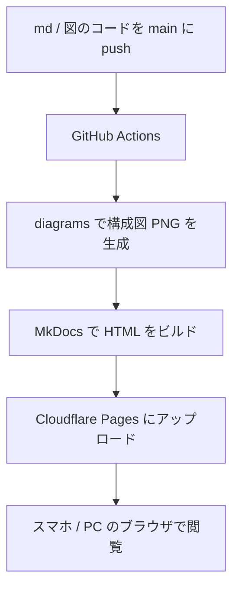

# Cloudflare Pages で公開する

このwikiを Cloudflare Pages に公開するまでの手順です。上から順に進めれば、`main` に push するだけでサイトが更新されるようになります。

## 全体の流れ



!!! note "Direct Upload 方式を採用している理由"
    Cloudflare 側でビルドする Git 連携方式ではなく、GitHub Actions でビルドしてからアップロードする **Direct Upload** 方式を使います。構成図の生成に必要な Graphviz と日本語フォントは、Pages のビルド環境のツール一覧に載っていないためです。

    Direct Upload で作ったプロジェクトは、**あとから Git 連携に切り替えられません**。切り替えるときはプロジェクトを作り直します。

!!! warning "Pages と Workers について"
    Cloudflare の公式ドキュメントは、新規プロジェクトには Workers を勧めています（"Start new projects with Workers"）。公式ページに Pages の廃止予定は書かれておらず、静的サイトの公開には今も使えます。このwikiでは Pages を使います。

## 手順 1: プロジェクトを作る

[Cloudflare ダッシュボード](https://dash.cloudflare.com/)にログインできるアカウントを用意し、ターミナルで次を実行します。

```bash
npx wrangler login
npx wrangler pages project create aws-wiki --production-branch main
```

- `wrangler login` を実行するとブラウザが開くので、アクセスを許可します。
- プロジェクト名を変えた場合は、[deploy.yml](https://github.com/ZoneTsuyoshi/aws-wiki/blob/main/.github/workflows/deploy.yml) の `--project-name` も同じ名前に変えます。
- 公開URLは通常 `https://aws-wiki.pages.dev` になります。名前が他の人と重なると、サブドメインにランダムな文字列が付くことがあります。実際のURLはダッシュボードの **Workers & Pages** で確認できます。

## 手順 2: Account ID を確認する

ダッシュボードのURLのうち、次の部分が Account ID です。

```text
https://dash.cloudflare.com/<ここが Account ID>/home
```

`npx wrangler whoami` でも確認できます。

!!! warning
    このリポジトリは公開設定なので、Account ID と API トークンはファイルに書かず、次の手順で GitHub Secrets に入れます。

## 手順 3: API トークンを作る

1. ダッシュボードで **Account API tokens** を開きます。
2. **Create Token** を選び、**Custom Token** の **Get started** を選びます。
3. **Token name** に `aws-wiki-deploy` などの名前を入れます。
4. **Permissions** を **Account** / **Cloudflare Pages** / **Edit** にします。
5. **Continue to summary** → **Create Token** と進みます。
6. 表示されたトークンをコピーします。**トークンはこの画面でしか表示されません**。

## 手順 4: GitHub Secrets に登録する

```bash
gh secret set CLOUDFLARE_ACCOUNT_ID
gh secret set CLOUDFLARE_API_TOKEN
```

それぞれ入力を求められるので、手順 2 の Account ID と手順 3 のトークンを貼り付けます。

ブラウザで登録する場合は、リポジトリの **Settings** → **Secrets and variables** → **Actions** → **New repository secret** から同じ名前で追加します。

## 手順 5: デプロイする

`main` に push すると [deploy.yml](https://github.com/ZoneTsuyoshi/aws-wiki/blob/main/.github/workflows/deploy.yml) が動きます。

1. GitHub の **Actions** タブで `Deploy wiki` が成功したことを確認します。
2. `https://aws-wiki.pages.dev` を開きます。
3. スマホではブラウザの「ホーム画面に追加」を使うと、アプリのように開けます。

push せずにやり直したいときは、Actions タブの **Run workflow** から手動で実行できます。

## 手順 6: 閲覧を自分だけに制限する（任意）

`pages.dev` のサイトは、そのままだと**URLを知っている人なら誰でも見られます**。Cloudflare Access を使うと、指定したメールアドレスの人だけに制限できます。

!!! danger "Access だけでは内容を隠しきれません"
    Access が守るのはサイトだけです。**GitHub リポジトリが公開のままなら、md と図のコードは誰でも読めます**。実環境の情報を書くなら、リポジトリも非公開にしてください。

    ```bash
    gh repo edit --visibility private --accept-visibility-change-consequences
    ```

Pages の設定で有効にできる Access は、最初はプレビュー用URLだけを守ります。本番の `aws-wiki.pages.dev` も守るには、次の手順が必要です。

1. **Workers & Pages** で `aws-wiki` を開き、**Settings** で Access policy を有効にします。
2. **Zero Trust** の **Access** → **Applications** で `aws-wiki` のアプリケーションを開き、**Configure** を選びます。
3. **Public hostname** のサブドメイン欄からワイルドカード（`*`）を消して保存します。エラーが出たらアプリケーション名を変えます。これで本番URLが保護対象になります。
4. プロジェクトの **Settings** に戻り、Access policy をもう一度有効にします。これでプレビュー用URLも保護されます。
5. Access のアプリケーションが、`aws-wiki.pages.dev` 用と `*.aws-wiki.pages.dev` 用の2つあることを確認します。
6. 両方のポリシーの許可対象を、自分のメールアドレスだけにします。
7. シークレットウィンドウでサイトを開き、ログイン画面が出ることを確認します。

Zero Trust を初めて使うときは、組織名やプランの選択を求められることがあります。

## 手順 7: 独自ドメインを使う（任意）

1. **Workers & Pages** で `aws-wiki` を開き、**Custom domains** → **Set up a domain** を選びます。
2. ドメインを入力して **Continue** を選びます。

| 種類 | 例 | 条件 |
|---|---|---|
| ルートドメイン | `example.com` | Cloudflare にゾーンを追加し、ネームサーバーを Cloudflare に向ける |
| サブドメイン | `wiki.example.com` | 他社 DNS でも可。`aws-wiki.pages.dev` への CNAME を追加する |

Access を使っている場合は、次の順番に注意します。

- Access policy がすでに有効なドメインは、Pages の独自ドメインとして追加できません。**先にドメインを追加**してください。
- 独自ドメイン用の Access アプリケーションも別に作ります。作らないと、ログイン画面は出ても正しく動きません。

## 無料プランの制限

| 項目 | 上限 |
|---|---|
| デプロイ回数 | 500 回 / 月 |
| ファイル数（Wrangler） | 20,000 |
| 1ファイルのサイズ | 25 MiB |

## うまくいかないとき

| 症状 | 原因と対処 |
|---|---|
| Actions で `Project not found` | 手順 1 のプロジェクトが未作成か、`--project-name` が違います |
| Actions で認証エラー | Secrets の名前か値が違うか、トークンの権限が **Cloudflare Pages / Edit** になっていません |
| `mkdocs build --strict` が失敗する | リンク切れか、図の出力ファイル名と md の参照先の不一致です。ログの該当行を確認します |
| 図の日本語が四角（豆腐）になる | 実行環境に日本語フォントがありません。CI では `fonts-noto-cjk` を入れています |
| `pages.dev` がまだ誰でも見られる | 手順 6 の 2〜3 を行っていません。プレビュー用URLしか保護されていない状態です |

## 参考

- [Use Direct Upload with continuous integration](https://developers.cloudflare.com/pages/how-to/use-direct-upload-with-continuous-integration/)
- [Direct Upload](https://developers.cloudflare.com/pages/get-started/direct-upload/)
- [Pages: Known issues（Access の設定）](https://developers.cloudflare.com/pages/platform/known-issues/)
- [Custom domains](https://developers.cloudflare.com/pages/configuration/custom-domains/)
